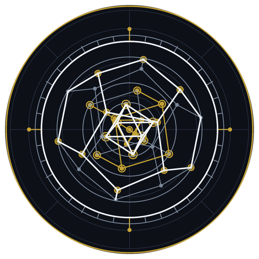
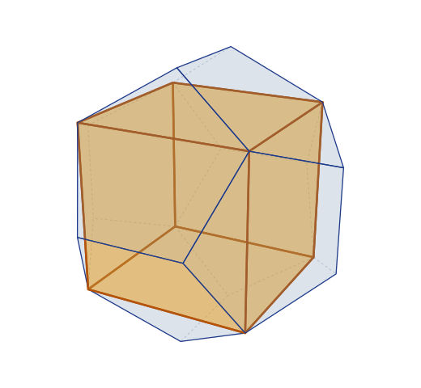

<a href="https://geometor.github.io/polyhedra/"></a>

# GEOMETOR • polyhedra

**Visit the Online Archive:** https://geometor.github.io/polyhedra/

<p align="center">
  <a href="https://geometor.github.io/polyhedra/"></a>
</p>

**Polyhedra • Platonic, Archimedean, Keplerian Solids & Leonardo Plates • semantic digital archive**

## Mission

`geometor/polyhedra` is part of the interconnected [GEOMETOR](https://geometor.com) semantic digital archive. It models three-dimensional constructive geometry, regular and semi-regular polyhedra, and spatial proportion in 100% exact symbolic algebra over $\mathbb{Z}$, $\mathbb{Q}(\phi)$, and radical field extensions. Grounded in Euclid's *Elements* Book XIII, Plato's *Timaeus*, Luca Pacioli and Leonardo da Vinci's *De Divina Proportione* (1509), and Johannes Kepler's *Harmonices Mundi* (1619), the repository liberates 26 canonical solids into addressable semantic monographs featuring interactive 3D HTML5 viewports, theme-adaptive vector diagrams, and exact dihedral spread calculations across the GEOMETOR corpus.

## Catalogs in This Archive

- [Catalog of Polyhedra](https://geometor.github.io/polyhedra/solids/) — Twenty-six exact symbolic solids across five geometric families (Platonic, Archimedean, Catalan, Elevated, and Pyramids) with interactive 3D viewports and comparative metrics.
- [Leonardo da Vinci's Polyhedral Plates (1509)](https://geometor.github.io/polyhedra/leonardo/) — Twenty paired woodcut folio studies from Luca Pacioli's *De Divina Proportione* paired with exact genus $g = F - 1$ *Corpora Vacua* proofs.
- [Golden Proportions in Polyhedra](https://geometor.github.io/polyhedra/golden/) — Certified golden ratio ($\phi$) theorems across 3D solids and 2D cross-sections.
- [Kepler, Squaring the Circle & the Great Pyramid](https://geometor.github.io/polyhedra/pyramid/) — Exact symbolic investigations of the 1597 Kepler right triangle, circle quadrature, and 14:11 Seked geometry.
- [3D Symbolic Infrastructure & Multi-Engine Pipeline](https://geometor.github.io/polyhedra/pipeline/) — Exact 3D modeling kernel, Conway/Pacioli operators, and multi-target export architecture to SVG, OBJ, IngeTrazo, and Blender.

## The Five Platonic Solids

All five regular solids $\{p, q\}$ are modeled symbolically over $\mathbb{Z}$ and $\mathbb{Q}(\phi)$ with pure rational dihedral spreads:

| Solid | Element | $\{p, q\}$ | $V$ | $E$ | $F$ | Euclid | Spread | $Q_{\text{in}} / Q_{\text{out}}$ |
| --- | --- | --- | --- | --- | --- | --- | --- | --- |
| **Tetrahedron** | Fire | $\{3, 3\}$ | 4 | 6 | 4 | XIII.13 | $8/9$ | $1/9$ |
| **Hexahedron** | Earth | $\{4, 3\}$ | 8 | 12 | 6 | XIII.15 | $1$ | $1/3$ |
| **Octahedron** | Air | $\{3, 4\}$ | 6 | 12 | 8 | XIII.14 | $8/9$ | $1/3$ |
| **Icosahedron** | Water | $\{3, 5\}$ | 12 | 30 | 20 | XIII.16 | $4/9$ | $(4\phi+3)/15$ |
| **Dodecahedron** | Aether | $\{5, 3\}$ | 20 | 30 | 12 | XIII.17 | $4/5$ | $(4\phi+3)/15$ |

## Python Package & Modules

The `geometor-polyhedra` Python package (`import geometor.polyhedra`) provides the executable symbolic geometry, construction, and compilation modules powering this archive:

- `catalog.py` — Exact symbolic catalog and registry of the 26 canonical polyhedra.
- `golden.py` — Exact symbolic golden proportions and Keplerian compounds in polyhedra.
- `model3d/bridge.py` — Bridge module connecting 3D polyhedra to 2D GEOMETOR symbolic models.
- `model3d/primitives.py` — Exact symbolic 3D geometric primitives and polyhedral models.
- `operators.py` — Exact symbolic polyhedral operators over algebraic number fields.
- `platonic.py` — Exact symbolic Platonic solids registry and 3D Rational Trigonometry.
- `pyramid.py` — Exact symbolic geometry of the Great Pyramid, Kepler triangle, and circle quadrature.
- `render/exporters.py` — Export pipelines for 3D polyhedra into Wavefront CAD, IngeTrazo, and Blender.
- `render/svg3d.py` — SVG 3D projection and publication-grade geometric renderers.
- `cli.py` — Command-line interface for geometor.polyhedra.

See the [API Reference](https://geometor.github.io/polyhedra/modules/) for full module documentation.

## Repository Contents

- `docsrc/` — RST catalog tracks, monographs, and 3D studios compiled by [PHOTON publish](https://github.com/photon-platform/publish).
- `src/geometor/polyhedra/` — Exact 3D modeling kernel, Conway/Pacioli operators, catalog definitions, and renderers.

## Local Build & Verification

```bash
publish build
uv run --no-sync pytest
```
## Part of the GEOMETOR Knowledge Archive

Explore all **74 Book Codices** and **11 Mathematical Catalogs** at https://geometor.com/books/.
