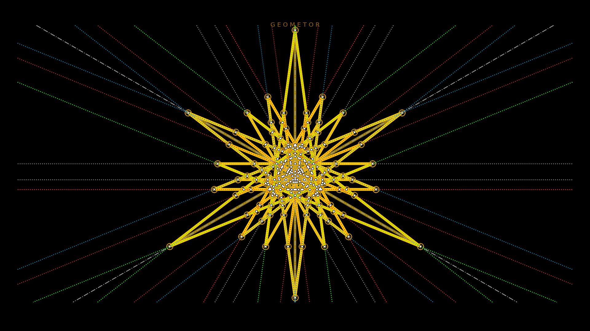

==================
geometor-polyhedra
==================

**Exact symbolic Platonic, Archimedean, and Keplerian polyhedral geometry in SymPy, Rational Trigonometry, and the GEOMETOR Digital Scriptorium.**

Overview
--------

``geometor-polyhedra`` explores three-dimensional constructive geometry, regular and semi-regular polyhedra, and spatial proportion in **100% exact symbolic algebra** (zero floating-point approximations) using `SymPy <https://www.sympy.org/>`_ and `geometor.model`.

From Euclid's *Elements* Book XIII to Plato's *Timaeus*, Luca Pacioli and Leonardo da Vinci's *De Divina Proportione* (1509), and Johannes Kepler's *Harmonices Mundi* (1619), polyhedra represent the pinnacle of classical deductive solid geometry.

The Five Platonic Solids
------------------------

All five regular solids $\{p, q\}$ are modeled over $\mathbb{Z}$ and the golden field $\mathbb{Q}(\phi)$ ($\phi = \frac{1 + \sqrt{5}}{2}$):

.. list-table::
   :header-rows: 1
   :widths: 16 10 8 8 8 10 12 14 14

   * - Solid
     - Element
     - $\{p, q\}$
     - $V$
     - $E$
     - $F$
     - Euclid
     - Spread
     - $Q_{\text{in}} / Q_{\text{out}}$
   * - **Tetrahedron**
     - Fire
     - $\{3, 3\}$
     - 4
     - 6
     - 4
     - XIII.13
     - $8/9$
     - $1/9$
   * - **Hexahedron**
     - Earth
     - $\{4, 3\}$
     - 8
     - 12
     - 6
     - XIII.15
     - $1$
     - $1/3$
   * - **Octahedron**
     - Air
     - $\{3, 4\}$
     - 6
     - 12
     - 8
     - XIII.14
     - $8/9$
     - $1/3$
   * - **Icosahedron**
     - Water
     - $\{3, 5\}$
     - 12
     - 30
     - 20
     - XIII.16
     - $4/9$
     - $(4\phi+3)/15$
   * - **Dodecahedron**
     - Aether
     - $\{5, 3\}$
     - 20
     - 30
     - 12
     - XIII.17
     - $4/5$
     - $(4\phi+3)/15$

Key Capabilities
----------------

- **Exact Symbolic Seed Kernel** (:mod:`geometor.polyhedra.platonic`): Frozen dataclass :class:`~geometor.polyhedra.platonic.RegularSolid` storing exact radical coordinates, oriented planar faces (CCW outward), edge graphs, and rational invariants over $\mathbb{Z}$ and $\mathbb{Q}(\phi)$.
- **Rational Trigonometry in 3D**: Exact quadrance, cross product, dot product, face normal, and dihedral spread functions (:func:`~geometor.polyhedra.platonic.dihedral_spread_3d`).
- **Polar Duality Invariants**: Exact equality of circumquadrance-to-inquadrance ratios between dual pairs:
  $$\frac{Q_{\text{in}}}{Q_{\text{out}}}(\text{Cube}) = \frac{Q_{\text{in}}}{Q_{\text{out}}}(\text{Octahedron}) = \frac{1}{3}$$
  $$\frac{Q_{\text{in}}}{Q_{\text{out}}}(\text{Dodecahedron}) = \frac{Q_{\text{in}}}{Q_{\text{out}}}(\text{Icosahedron}) = \frac{4\phi + 3}{15} = \frac{1}{3} + \frac{2\sqrt{5}}{15}$$
- **Leonardo da Vinci Plate Concordance**: Direct mapping to Leonardo da Vinci's 60 polyhedral woodcuts from Luca Pacioli's *De Divina Proportione* (1509).
- **Interactive Rich CLI**: Inspect solids and invariants via ``polyhedra``.

Quickstart
----------

.. code-block:: python

   from geometor.polyhedra import (
       get_platonic_solid,
       get_platonic_solids,
       dihedral_spread_3d,
       face_normal_3d,
       quadrance_3d,
   )

   # Fetch all five solids
   solids = get_platonic_solids()
   for slug, solid in solids.items():
       print(f"{solid.name} {{{solid.schlafli[0]},{solid.schlafli[1]}}}: V={len(solid.vertices)} E={len(solid.edges)} F={len(solid.faces)}")

   # Inspect the dodecahedron
   dodec = get_platonic_solid("dodecahedron")
   print("Dihedral spread:", dodec.dihedral_spread)  # 4/5
   print("Q_in / Q_out:", dodec.q_in_over_q_out)      # (4*phi + 3)/15

CLI Usage
---------

.. code-block:: bash

   # Display summary table of all 5 Platonic solids
   polyhedra

   # Inspect specific solid details
   polyhedra icosahedron
