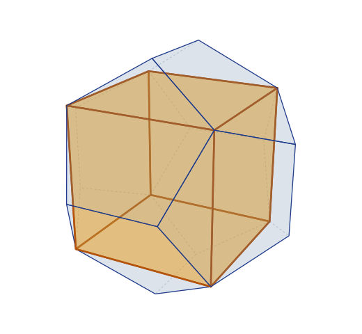
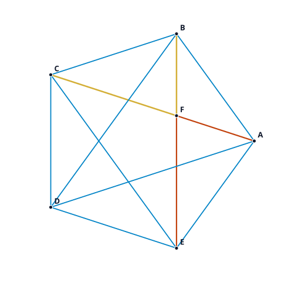

:layout: book
:title: Five Inscribed Cubes in the Dodecahedron

=========================================
Five Inscribed Cubes in the Dodecahedron
=========================================

*Euclid XIII.17 Roof Construction, the Sixty Pentagonal Diagonals, and the :math:`A_5` Orbit*

.. epigraph::

   *Dodecaedron intra datum sphaeram construere, et comprehendere sphaerae superficie, sicut priora corpora: ostendere etiam quod dodecaedri latus irrationalis est linea quae apotome vocatur.*

   *To construct a dodecahedron within a given sphere, and comprehend it by the surface of the sphere, like the preceding bodies; and to show that the side of the dodecahedron is the irrational line called an apotome.*

   — :person:`Euclid of Alexandria`, *Elements* Book XIII, Proposition 17

Interactive 3D Codex
--------------------

The interactive 3D model below displays the regular dodecahedron and its inscribed regular cubes. Use the widget controls to toggle individual cubes and inspect their partition of the pentagonal face diagonals:

.. raw:: html

   

Euclid's Hipped Roof Construction (Elements XIII.17)
----------------------------------------------------

In Proposition 17 of Book XIII, Euclid provides an extraordinary constructive proof of the regular dodecahedron: rather than constructing it from twelve isolated pentagons, he builds it upon a central **inscribed cube**.

   *The canonical regular dodecahedron with translucent golden faces highlighting an inscribed regular cube :math:`(\pm 1, \pm 1, \pm 1)`.*

Take a regular cube of edge length :math:`2` (:math:`Q_{\text{cube}} = 4`), centered at the origin with eight vertices:

.. math::

   V_{\text{cube}} = \{(\pm 1, \pm 1, \pm 1)\}

On each of the six square faces of this cube, erect a roof-like wedge (a hipped roof or ridge wedge) whose ridge line is parallel to one pair of square edges:

1. On the top face :math:`Z = 1`, the ridge line is parallel to the :math:`Y`-axis, joining:

   .. math::

      (0, \phi^{-1}, \phi) \quad \text{and} \quad (0, -\phi^{-1}, \phi)

   where :math:`\phi^{-1} = \phi - 1 = \frac{\sqrt{5} - 1}{2}`.

2. Across all six square faces, the twelve ridge endpoints lie on the golden planes:

   .. math::

      V_{\text{ridge}} = \{(0, \pm \phi^{-1}, \pm \phi), (\pm \phi^{-1}, \pm \phi, 0), (\pm \phi, 0, \pm \phi^{-1})\}

Combining the :math:`8` cube corners with the :math:`12` ridge endpoints gives the complete set of :math:`20` vertices of the regular dodecahedron:

.. math::

   V_{\text{dod}} = V_{\text{cube}} \cup V_{\text{ridge}}

Each square face of the underlying cube is spanned by two adjacent sloped pentagonal faces that meet along the ridge line.

Exact Metric Verification
~~~~~~~~~~~~~~~~~~~~~~~~~

To prove that the twenty vertices form a regular dodecahedron, all thirty edges must be shown to have identical length:

1. **Ridge Length**: The distance between :math:`(0, \phi^{-1}, \phi)` and :math:`(0, -\phi^{-1}, \phi)` is:

   .. math::

      Q_{\text{ridge}} = (2\phi^{-1})^2 = 4\phi^{-2} = 4(2 - \phi) = 8 - 4\phi

2. **Rafter Length (Cube Corner to Ridge Endpoint)**:
   The distance between :math:`(1, 1, 1)` and :math:`(0, \phi^{-1}, \phi)`:

   .. math::

      \Delta x = 1 - 0 = 1 \implies (\Delta x)^2 = 1

   .. math::

      \Delta y = 1 - (\phi - 1) = 2 - \phi \implies (\Delta y)^2 = (2 - \phi)^2 = 4 - 4\phi + \phi^2 = 5 - 3\phi

   .. math::

      \Delta z = 1 - \phi = -(\phi - 1) \implies (\Delta z)^2 = (\phi - 1)^2 = \phi^2 - 2\phi + 1 = 2 - \phi

   Summing the three squared components:

   .. math::

      Q_{\text{rafter}} = 1 + (5 - 3\phi) + (2 - \phi) = 8 - 4\phi = 4(2 - \phi) = 4\phi^{-2}

3. **Equality of Edges**: Since :math:`Q_{\text{ridge}} = Q_{\text{rafter}} = 4\phi^{-2}`, all thirty edges of the dodecahedron are strictly congruent!

4. **Edge Ratio**: The ratio of the cube edge quadrance to the dodecahedron edge quadrance is:

   .. math::

      \frac{Q_{\text{cube}}}{Q_{\text{dod}}} = \frac{4}{4\phi^{-2}} = \phi^2 = \phi + 1

   Thus, the cube edge length is in exact golden proportion to the dodecahedron edge length:

   .. math::

      \frac{\text{Length}_{\text{cube}}}{\text{Length}_{\text{dod}}} = \phi : 1

The Sixty Diagonals and the :math:`A_5` Orbit
---------------------------------------------

Every edge of an inscribed regular cube connects two non-adjacent vertices of a pentagonal face of the dodecahedron. Therefore, **every cube edge is a diagonal of a pentagon**.

   *The regular pentagon and pentagram cross-section showing diagonals cutting one another in extreme and mean ratio (:math:`\phi^2`).*

Partition of Diagonals
~~~~~~~~~~~~~~~~~~~~~~

A regular dodecahedron has twelve regular pentagonal faces. Each pentagon has :math:`\binom{5}{2} - 5 = 5` diagonals:

.. math::

   12 \text{ faces} \times 5 \text{ diagonals} = 60 \text{ diagonals in total}

Because each regular cube has twelve edges, five distinct regular cubes require:

.. math::

   5 \text{ cubes} \times 12 \text{ edges} = 60 \text{ edges}

In the ``geometor.polyhedra.golden.build_dodecahedron_five_cubes()`` construction:

- The 60 edges of the five inscribed cubes are **completely disjoint**;
- They form an exact 1-to-1 partition of all 60 diagonals of the twelve pentagonal faces;
- Each pentagonal face contains exactly one edge from each of the five cubes, forming an inscribed pentagram!

Group-Theoretic Significance (:math:`A_5`)
~~~~~~~~~~~~~~~~~~~~~~~~~~~~~~~~~~~~~~~~~~

The rotational symmetry group of the regular dodecahedron is the **alternating group** :math:`A_5` of order :math:`60`.

Any rotational symmetry of the dodecahedron permutes the five inscribed cubes among themselves. Because no non-trivial rotation leaves all five cubes fixed, this action defines a faithful group isomorphism:

.. math::

   \text{Rot}(\text{Dodecahedron}) \cong A_5 \subset S_5

This provides the classical geometric representation of the simple group of order 60, directly linking the solubility of quintic polynomials with the divine proportion in 3-space.
