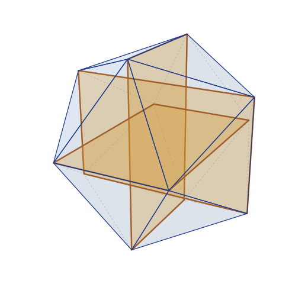
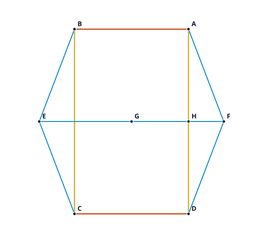

:layout: book
:title: Golden Rectangles of the Icosahedron

====================================
Golden Rectangles of the Icosahedron
====================================

*Three Mutually Orthogonal Planes, Exact Circumquadrance, and the Keplerian Meridian*

.. epigraph::

   *Icosaedron intra sphaeram constituere, et comprehendere sphaerae superficie, sicut priora corpora: ostendere etiam quod icosaedri latus irrationalis est linea quae minor vocatur.*

   *To construct an icosahedron within a sphere, and comprehend it by the surface of the sphere, like the preceding bodies; and to show that the side of the icosahedron is the irrational line called minor.*

   — :person:`Euclid of Alexandria`, *Elements* Book XIII, Proposition 16

Interactive 3D Codex
--------------------

The interactive 3D model below displays the canonical regular icosahedron intersected by the three mutually perpendicular golden rectangles spanning its twelve vertices:

.. raw:: html

   

Three Orthogonal Golden Rectangles
----------------------------------

In Cartesian 3-space, the twelve vertices of the regular icosahedron can be partitioned into three congruent, mutually orthogonal rectangles whose center is the origin :math:`(0, 0, 0)`:

.. math::

   R_{YZ} = \{(0, 1, \phi), (0, -1, \phi), (0, -1, -\phi), (0, 1, -\phi)\}

.. math::

   R_{ZX} = \{(\phi, 0, 1), (-\phi, 0, 1), (-\phi, 0, -1), (\phi, 0, -1)\}

.. math::

   R_{XY} = \{(1, \phi, 0), (-1, \phi, 0), (-1, -\phi, 0), (1, -\phi, 0)\}

where :math:`\phi = \frac{1 + \sqrt{5}}{2}` satisfies :math:`\phi^2 = \phi + 1`.

   *The three mutually perpendicular golden rectangles :math:`R_{YZ}`, :math:`R_{ZX}`, and :math:`R_{XY}` spanning the twelve vertices of the regular icosahedron.*

Pairwise Orthogonality of Normal Vectors
~~~~~~~~~~~~~~~~~~~~~~~~~~~~~~~~~~~~~~~~

The normal vectors to the planes of these three rectangles are the coordinate unit vectors:

.. math::

   \mathbf{n}_{YZ} = (1, 0, 0), \quad \mathbf{n}_{ZX} = (0, 1, 0), \quad \mathbf{n}_{XY} = (0, 0, 1)

Their mutual dot products vanish identically:

.. math::

   \mathbf{n}_{YZ} \cdot \mathbf{n}_{ZX} = \mathbf{n}_{ZX} \cdot \mathbf{n}_{XY} = \mathbf{n}_{XY} \cdot \mathbf{n}_{YZ} = 0

Thus, the three planes are pairwise perpendicular, meeting along the three coordinate axes.

Exact Metric Proportions and Circumquadrance
~~~~~~~~~~~~~~~~~~~~~~~~~~~~~~~~~~~~~~~~~~~~

Consider the rectangle :math:`R_{YZ}` in the plane :math:`X = 0`:

1. **Short Edge**: Joining :math:`(0, 1, \phi)` and :math:`(0, -1, \phi)`:

   .. math::

      Q_{\text{short}} = (0 - 0)^2 + (-1 - 1)^2 + (\phi - \phi)^2 = (-2)^2 = 4

   The length of the short edge is :math:`\sqrt{4} = 2`. Each of the three rectangles contributes two short edges, accounting for :math:`3 \times 2 = 6` edges of the twenty-face icosahedron.

2. **Long Edge**: Joining :math:`(0, 1, \phi)` and :math:`(0, 1, -\phi)`:

   .. math::

      Q_{\text{long}} = (0 - 0)^2 + (1 - 1)^2 + (-\phi - \phi)^2 = (-2\phi)^2 = 4\phi^2 = 4(\phi + 1)

   The length of the long edge is :math:`2\phi`. These long edges do not lie on the surface of the icosahedron, but form interior chords passing through the interior.

3. **Aspect Ratio**: The quadrance ratio between the edges is:

   .. math::

      \frac{Q_{\text{long}}}{Q_{\text{short}}} = \frac{4\phi^2}{4} = \phi^2 = \phi + 1

   Taking square roots confirms the classical golden aspect ratio :math:`\frac{\text{long}}{\text{short}} = \phi : 1`.

4. **Diagonal Quadrance**: By the Pythagorean theorem in the rectangle:

   .. math::

      Q_{\text{diag}} = Q_{\text{short}} + Q_{\text{long}} = 4 + 4\phi^2 = 4(1 + \phi + 1) = 4(\phi + 2)

5. **Circumquadrance**: Since the rectangle is centered at the origin, each diagonal connects antipodal vertices :math:`V` and :math:`-V`. The circumradius is half the diagonal, so its quadrance is:

   .. math::

      Q_{\text{out}} = \frac{Q_{\text{diag}}}{4} = \phi + 2 = \frac{5 + \sqrt{5}}{2}

The Principal Meridian Hexagon
------------------------------

When the regular icosahedron is sliced along the principal symmetry plane :math:`X = 0`, the cross-section reveals both the golden rectangle :math:`R_{YZ}` and the equatorial crossings of the remaining icosahedron edges.

   *The 2D principal meridian section (:math:`X = 0`) showing the :math:`2 \times 2\phi` golden rectangle :math:`ABCD`, the equatorial axis :math:`EF`, and the golden meridian hexagon.*

Kepler–Pacioli Meridian Construction
~~~~~~~~~~~~~~~~~~~~~~~~~~~~~~~~~~~~

In the :math:`(Y, Z)` coordinate plane:

- **Vertices of :math:`R_{YZ}`**:
  :math:`A = (1, \phi)`, :math:`B = (-1, \phi)`, :math:`C = (-1, -\phi)`, :math:`D = (1, -\phi)`.
- **Equatorial Crossings**:
  The four icosahedral edges connecting :math:`R_{ZX}` and :math:`R_{XY}` intersect the plane :math:`X = 0` at the two equatorial points :math:`E = (-\phi, 0)` and :math:`F = (\phi, 0)`.
- **Meridian Hexagon**:
  Connecting the cyclic sequence :math:`A \to B \to E \to C \to D \to F \to A` forms a symmetric equiangular hexagon whose diagonals and axes divide one another in extreme and mean ratio.

Equatorial Golden Division
~~~~~~~~~~~~~~~~~~~~~~~~~~

Let :math:`O = (0, 0)` be the center of the icosahedron, and :math:`H = (1, 0)` be the midpoint of the vertical side :math:`AD`:

1. Quadrance from center to equatorial vertex :math:`F`:

   .. math::

      Q(O, F) = \phi^2 = \phi + 1

2. Quadrance from center to chord midpoint :math:`H`:

   .. math::

      Q(O, H) = 1^2 = 1

3. Quadrance from chord midpoint to equatorial vertex :math:`F`:

   .. math::

      Q(H, F) = (\phi - 1)^2 = \phi^{-2} = 2 - \phi

4. The resulting quadrance ratios certify the divine proportion:

   .. math::

      \frac{Q(O, F)}{Q(O, H)} = \frac{\phi^2}{1} = \phi^2, \quad \frac{Q(O, H)}{Q(H, F)} = \frac{1}{\phi^{-2}} = \phi^2

Thus, the vertical side of the golden rectangle divides the equatorial radius :math:`OF` in exact extreme and mean ratio.
