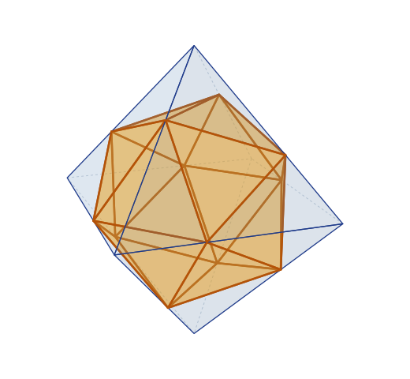

:layout: book
:title: Golden Division of the Octahedron

=================================
Golden Division of the Octahedron
=================================

*Continuous Morphism from Cuboctahedron to Regular Icosahedron via Edge Division*

.. epigraph::

   *Ex octaedro icosaedron producere: si enim unumquodque latus octaedri secundum proportionem habentem medium et duo extrema dividatur, puncta divisionum icosaedri vertices constituunt.*

   *To produce an icosahedron from an octahedron: for if each side of the octahedron is divided according to the proportion having a mean and two extremes, the points of division constitute the vertices of the icosahedron.*

   — :person:`Luca Pacioli`, *De Divina Proportione*, Cap. LV (Venice, 1509)

Interactive 3D Morphism Codex
-----------------------------

The interactive 3D model below displays the regular octahedron of scale :math:`\phi^2` and the inscribed regular icosahedron produced by golden edge division. Use the slider in the widget to continuously morph the edge division parameter :math:`\tau`:

.. raw:: html

   

Axiomatic Construction
----------------------

Consider a regular octahedron whose six vertices lie on the Cartesian coordinate axes, scaled by the golden factor :math:`\phi^2 = \phi + 1`:

.. math::

   V_{\text{oct}} = \{(\pm \phi^2, 0, 0), (0, \pm \phi^2, 0), (0, 0, \pm \phi^2)\}

The edge quadrance of this octahedron is:

.. math::

   Q_{\text{oct}} = (\phi^2)^2 + (\phi^2)^2 = 2\phi^4 = 2(\phi + 1)^2 = 2(3\phi + 2) = 6\phi + 4

   *The :math:`\phi^2`-scaled octahedron with translucent golden faces highlighting the inscribed regular icosahedron.*

Golden Division of Directed Edges
~~~~~~~~~~~~~~~~~~~~~~~~~~~~~~~~~

The octahedron possesses twelve edges. By directing these edges cyclically around the eight triangular faces, each directed edge :math:`\vec{AB}` is divided at a point :math:`G` in extreme and mean ratio:

.. math::

   \frac{\text{Length}(AB)}{\text{Length}(GB)} = \frac{\text{Length}(GB)}{\text{Length}(AG)} = \phi

In affine coordinates, the golden division point :math:`G` is given by the weighted barycentric combination:

.. math::

   G = \frac{\phi A + B}{\phi + 1} = \frac{\phi A + B}{\phi^2}

For example, on the edge from :math:`A = (0, 0, \phi^2)` to :math:`B = (0, \phi^2, 0)`:

.. math::

   G = \frac{\phi(0, 0, \phi^2) + (0, \phi^2, 0)}{\phi^2} = (0, 1, \phi)

Computing :math:`G` across all twelve cyclically oriented edges yields the complete set of twelve canonical vertices of the regular icosahedron:

.. math::

   \{(0, \pm 1, \pm \phi), (\pm \phi, 0, \pm 1), (\pm 1, \pm \phi, 0)\}

Exact Quadrance Relations
~~~~~~~~~~~~~~~~~~~~~~~~~

The segment lengths along each octahedron edge satisfy exact algebraic proportions over :math:`\mathbb{Q}(\phi)`:

1. **Minor Segment Quadrance**:

   .. math::

      Q_{\text{minor}} = Q(A, G) = \frac{Q_{\text{oct}}}{\phi^4} = \frac{2\phi^4}{\phi^4} = 2

2. **Major Segment Quadrance**:

   .. math::

      Q_{\text{major}} = Q(G, B) = \phi^2 Q_{\text{minor}} = 2\phi^2 = 2(\phi + 1) = 2\phi + 2

3. **Total Edge Quadrance**:

   .. math::

      Q_{\text{oct}} = \phi^2 Q_{\text{major}} = 2\phi^4 = 6\phi + 4

4. **Inscribed Icosahedron Edge Quadrance**:
   The distance between two adjacent division points on adjacent octahedral edges is:

   .. math::

      Q_{\text{ico}} = (1 - (-1))^2 + (\phi - \phi)^2 + (0 - 0)^2 = 2^2 = 4

   The ratio between the inscribed icosahedron edge quadrance and the minor edge segment is an exact integer:

   .. math::

      \frac{Q_{\text{ico}}}{Q_{\text{minor}}} = \frac{4}{2} = 2

Continuous Morphism: From Cuboctahedron to Icosahedron
------------------------------------------------------

Let :math:`\tau \in (0, 1)` parameterize the position of the division point on each directed edge:

.. math::

   P(\tau) = (1 - \tau) A + \tau B

As :math:`\tau` varies, the twelve points :math:`P(\tau)` trace a continuous 1-parameter family of polyhedra:

- **At :math:`\tau = 1/2` (Midpoint Rectification)**:
  The division points are the exact midpoints of the octahedral edges. Connecting adjacent midpoints yields the **Cuboctahedron** :math:`\{3, 4, 3, 4\}`, a semi-regular Archimedean solid with 12 vertices, 8 equilateral triangular faces, and 6 square faces.

- **At :math:`1/2 < \tau < \phi^{-1}` (Snubbing & Twisting)**:
  Each of the 6 square faces of the cuboctahedron buckles along a diagonal, splitting into two triangles. The 8 triangular faces rotate about their face normals.

- **At :math:`\tau = \phi^{-1} = \phi - 1 \approx 0.618034` (The Golden Section)**:
  The buckled squares degenerate into pairs of coplanar equilateral triangles, yielding exactly :math:`8 + 2 \times 6 = 20` congruent equilateral triangles. All 30 edges attain equal length :math:`2` (:math:`Q = 4`), crystallizing into the Platonic **Regular Icosahedron** :math:`\{3, 5\}`.

- **At :math:`\tau = 1`**:
  The division points collapse into the six original vertices of the octahedron.

This remarkable kinematic transformation demonstrates that the regular icosahedron is the unique twisted, chiral equilibrium of the regular octahedron governed by the divine proportion.
