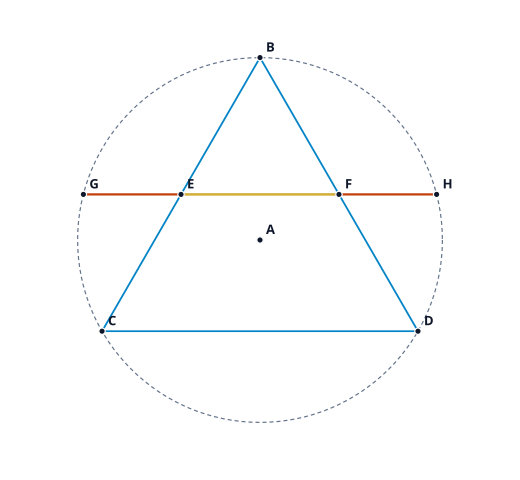

:layout: book
:type: theorem
:order: 5
:title: George Odom's Golden Construction in the Tetrahedron (1983)
:featured_image: _static/svg/golden/odom_tetrahedron_section.svg
:featured_image_alt: George Odom's Golden Ratio Construction in the Regular Tetrahedron
:categories: golden-proportions
:tags: phi, golden-ratio, tetrahedron, odom-theorem, midsphere
:excerpt: George Odom's 1983 discovery demonstrating that extending the chord joining the side midpoints of an equilateral triangular face to its circumcircle divides the segment in extreme and mean ratio phi.

===========================================================
George Odom's Golden Construction in the Tetrahedron (1983)
===========================================================

*The Divine Proportion Hidden in the Equilateral Triangle and Regular Tetrahedron*

.. epigraph::

   *Let ABC be an equilateral triangle inscribed in a circle, and let D and E be the midpoints of sides AB and AC. Let the line DE meet the circle at F and G. Then E divides DG in extreme and mean ratio.*

   — **George Odom**, *American Mathematical Monthly*, Problem 1118 (1983)

.. enunciation::

   In 1983, the American artist and geometer George Odom discovered that connecting the midpoints :math:`M_1` and :math:`M_2` of two sides of an equilateral triangular face of a regular tetrahedron and extending the segment to intersect the face's circumcircle at :math:`G_2` divides the chord in the **divine proportion**: :math:`Q(M_1, M_2) / Q(M_2, G_2) = \phi^2`, proving that :math:`\phi` is an organic invariant of tetrahedral geometry.

Geometric Configuration
-----------------------

While the divine proportion is famously intrinsic to the icosahedron and dodecahedron, George Odom discovered an astonishingly simple golden section hidden within the simplest Platonic solid: the **regular tetrahedron**.

   *George Odom's 1983 construction: connecting midpoints :math:`M_1` and :math:`M_2` of an equilateral triangle inscribed in a circle divides the extended chord in extreme and mean ratio.*

Axiomatic Formulation
---------------------

Let :math:`\triangle ABC` be an equilateral triangular face of a regular tetrahedron, inscribed in its circumcircle :math:`\mathcal{C}` of radius :math:`R = 2`:

.. math::

   A = (0, 2), \quad B = (-\sqrt{3}, -1), \quad C = (\sqrt{3}, -1)

.. math::

   \mathcal{C}: x^2 + y^2 = 4

1. Let :math:`M_1` and :math:`M_2` be the midpoints of sides :math:`AB` and :math:`AC`:

   .. math::

      M_1 = \left(-\frac{\sqrt{3}}{2}, \frac{1}{2}\right), \quad M_2 = \left(\frac{\sqrt{3}}{2}, \frac{1}{2}\right)

2. The line :math:`M_1 M_2` is horizontal, given by the constant equation :math:`y = 1/2`.

3. Extending the line :math:`M_1 M_2` to intersect the circumcircle :math:`\mathcal{C}`:

   .. math::

      x^2 + \left(\frac{1}{2}\right)^2 = 4 \implies x^2 = 4 - \frac{1}{4} = \frac{15}{4} \implies x = \pm \frac{\sqrt{15}}{2}

   Thus, the chord endpoints are:

   .. math::

      G_1 = \left(-\frac{\sqrt{15}}{2}, \frac{1}{2}\right), \quad G_2 = \left(\frac{\sqrt{15}}{2}, \frac{1}{2}\right)

Exact Algebraic Proof of the Golden Ratio
-----------------------------------------

Let us compute the exact lengths and quadrances along the chord:

1. **Midpoint Segment :math:`M_1 M_2` (Major Segment)**:

   .. math::

      \text{Length}(M_1 M_2) = \frac{\sqrt{3}}{2} - \left(-\frac{\sqrt{3}}{2}\right) = \sqrt{3} \implies Q(M_1, M_2) = 3

2. **Extension Segment :math:`M_2 G_2` (Minor Segment)**:

   .. math::

      \text{Length}(M_2 G_2) = \frac{\sqrt{15}}{2} - \frac{\sqrt{3}}{2} = \sqrt{3} \left(\frac{\sqrt{5} - 1}{2}\right) = \sqrt{3} \phi^{-1}

   The quadrance of this minor segment is:

   .. math::

      Q(M_2, G_2) = 3\phi^{-2} = 3(2 - \phi)

3. **Total Chord Segment :math:`M_1 G_2`**:

   .. math::

      \text{Length}(M_1 G_2) = \text{Length}(M_1 M_2) + \text{Length}(M_2 G_2) = \sqrt{3} + \sqrt{3}\phi^{-1} = \sqrt{3}(1 + \phi^{-1}) = \sqrt{3}\phi

   The quadrance of the total segment is:

   .. math::

      Q(M_1, G_2) = 3\phi^2 = 3(\phi + 1)

4. **Quadrance Ratio Invariants**:
   Evaluating the ratio of the major segment to the minor segment:

   .. math::

      \frac{Q(M_1, M_2)}{Q(M_2, G_2)} = \frac{3}{3\phi^{-2}} = \phi^2 = \phi + 1

   Evaluating the ratio of the total chord to the major segment:

   .. math::

      \frac{Q(M_1, G_2)}{Q(M_1, M_2)} = \frac{3\phi^2}{3} = \phi^2 = \phi + 1

Taking square roots yields the classic definition of extreme and mean ratio:

.. math::

   \frac{\text{Length}(M_1 G_2)}{\text{Length}(M_1 M_2)} = \frac{\text{Length}(M_1 M_2)}{\text{Length}(M_2 G_2)} = \phi = \frac{1 + \sqrt{5}}{2}

Odom's theorem proves that the divine proportion is not merely an isolated property of pentagonal symmetry, but an organic consequence of the circumcircle of the equilateral triangle and regular tetrahedron.

Canonical Solid Codex
---------------------

For the complete interactive 3D model, exact symbolic coordinates over :math:`\mathbb{Q}`, face normals, and dihedral angles, consult the canonical solid codex:

- :doc:`Regular Tetrahedron </solids/01-platonic/tetrahedron/index>`
