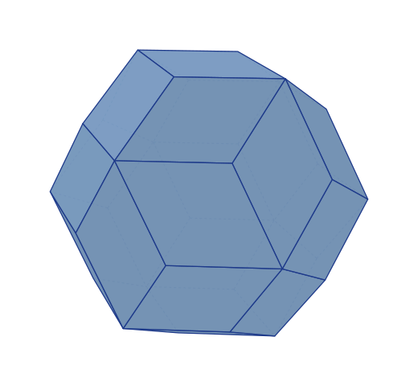

:layout: book
:type: theorem
:order: 4
:title: Kepler's Rhombic Triacontahedron (1611)
:featured_image: _static/svg/golden/rhombic_triacontahedron.svg
:featured_image_alt: Kepler's Rhombic Triacontahedron with 30 Golden Rhombic Faces
:categories: golden-proportions
:tags: phi, golden-ratio, rhombic-triacontahedron, kepler, catalan-solids
:excerpt: Johannes Kepler's 1611 Catalan zonohedron uniting the 20 vertices of the regular dodecahedron with the 12 vertices of the dual icosahedron to form 30 congruent golden rhombi with diagonal ratio phi.

=======================================
Kepler's Rhombic Triacontahedron (1611)
=======================================

*The Thirty Golden Rhombi of the Rhombic Triacontahedron*

.. epigraph::

   *Hic habes triacontaedron rhombicum, figura pulcherrima, cuius triginta bases sunt rhombi aequales, quorum anguli sunt conformes proportioni divinae...*

   *Here you have the rhombic triacontahedron, a most beautiful figure whose thirty bases are equal rhombi, whose angles conform to the divine proportion...*

   — **Johannes Kepler**, *Strena Seu de Nive Sexangula* (Frankfurt, 1611)

.. enunciation::

   In *Strena Seu de Nive Sexangula* (1611), Johannes Kepler united the 20 vertices of the regular dodecahedron with the 12 vertices of its dual regular icosahedron to form the 32 vertices of the **Rhombic Triacontahedron**. Its 30 faces are congruent golden rhombi whose long-to-short diagonal quadrance ratio is identically :math:`Q_{\text{long}} / Q_{\text{short}} = \phi^2`, establishing the divine proportion :math:`\phi = \frac{1 + \sqrt{5}}{2}` as the diagonal aspect ratio of every face.

Interactive 3D Codex
--------------------

The interactive 3D model below displays Kepler's Rhombic Triacontahedron, uniting the twenty vertices of the regular dodecahedron with the twelve vertices of its dual regular icosahedron into thirty golden rhombi:

.. raw:: html

   

Kepler's Rhombic Triacontahedron (1611)
---------------------------------------

In his 1611 treatise *Strena Seu de Nive Sexangula* (*A New Year's Gift of Hexagonal Snow*), **Johannes Kepler** discovered two magnificent rhombic polyhedra: the rhombic dodecahedron (dual of the cuboctahedron) and the **rhombic triacontahedron** (dual of the icosidodecahedron).

   *Kepler's Rhombic Triacontahedron: 32 vertices and 30 congruent golden rhombic faces uniting the dodecahedral and icosahedral duals.*

The rhombic triacontahedron is a Catalan zonohedron whose topology satisfies:

- **Vertices**: :math:`V = 32`, consisting of:
  - :math:`20` degree-3 obtuse vertices belonging to the regular dodecahedron;
  - :math:`12` degree-5 acute vertices belonging to the dual-oriented regular icosahedron.
- **Faces**: :math:`F = 30` congruent golden rhombi.
- **Edges**: :math:`E = 60` congruent edges.
- **Euler Characteristic**: :math:`V - E + F = 32 - 60 + 30 = 2`.

Exact Geometry of the Golden Rhombus
------------------------------------

Each of the thirty faces is a planar **golden rhombus** whose vertices alternate between the degree-3 dodecahedral set and the degree-5 icosahedral set:

1. **Long Diagonal**: Joins two opposite degree-5 (icosahedral) vertices:

   .. math::

      Q_{\text{long}} = 4 \implies \text{Length} = 2

2. **Short Diagonal**: Joins two opposite degree-3 (dodecahedral) vertices:

   .. math::

      Q_{\text{short}} = 4\phi^{-2} = 4(2 - \phi) = 8 - 4\phi \implies \text{Length} = 2\phi^{-1}

3. **Diagonal Quadrance Ratio**:

   .. math::

      \frac{Q_{\text{long}}}{Q_{\text{short}}} = \frac{4}{4\phi^{-2}} = \phi^2 = \phi + 1

   Taking square roots confirms that the ratio of the diagonals is the divine proportion:

   .. math::

      \frac{\text{Length}_{\text{long}}}{\text{Length}_{\text{short}}} = \phi : 1

4. **Edge Quadrance**: In any rhombus, the edge quadrance is one quarter the sum of the diagonal quadrances:

   .. math::

      Q_{\text{edge}} = \frac{Q_{\text{long}} + Q_{\text{short}}}{4} = \frac{4 + 4(2 - \phi)}{4} = 1 + 2 - \phi = 3 - \phi

5. **Dihedral Spread**: The angle between adjacent rhombic faces is an exact rational invariant in Norman Wildberger's Rational Trigonometry:

   .. math::

      s_{\text{dihedral}} = \sin^2(144^\circ) = \frac{5 - \sqrt{5}}{8}

Canonical Solid Codex
---------------------

For the complete interactive 3D model, exact symbolic coordinates over :math:`\mathbb{Q}(\phi)`, face normals, and dihedral angles, consult the canonical solid codex:

- :doc:`Rhombic Triacontahedron </solids/03-catalan/rhombic-triacontahedron/index>`
