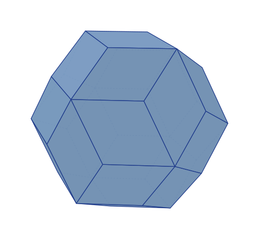
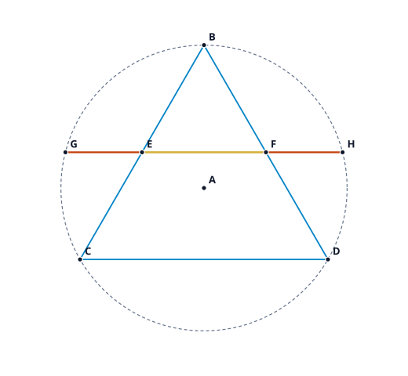

:layout: book
:title: Kepler's Triacontahedron & Odom's Section
:book_title: Kepler's Triacontahedron & Odom's Section
:book_subtitle: Kepler Strena (1611) · Thirty Golden Rhombi · George Odom's Golden Theorem (1983)

==========================================
Kepler's Triacontahedron & Odom's Section
==========================================

*The Thirty Golden Rhombi of the Rhombic Triacontahedron and George Odom's Tetrahedron Chord*

.. epigraph::

   *Hic habes triacontaedron rhombicum, figura pulcherrima, cuius triginta bases sunt rhombi aequales, quorum anguli sunt conformes proportioni divinae...*

   *Here you have the rhombic triacontahedron, a most beautiful figure whose thirty bases are equal rhombi, whose angles conform to the divine proportion...*

   — :person:`Johannes Kepler`, *Strena Seu de Nive Sexangula* (Frankfurt, 1611)

Interactive 3D Codex
--------------------

The interactive 3D model below displays Kepler's Rhombic Triacontahedron, uniting the twenty vertices of the regular dodecahedron with the twelve vertices of its dual regular icosahedron into thirty golden rhombi:

.. raw:: html

   

Kepler's Rhombic Triacontahedron (1611)
---------------------------------------

In his 1611 treatise *Strena Seu de Nive Sexangula* (*A New Year's Gift of Hexagonal Snow*), **Johannes Kepler** discovered two magnificent rhombic polyhedra: the rhombic dodecahedron (dual of the cuboctahedron) and the **rhombic triacontahedron** (dual of the icosidodecahedron).

   *Kepler's Rhombic Triacontahedron: 32 vertices and 30 congruent golden rhombic faces uniting the dodecahedral and icosahedral duals.*

The rhombic triacontahedron is a Catalan zonohedron whose topology satisfies:

- **Vertices**: :math:`V = 32`, consisting of:
  - :math:`20` degree-3 obtuse vertices belonging to the regular dodecahedron;
  - :math:`12` degree-5 acute vertices belonging to the dual-oriented regular icosahedron.
- **Faces**: :math:`F = 30` congruent golden rhombi.
- **Edges**: :math:`E = 60` congruent edges.
- **Euler Characteristic**: :math:`V - E + F = 32 - 60 + 30 = 2`.

Exact Geometry of the Golden Rhombus
~~~~~~~~~~~~~~~~~~~~~~~~~~~~~~~~~~~~

Each of the thirty faces is a planar **golden rhombus** whose vertices alternate between the degree-3 dodecahedral set and the degree-5 icosahedral set:

1. **Long Diagonal**: Joins two opposite degree-5 (icosahedral) vertices:

   .. math::

      Q_{\text{long}} = 4 \implies \text{Length} = 2

2. **Short Diagonal**: Joins two opposite degree-3 (dodecahedral) vertices:

   .. math::

      Q_{\text{short}} = 4\phi^{-2} = 4(2 - \phi) = 8 - 4\phi \implies \text{Length} = 2\phi^{-1}

3. **Diagonal Quadrance Ratio**:

   .. math::

      \frac{Q_{\text{long}}}{Q_{\text{short}}} = \frac{4}{4\phi^{-2}} = \phi^2 = \phi + 1

   Taking square roots confirms that the ratio of the diagonals is the divine proportion:

   .. math::

      \frac{\text{Length}_{\text{long}}}{\text{Length}_{\text{short}}} = \phi : 1

4. **Edge Quadrance**: In any rhombus, the edge quadrance is one quarter the sum of the diagonal quadrances:

   .. math::

      Q_{\text{edge}} = \frac{Q_{\text{long}} + Q_{\text{short}}}{4} = \frac{4 + 4(2 - \phi)}{4} = 1 + 2 - \phi = 3 - \phi

5. **Dihedral Spread**: The angle between adjacent rhombic faces is an exact rational invariant in Norman Wildberger's Rational Trigonometry:

   .. math::

      s_{\text{dihedral}} = \sin^2(144^\circ) = \frac{5 - \sqrt{5}}{8}

George Odom's Golden Theorem in the Tetrahedron (1983)
------------------------------------------------------

While the divine proportion is famously intrinsic to the icosahedron and dodecahedron, in 1983 the American artist and geometer **George Odom** discovered an astonishingly simple golden section hidden within the simplest Platonic solid: the **regular tetrahedron**.

   *George Odom's 1983 construction: connecting midpoints :math:`M_1` and :math:`M_2` of an equilateral triangle inscribed in a circle divides the extended chord in extreme and mean ratio.*

Axiomatic Formulation
~~~~~~~~~~~~~~~~~~~~~

Let :math:`\triangle ABC` be an equilateral triangular face of a regular tetrahedron, inscribed in its circumcircle :math:`\mathcal{C}` of radius :math:`R = 2`:

.. math::

   A = (0, 2), \quad B = (-\sqrt{3}, -1), \quad C = (\sqrt{3}, -1)

.. math::

   \mathcal{C}: x^2 + y^2 = 4

1. Let :math:`M_1` and :math:`M_2` be the midpoints of sides :math:`AB` and :math:`AC`:

   .. math::

      M_1 = \left(-\frac{\sqrt{3}}{2}, \frac{1}{2}\right), \quad M_2 = \left(\frac{\sqrt{3}}{2}, \frac{1}{2}\right)

2. The line :math:`M_1 M_2` is horizontal, given by the constant equation :math:`y = 1/2`.

3. Extending the line :math:`M_1 M_2` to intersect the circumcircle :math:`\mathcal{C}`:

   .. math::

      x^2 + \left(\frac{1}{2}\right)^2 = 4 \implies x^2 = 4 - \frac{1}{4} = \frac{15}{4} \implies x = \pm \frac{\sqrt{15}}{2}

   Thus, the chord endpoints are:

   .. math::

      G_1 = \left(-\frac{\sqrt{15}}{2}, \frac{1}{2}\right), \quad G_2 = \left(\frac{\sqrt{15}}{2}, \frac{1}{2}\right)

Exact Algebraic Proof of the Golden Ratio
~~~~~~~~~~~~~~~~~~~~~~~~~~~~~~~~~~~~~~~~~

Let us compute the exact lengths and quadrances along the chord:

1. **Midpoint Segment :math:`M_1 M_2` (Major Segment)**:

   .. math::

      \text{Length}(M_1 M_2) = \frac{\sqrt{3}}{2} - \left(-\frac{\sqrt{3}}{2}\right) = \sqrt{3} \implies Q(M_1, M_2) = 3

2. **Extension Segment :math:`M_2 G_2` (Minor Segment)**:

   .. math::

      \text{Length}(M_2 G_2) = \frac{\sqrt{15}}{2} - \frac{\sqrt{3}}{2} = \sqrt{3} \left(\frac{\sqrt{5} - 1}{2}\right) = \sqrt{3} \phi^{-1}

   The quadrance of this minor segment is:

   .. math::

      Q(M_2, G_2) = 3\phi^{-2} = 3(2 - \phi)

3. **Total Chord Segment :math:`M_1 G_2`**:

   .. math::

      \text{Length}(M_1 G_2) = \text{Length}(M_1 M_2) + \text{Length}(M_2 G_2) = \sqrt{3} + \sqrt{3}\phi^{-1} = \sqrt{3}(1 + \phi^{-1}) = \sqrt{3}\phi

   The quadrance of the total segment is:

   .. math::

      Q(M_1, G_2) = 3\phi^2 = 3(\phi + 1)

4. **Quadrance Ratio Invariants**:
   Evaluating the ratio of the major segment to the minor segment:

   .. math::

      \frac{Q(M_1, M_2)}{Q(M_2, G_2)} = \frac{3}{3\phi^{-2}} = \phi^2 = \phi + 1

   Evaluating the ratio of the total chord to the major segment:

   .. math::

      \frac{Q(M_1, G_2)}{Q(M_1, M_2)} = \frac{3\phi^2}{3} = \phi^2 = \phi + 1

Taking square roots yields the classic definition of extreme and mean ratio:

.. math::

   \frac{\text{Length}(M_1 G_2)}{\text{Length}(M_1 M_2)} = \frac{\text{Length}(M_1 M_2)}{\text{Length}(M_2 G_2)} = \phi = \frac{1 + \sqrt{5}}{2}

Odom's theorem proves that the divine proportion is not merely an isolated property of pentagonal symmetry, but an organic consequence of the circumcircle of the equilateral triangle and regular tetrahedron.
