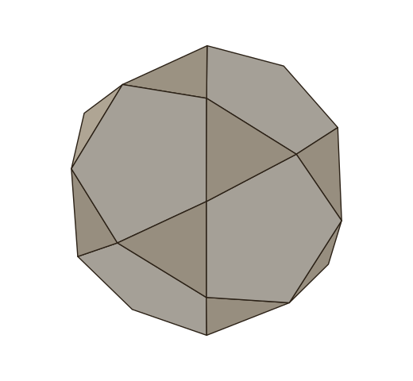

:layout: book
:title: Leonardo Plates: Icosahedron, Dodecahedron & Vigintisex Basium (Tabulae XXI–XXXVI)
:book_title: Polyhedra: Platonic Solids & Divine Proportion
:book_subtitle: Dedicated Gallery & Exact Symbolic Reconstruction of Folios 0231–0261

===================================================================================
Leonardo Plates: Icosahedron, Dodecahedron & Vigintisex Basium (Tabulae XXI–XXXVI)
===================================================================================

*Dedicated Scholarly Gallery & Exact Symbolic Reconstruction of Folios 0231–0261*

.. epigraph::

   *Non aliter potest intelligi haec divina proportio, nisi per has formas quas fecit nobis Lionardo da Vinci...*

   *In no other way can this divine proportion be understood, except through these forms which Leonardo da Vinci made for us...*

   — :person:`Luca Pacioli`, *De Divina Proportione*, Cap. V (Venice, 1509)

This chapter presents Tabulae XXI through XXXVI drawn by **Leonardo da Vinci** for Luca Pacioli's *De Divina Proportione* (1509). These plates enshrine the two celestial polyhedra governed by the Golden Ratio :math:`\phi = \frac{1 + \sqrt{5}}{2}`—the **Icosahedron** (Tabulae XXI–XXVI) and **Dodecahedron** (Tabulae XXVII–XXXIIII)—concluding with the grand architectural climax of the 1509 treatise, the **26-Base Body** (*Vigintisex Basium* / Rhombicuboctahedron, Tabulae XXXV–XXXVI).

---

I. The Icosahedron Family (Tabulae XXI–XXVI, Folios 0231–0241)
==============================================================

The regular icosahedron :math:`\{3, 5\}` is composed of 20 equilateral triangular faces, 30 edges, and 12 vertices. In Plato's *Timaeus* (55b), the icosahedron represents **Water**, possessing the greatest number of faces and the smoothest mobility among the four terrestrial elements.

Algebraically, the icosahedron cannot be embedded over the rational field :math:`\mathbb{Q}`: its 12 vertices are defined by three mutually perpendicular **golden rectangles** having aspect ratio :math:`1 : \phi`:

.. math::

   (0, \pm 1, \pm \phi), \quad (\pm 1, \pm \phi, 0), \quad (\pm \phi, 0, \pm 1)

Tabula XXI & XXII (Folios 0231–0233): *Icosahedron Planum Solidum et Vacuum*
~~~~~~~~~~~~~~~~~~~~~~~~~~~~~~~~~~~~~~~~~~~~~~~~~~~~~~~~~~~~~~~~~~~~~~~~~~~~~

In Tabula XXII, Leonardo hollows out the 20 triangular faces into mitered wooden frames. By the Vacuate Manifold Theorem, the hollow icosahedron framework possesses the highest topological **genus** of all regular polyhedra:

.. math::

   g = F - 1 = 20 - 1 = 19

- **Vertices**: :math:`V_{\text{vac}} = 2V + 4E = 2(12) + 4(30) = 144`
- **Edges**: :math:`E_{\text{vac}} = 12E = 12(30) = 360`
- **Faces**: :math:`F_{\text{vac}} = 6E = 6(30) = 180` planar trapezoids
- **Euler Characteristic**: :math:`\chi = 144 - 360 + 180 = -36 = 2 - 2(19)`

All 144 vertices reside strictly within the golden number field :math:`\mathbb{Q}(\phi)`.

.. list-table::
   :widths: 50 50

   * - .. figure:: plates/0231.g1.png
          :align: center
          :alt: Tabula XXI (Folio 0231) - Icosahedron Planum Solidum

          **Tabula XXI (Folio 0231)**: *Icosahedron Planum Solidum*.
     - .. figure:: plates/0233.g1.png
          :align: center
          :alt: Tabula XXII (Folio 0233) - Icosahedron Planum Vacuum

          **Tabula XXII (Folio 0233)**: *Icosahedron Planum Vacuum* (:math:`g = 19`).

Interactive 3D Codex: Icosahedron
~~~~~~~~~~~~~~~~~~~~~~~~~~~~~~~~~

.. raw:: html

   

Tabula XXIII & XXIIII (Folios 0235–0237): *Icosahedron Abscisum* (The Fullerene / Soccer Ball)
~~~~~~~~~~~~~~~~~~~~~~~~~~~~~~~~~~~~~~~~~~~~~~~~~~~~~~~~~~~~~~~~~~~~~~~~~~~~~~~~~~~~~~~~~~~~~~

Tabulae XXIII and XXIIII represent one of the most remarkable milestones in the iconography of science:

.. list-table::
   :widths: 50 50

   * - .. figure:: plates/0235.g1.png
          :align: center
          :alt: Tabula XXIII (Folio 0235) - Icosahedron Abscisum Solidum

          **Tabula XXIII (Folio 0235)**: *Icosahedron Abscisum Solidum*.
     - .. figure:: plates/0237.g1.png
          :align: center
          :alt: Tabula XXIIII (Folio 0237) - Icosahedron Abscisum Vacuum

          **Tabula XXIIII (Folio 0237)**: *Icosahedron Abscisum Vacuum*.

Leonardo as the First Illustrator of the Buckyball
''''''''''''''''''''''''''''''''''''''''''''''''''

When the 12 vertices of an icosahedron are truncated at ratio :math:`t = 1/3` (via ``truncate(solid, ratio=sp.Rational(1, 3))``), the 12 pentagonal corners become 12 regular pentagons, and the 20 triangular faces become 20 regular hexagons. The resulting Archimedean solid is the **Truncated Icosahedron** (*Icosahedron Abscisum*):

- **Vertices**: :math:`V = 2E = 2(30) = 60`
- **Edges**: :math:`E = 3(30) = 90`
- **Faces**: :math:`F = 12 \text{ pentagons} + 20 \text{ hexagons} = 32`

This is the exact geometric structure of the **classical association football (soccer ball)** and the Nobel Prize-winning carbon allotrope **Buckminsterfullerene** (:math:`\text{C}_{60}`). **Leonardo da Vinci was the very first person in history to draw and publish this 32-face cage**—four hundred and eighty-six years before Kroto, Smalley, and Curl synthesized :math:`\text{C}_{60}` in 1985!

Tabula XXV & XXVI (Folios 0239–0241): *Icosahedron Elevatum*
~~~~~~~~~~~~~~~~~~~~~~~~~~~~~~~~~~~~~~~~~~~~~~~~~~~~~~~~~~~~

By erecting equilateral pyramids over each of the 20 triangular faces of the icosahedron (via ``elevate(solid)``), Leonardo constructs the **Triakis Icosahedron** (*Icosahedron Elevatum*), having :math:`20 \times 3 = 60` triangular facets and :math:`12 + 20 = 32` vertices:

.. list-table::
   :widths: 50 50

   * - .. figure:: plates/0239.g1.png
          :align: center
          :alt: Tabula XXV (Folio 0239) - Icosahedron Elevatum Solidum

          **Tabula XXV (Folio 0239)**: *Icosahedron Elevatum Solidum*.
     - .. figure:: plates/0241.g1.png
          :align: center
          :alt: Tabula XXVI (Folio 0241) - Icosahedron Elevatum Vacuum

          **Tabula XXVI (Folio 0241)**: *Icosahedron Elevatum Vacuum*.

---

II. The Dodecahedron Family (Tabulae XXVII–XXXIIII, Folios 0243–0257)
=====================================================================

The regular dodecahedron :math:`\{5, 3\}` has 20 vertices, 30 edges, and 12 regular pentagonal faces. In the *Timaeus* (55c), Plato reserves this solid for the cosmos itself: *"There remained a fifth construction, which God used for embroidering the constellations on the whole heaven."* Pacioli identifies the dodecahedron with the **Aether** or **Quintessence** (*Quinta Essentia*), because the golden ratio governs its pentagonal face diagonals in accordance with Euclid XIII.17.

In exact coordinates over :math:`\mathbb{Q}(\phi)`, its 20 vertices comprise the 8 corners of the cube :math:`(\pm 1, \pm 1, \pm 1)` plus the 12 golden roof vertices:

.. math::

   (0, \pm \phi^{-1}, \pm \phi), \quad (\pm \phi^{-1}, \pm \phi, 0), \quad (\pm \phi, 0, \pm \phi^{-1})

Tabula XXVII & XXVIII (Folios 0243–0245): *Dodecahedron Planum Solidum et Vacuum*
~~~~~~~~~~~~~~~~~~~~~~~~~~~~~~~~~~~~~~~~~~~~~~~~~~~~~~~~~~~~~~~~~~~~~~~~~~~~~~~~~

The hollow wooden dodecahedron (*Dodecahedron Planum Vacuum*, Tabula XXVIII) contains 12 pentagonal window apertures. By the Vacuate Manifold Theorem, its topological **genus** is:

.. math::

   g = F - 1 = 12 - 1 = 11

- **Vertices**: :math:`V_{\text{vac}} = 2(20) + 4(30) = 160`
- **Edges**: :math:`E_{\text{vac}} = 12(30) = 360`
- **Faces**: :math:`F_{\text{vac}} = 6(30) = 180` planar trapezoids
- **Euler Characteristic**: :math:`\chi = 160 - 360 + 180 = -20 = 2 - 2(11)`

.. list-table::
   :widths: 50 50

   * - .. figure:: plates/0243.g1.png
          :align: center
          :alt: Tabula XXVII (Folio 0243) - Dodecahedron Planum Solidum

          **Tabula XXVII (Folio 0243)**: *Dodecahedron Planum Solidum*.
     - .. figure:: plates/0245.g1.png
          :align: center
          :alt: Tabula XXVIII (Folio 0245) - Dodecahedron Planum Vacuum

          **Tabula XXVIII (Folio 0245)**: *Dodecahedron Planum Vacuum* (:math:`g = 11`).

Interactive 3D Codex: Dodecahedron
~~~~~~~~~~~~~~~~~~~~~~~~~~~~~~~~~~

.. raw:: html

   

Tabula XXIX & XXX (Folios 0247–0249): *Dodecahedron Abscisum* (The Icosidodecahedron)
~~~~~~~~~~~~~~~~~~~~~~~~~~~~~~~~~~~~~~~~~~~~~~~~~~~~~~~~~~~~~~~~~~~~~~~~~~~~~~~~~~~~~

Truncating the dodecahedron at the midpoints of its 30 edges (via ``rectify(solid)``) produces the Archimedean **Icosidodecahedron** (:math:`V = 30, E = 60, F = 32`), consisting of 12 regular pentagons and 20 equilateral triangles:

.. list-table::
   :widths: 50 50

   * - .. figure:: plates/0247.g1.png
          :align: center
          :alt: Tabula XXIX (Folio 0247) - Dodecahedron Abscisum Solidum

          **Tabula XXIX (Folio 0247)**: *Dodecahedron Abscisum Solidum*.
     - .. figure:: plates/0249.g1.png
          :align: center
          :alt: Tabula XXX (Folio 0249) - Dodecahedron Abscisum Vacuum

          **Tabula XXX (Folio 0249)**: *Dodecahedron Abscisum Vacuum*.

   **Exact Symbolic Reconstruction**: *Dodecahedron Abscisum* (Icosidodecahedron) in exact :math:`\mathbb{Q}(\phi)` coordinates, showing the interplay between golden pentagons and equilateral triangles.

Tabula XXXI & XXXII (Folios 0251–0253): *Dodecahedron Elevatum*
~~~~~~~~~~~~~~~~~~~~~~~~~~~~~~~~~~~~~~~~~~~~~~~~~~~~~~~~~~~~~~~

By erecting pentagonal pyramids over each of the 12 pentagonal faces (via ``elevate(solid)``), Leonardo creates the **Pentakis Dodecahedron** (*Dodecahedron Elevatum*), having :math:`12 \times 5 = 60$ triangular facets and :math:`20 + 12 = 32` vertices:

.. list-table::
   :widths: 50 50

   * - .. figure:: plates/0251.g1.png
          :align: center
          :alt: Tabula XXXI (Folio 0251) - Dodecahedron Elevatum Solidum

          **Tabula XXXI (Folio 0251)**: *Dodecahedron Elevatum Solidum*.
     - .. figure:: plates/0253.g1.png
          :align: center
          :alt: Tabula XXXII (Folio 0253) - Dodecahedron Elevatum Vacuum

          **Tabula XXXII (Folio 0253)**: *Dodecahedron Elevatum Vacuum*.

Tabula XXXIII & XXXIIII (Folios 0255–0257): *Dodecahedron Abscisum Elevatum*
~~~~~~~~~~~~~~~~~~~~~~~~~~~~~~~~~~~~~~~~~~~~~~~~~~~~~~~~~~~~~~~~~~~~~~~~~~~~~

Erecting pyramids over all 32 faces of the icosidodecahedron creates the stellated compound *Dodecahedron Abscisum Elevatum*, boasting :math:`12 \times 5 + 20 \times 3 = 120` triangular facets:

.. list-table::
   :widths: 50 50

   * - .. figure:: plates/0255.g1.png
          :align: center
          :alt: Tabula XXXIII (Folio 0255) - Dodecahedron Abscisum Elevatum Solidum

          **Tabula XXXIII (Folio 0255)**: *Dodecahedron Abscisum Elevatum Solidum*.
     - .. figure:: plates/0257.g1.png
          :align: center
          :alt: Tabula XXXIIII (Folio 0257) - Dodecahedron Abscisum Elevatum Vacuum

          **Tabula XXXIIII (Folio 0257)**: *Dodecahedron Abscisum Elevatum Vacuum*.

---

III. The 26-Base Body (*Vigintisex Basium*, Tabulae XXXV–XXXVI)
===============================================================

Tabulae XXXV and XXXVI (Folios 0259 and 0261) represent the architectural jewel of Luca Pacioli and Leonardo da Vinci's collaboration: the **26-Base Body** (*Vigintisex Basium*), known in modern geometry as the **Rhombicuboctahedron** (small rhombicuboctahedron):

.. list-table::
   :widths: 50 50

   * - .. figure:: plates/0259.g1.png
          :align: center
          :alt: Tabula XXXV (Folio 0259) - Vigintisex Basium Planum Solidum

          **Tabula XXXV (Folio 0259)**: *Vigintisex Basium Planum Solidum*.
     - .. figure:: plates/0261.g1.png
          :align: center
          :alt: Tabula XXXVI (Folio 0261) - Vigintisex Basium Planum Vacuum

          **Tabula XXXVI (Folio 0261)**: *Vigintisex Basium Planum Vacuum*.

The Piazza San Marco Anecdote (1489)
~~~~~~~~~~~~~~~~~~~~~~~~~~~~~~~~~~~~

In Chapter LI of *De Divina Proportione*, Pacioli recounts the legendary sensation caused in Venice by a giant hollow model of the 26-base body:

.. epigraph::

   *Questo nobilissimo corpo de 26 base fu per noi prima composto in la inclita cita de Venetia ne li anni del nostro Signore 1489... E fu suspenso in alto in una bella sala appresso la chiesa de San Marco, dove concorse quasi tutta la cita ad admirarlo, maestri de legname, muratori, et architetti con grandissimo stupore della sua armonia e leggerezza...*

   *This most noble body of 26 bases was first constructed by us in the renowned city of Venice in the year of our Lord 1489... And it was suspended aloft in a beautiful hall near the church of San Marco, where almost the entire city came together to marvel at it—master carpenters, masons, and architects with the greatest wonder at its harmony and lightness...*

   — :person:`Luca Pacioli`, *De Divina Proportione*, Cap. LI

Mathematical Architecture of the Rhombicuboctahedron
~~~~~~~~~~~~~~~~~~~~~~~~~~~~~~~~~~~~~~~~~~~~~~~~~~~~~

The 26-base solid comprises:

- **Faces**: :math:`F = 26` (8 equilateral triangles and 18 squares: 6 axial squares aligned with the cube and 12 belt squares aligned with the cuboctahedron)
- **Vertices**: :math:`V = 24`
- **Edges**: :math:`E = 48`
- **Symmetry**: Full octahedral group :math:`O_h`

In exact coordinates over :math:`\mathbb{Q}(\sqrt{2})`, taking the edge length to be :math:`2`, its 24 vertices are obtained by all signed permutations of:

.. math::

   (\pm 1, \pm 1, \pm (1 + \sqrt{2}))

When Leonardo rendered the hollow framework (*Vigintisex Basium Planum Vacuum*, Tabula XXXVI), its open lattice structure satisfied:

- **Vertices**: :math:`V_{\text{vac}} = 2V + 4E = 2(24) + 4(48) = 240`
- **Edges**: :math:`E_{\text{vac}} = 12E = 12(48) = 576`
- **Faces**: :math:`F_{\text{vac}} = 6E = 6(48) = 288` planar trapezoids
- **Genus**: :math:`g = F - 1 = 26 - 1 = 25`!
