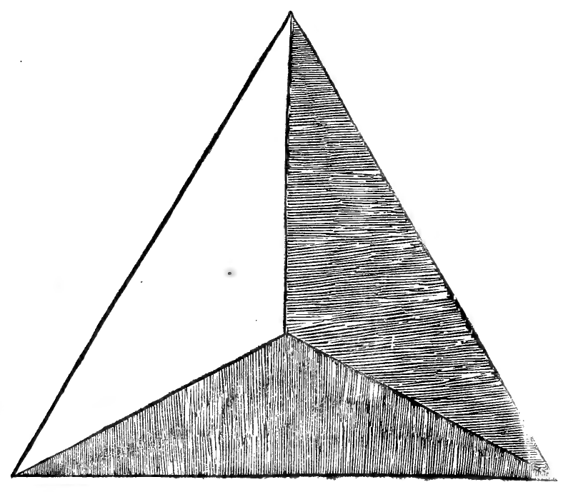
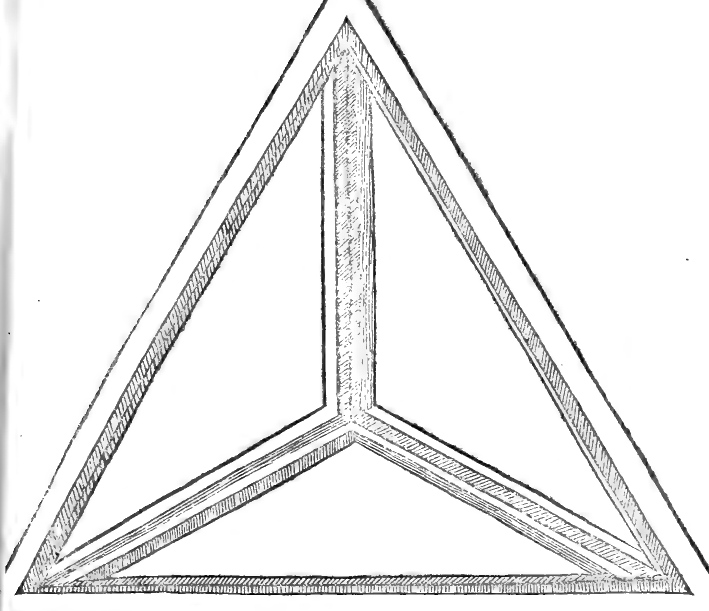
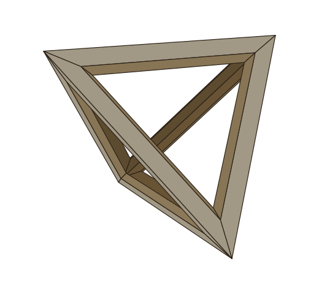
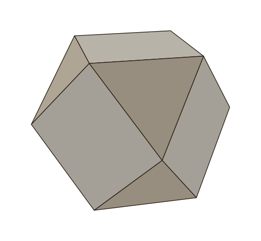
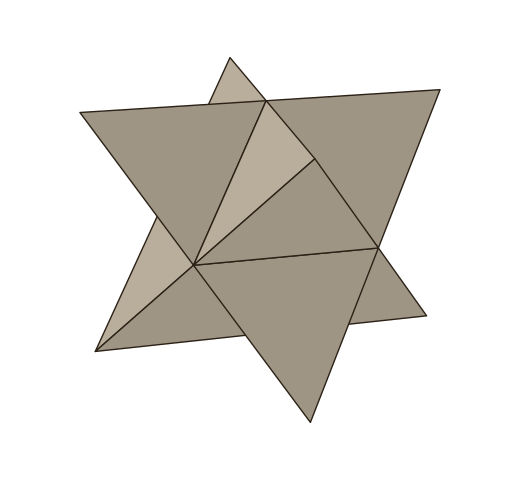

:layout: book
:title: Leonardo Plates: Tetrahedron, Hexahedron & Octahedron (Tabulae I–XX)
:book_title: Polyhedra: Platonic Solids & Divine Proportion
:book_subtitle: Dedicated Gallery & Exact Symbolic Reconstruction of Folios 0187–0229

====================================================================
Leonardo Plates: Tetrahedron, Hexahedron & Octahedron (Tabulae I–XX)
====================================================================

*Dedicated Scholarly Gallery & Exact Symbolic Reconstruction of Folios 0187–0229*

.. epigraph::

   *Fra li quali maxime quello delli 72 corpi di tanta e si vaga mirabile forma da ciascuno estimato e la dolce e soave prospettiva per mano del prelibato Lionardo da Vinci depenti in la corte del nostro Duca Lodovico Sforza...*

   *Among which especially that of the 72 bodies of such varied and wondrous form, esteemed by everyone, and the sweet and pleasing perspective painted by the hand of the exquisite Leonardo da Vinci in the court of our Duke Ludovico Sforza...*

   — :person:`Luca Pacioli`, *De Divina Proportione*, Epistola Dedicatoria (Milan, 1498)

This chapter presents the first twenty polyhedral plates drawn by **Leonardo da Vinci** for Luca Pacioli's *De Divina Proportione* (1509), spanning the regular **Tetrahedron** (Tabulae I–VI), **Hexahedron / Cube** (Tabulae VII–XIIII), and **Octahedron** (Tabulae XV–XX). Each historical woodcut plate is accompanied by its high-resolution folio scan, Latin cartouche, mathematical taxonomy, exact symbolic reconstruction, and interactive 3D model.

---

I. The Tetrahedron Family (Tabulae I–VI, Folios 0187–0197)
===========================================================

The regular tetrahedron :math:`\{3, 3\}` is the simplest of all regular polyhedra, possessing 4 vertices, 6 edges, and 4 equilateral triangular faces. In Plato's *Timaeus* (54d–55a), the tetrahedron is assigned to **Fire** because of its penetrating sharpness and mobile stability.

Leonardo constructed three distinct architectural variations of the tetrahedron: the basic solid and hollow bodies (*Planum Solidum* and *Planum Vacuum*), the truncated body (*Abscisum*), and the stellated body (*Elevatum*).

Tabula I (Folio 0187): *Tetrahedron Planum Solidum*
~~~~~~~~~~~~~~~~~~~~~~~~~~~~~~~~~~~~~~~~~~~~~~~~~~~~~

   **Tabula I (Folio 0187)**: *Tetrahedron Planum Solidum* (Τετράεδρον ἐπίπεδον στερεόν). The regular tetrahedron with solid planar facets and parallel woodcut cross-hatching.

Tabula II (Folio 0189): *Tetrahedron Planum Vacuum*
~~~~~~~~~~~~~~~~~~~~~~~~~~~~~~~~~~~~~~~~~~~~~~~~~~~~~

In Tabula II, Leonardo strips away the opaque faces to construct the hollow wooden lattice framework (*Corpus Vacuum*). As established by our Vacuate Manifold Theorem, this hollow frame transforms the simple tetrahedron (:math:`g = 0`) into a closed orientable 2-manifold surface of topological **genus** :math:`g = F - 1 = 4 - 1 = 3`, containing:

- **Vertices**: :math:`V_{\text{vac}} = 2V + 4E = 2(4) + 4(6) = 32`
- **Edges**: :math:`E_{\text{vac}} = 12E = 12(6) = 72`
- **Faces**: :math:`F_{\text{vac}} = 6E = 6(6) = 36` planar trapezoids
- **Euler Characteristic**: :math:`\chi = 32 - 72 + 36 = -4 = 2 - 2(3)`

   **Tabula II (Folio 0189)**: *Tetrahedron Planum Vacuum* (Τετράεδρον ἐπίπεδον κενόν). The open mitered wooden framework revealing the opposite apex and hollow interior.

   **Exact Symbolic Reconstruction**: *Tetrahedron Planum Vacuum* rendered with exact coordinates over :math:`\mathbb{Q}`, featuring mitered boxwood frame rails, darker inner reveals, and depth sorting.

Interactive 3D Codex: Tetrahedron
~~~~~~~~~~~~~~~~~~~~~~~~~~~~~~~~~

.. raw:: html

   

Tabula III & IIII (Folios 0191–0193): *Tetrahedron Abscisum*
~~~~~~~~~~~~~~~~~~~~~~~~~~~~~~~~~~~~~~~~~~~~~~~~~~~~~~~~~~~~

By truncating each of the 4 vertices of the tetrahedron at rational edge parameter :math:`t = 1/3` (via ``truncate(solid, ratio=sp.Rational(1, 3))``), the vertices are replaced by 4 equilateral triangular facets, while the 4 original triangles are truncated into 4 regular hexagons. The resulting body is the **Truncated Tetrahedron** (*Tetrahedron Abscisum*), an Archimedean semi-regular solid with :math:`V = 12, E = 18, F = 8`:

.. list-table::
   :widths: 50 50

   * - .. figure:: plates/0191.g1.png
          :align: center
          :alt: Tabula III (Folio 0191) - Tetrahedron Abscisum Solidum

          **Tabula III (Folio 0191)**: *Tetrahedron Abscisum Solidum*.
     - .. figure:: plates/0193.g1.png
          :align: center
          :alt: Tabula IIII (Folio 0193) - Tetrahedron Abscisum Vacuum

          **Tabula IIII (Folio 0193)**: *Tetrahedron Abscisum Vacuum*.

Tabula V & VI (Folios 0195–0197): *Tetrahedron Elevatum*
~~~~~~~~~~~~~~~~~~~~~~~~~~~~~~~~~~~~~~~~~~~~~~~~~~~~~~~~~

By erecting regular triangular pyramids over each of the 4 faces (via ``elevate(solid)``), Leonardo produces the **Triakis Tetrahedron** (*Tetrahedron Elevatum*), consisting of :math:`4 \times 3 = 12` equilateral triangular faces and :math:`4 + 4 = 8` vertices:

.. list-table::
   :widths: 50 50

   * - .. figure:: plates/0195.g1.png
          :align: center
          :alt: Tabula V (Folio 0195) - Tetrahedron Elevatum Solidum

          **Tabula V (Folio 0195)**: *Tetrahedron Elevatum Solidum*.
     - .. figure:: plates/0197.g1.png
          :align: center
          :alt: Tabula VI (Folio 0197) - Tetrahedron Elevatum Vacuum

          **Tabula VI (Folio 0197)**: *Tetrahedron Elevatum Vacuum*.

---

II. The Hexahedron / Cube Family (Tabulae VII–XIIII, Folios 0199–0217)
======================================================================

The regular hexahedron (cube) :math:`\{4, 3\}` has 8 vertices, 12 edges, and 6 square faces. In Plato's *Timaeus* (55d), the cube is the embodiment of **Earth** due to its immovable square foundation.

Tabula VII & VIII (Folios 0199–0201): *Exahedron Planum Solidum et Vacuum*
~~~~~~~~~~~~~~~~~~~~~~~~~~~~~~~~~~~~~~~~~~~~~~~~~~~~~~~~~~~~~~~~~~~~~~~~~~~

The hollow wooden cube framework (*Exahedron Planum Vacuum*, Tabula VIII) has 6 square window openings meeting in the central void. By the Vacuate Manifold Theorem, its topological **genus** is :math:`g = F - 1 = 6 - 1 = 5`:

- **Vertices**: :math:`V_{\text{vac}} = 2(8) + 4(12) = 64`
- **Edges**: :math:`E_{\text{vac}} = 12(12) = 144`
- **Faces**: :math:`F_{\text{vac}} = 6(12) = 72` planar trapezoids
- **Euler Characteristic**: :math:`\chi = 64 - 144 + 72 = -8 = 2 - 2(5)`

.. list-table::
   :widths: 50 50

   * - .. figure:: plates/0199.g1.png
          :align: center
          :alt: Tabula VII (Folio 0199) - Exahedron Planum Solidum

          **Tabula VII (Folio 0199)**: *Exahedron sive Cubus Planum Solidum*.
     - .. figure:: plates/0201.g1.png
          :align: center
          :alt: Tabula VIII (Folio 0201) - Exahedron Planum Vacuum

          **Tabula VIII (Folio 0201)**: *Exahedron Planum Vacuum* (:math:`g = 5`).

Tabula VIIII & X (Folios 0203–0205): *Exahedron Abscisum* (The Cuboctahedron)
~~~~~~~~~~~~~~~~~~~~~~~~~~~~~~~~~~~~~~~~~~~~~~~~~~~~~~~~~~~~~~~~~~~~~~~~~~~~~

In Tabulae VIIII and X, Pacioli directs the truncation of the cube at the **exact midpoints of its edges** (Pacioli's edge rectification, ``rectify(solid)``). This operation creates 8 equilateral triangular faces at the 8 cube corners and shrinks the 6 square faces into 6 rotated squares, producing the Archimedean **Cuboctahedron** (:math:`V = 12, E = 24, F = 14`):

.. list-table::
   :widths: 50 50

   * - .. figure:: plates/0203.g1.png
          :align: center
          :alt: Tabula VIIII (Folio 0203) - Exahedron Abscisum Solidum

          **Tabula VIIII (Folio 0203)**: *Exahedron Abscisum Solidum*.
     - .. figure:: plates/0205.g1.png
          :align: center
          :alt: Tabula X (Folio 0205) - Exahedron Abscisum Vacuum

          **Tabula X (Folio 0205)**: *Exahedron Abscisum Vacuum*.

   **Exact Symbolic Reconstruction**: *Hexahedron Abscisum* (Cuboctahedron) generated from exact edge-midpoint coordinates over :math:`\mathbb{Q}`, highlighting the alternating triangular and square facets.

Interactive 3D Codex: Hexahedron
~~~~~~~~~~~~~~~~~~~~~~~~~~~~~~~~

.. raw:: html

   

Tabula XI & XII (Folios 0207–0209): *Exahedron Elevatum*
~~~~~~~~~~~~~~~~~~~~~~~~~~~~~~~~~~~~~~~~~~~~~~~~~~~~~~~~~

By erecting square pyramids over the 6 square faces of the cube (via ``elevate(solid)``), Leonardo produces the **Tetrakis Hexahedron** (*Exahedron Elevatum*), having :math:`6 \times 4 = 24` triangular faces and :math:`8 + 6 = 14` vertices:

.. list-table::
   :widths: 50 50

   * - .. figure:: plates/0207.g1.png
          :align: center
          :alt: Tabula XI (Folio 0207) - Exahedron Elevatum Solidum

          **Tabula XI (Folio 0207)**: *Exahedron Elevatum Solidum*.
     - .. figure:: plates/0209.g1.png
          :align: center
          :alt: Tabula XII (Folio 0209) - Exahedron Elevatum Vacuum

          **Tabula XII (Folio 0209)**: *Exahedron Elevatum Vacuum*.

Tabula XIII & XIIII (Folios 0211 & 0217): *Exahedron Abscisum Elevatum*
~~~~~~~~~~~~~~~~~~~~~~~~~~~~~~~~~~~~~~~~~~~~~~~~~~~~~~~~~~~~~~~~~~~~~~~~

The compound variation *Exahedron Abscisum Elevatum* combines rectification and stellation: pyramids are erected on both the 8 triangular and 6 square facets of the cuboctahedron, creating a complex star body with :math:`8 \times 3 + 6 \times 4 = 48` triangular facets.

.. note::

   **Scholarly Note on Paganini's 1509 Folio Numbering**: In Paganini's printing shop, folios 0213 and 0215 were utilized for the full-page Vitruvian architectural column engravings (*Colonna Corinta, Jonica e Pulvinata con Stilobata e Steriobata*). Consequently, Tabula XIIII (*Exahedron Abscisum Elevatum Vacuum*) appears on **Folio 0217**, immediately following the architectural plates.

.. list-table::
   :widths: 50 50

   * - .. figure:: plates/0211.g1.png
          :align: center
          :alt: Tabula XIII (Folio 0211) - Exahedron Abscisum Elevatum Solidum

          **Tabula XIII (Folio 0211)**: *Exahedron Abscisum Elevatum Solidum*.
     - .. figure:: plates/0217.g1.png
          :align: center
          :alt: Tabula XIIII (Folio 0217) - Exahedron Abscisum Elevatum Vacuum

          **Tabula XIIII (Folio 0217)**: *Exahedron Abscisum Elevatum Vacuum*.

---

III. The Octahedron Family (Tabulae XV–XX, Folios 0219–0229)
============================================================

The regular octahedron :math:`\{3, 4\}` has 6 vertices, 12 edges, and 8 equilateral triangular faces. Dual to the cube, it represents **Air** in the Platonic cosmology (*Timaeus* 54e).

Tabula XV & XVI (Folios 0219–0221): *Octahedron Planum Solidum et Vacuum*
~~~~~~~~~~~~~~~~~~~~~~~~~~~~~~~~~~~~~~~~~~~~~~~~~~~~~~~~~~~~~~~~~~~~~~~~~~

The hollow wooden octahedron framework (*Octahedron Planum Vacuum*, Tabula XVI) has 8 triangular openings. By the Vacuate Manifold Theorem, its topological **genus** is :math:`g = F - 1 = 8 - 1 = 7`:

- **Vertices**: :math:`V_{\text{vac}} = 2(6) + 4(12) = 60`
- **Edges**: :math:`E_{\text{vac}} = 12(12) = 144`
- **Faces**: :math:`F_{\text{vac}} = 6(12) = 72` planar trapezoids
- **Euler Characteristic**: :math:`\chi = 60 - 144 + 72 = -12 = 2 - 2(7)`

.. list-table::
   :widths: 50 50

   * - .. figure:: plates/0219.g1.png
          :align: center
          :alt: Tabula XV (Folio 0219) - Octahedron Planum Solidum

          **Tabula XV (Folio 0219)**: *Octahedron Planum Solidum*.
     - .. figure:: plates/0221.g1.png
          :align: center
          :alt: Tabula XVI (Folio 0221) - Octahedron Planum Vacuum

          **Tabula XVI (Folio 0221)**: *Octahedron Planum Vacuum* (:math:`g = 7`).

Tabula XVII & XVIII (Folios 0223–0225): *Octahedron Abscisum* (Truncated Octahedron)
~~~~~~~~~~~~~~~~~~~~~~~~~~~~~~~~~~~~~~~~~~~~~~~~~~~~~~~~~~~~~~~~~~~~~~~~~~~~~~~~~~~~~

Truncating the 6 vertices of the octahedron at ratio :math:`t = 1/3` creates 6 square faces and turns the 8 triangular faces into regular hexagons. The resulting **Truncated Octahedron** (:math:`V = 24, E = 36, F = 14`) is famous as the only Archimedean solid capable of tessellating three-dimensional space by itself (Lord Kelvin's idealized foam cell):

.. list-table::
   :widths: 50 50

   * - .. figure:: plates/0223.g1.png
          :align: center
          :alt: Tabula XVII (Folio 0223) - Octahedron Abscisum Solidum

          **Tabula XVII (Folio 0223)**: *Octahedron Abscisum Solidum*.
     - .. figure:: plates/0225.g1.png
          :align: center
          :alt: Tabula XVIII (Folio 0225) - Octahedron Abscisum Vacuum

          **Tabula XVIII (Folio 0225)**: *Octahedron Abscisum Vacuum*.

Tabulae XIX & XX: *Octahedron Elevatum* — The Stella Octangula (1509)
~~~~~~~~~~~~~~~~~~~~~~~~~~~~~~~~~~~~~~~~~~~~~~~~~~~~~~~~~~~~~~~~~~~~~

Tabulae XIX and XX represent one of the crowning triumphs of Leonardo da Vinci's geometric art:

.. list-table::
   :widths: 50 50

   * - .. figure:: plates/0227.g1.png
          :align: center
          :alt: Tabula XIX (Folio 0227) - Octahedron Elevatum Solidum

          **Tabula XIX (Folio 0227)**: *Octahedron Elevatum Solidum* (*Stella Octangula*).
     - .. figure:: plates/0229.g1.png
          :align: center
          :alt: Tabula XX (Folio 0229) - Octahedron Elevatum Vacuum

          **Tabula XX (Folio 0229)**: *Octahedron Elevatum Vacuum*.

   **Exact Symbolic Reconstruction**: *Octahedron Elevatum* (*Stella Octangula*), modeled in exact coordinates over :math:`\mathbb{Q}`, demonstrating the interpenetration of two regular tetrahedra sharing a central octahedral core.

Historical Discovery: Leonardo Before Kepler
''''''''''''''''''''''''''''''''''''''''''''

In astronomical and geometric history, credit for discovering the **Stella Octangula** (the compound of two interpenetrating dual regular tetrahedra) is almost universally accorded to **Johannes Kepler**, who coined the term in *Harmonices Mundi* (Linz, 1619, Book II).

However, **Leonardo da Vinci drew both the solid and hollow Stella Octangula with rigorous perspective and chiaroscuro modeling in 1497**, published in Pacioli's *De Divina Proportione* in **1509**—more than **110 years before Kepler**!

Geometric Structure of the Stella Octangula
'''''''''''''''''''''''''''''''''''''''''''

When equilateral pyramids are erected over the 8 triangular faces of an octahedron (via ``elevate(octahedron)``), the apex of each pyramid forms an equilateral tetrahedron whose base is an octahedral face. In exact coordinates, the 8 pyramid apices are precisely the 8 corners of a cube :math:`(\pm 1, \pm 1, \pm 1)`.

The 8 triangular pyramids combine in groups of four to form **two interpenetrating regular tetrahedra**:

.. math::

   T_1: (1, 1, 1), (1, -1, -1), (-1, 1, -1), (-1, -1, 1)

.. math::

   T_2: (-1, -1, -1), (-1, 1, 1), (1, -1, 1), (1, 1, -1)

- **Apex Vertices**: 8 (corners of cube)
- **Octahedral Core Vertices**: 6 (centers of cube faces)
- **Total Vertices**: :math:`V = 8 + 6 = 14`
- **Edges**: :math:`E = 36`
- **Faces**: :math:`F = 24` equilateral triangular facets
- **Shared Intersection Core**: An exact regular octahedron

Interactive 3D Codex: Octahedron Elevatum
~~~~~~~~~~~~~~~~~~~~~~~~~~~~~~~~~~~~~~~~~

.. raw:: html

   

