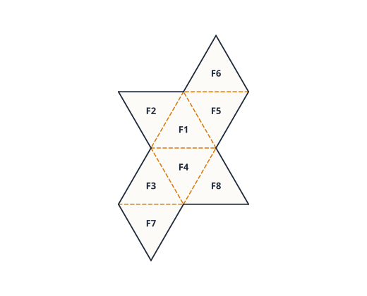
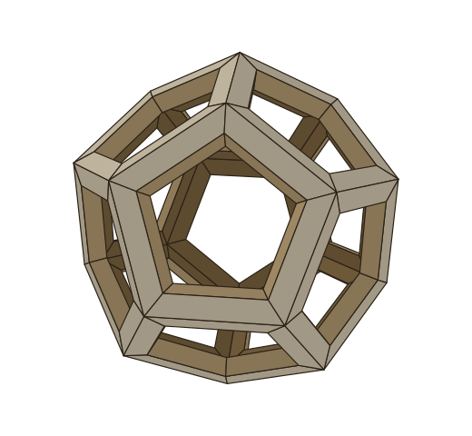

:navigation: header
:order: 5
:nav_title: 3D Pipeline
:layout: book
:title: 3D Symbolic Infrastructure & Multi-Engine Pipeline
:book_title: 3D Symbolic Infrastructure & Multi-Engine Pipeline
:book_subtitle: Exact Symbolic 3D Modeling, Conway/Pacioli Operators, and Multi-Target Export Architecture

==================================================
3D Symbolic Infrastructure & Multi-Engine Pipeline
==================================================

*Exact Symbolic 3D Modeling, Conway/Pacioli Operators, and Multi-Target Export Architecture*

.. epigraph::

   *Sicut punctum est principium lineae, et linea superficiei, et superficies corporis: ita et scientia de corpore praesupponit scientiam de superficiebus, et haec de lineis, et haec de punctis.*

   *Just as a point is the beginning of a line, a line of a surface, and a surface of a body: so also the science of body presupposes the science of surfaces, this of lines, and this of points.*

   — **St. Thomas Aquinas**, *In De Caelo et Mundo*, Lib. I, Lect. 2

The core design mandate of **GEOMETOR Polyhedra** is absolute mathematical truth: **100% exact symbolic algebra over algebraic number fields** :math:`\mathbb{Q}(\phi, \sqrt{d})`, with zero floating-point approximations.

From a single exact symbolic model instantiated in ``geometor.polyhedra.model3d``, the system drives a unified multi-engine pipeline delivering four distinct production targets: publication-grade 2D SVGs, interactive Book Codex canvas viewports, IngeTrazo CAD assemblies via MCP, and photorealistic studio rendering in Blender 5.x.

.. contents:: Table of Contents
   :local:
   :depth: 2

---

I. Exact Symbolic 3D Architecture (``model3d``)
===============================================

Every spatial entity in ``geometor.polyhedra.model3d`` is grounded in SymPy symbolic expressions (:math:`\mathbb{Z}`, :math:`\mathbb{Q}`, :math:`\mathbb{Q}(\phi)`, :math:`\mathbb{Q}(\sqrt{d})`). The module enforces a **strict zero-float contract**: passing Python ``float`` or ``sympy.Float`` values immediately raises a ``TypeError``.

Spatial Primitives (``primitives.py``)
~~~~~~~~~~~~~~~~~~~~~~~~~~~~~~~~~~~~~~~

.. list-table::
   :header-rows: 1
   :widths: 22 28 50

   * - Class
     - Exact Coordinates
     - Key Operations & Algebraic Invariants
   * - ``Vector3D``
     - :math:`(x, y, z) \in \mathbb{K}^3`
     - Vector addition, scalar multiplication, dot product, cross product, exact quadrance :math:`Q(\mathbf{v}) = x^2 + y^2 + z^2`.
   * - ``Point3D``
     - :math:`(x, y, z) \in \mathbb{K}^3`
     - Affine displacement :math:`P + \mathbf{v}`, vector difference :math:`P_1 \to P_2`, quadrance between points :math:`Q(P_1, P_2)`, exact linear interpolation :math:`\text{lerp}(P_2, t) = (1 - t)P_1 + t P_2`.
   * - ``Line3D``
     - :math:`P_1 + t(P_2 - P_1)`
     - Parametric 3D line passing through two exact points; direction vector, containment test.
   * - ``Plane3D``
     - :math:`\mathbf{n} \cdot (P - P_0) = 0`
     - Exact plane equation :math:`ax + by + cz + d = 0`; normal vector, point projection, line-plane intersection, segment intersection.
   * - ``Sphere3D``
     - :math:`(C, Q_R)`
     - Sphere center :math:`C \in \text{Point3D}` and exact squared radius (quadrance) :math:`Q_R \in \mathbb{K}`; point power, intersection with lines.
   * - ``Solid3D``
     - Frozen manifold
     - Closed polyhedral surface holding exact vertices, face polygons, boundary edges, face centroids, outward normals, topological invariants (:math:`\chi, g`), and semantic face roles.

The Solid3D Manifold Data Model
~~~~~~~~~~~~~~~~~~~~~~~~~~~~~~~

``Solid3D`` is a frozen, immutable data structure representing an exact orientable 2-manifold surface. Each face is stored as an ordered tuple of vertex indices wound counter-clockwise when viewed from the exterior.

.. code-block:: python

   from geometor.polyhedra.model3d import Point3D, Solid3D
   from geometor.polyhedra.platonic import PHI
   import sympy as sp

   # Golden vertices of the regular icosahedron
   verts = (
       Point3D(sp.Integer(0), sp.Integer(1), PHI),
       Point3D(sp.Integer(0), -sp.Integer(1), PHI),
       Point3D(sp.Integer(0), sp.Integer(1), -PHI),
       Point3D(sp.Integer(0), -sp.Integer(1), -PHI),
       Point3D(sp.Integer(1), PHI, sp.Integer(0)),
       Point3D(-sp.Integer(1), PHI, sp.Integer(0)),
       Point3D(sp.Integer(1), -PHI, sp.Integer(0)),
       Point3D(-sp.Integer(1), -PHI, sp.Integer(0)),
       Point3D(PHI, sp.Integer(0), sp.Integer(1)),
       Point3D(-PHI, sp.Integer(0), sp.Integer(1)),
       Point3D(PHI, sp.Integer(0), -sp.Integer(1)),
       Point3D(-PHI, sp.Integer(0), -sp.Integer(1)),
   )

   # Solid3D automatically computes edges, face centroids, face normals,
   # Euler characteristic, and verifies planarity and orientation.
   ico = Solid3D(slug="icosahedron", title="Regular Icosahedron", vertices=verts, faces=...)
   assert ico.euler_characteristic == 2
   assert ico.are_faces_coplanar()
   assert ico.is_outward_oriented()

---

II. Conway & Pacioli Polyhedral Operators (``operators.py``)
============================================================

The ``geometor.polyhedra.operators`` module provides five closed-form constructive geometric transformations that preserve exact algebraic coordinates:

1. Vacuate (``vacuate``)
~~~~~~~~~~~~~~~~~~~~~~~~

Implements Leonardo da Vinci's hollow wooden manifold (*Corpus Vacuum*). Concentric outer and inner frame rails are generated around central window openings with rational shrink parameters :math:`\mu` (aperture) and :math:`\lambda` (shell thickness):

.. math::

   V_{\text{vac}} = 2V + 4E, \quad E_{\text{vac}} = 12E, \quad F_{\text{vac}} = 6E, \quad g = F - 1

2. Rectify (``rectify``)
~~~~~~~~~~~~~~~~~~~~~~~~

Pacioli's edge-midpoint truncation (*Abscisum*). Places vertices at the exact midpoints :math:`M_e = \frac{1}{2}(u + v)` of all edges, transforming:
- **Tetrahedron** :math:`\to` **Regular Octahedron** (:math:`V=6, E=12, F=8`)
- **Hexahedron** :math:`\to` **Cuboctahedron** (:math:`V=12, E=24, F=14`)
- **Octahedron** :math:`\to` **Cuboctahedron** (:math:`V=12, E=24, F=14`)
- **Dodecahedron** :math:`\to` **Icosidodecahedron** (:math:`V=30, E=60, F=32`)
- **Icosahedron** :math:`\to` **Icosidodecahedron** (:math:`V=30, E=60, F=32`)

3. Truncate (``truncate``)
~~~~~~~~~~~~~~~~~~~~~~~~~~

Archimedean corner-cutting at rational edge parameter :math:`t \in (0, 1/2)` (default :math:`t = 1/3`). Divides each directed edge into segments of ratio :math:`t : 1-2t : t`, producing:
- Truncated Tetrahedron (:math:`V=12, E=18, F=8`)
- Truncated Octahedron (:math:`V=24, E=36, F=14`)
- Truncated Icosahedron (:math:`V=60, E=90, F=32`, Fullerene soccer ball)

4. Elevate (``elevate``)
~~~~~~~~~~~~~~~~~~~~~~~~

Pacioli and Leonardo's stellation operator (*Elevatum* / Conway *kis*). Replaces each :math:`k`-gon face with :math:`k` triangular facets meeting at an apex erected along the face normal. When ``height_scale=None``, the module calculates the exact algebraic height:

.. math::

   h = \sqrt{s^2 - r^2}

where :math:`s^2` is the face edge quadrance and :math:`r^2` is the face circumquadrance, ensuring all lateral triangular facets are **strictly equilateral**.

5. Polar Dual (``polar_dual``)
~~~~~~~~~~~~~~~~~~~~~~~~~~~~~~

Constructs the exact polar reciprocal across a concentric sphere of quadrance :math:`Q_S`. Each face plane is mapped to its pole vertex:

.. math::

   v^* = \frac{Q_S}{\mathbf{n} \cdot c_f} \mathbf{n}

mapping the Cube to the Octahedron, the Dodecahedron to the Icosahedron, and the Tetrahedron to itself.

---

III. The Dimensional Bridge (``bridge.py``)
===========================================

The dimensional bridge links 3D polyhedral manifolds directly into 2D constructive geometry and automated discovery engines:

Planar Cross-Section Slicing (``slice_solid_to_model``)
~~~~~~~~~~~~~~~~~~~~~~~~~~~~~~~~~~~~~~~~~~~~~~~~~~~~~~~

Computes the exact 3D planar cross-section of a ``Solid3D`` with an arbitrary slicing plane :math:`\Pi`, projects the intersection points onto orthonormal 2D axes :math:`(\mathbf{u}, \mathbf{v})`, and constructs an exact 2D ``geometor.model.Model``:

.. code-block:: python

   from geometor.polyhedra.model3d import Plane3D, Point3D, Vector3D, slice_solid_to_model
   from geometor.divine import scan_model_for_golden_sections
   import sympy as sp

   # Slice dodecahedron along an equatorial golden plane
   plane = Plane3D.from_point_and_normal(
       Point3D(0, 0, 0),
       Vector3D(0, 0, sp.Integer(1)),
   )
   u_axis = Vector3D(sp.Integer(1), 0, 0)
   v_axis = Vector3D(0, sp.Integer(1), 0)

   model2d = slice_solid_to_model(dodecahedron, plane, u_axis, v_axis, name="dodec_slice")

   # Automated discovery scans the exact 2D model for golden sections and harmonic ranges!
   golden_sections = scan_model_for_golden_sections(model2d)

2D Net Unfolding (``unfold_net_2d``)
~~~~~~~~~~~~~~~~~~~~~~~~~~~~~~~~~~~~

Unfolds the 3D polygonal faces of any convex solid onto a 2D Euclidean plane via a **breadth-first spanning tree over the polyhedral dual graph**:

- Begins at an initial root face positioned at the 2D origin.
- Flattens each neighbor face along its shared hinge edge using 2D rotation matrices.
- Guarantees zero backwards folding and produces clean, non-overlapping papercraft nets suitable for physical cardboard assembly and SVG visualization.

   **Unfolded 2D Net**: Exact planar layout of the regular octahedron, displaying hinge fold lines and cut boundaries.

---

IV. The Multi-Engine Export Pipeline
====================================

A single exact ``Solid3D`` model drives four independent downstream rendering targets:

.. list-table::
   :header-rows: 1
   :widths: 20 25 25 30

   * - Target
     - Technology
     - Output Artifact
     - Key Capabilities
   * - **1. 2D Vector SVGs**
     - ``render.svg3d``
     - Standalone ``.svg`` files
     - Perspective projection, depth sorting, chiaroscuro shading, dark-mode CSS classes, `.euclid-graphic` integration.
   * - **2. Interactive Codex**
     - ``polyhedra_3d_codex.js``
     - HTML5 Canvas Mount
     - Real-time quaternion rotation, trackball drag, variant switcher (Solidum/Vacuum/Abscisum/Elevatum), dual overlays.
   * - **3. IngeTrazo CAD**
     - ``export_ingetrazo_script``
     - Python Script & Wavefront OBJ/MTL
     - Live MCP bridge, multi-layer scene layout (``Platonic_Solida``, ``Leonardo_Vacua``), parametric mesh editing.
   * - **4. Blender 5.x Studio**
     - ``export_blender_script``
     - Standalone Python Studio Generator
     - Studio 3-point lighting, Principled BSDF Renaissance woodcut materials (Boxwood, Alabaster, Gold), Cycles/EEVEE rendering.

Target 1: Publication-Grade 2D SVGs (``render.svg3d``)
~~~~~~~~~~~~~~~~~~~~~~~~~~~~~~~~~~~~~~~~~~~~~~~~~~~~~~

The ``render_solid_svg`` engine projects 3D solids onto 2D vector viewports using perspective transformation, painter's depth sorting, directional light intensity calculations, and semantic styling:

- **Renaissance Palette**: Outer boxwood beams, darker inner reveals, and walnut cavities for *corpora vacua*.
- **Platonic Elemental Palette**: Fire crimson (Tetrahedron), Earth ochre (Hexahedron), Air sky-blue (Octahedron), Water azure (Icosahedron), and Aether royal violet (Dodecahedron).

   **Publication SVG**: *Dodecahedron Planum Vacuum* rendered with Renaissance boxwood frame styling, deep window jambs, and exact depth sorting.

Target 2: Interactive Book Codex 3D Canvas
~~~~~~~~~~~~~~~~~~~~~~~~~~~~~~~~~~~~~~~~~~

Embedded directly into Sphinx Book Codices via lightweight HTML mounts:

.. code-block:: html

   

The client-side engine (``polyhedra_3d_codex.js``) initializes automatically on document load:
- Camera-locked 3-point studio lighting with smooth pointer orbit and wheel zoom.
- Unified **Surfaces**, **Wireframe**, and **Frame** display modes with a continuous surface **Opacity** slider, **Aperture** frame control, and 3D **Vertices** sphere toggles.
- Golden ratio diagnostic overlays (Euclidean 5-cubes compound, internal golden rectangles, and polar dual wireframes).

Target 3: IngeTrazo 0.6.0 CAD & Live MCP Bridge
~~~~~~~~~~~~~~~~~~~~~~~~~~~~~~~~~~~~~~~~~~~~~~~

The pipeline exports both standard **Wavefront CAD files** (``.obj`` and companion ``.mtl`` with Renaissance material definitions) and direct **IngeTrazo 0.6.0 Python scripts**:

.. code-block:: python

   from geometor.polyhedra.model3d import Solid3D
   from geometor.polyhedra.operators import vacuate
   from geometor.polyhedra.platonic import get_platonic_solids
   from geometor.polyhedra.render import export_ingetrazo_script, export_obj_mtl
   from pathlib import Path

   solids_raw = get_platonic_solids()
   dodec = Solid3D.from_regular_solid(solids_raw["dodecahedron"])
   dodec_vac = vacuate(dodec)

   # Export CAD Wavefront OBJ/MTL
   export_obj_mtl(dodec_vac, Path("demos/exports/dodecahedron_vacuum.obj"))

   # Export executable IngeTrazo scene script
   export_ingetrazo_script(
       [dodec, dodec_vac],
       Path("demos/exports/build_ingetrazo_polyhedra.py"),
   )

IngeTrazo CAD scripts can be executed directly inside the user's live parametric CAD session using the **IngeTrazo MCP Server** (``call_mcp_tool(ServerName="ingetrazo", ToolName="run_python", ...)``), allowing agents to construct, inspect, and screenshot polyhedral CAD models programmatically.

Target 4: Blender 5.x Studio Renderer
~~~~~~~~~~~~~~~~~~~~~~~~~~~~~~~~~~~~~

For photorealistic publication renders and animations, ``export_blender_script`` emits a self-contained Python script tailored for modern Blender 5.x:

- Configures a dedicated ``GEOMETOR_Polyhedra`` collection.
- Builds multi-layer polyhedral meshes with correct vertex normals and face winding.
- Instantiates calibrated **Principled BSDF materials**:
  - **Italian Boxwood**: Warm, sunlit diffuse tone with subtle micro-roughness.
  - **Alabaster**: Translucent parchment stone with soft specular highlights.
  - **Walnut**: Deep shadowed cavities for interior hollow frames.
  - **Gold**: Metallic golden highlights for stellation apices.
- Sets up high-key studio lighting with key, fill, and rim lights, and orients an orthographic/perspective camera with depth of field.

.. code-block:: python

   from geometor.polyhedra.render import export_blender_script
   from pathlib import Path

   # Generate Blender 5.x studio script
   export_blender_script(
       [tet, cube, octa, ico, dodec],
       Path("demos/exports/build_blender_polyhedra.py"),
       spacing=5.0,
   )

The generated script can be executed headlessly via ``blender --background --python demos/exports/build_blender_polyhedra.py`` to produce publication-grade renders.
