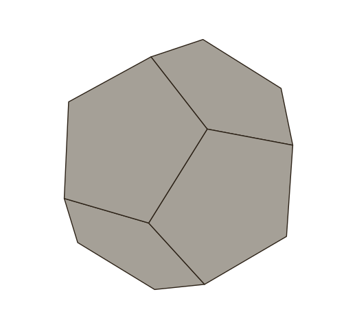
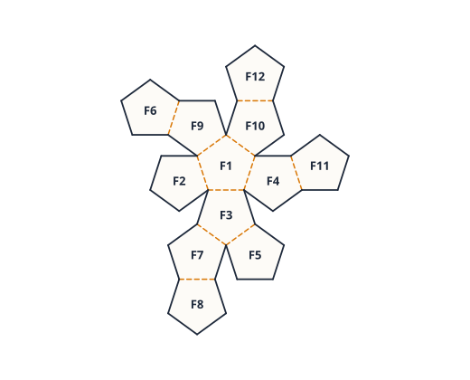

:layout: book
:title: Dodecahedron

============
Dodecahedron
============

*Euclid XIII.17 · Plato Timaeus (Aether/Cosmos) · Pacioli De Divina Proportione Cap. XXV · Tabulae XXVII–XXXIIII*

.. epigraph::

   *To construct a regular dodecahedron inside a given sphere and to prove that the side of the dodecahedron is an irrational straight line called an apotome.*

   — :person:`Euclid of Alexandria`, *Elements* Book XIII, Proposition 17 (G-Index: ``G.600``)

.. list-table::
   :widths: 20 20 15 15 15 15
   :header-rows: 1

   * - Classical Name
     - Greek Orthography
     - Element (Plato)
     - Schläfli $\{p, q\}$
     - Euclid Proposition
     - Pacioli Chapter
   * - **Dodecahedron**
     - Δωδεκάεδρον
     - **Aether / Cosmos** (Αἰθήρ / Οὐρανός)
     - $\{5, 3\}$
     - Book XIII, Prop. 17 (``G.600``)
     - *De Divina Proportione*, Cap. XXV

The **Regular Dodecahedron** is the crowning masterpiece of classical stereometry and the principal subject of Luca Pacioli's *De Divina Proportione* (1509). In Plato's *Timaeus* (55c), after assigning the four triangular and square bodies to Fire, Earth, Air, and Water, Plato reserves the dodecahedron for the cosmos itself:

.. epigraph::

   *There being yet a fifth combination, God used it for the whole, embroidering constellations thereupon.*

   — :person:`Plato`, *Timaeus* 55c

In the Pythagorean and Renaissance traditions, the dodecahedron represents the **Quintessence** (the Fifth Essence), embodying celestial harmony and the divine proportion :math:`\phi`. Euclid reserves the dodecahedron for the ultimate constructive proposition of the *Elements* (XIII.17), proving that its edge is an irrational line called an *apotome*.

In the GEOMETOR formulation, the twenty vertices of the dodecahedron are modeled with exact symbolic precision over :math:`\mathbb{Q}(\phi)` (:math:`\phi = \frac{1 + \sqrt{5}}{2}`) by uniting the eight corners of a cube with twelve golden ridge vertices.

Interactive 3D Explorer
-----------------------

.. raw:: html

   

.. note::

   **Interactive Codex Controls**:
   
   - **Orbit & Inspect**: Click and drag to orbit in three dimensions. Scroll or pinch to zoom.
   - **Variant Toggle**: Switch between Leonardo's *Vacuum* (wooden pentagonal frames), *Solidum* (opaque pentagonal facets), and *Abscisum* (truncated dodecahedron / icosidodecahedron).
   - **Aperture Slider**: Scrub the wooden beam aperture :math:`\mu \in [0.10, 0.45]` to inspect the interior mitered joinery of the twelve pentagonal windows.
   - **Structural Overlays**: Toggle the **Compound of Five Cubes** (Euclid XIII.17) and **Polar Dual** (the regular icosahedron connecting face centroids).
   - **Perspective Snap**: Snap to Leonardo da Vinci's canonical 1509 woodcut orientation.

Exact Symbolic Coordinates & Metric Ledger
------------------------------------------

Canonical Golden Coordinates
~~~~~~~~~~~~~~~~~~~~~~~~~~~~

The twenty vertices of the regular dodecahedron are formed by the union of eight cube vertices and twelve golden coordinate planes over :math:`\mathbb{Q}(\phi)` (where :math:`\phi^{-1} = \phi - 1 = \frac{\sqrt{5}-1}{2}`):

.. math::

   V = \{(\pm 1, \pm 1, \pm 1)\} \cup \{(0, \pm \phi^{-1}, \pm \phi)\} \cup \{(\pm \phi^{-1}, \pm \phi, 0)\} \cup \{(\pm \phi, 0, \pm \phi^{-1})\}

Explicit enumeration of all twenty vertices:

.. math::

   \begin{aligned}
   V_0 &= (1, 1, 1), & V_1 &= (1, 1, -1), & V_2 &= (1, -1, 1), & V_3 &= (1, -1, -1) \\
   V_4 &= (-1, 1, 1), & V_5 &= (-1, 1, -1), & V_6 &= (-1, -1, 1), & V_7 &= (-1, -1, -1) \\
   V_8 &= (0, \phi^{-1}, \phi), & V_9 &= (0, \phi^{-1}, -\phi), & V_{10} &= (0, -\phi^{-1}, \phi), & V_{11} &= (0, -\phi^{-1}, -\phi) \\
   V_{12} &= (\phi^{-1}, \phi, 0), & V_{13} &= (\phi^{-1}, -\phi, 0), & V_{14} &= (-\phi^{-1}, \phi, 0), & V_{15} &= (-\phi^{-1}, -\phi, 0) \\
   V_{16} &= (\phi, 0, \phi^{-1}), & V_{17} &= (\phi, 0, -\phi^{-1}), & V_{18} &= (-\phi, 0, \phi^{-1}), & V_{19} &= (-\phi, 0, -\phi^{-1})
   \end{aligned}

Every vertex lies on the exact same circumscribing sphere:

.. math::

   Q_{\text{out}}(\text{Cube}) = 1^2 + 1^2 + 1^2 = 3

.. math::

   Q_{\text{out}}(\text{Golden}) = 0^2 + (\phi^{-1})^2 + \phi^2 = (2 - \phi) + (\phi + 1) = 3

Face Cycles & Normal Orientations
~~~~~~~~~~~~~~~~~~~~~~~~~~~~~~~~~

The twelve regular pentagonal faces are oriented with counter-clockwise outward normal cycles:

.. math::

   \begin{aligned}
   F_0 &= (0, 12, 14, 4, 8), & F_1 &= (0, 8, 10, 2, 16), & F_2 &= (0, 16, 17, 1, 12) \\
   F_3 &= (1, 9, 5, 14, 12), & F_4 &= (1, 17, 3, 11, 9), & F_5 &= (2, 10, 6, 15, 13) \\
   F_6 &= (2, 13, 3, 17, 16), & F_7 &= (3, 13, 15, 7, 11), & F_8 &= (4, 18, 6, 10, 8) \\
   F_9 &= (4, 14, 5, 19, 18), & F_{10} &= (5, 9, 11, 7, 19), & F_{11} &= (6, 18, 19, 7, 15)
   \end{aligned}

The thirty edges consist of six edges lying along coordinate planes and twenty-four edges connecting cube vertices to the twelve golden ridge vertices.

3D Rational Trigonometry Ledger
~~~~~~~~~~~~~~~~~~~~~~~~~~~~~~~

In Rational Trigonometry, the metric ledger of the regular dodecahedron over :math:`\mathbb{Q}(\phi)` is exact:

.. list-table::
   :widths: 35 25 40
   :header-rows: 1

   * - Metric Invariant
     - Exact Value
     - Geometric Significance
   * - **Edge Quadrance** :math:`Q_E`
     - :math:`4\phi^{-2} = 8 - 4\phi = 6 - 2\sqrt{5}`
     - Edge length :math:`s = 2\phi^{-1} = \sqrt{5} - 1`
   * - **Circumquadrance** :math:`Q_{\text{out}}`
     - :math:`3`
     - Circumradius :math:`R = \sqrt{3}` for all 20 vertices
   * - **Midquadrance** :math:`Q_{\text{mid}}`
     - :math:`\phi + 1 = \phi^2 = \frac{3+\sqrt{5}}{2}`
     - Midradius :math:`r_{\text{mid}} = \phi` at edge midpoint
   * - **Inquadrance** :math:`Q_{\text{in}}`
     - :math:`\frac{4\phi + 3}{5} = \frac{5 + 2\sqrt{5}}{5}`
     - Inradius at pentagon face centroid
   * - **Sphere Quadrance Ratio** :math:`Q_{\text{in}} / Q_{\text{out}}`
     - :math:`\frac{4\phi + 3}{15} = \frac{5+2\sqrt{5}}{15}`
     - Identical to the Icosahedron ratio!
   * - **Mid-to-Circum Ratio** :math:`Q_{\text{mid}} / Q_{\text{out}}`
     - :math:`\frac{\phi + 1}{3} = \frac{3+\sqrt{5}}{6}`
     - Mid-sphere tangent to all 30 edges
   * - **Dihedral Spread** :math:`s`
     - :math:`4/5`
     - :math:`\cos\theta = -1/\sqrt{5} \implies s = 1 - 1/5 = 4/5`
   * - **Polar Dual**
     - Icosahedron
     - Connecting 12 face centroids produces regular icosahedron :math:`\{3, 5\}`

Dihedral Spread Derivation
~~~~~~~~~~~~~~~~~~~~~~~~~~

The interior dihedral angle :math:`\theta` between any two adjacent pentagonal faces satisfies:

.. math::

   \cos\theta = -\frac{1}{\sqrt{5}}

Squaring the cosine gives :math:`\cos^2\theta = \frac{1}{5}`. The dihedral angle is :math:`\theta = \arccos(-1/\sqrt{5}) \approx 116.565^\circ`. In Rational Trigonometry, the **dihedral spread** is:

.. math::

   s = 1 - \cos^2\theta = 1 - \frac{1}{5} = \frac{4}{5}

.. important::

   **Pure Rational Dihedral Spread**:
   The dihedral spread of the regular dodecahedron is the exact rational number **4/5**!

Topological Invariants
~~~~~~~~~~~~~~~~~~~~~~

.. list-table::
   :widths: 30 15 15 15 25
   :header-rows: 1

   * - Body Variant
     - Vertices :math:`V`
     - Edges :math:`E`
     - Faces :math:`F`
     - Euler Characteristic :math:`\chi` & Genus :math:`g`
   * - **Solidum** (Closed Polyhedron)
     - 20
     - 30
     - 12
     - :math:`\chi = V - E + F = 2`, :math:`g = 0` (Sphere)
   * - **Vacuum** (Open Wooden Frame)
     - 160
     - 300
     - 132
     - :math:`\chi = 4 - 2F = -20`, :math:`g = F - 1 = 11` (11-Hole Torus)

In Leonardo da Vinci's *Vacuum*, the twelve pentagonal window apertures form an orientable 2-manifold with eleven interior through-tunnels, giving genus :math:`g = 12 - 1 = 11` and Euler characteristic :math:`\chi = 4 - 2(12) = -20`.

Golden Proportions (:math:`\phi`) in the Dodecahedron
-----------------------------------------------------

The Twelve Pentagonal Faces and Golden Diagonals
~~~~~~~~~~~~~~~~~~~~~~~~~~~~~~~~~~~~~~~~~~~~~~~~

Every face of the dodecahedron is a regular pentagon with five golden diagonals. The diagonal of any regular pentagon is related to its side by the **golden ratio** :math:`\phi`:

   *Golden Pentagonal Faces*: In the canonical model, the pentagon diagonals have length :math:`2` (:math:`Q_d = 4`), while the edges have length :math:`2\phi^{-1}` (:math:`Q_e = 4\phi^{-2}`).

.. math::

   \frac{d_{\text{pentagon}}}{s_{\text{pentagon}}} = \frac{2}{2\phi^{-1}} = \phi = \frac{1 + \sqrt{5}}{2}

In Rational Trigonometry quadrances:

.. math::

   \frac{Q_{\text{diagonal}}}{Q_{\text{edge}}} = \frac{4}{4\phi^{-2}} = \phi^2 = \phi + 1 = \frac{3+\sqrt{5}}{2}

The Inscription of the Five Cubes (Kepler's Compound)
~~~~~~~~~~~~~~~~~~~~~~~~~~~~~~~~~~~~~~~~~~~~~~~~~~~~~

The twenty vertices of the regular dodecahedron can be partitioned into **five disjoint subsets of eight vertices**, each forming an exact regular cube of edge length :math:`2` inscribed within the circumsphere:

1. Each inscribed cube has 12 edges, for a total of :math:`5 \times 12 = 60` directed edges (:math:`30` undirected edges).
2. The twelve pentagonal faces each carry 5 diagonals, for a total of :math:`12 \times 5 = 60` directed diagonals (:math:`30` undirected diagonals).
3. The sixty directed edges of the five cubes **precisely partition all sixty directed diagonals** of the twelve pentagons!

Every pentagonal face carries exactly one diagonal from each of the five cubes, forming an interlocking pentagram on every face. The ratio of the cube edge quadrance to the dodecahedron edge quadrance is:

.. math::

   \frac{Q_{\text{cube}}}{Q_{\text{dod}}} = \frac{4}{4\phi^{-2}} = \phi^2 = \phi + 1

Three Orthogonal Axial Golden Rectangles
~~~~~~~~~~~~~~~~~~~~~~~~~~~~~~~~~~~~~~~~

The twelve non-cube vertices lie in groups of four on the three coordinate planes, forming three mutually orthogonal rectangles of dimensions :math:`2\phi \times 2\phi^{-1}`:

.. math::

   \frac{2\phi}{2\phi^{-1}} = \phi^2 = \phi + 1 = \frac{3+\sqrt{5}}{2}

Leonardo da Vinci's 1509 Woodcuts vs. Exact Mathematical SVGs
-------------------------------------------------------------

Tabulae XXVII through XXXIIII of Pacioli's *De Divina Proportione* illustrate Leonardo da Vinci's eight masterly variations on the dodecahedron.

Comparative Visual Analysis
~~~~~~~~~~~~~~~~~~~~~~~~~~~

.. list-table::
   :widths: 50 50
   :header-rows: 1

   * - Leonardo da Vinci (1509 Woodcut)
     - GEOMETOR Exact Symbolic Reconstruction
   * - .. figure:: ../leonardo/plates/0243.g1.png
          :alt: Leonardo da Vinci — Tabula XXVII: Dodecahedron Planum Solidum (1509)
          :width: 100%

          **Tabula XXVII**: *Dodecahedron Planum Solidum* (Folio 0243)
     - .. figure:: ../_static/svg/platonic/dodecahedron_solidum.svg
          :alt: GEOMETOR Exact SVG — Dodecahedron Solidum
          :width: 100%

          **Exact Solidum**: Isometric Perspective Projection

.. list-table::
   :widths: 50 50
   :header-rows: 1

   * - Leonardo da Vinci (1509 Woodcut)
     - GEOMETOR Exact Symbolic Reconstruction
   * - .. figure:: ../leonardo/plates/0245.g1.png
          :alt: Leonardo da Vinci — Tabula XXVIII: Dodecahedron Planum Vacuum (1509)
          :width: 100%

          **Tabula XXVIII**: *Dodecahedron Planum Vacuum* (Folio 0245)
     - .. figure:: ../_static/svg/platonic/dodecahedron_vacuum.svg
          :alt: GEOMETOR Exact SVG — Dodecahedron Vacuum
          :width: 100%

          **Exact Vacuum**: Open Wooden Beam Lattice (:math:`\mu = 0.25`)

.. list-table::
   :widths: 50 50
   :header-rows: 1

   * - Leonardo da Vinci (1509 Woodcut)
     - GEOMETOR Exact Symbolic Reconstruction
   * - .. figure:: ../leonardo/plates/0247.g1.png
          :alt: Leonardo da Vinci — Tabula XXIX: Dodecahedron Abscisum Solidum (1509)
          :width: 100%

          **Tabula XXIX**: *Dodecahedron Abscisum Solidum* (Folio 0247)
     - .. figure:: ../_static/svg/platonic/dodecahedron_abscisum.svg
          :alt: GEOMETOR Exact SVG — Dodecahedron Abscisum
          :width: 100%

          **Exact Abscisum**: Truncated Dodecahedron / Icosidodecahedron

2D Unfolded Net
---------------

The regular dodecahedron unfolds into the plane along nineteen cut edges into two matching florets of six regular pentagons:

   *2D Dihedral-Hinge Unfolding*: Two six-pentagon florets connected at a single hinge edge (dashed) with external cut boundaries (solid).

For a dodecahedron of canonical edge length :math:`s = 2\phi^{-1}` (:math:`Q_E = 4\phi^{-2}`), the total surface area and volume are:

.. math::

   A_{\text{total}} = 12 \times \frac{5}{4} \sqrt{\frac{5 + 2\sqrt{5}}{5}} s^2 = 3\sqrt{25 + 10\sqrt{5}} s^2

.. math::

   V_{\text{total}} = \frac{15 + 7\sqrt{5}}{4} s^3 = \frac{\phi^4 \sqrt{5}}{2} s^3
