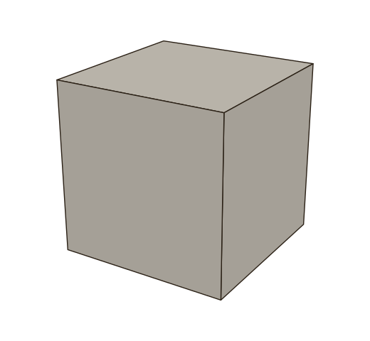
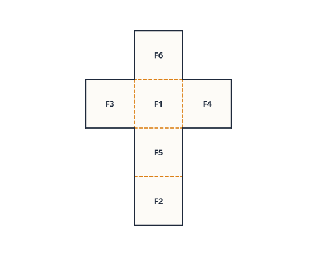

:layout: book
:title: Hexahedron (Cube)

=================
Hexahedron (Cube)
=================

*Euclid XIII.15 · Plato Timaeus (Earth) · Pacioli De Divina Proportione Cap. XXII · Tabulae VII–XIIII*

.. epigraph::

   *To construct a cube inside a given sphere and to prove that the square on the diameter of the sphere is three times the square on the side of the cube.*

   — :person:`Euclid of Alexandria`, *Elements* Book XIII, Proposition 15 (G-Index: ``G.595``)

.. list-table::
   :widths: 20 20 15 15 15 15
   :header-rows: 1

   * - Classical Name
     - Greek Orthography
     - Element (Plato)
     - Schläfli $\{p, q\}$
     - Euclid Proposition
     - Pacioli Chapter
   * - **Hexahedron** (Cube)
     - Ἑξάεδρον
     - **Earth** (*Terra* / Γῆ)
     - $\{4, 3\}$
     - Book XIII, Prop. 15 (``G.595``)
     - *De Divina Proportione*, Cap. XXII

The **Regular Hexahedron** (commonly called the **Cube**) is the canonical orthogonal solid of Euclidean three-space. In Plato's *Timaeus* (55d–56a), the cube is assigned to the element **Earth**: possessing square faces that sit firmly upon any plane, it is the most stable, immovable, and solid of the five Platonic bodies.

Euclid constructs the cube in *Elements* XIII.15 by inscribing a square in the equatorial great circle of the sphere, erecting perpendiculars from its four vertices to meet the upper and lower hemispheres, and proving that the sphere's diameter squared is triple the cube's edge squared (:math:`D^2 = 3 s^2 \implies Q_D = 3 Q_E`).

In the GEOMETOR formulation, the cube serves as the universal coordinate cradle for constructive 3D geometry: all eight vertices are integer coordinate triples :math:`(\pm 1, \pm 1, \pm 1)` over :math:`\mathbb{Z}`.

Interactive 3D Explorer
-----------------------

.. raw:: html

   

.. note::

   **Interactive Codex Controls**:
   
   - **Orbit & Inspect**: Click and drag to orbit in three dimensions. Scroll or pinch to zoom.
   - **Variant Toggle**: Switch between *Vacuum* (open wooden framework), *Solidum* (opaque square facets), and *Abscisum* (truncated cube / cuboctahedron).
   - **Aperture Slider**: Scrub the wooden beam aperture :math:`\mu \in [0.10, 0.45]` to inspect Leonardo's internal square joinery.
   - **Structural Overlays**: Toggle the **Golden Ratio** hipped roofs (Euclid XIII.17) and **Polar Dual** (regular octahedron connecting face centroids).
   - **Perspective Snap**: Snap directly to Leonardo da Vinci's canonical 1509 woodcut angle.

Exact Symbolic Coordinates & Metric Ledger
------------------------------------------

Canonical Lattice Coordinates
~~~~~~~~~~~~~~~~~~~~~~~~~~~~~

The regular cube is modeled on the eight canonical corners of the symmetric unit cube in :math:`\mathbb{Z}^3`:

.. math::

   \begin{aligned}
   V_0 &= (1, 1, 1), & V_1 &= (1, 1, -1), & V_2 &= (1, -1, 1), & V_3 &= (1, -1, -1) \\
   V_4 &= (-1, 1, 1), & V_5 &= (-1, 1, -1), & V_6 &= (-1, -1, 1), & V_7 &= (-1, -1, -1)
   \end{aligned}

Face Cycles & Normal Orientations
~~~~~~~~~~~~~~~~~~~~~~~~~~~~~~~~~

The six square faces are oriented with outward-pointing counter-clockwise normal cycles:

.. math::

   \begin{aligned}
   F_0 &= (0, 2, 3, 1) \quad (+x \text{ face}, \; n_0 = (1, 0, 0)) \\
   F_1 &= (4, 5, 7, 6) \quad (-x \text{ face}, \; n_1 = (-1, 0, 0)) \\
   F_2 &= (0, 1, 5, 4) \quad (+y \text{ face}, \; n_2 = (0, 1, 0)) \\
   F_3 &= (2, 6, 7, 3) \quad (-y \text{ face}, \; n_3 = (0, -1, 0)) \\
   F_4 &= (0, 4, 6, 2) \quad (+z \text{ face}, \; n_4 = (0, 0, 1)) \\
   F_5 &= (1, 3, 7, 5) \quad (-z \text{ face}, \; n_5 = (0, 0, -1))
   \end{aligned}

The twelve edges run parallel to the Cartesian axes, with four along :math:`x`, four along :math:`y`, and four along :math:`z`.

3D Rational Trigonometry Ledger
~~~~~~~~~~~~~~~~~~~~~~~~~~~~~~~

In Rational Trigonometry, all metric quantities are exact rational numbers:

.. list-table::
   :widths: 35 25 40
   :header-rows: 1

   * - Metric Invariant
     - Exact Value
     - Geometric Significance
   * - **Edge Quadrance** :math:`Q_E`
     - :math:`4`
     - Edge length :math:`s = 2`
   * - **Circumquadrance** :math:`Q_{\text{out}}`
     - :math:`3`
     - Circumradius :math:`R = \sqrt{3}` across diagonal
   * - **Midquadrance** :math:`Q_{\text{mid}}`
     - :math:`2`
     - Midradius :math:`r_{\text{mid}} = \sqrt{2}` at edge midpoint :math:`(1, 1, 0)`
   * - **Inquadrance** :math:`Q_{\text{in}}`
     - :math:`1`
     - Inradius :math:`r = 1` at face center :math:`(1, 0, 0)`
   * - **Sphere Quadrance Ratio** :math:`Q_{\text{in}} / Q_{\text{out}}`
     - :math:`1/3`
     - Concentric sphere volume ratio :math:`(1/3)^{3/2} = 1/(3\sqrt{3})`
   * - **Mid-to-Circum Ratio** :math:`Q_{\text{mid}} / Q_{\text{out}}`
     - :math:`2/3`
     - Mid-sphere tangent to all 12 edges
   * - **Euclid XIII.15 Invariant** :math:`Q_D / Q_E`
     - :math:`3`
     - :math:`Q_{\text{diameter}} = 4 Q_{\text{out}} = 12 \implies 12 / 4 = 3`
   * - **Dihedral Spread** :math:`s`
     - :math:`1`
     - :math:`\theta = 90^\circ \implies \cos\theta = 0 \implies s = \sin^2(90^\circ) = 1`
   * - **Polar Dual**
     - Octahedron
     - Connecting 6 face centroids produces regular octahedron :math:`\{3, 4\}`

Dihedral Spread Derivation
~~~~~~~~~~~~~~~~~~~~~~~~~~

Adjacent faces meet at right angles. Taking normal vectors :math:`n_0 = (1, 0, 0)` and :math:`n_2 = (0, 1, 0)`:

.. math::

   n_0 \cdot n_2 = 1(0) + 0(1) + 0(0) = 0

.. math::

   Q(n_0) = 1^2 = 1, \quad Q(n_2) = 1^2 = 1

.. math::

   s(F_0, F_2) = 1 - \frac{(n_0 \cdot n_2)^2}{Q(n_0) Q(n_2)} = 1 - \frac{0^2}{1 \times 1} = 1

The dihedral spread of the cube is identically **1**, reflecting the absolute orthogonality of Cartesian space.

Topological Invariants
~~~~~~~~~~~~~~~~~~~~~~

.. list-table::
   :widths: 30 15 15 15 25
   :header-rows: 1

   * - Body Variant
     - Vertices :math:`V`
     - Edges :math:`E`
     - Faces :math:`F`
     - Euler Characteristic :math:`\chi` & Genus :math:`g`
   * - **Solidum** (Closed Polyhedron)
     - 8
     - 12
     - 6
     - :math:`\chi = V - E + F = 2`, :math:`g = 0` (Sphere)
   * - **Vacuum** (Open Wooden Frame)
     - 48
     - 96
     - 40
     - :math:`\chi = 4 - 2F = -8`, :math:`g = F - 1 = 5` (5-Hole Torus)

In Leonardo da Vinci's hollow *Vacuum*, the six square window apertures transform the solid into an orientable 2-manifold with genus :math:`g = 6 - 1 = 5` and Euler characteristic :math:`\chi = 4 - 2(6) = -8`.

Golden Proportions (:math:`\phi`) in the Hexahedron
---------------------------------------------------

The Foundation of Euclid XIII.17 (Hipped Roofs)
~~~~~~~~~~~~~~~~~~~~~~~~~~~~~~~~~~~~~~~~~~~~~~~

In *Elements* XIII.17, Euclid accomplishes one of the crowning triumphs of classical geometry: **the construction of the regular dodecahedron from the cube**.

   *Euclidean Cradle (XIII.17)*: On each of the 6 square faces of the cube, a golden hipped roof is erected to create the 12 pentagonal faces of the dodecahedron.

Euclid begins with an inscribed cube of edge length :math:`s_{\text{cube}} = 2`. On each of the six square faces, he erects a triangular wedge or "hipped roof" whose ridge line is parallel to one coordinate axis:

1. The ridge line has exact length :math:`2\phi^{-1} = 2(\phi - 1) = \sqrt{5} - 1`.
2. The distance from the center of the cube face to the ridge is :math:`\phi^{-1}`.
3. The four triangular slopes of adjacent roofs meet to form planar regular pentagons!
4. The edge of the resulting dodecahedron is the ridge length :math:`s_{\text{dod}} = 2\phi^{-1}`.

The ratio of the cube's edge to the dodecahedron's edge is therefore precisely the **golden ratio**:

.. math::

   \frac{s_{\text{cube}}}{s_{\text{dod}}} = \frac{2}{2\phi^{-1}} = \phi = \frac{1 + \sqrt{5}}{2}

In Rational Trigonometry quadrances:

.. math::

   \frac{Q_{\text{cube}}}{Q_{\text{dod}}} = \frac{4}{4\phi^{-2}} = \phi^2 = \phi + 1 = \frac{3 + \sqrt{5}}{2}

The Compound of Five Cubes in a Dodecahedron
~~~~~~~~~~~~~~~~~~~~~~~~~~~~~~~~~~~~~~~~~~~~

A deeper golden relationship emerges when the 20 vertices of the regular dodecahedron are inspected: they contain **five distinct inscribed cubes**, forming Kepler's celebrated *Compound of Five Cubes*.

Each cube has 12 edges, giving :math:`5 \times 12 = 60` directed edges. The dodecahedron has 12 pentagonal faces, and each pentagon contains 5 golden diagonals (:math:`12 \times 5 = 60` directed diagonals). The edges of the five cubes **precisely partition all 30 diagonals of the dodecahedron**, with each pentagonal face bearing exactly one diagonal from each of the five cubes!

Leonardo da Vinci's 1509 Woodcuts vs. Exact Mathematical SVGs
-------------------------------------------------------------

Tabulae VII through XIIII of Pacioli's *De Divina Proportione* present Leonardo da Vinci's variations on the cube: *Planum Solidum*, *Planum Vacuum*, *Abscisum Solidum*, *Abscisum Vacuum*, *Elevatum Solidum*, and *Elevatum Vacuum*.

Comparative Visual Analysis
~~~~~~~~~~~~~~~~~~~~~~~~~~~

.. list-table::
   :widths: 50 50
   :header-rows: 1

   * - Leonardo da Vinci (1509 Woodcut)
     - GEOMETOR Exact Symbolic Reconstruction
   * - .. figure:: ../leonardo/plates/0199.g1.png
          :alt: Leonardo da Vinci — Tabula VII: Exahedron Planum Solidum (1509)
          :width: 100%

          **Tabula VII**: *Exahedron Planum Solidum* (Folio 0199)
     - .. figure:: ../_static/svg/platonic/hexahedron_solidum.svg
          :alt: GEOMETOR Exact SVG — Hexahedron Solidum
          :width: 100%

          **Exact Solidum**: Isometric Perspective Projection

.. list-table::
   :widths: 50 50
   :header-rows: 1

   * - Leonardo da Vinci (1509 Woodcut)
     - GEOMETOR Exact Symbolic Reconstruction
   * - .. figure:: ../leonardo/plates/0201.g1.png
          :alt: Leonardo da Vinci — Tabula VIII: Exahedron Planum Vacuum (1509)
          :width: 100%

          **Tabula VIII**: *Exahedron Planum Vacuum* (Folio 0201)
     - .. figure:: ../_static/svg/platonic/hexahedron_vacuum.svg
          :alt: GEOMETOR Exact SVG — Hexahedron Vacuum
          :width: 100%

          **Exact Vacuum**: Open Wooden Beam Lattice (:math:`\mu = 0.25`)

.. list-table::
   :widths: 50 50
   :header-rows: 1

   * - Leonardo da Vinci (1509 Woodcut)
     - GEOMETOR Exact Symbolic Reconstruction
   * - .. figure:: ../leonardo/plates/0203.g1.png
          :alt: Leonardo da Vinci — Tabula VIIII: Exahedron Abscisum Solidum (1509)
          :width: 100%

          **Tabula VIIII**: *Exahedron Abscisum Solidum* (Folio 0203)
     - .. figure:: ../_static/svg/platonic/hexahedron_abscisum.svg
          :alt: GEOMETOR Exact SVG — Hexahedron Abscisum
          :width: 100%

          **Exact Abscisum**: Truncated Cube with 8 Triangular Facets

2D Unfolded Net
---------------

The regular cube unfolds into the plane along seven cut edges into the classic Latin Cross net (one of eleven possible hexamino nets):

   *2D Dihedral-Hinge Unfolding*: Latin Cross arrangement showing the four aligned square faces with two lateral wings hinged along orthogonal seams (dashed) and outer cut boundaries (solid).

The total surface area and volume of the canonical cube of edge :math:`s = 2` are:

.. math::

   A_{\text{total}} = 6 s^2 = 6(4) = 24, \quad V_{\text{total}} = s^3 = 2^3 = 8
