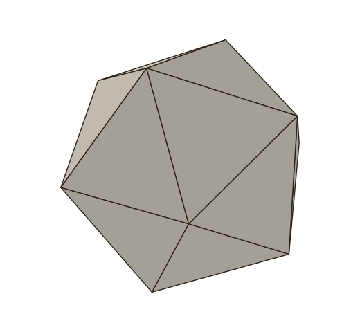
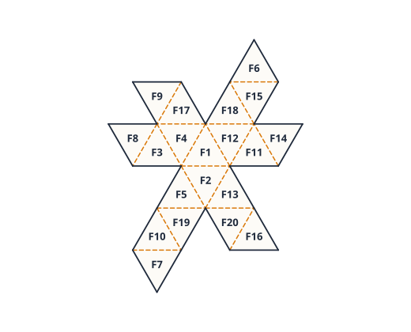

:layout: book
:title: Icosahedron

===========
Icosahedron
===========

*Euclid XIII.16 · Plato Timaeus (Water) · Pacioli De Divina Proportione Cap. XXIIII · Tabulae XXI–XXVI*

.. epigraph::

   *To construct a regular icosahedron inside a given sphere and to prove that the side of the icosahedron is an irrational straight line called minor.*

   — :person:`Euclid of Alexandria`, *Elements* Book XIII, Proposition 16 (G-Index: ``G.597``)

.. list-table::
   :widths: 20 20 15 15 15 15
   :header-rows: 1

   * - Classical Name
     - Greek Orthography
     - Element (Plato)
     - Schläfli $\{p, q\}$
     - Euclid Proposition
     - Pacioli Chapter
   * - **Icosahedron**
     - Εἰκοσάεδρον
     - **Water** (*Aqua* / Ὕδωρ)
     - $\{3, 5\}$
     - Book XIII, Prop. 16 (``G.597``)
     - *De Divina Proportione*, Cap. XXIIII

The **Regular Icosahedron** is the most complex of the deltahedral Platonic solids, possessing twenty equilateral triangular faces and twelve vertices. In Plato's *Timaeus* (56a–56b), the icosahedron is assigned to the element **Water**: with the greatest number of faces, the most obtuse dihedral angles, and the closest approximation to a rolling sphere, it is the most mobile, fluid, and least sharp of all triangular polyhedra.

In *Elements* XIII.16, Euclid provides a magnificent constructive proof: he inscribes a regular decagon in a circle, erects golden perpendiculars, and proves that the side of the icosahedron is an irrational line called *minor* (:math:`s = r \sqrt{\frac{5 - \sqrt{5}}{5}}` relative to sphere diameter).

In the GEOMETOR formulation, the twelve vertices of the icosahedron are modeled exactly over the golden algebraic field :math:`\mathbb{Q}(\phi)` (:math:`\phi = \frac{1 + \sqrt{5}}{2}`) via three mutually orthogonal **Golden Rectangles**.

Interactive 3D Explorer
-----------------------

.. raw:: html

   

.. note::

   **Interactive Codex Controls**:
   
   - **Orbit & Inspect**: Click and drag to orbit in three dimensions. Scroll or pinch to zoom.
   - **Variant Toggle**: Switch between Leonardo's *Vacuum* (wooden beam lattice), *Solidum* (twenty opaque triangular facets), and *Elevatum* (sixty triangular facet stellations).
   - **Aperture Slider**: Scrub the wooden beam aperture :math:`\mu \in [0.10, 0.45]` to observe how the twenty triangular windows reveal opposite golden rectangles.
   - **Structural Overlays**: Toggle the **Golden Rectangles** (:math:`R_{YZ}, R_{ZX}, R_{XY}`) and **Polar Dual** (the regular dodecahedron connecting face centroids).
   - **Perspective Snap**: Snap to Leonardo da Vinci's canonical 1509 woodcut vantage point.

Exact Symbolic Coordinates & Metric Ledger
------------------------------------------

Canonical Golden Coordinates
~~~~~~~~~~~~~~~~~~~~~~~~~~~~

The twelve vertices of the regular icosahedron are generated by cyclic permutations of coordinates with one zero coordinate and two golden coordinates over :math:`\mathbb{Q}(\phi)`:

.. math::

   V \in \{(0, \pm 1, \pm \phi), (\pm \phi, 0, \pm 1), (\pm 1, \pm \phi, 0)\}

Explicit vertex enumeration:

.. math::

   \begin{aligned}
   V_0 &= (0, 1, \phi), & V_1 &= (0, 1, -\phi), & V_2 &= (0, -1, \phi), & V_3 &= (0, -1, -\phi) \\
   V_4 &= (1, \phi, 0), & V_5 &= (1, -\phi, 0), & V_6 &= (-1, \phi, 0), & V_7 &= (-1, -\phi, 0) \\
   V_8 &= (\phi, 0, 1), & V_9 &= (\phi, 0, -1), & V_{10} &= (-\phi, 0, 1), & V_{11} &= (-\phi, 0, -1)
   \end{aligned}

Face Cycles & Normal Orientations
~~~~~~~~~~~~~~~~~~~~~~~~~~~~~~~~~

The twenty equilateral triangular faces are oriented with counter-clockwise outward normal cycles:

.. math::

   \begin{aligned}
   F_0 &= (0, 2, 8), & F_1 &= (0, 10, 2), & F_2 &= (0, 4, 6), & F_3 &= (0, 8, 4), & F_4 &= (0, 6, 10) \\
   F_5 &= (1, 9, 3), & F_6 &= (1, 3, 11), & F_7 &= (1, 6, 4), & F_8 &= (1, 4, 9), & F_9 &= (1, 11, 6) \\
   F_{10} &= (2, 7, 5), & F_{11} &= (2, 5, 8), & F_{12} &= (2, 10, 7), & F_{13} &= (3, 5, 7), & F_{14} &= (3, 9, 5) \\
   F_{15} &= (3, 7, 11), & F_{16} &= (4, 8, 9), & F_{17} &= (5, 9, 8), & F_{18} &= (6, 11, 10), & F_{19} &= (7, 10, 11)
   \end{aligned}

The thirty edges consist of twelve edges lying along the three golden rectangles, and eighteen edges connecting vertices between different orthogonal planes.

3D Rational Trigonometry Ledger
~~~~~~~~~~~~~~~~~~~~~~~~~~~~~~~

In Rational Trigonometry, the metric ledger of the icosahedron over :math:`\mathbb{Q}(\phi)` is exact:

.. list-table::
   :widths: 35 25 40
   :header-rows: 1

   * - Metric Invariant
     - Exact Value
     - Geometric Significance
   * - **Edge Quadrance** :math:`Q_E`
     - :math:`4`
     - Edge length :math:`s = 2`
   * - **Circumquadrance** :math:`Q_{\text{out}}`
     - :math:`\phi + 2 = \frac{5+\sqrt{5}}{2}`
     - :math:`0^2 + 1^2 + \phi^2 = 1 + (\phi+1) = \phi + 2`
   * - **Midquadrance** :math:`Q_{\text{mid}}`
     - :math:`\phi + 1 = \frac{3+\sqrt{5}}{2}`
     - Midpoint of :math:`V_0, V_2` is :math:`(0, 0, \phi) \implies Q_{\text{mid}} = \phi^2`
   * - **Inquadrance** :math:`Q_{\text{in}}`
     - :math:`\frac{2\phi + 2}{3} = \frac{3+\sqrt{5}}{3}`
     - Inradius at face centroid
   * - **Sphere Quadrance Ratio** :math:`Q_{\text{in}} / Q_{\text{out}}`
     - :math:`\frac{4\phi + 3}{15} = \frac{5+2\sqrt{5}}{15}`
     - Identical to the Dodecahedron ratio!
   * - **Mid-to-Circum Ratio** :math:`Q_{\text{mid}} / Q_{\text{out}}`
     - :math:`\frac{\phi + 2}{5} = \frac{5+\sqrt{5}}{10}`
     - Exact golden ratio partition
   * - **Dihedral Spread** :math:`s`
     - :math:`4/9`
     - :math:`\cos\theta = -\sqrt{5}/3 \implies s = 1 - 5/9 = 4/9`
   * - **Polar Dual**
     - Dodecahedron
     - Connecting 20 face centroids produces regular dodecahedron :math:`\{5, 3\}`

Dihedral Spread Derivation
~~~~~~~~~~~~~~~~~~~~~~~~~~

The interior dihedral angle :math:`\theta` between adjacent faces :math:`F_0 = (0, 2, 8)` and :math:`F_1 = (0, 10, 2)` is obtained from their normal vectors:

.. math::

   n_0 = (V_2 - V_0) \times (V_8 - V_0) = (0, -2, 0) \times (\phi, -1, 1-\phi) = (2\phi - 2, 0, 2\phi) \sim (\phi^{-1}, 0, \phi)

.. math::

   n_1 = (V_{10} - V_0) \times (V_2 - V_0) = (-\phi, -1, 1-\phi) \times (0, -2, 0) = (2\phi - 2, 0, -2\phi) \sim (\phi^{-1}, 0, -\phi)

The cosine of the angle between face normals is:

.. math::

   \cos\theta = -\frac{\sqrt{5}}{3}

Squaring this gives :math:`\cos^2\theta = \frac{5}{9}`. In Rational Trigonometry, the **dihedral spread** is:

.. math::

   s(F_0, F_1) = 1 - \cos^2\theta = 1 - \frac{5}{9} = \frac{4}{9}

.. important::

   **Pure Rational Dihedral Spread**:
   Despite requiring the radical :math:`\sqrt{5}` to express its vertex coordinates and dihedral angle, the dihedral spread of the regular icosahedron is the exact rational fraction **4/9**!

Topological Invariants
~~~~~~~~~~~~~~~~~~~~~~

.. list-table::
   :widths: 30 15 15 15 25
   :header-rows: 1

   * - Body Variant
     - Vertices :math:`V`
     - Edges :math:`E`
     - Faces :math:`F`
     - Euler Characteristic :math:`\chi` & Genus :math:`g`
   * - **Solidum** (Closed Polyhedron)
     - 12
     - 30
     - 20
     - :math:`\chi = V - E + F = 2`, :math:`g = 0` (Sphere)
   * - **Vacuum** (Open Wooden Frame)
     - 160
     - 300
     - 120
     - :math:`\chi = 4 - 2F = -36`, :math:`g = F - 1 = 19` (19-Hole Torus)

In Leonardo da Vinci's *Vacuum*, the twenty triangular window apertures transform the solid into an orientable 2-manifold with nineteen internal tunnels, giving genus :math:`g = 20 - 1 = 19` and Euler characteristic :math:`\chi = 4 - 2(20) = -36`.

Golden Proportions (:math:`\phi`) in the Icosahedron
----------------------------------------------------

The Three Mutually Orthogonal Golden Rectangles
~~~~~~~~~~~~~~~~~~~~~~~~~~~~~~~~~~~~~~~~~~~~~~~

The twelve vertices of the icosahedron span three mutually orthogonal golden rectangles centered at the origin:

.. math::

   \begin{aligned}
   R_{YZ} &= \{V_0, V_1, V_3, V_2\} \quad (\text{lying in plane } x = 0) \\
   R_{ZX} &= \{V_8, V_9, V_{11}, V_{10}\} \quad (\text{lying in plane } y = 0) \\
   R_{XY} &= \{V_4, V_5, V_7, V_6\} \quad (\text{lying in plane } z = 0)
   \end{aligned}

   *Golden Rectangles*: The 12 vertices of the icosahedron are the corners of three golden rectangles of aspect ratio :math:`1 : \phi`, oriented perpendicular to one another along the coordinate axes.

Each rectangle has short side :math:`2` and long side :math:`2\phi`:

- **Short Edge Quadrance**: :math:`Q_{\text{short}} = 2^2 = 4` (coinciding with icosahedron edges).
- **Long Edge Quadrance**: :math:`Q_{\text{long}} = (2\phi)^2 = 4\phi^2 = 4(\phi + 1) = 4\phi + 4`.
- **Quadrance Ratio**: :math:`Q_{\text{long}} / Q_{\text{short}} = \phi^2 = \phi + 1 = \frac{3+\sqrt{5}}{2}`.
- **Diagonal Quadrance**: :math:`Q_{\text{diag}} = Q_{\text{short}} + Q_{\text{long}} = 4 + 4\phi^2 = 4(\phi + 2) = 4 Q_{\text{out}}`.

Equatorial Pentagonal Vertex Figures
~~~~~~~~~~~~~~~~~~~~~~~~~~~~~~~~~~~~

Around any vertex :math:`V_k`, the five adjacent vertices form a regular planar pentagon. The ratio of the pentagon diagonal to the side of the pentagon is precisely the **golden ratio** :math:`\phi`:

.. math::

   \frac{d_{\text{pentagon}}}{s_{\text{pentagon}}} = \phi = \frac{1 + \sqrt{5}}{2}

This confirms that every vertex figure of the icosahedron is an exact golden pentagrammatic crown.

Leonardo da Vinci's 1509 Woodcuts vs. Exact Mathematical SVGs
-------------------------------------------------------------

Tabulae XXI through XXVI of Pacioli's *De Divina Proportione* present Leonardo da Vinci's six master drawings of the icosahedron.

Comparative Visual Analysis
~~~~~~~~~~~~~~~~~~~~~~~~~~~

.. list-table::
   :widths: 50 50
   :header-rows: 1

   * - Leonardo da Vinci (1509 Woodcut)
     - GEOMETOR Exact Symbolic Reconstruction
   * - .. figure:: ../leonardo/plates/0231.g1.png
          :alt: Leonardo da Vinci — Tabula XXI: Icosahedron Planum Solidum (1509)
          :width: 100%

          **Tabula XXI**: *Icosahedron Planum Solidum* (Folio 0231)
     - .. figure:: ../_static/svg/platonic/icosahedron_solidum.svg
          :alt: GEOMETOR Exact SVG — Icosahedron Solidum
          :width: 100%

          **Exact Solidum**: Renaissance Chiaroscuro Perspective

.. list-table::
   :widths: 50 50
   :header-rows: 1

   * - Leonardo da Vinci (1509 Woodcut)
     - GEOMETOR Exact Symbolic Reconstruction
   * - .. figure:: ../leonardo/plates/0233.g1.png
          :alt: Leonardo da Vinci — Tabula XXII: Icosahedron Planum Vacuum (1509)
          :width: 100%

          **Tabula XXII**: *Icosahedron Planum Vacuum* (Folio 0233)
     - .. figure:: ../_static/svg/platonic/icosahedron_vacuum.svg
          :alt: GEOMETOR Exact SVG — Icosahedron Vacuum
          :width: 100%

          **Exact Vacuum**: Open Wooden Beam Lattice (:math:`\mu = 0.25`)

Renaissance Perspective Triumph
~~~~~~~~~~~~~~~~~~~~~~~~~~~~~~~

Drawing the *Icosahedron Planum Vacuum* was widely recognized in the Renaissance as a supreme test of perspectival mathematics. Because twenty triangular frames overlap at various depths, Leonardo had to compute the exact visual occlusion of sixty interior beam edges. His solution—rendered with fine pearwood hatching—gives the impression of a real wooden armillary sphere floating in space.

2D Unfolded Net
---------------

The regular icosahedron unfolds into the plane along nineteen cut edges. The canonical net consists of a central band of ten equilateral triangles flanked above and below by two caps of five triangles:

   *2D Dihedral-Hinge Unfolding*: Central strip of ten equilateral triangles flanked by two alternating pentagonal florets hinged along internal boundaries (dashed) with external cuts (solid).

For an icosahedron of edge :math:`s = 2` (:math:`Q_E = 4`), the total surface area and volume are:

.. math::

   A_{\text{total}} = 20 \times \frac{\sqrt{3}}{4} s^2 = 5\sqrt{3}(4) = 20\sqrt{3}

.. math::

   V_{\text{total}} = \frac{5(3 + \sqrt{5})}{12} s^3 = \frac{5\phi^2}{6}(8) = \frac{20\phi^2}{3} = \frac{10(3+\sqrt{5})}{3}
