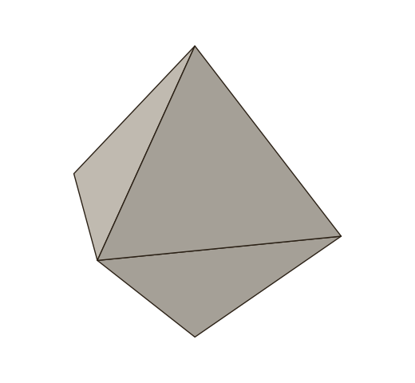
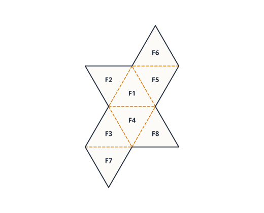

:layout: book
:title: Octahedron

==========
Octahedron
==========

*Euclid XIII.14 · Plato Timaeus (Air) · Pacioli De Divina Proportione Cap. XXIII · Tabulae XV–XX*

.. epigraph::

   *To construct a regular octahedron inside a given sphere and to prove that the square on the diameter of the sphere is double the square on the side of the octahedron.*

   — :person:`Euclid of Alexandria`, *Elements* Book XIII, Proposition 14 (G-Index: ``G.594``)

.. list-table::
   :widths: 20 20 15 15 15 15
   :header-rows: 1

   * - Classical Name
     - Greek Orthography
     - Element (Plato)
     - Schläfli $\{p, q\}$
     - Euclid Proposition
     - Pacioli Chapter
   * - **Octahedron**
     - Ὀκτάεδρον
     - **Air** (*Aer* / Ἀήρ)
     - $\{3, 4\}$
     - Book XIII, Prop. 14 (``G.594``)
     - *De Divina Proportione*, Cap. XXIII

The **Regular Octahedron** is the central dual bridge between the fire-tetrahedron and the water-icosahedron. In Plato's *Timaeus* (56a–56b), the octahedron is assigned to the element **Air**: with eight equilateral triangular faces and six vertices, it holds intermediate mobility, intermediate sharpness of dihedral angles, and intermediate fineness of elemental parts between the sharp tetrahedron (fire) and the multi-faceted icosahedron (water).

Euclid constructs the octahedron in *Elements* XIII.14 by drawing two diameters of the given sphere at right angles, erecting a third perpendicular diameter through the center, and joining their six endpoints. He establishes the fundamental metric theorem that the diameter squared of the circumscribing sphere is double the square on the side of the octahedron (:math:`D^2 = 2 s^2 \implies Q_D = 2 Q_E`).

In the GEOMETOR formulation, the octahedron is the simplest regular solid to model symbolically, residing on the six Cartesian unit basis vectors :math:`(\pm 1, 0, 0), (0, \pm 1, 0), (0, 0, \pm 1)` over :math:`\mathbb{Z}`.

Interactive 3D Explorer
-----------------------

.. raw:: html

   

.. note::

   **Interactive Codex Controls**:
   
   - **Orbit & Inspect**: Click and drag to orbit in three dimensions. Scroll or pinch to zoom.
   - **Variant Toggle**: Switch between Leonardo's *Vacuum* (wooden beams), *Solidum* (opaque triangular facets), and *Elevatum* (stellated octahedron / Kepler's *Stella Octangula*).
   - **Aperture Slider**: Scrub the wooden beam aperture :math:`\mu \in [0.10, 0.45]` to observe how opposite vertex pyramids frame internal voids.
   - **Structural Overlays**: Toggle the **Golden Ratio** edge division and **Polar Dual** (the cube connecting face centroids).
   - **Perspective Snap**: Snap to Leonardo da Vinci's canonical 1509 woodcut orientation.

Exact Symbolic Coordinates & Metric Ledger
------------------------------------------

Canonical Lattice Coordinates
~~~~~~~~~~~~~~~~~~~~~~~~~~~~~

The regular octahedron is defined by the six axial unit vertices:

.. math::

   \begin{aligned}
   V_0 &= (1, 0, 0), & V_1 &= (-1, 0, 0) \\
   V_2 &= (0, 1, 0), & V_3 &= (0, -1, 0) \\
   V_4 &= (0, 0, 1), & V_5 &= (0, 0, -1)
   \end{aligned}

Face Cycles & Normal Orientations
~~~~~~~~~~~~~~~~~~~~~~~~~~~~~~~~~

The eight equilateral triangular faces are oriented with outward-pointing counter-clockwise normal cycles:

.. math::

   \begin{aligned}
   F_0 &= (0, 2, 4) \quad (+++ \text{ octant}, \; n_0 = (1, 1, 1)) \\
   F_1 &= (0, 4, 3) \quad (+-+ \text{ octant}, \; n_1 = (1, -1, 1)) \\
   F_2 &= (0, 3, 5) \quad (+-- \text{ octant}, \; n_2 = (1, -1, -1)) \\
   F_3 &= (0, 5, 2) \quad (++- \text{ octant}, \; n_3 = (1, 1, -1)) \\
   F_4 &= (1, 4, 2) \quad (-++ \text{ octant}, \; n_4 = (-1, 1, 1)) \\
   F_5 &= (1, 3, 4) \quad (--+ \text{ octant}, \; n_5 = (-1, -1, 1)) \\
   F_6 &= (1, 5, 3) \quad (--- \text{ octant}, \; n_6 = (-1, -1, -1)) \\
   F_7 &= (1, 2, 5) \quad (-+- \text{ octant}, \; n_7 = (-1, 1, -1))
   \end{aligned}

The twelve edges join adjacent axial points, each lying in one of the three coordinate planes (:math:`xy`, :math:`yz`, :math:`zx`).

3D Rational Trigonometry Ledger
~~~~~~~~~~~~~~~~~~~~~~~~~~~~~~~

In Rational Trigonometry, all metric measures are exact integers or simple fractions:

.. list-table::
   :widths: 35 25 40
   :header-rows: 1

   * - Metric Invariant
     - Exact Value
     - Geometric Significance
   * - **Edge Quadrance** :math:`Q_E`
     - :math:`2`
     - Edge length :math:`s = \sqrt{2}` across axes
   * - **Circumquadrance** :math:`Q_{\text{out}}`
     - :math:`1`
     - Circumradius :math:`R = 1` along coordinate axes
   * - **Midquadrance** :math:`Q_{\text{mid}}`
     - :math:`1/2`
     - Midradius :math:`r_{\text{mid}} = 1/\sqrt{2}` at edge midpoint :math:`(1/2, 1/2, 0)`
   * - **Inquadrance** :math:`Q_{\text{in}}`
     - :math:`1/3`
     - Inradius :math:`r = 1/\sqrt{3}` at face centroid :math:`(1/3, 1/3, 1/3)`
   * - **Sphere Quadrance Ratio** :math:`Q_{\text{in}} / Q_{\text{out}}`
     - :math:`1/3`
     - Concentric sphere volume ratio :math:`(1/3)^{3/2} = 1/(3\sqrt{3})`
   * - **Mid-to-Circum Ratio** :math:`Q_{\text{mid}} / Q_{\text{out}}`
     - :math:`1/2`
     - Mid-sphere tangent to all 12 edges
   * - **Euclid XIII.14 Invariant** :math:`Q_D / Q_E`
     - :math:`2`
     - :math:`Q_{\text{diameter}} = 4 Q_{\text{out}} = 4 \implies 4 / 2 = 2`
   * - **Dihedral Spread** :math:`s`
     - :math:`8/9`
     - :math:`\cos\theta = -1/3 \implies s = 1 - (-1/3)^2 = 8/9`
   * - **Polar Dual**
     - Hexahedron (Cube)
     - Connecting 8 face centroids produces regular cube :math:`\{4, 3\}`

Dihedral Spread Derivation
~~~~~~~~~~~~~~~~~~~~~~~~~~

Consider adjacent faces :math:`F_0 = (0, 2, 4)` and :math:`F_1 = (0, 4, 3)` with unnormalized outward normals :math:`n_0 = (1, 1, 1)` and :math:`n_1 = (1, -1, 1)`:

.. math::

   n_0 \cdot n_1 = 1(1) + 1(-1) + 1(1) = 1

.. math::

   Q(n_0) = 1^2 + 1^2 + 1^2 = 3, \quad Q(n_1) = 1^2 + (-1)^2 + 1^2 = 3

The cosine of the interior dihedral angle between the planes is :math:`\cos\theta = -1/3` (the angle is :math:`\theta = \arccos(-1/3) \approx 109.47^\circ`). The dihedral spread is:

.. math::

   s(F_0, F_1) = 1 - \frac{(n_0 \cdot n_1)^2}{Q(n_0) Q(n_1)} = 1 - \frac{1^2}{3 \times 3} = 1 - \frac{1}{9} = \frac{8}{9}

.. important::

   **Remarkable Rational Trigonometry Invariant**:
   The Octahedron :math:`\{3, 4\}` and the Tetrahedron :math:`\{3, 3\}` share the **identical dihedral spread** :math:`s = 8/9`, despite possessing entirely different symmetry groups (:math:`O_h` vs. :math:`T_d`) and vertex figures!

Topological Invariants
~~~~~~~~~~~~~~~~~~~~~~

.. list-table::
   :widths: 30 15 15 15 25
   :header-rows: 1

   * - Body Variant
     - Vertices :math:`V`
     - Edges :math:`E`
     - Faces :math:`F`
     - Euler Characteristic :math:`\chi` & Genus :math:`g`
   * - **Solidum** (Closed Polyhedron)
     - 6
     - 12
     - 8
     - :math:`\chi = V - E + F = 2`, :math:`g = 0` (Sphere)
   * - **Vacuum** (Open Wooden Frame)
     - 64
     - 120
     - 48
     - :math:`\chi = 4 - 2F = -12`, :math:`g = F - 1 = 7` (7-Hole Torus)

In Leonardo da Vinci's *Vacuum*, the eight triangular openings create seven interconnected tunnels through the center of the frame, yielding genus :math:`g = 8 - 1 = 7` and Euler characteristic :math:`\chi = 4 - 2(8) = -12`.

Golden Proportions (:math:`\phi`) in the Octahedron
---------------------------------------------------

Golden Edge Division into the Regular Icosahedron
~~~~~~~~~~~~~~~~~~~~~~~~~~~~~~~~~~~~~~~~~~~~~~~~~

The octahedron is the direct geometric mother of the **Regular Icosahedron** through a classic transformation: **golden sectioning of its twelve edges**.

   *Golden Edge Division*: Dividing each of the 12 directed edges of an octahedron of radius :math:`\phi^2` in the golden ratio :math:`1 : \phi` produces the 12 vertices of the Regular Icosahedron.

Consider a regular octahedron scaled so that its axial radius is :math:`R = \phi^2 = \phi + 1 = \frac{3+\sqrt{5}}{2}`:

.. math::

   V_{\text{oct}} \in \{(\pm \phi^2, 0, 0), (0, \pm \phi^2, 0), (0, 0, \pm \phi^2)\}

The edge quadrance of this octahedron is:

.. math::

   Q_{\text{oct}} = (\phi^2)^2 + (\phi^2)^2 = 2\phi^4 = 2(3\phi + 2) = 6\phi + 4

If we orient each of the twelve edges cyclically around the faces and divide each directed edge from vertex :math:`A` to vertex :math:`B` in the golden ratio :math:`1 : \phi`, the division point :math:`P` is given by:

.. math::

   P = \frac{\phi A + B}{\phi + 1} = \phi^{-1} A + \phi^{-2} B

Because :math:`\phi^2 \times \phi^{-1} = \phi` and :math:`\phi^2 \times \phi^{-2} = 1`, the coordinates of these twelve division points are:

.. math::

   P \in \{(0, \pm 1, \pm \phi), (\pm \phi, 0, \pm 1), (\pm 1, \pm \phi, 0)\}

These are **identically the twelve canonical vertices of the Regular Icosahedron**!

Quadrance Segments along the Octahedral Edges
~~~~~~~~~~~~~~~~~~~~~~~~~~~~~~~~~~~~~~~~~~~~~

The golden division divides each octahedron edge into a major segment :math:`S_{\text{maj}}` and a minor segment :math:`S_{\text{min}}`:

.. math::

   \frac{Q_{\text{maj}}}{Q_{\text{min}}} = \phi^2 = \phi + 1 = \frac{3+\sqrt{5}}{2}

The distance between two adjacent division points across any octahedral face is exactly :math:`2`, yielding an inscribed icosahedron with exact edge quadrance :math:`Q_{\text{ico}} = 4`.

Leonardo da Vinci's 1509 Woodcuts vs. Exact Mathematical SVGs
-------------------------------------------------------------

Tabulae XV through XX of Pacioli's *De Divina Proportione* depict Leonardo's six variations on the regular octahedron: *Planum Solidum*, *Planum Vacuum*, *Abscisum Solidum*, *Abscisum Vacuum*, *Elevatum Solidum*, and *Elevatum Vacuum*.

Comparative Visual Analysis
~~~~~~~~~~~~~~~~~~~~~~~~~~~

.. list-table::
   :widths: 50 50
   :header-rows: 1

   * - Leonardo da Vinci (1509 Woodcut)
     - GEOMETOR Exact Symbolic Reconstruction
   * - .. figure:: ../leonardo/plates/0219.g1.png
          :alt: Leonardo da Vinci — Tabula XV: Octahedron Planum Solidum (1509)
          :width: 100%

          **Tabula XV**: *Octahedron Planum Solidum* (Folio 0219)
     - .. figure:: ../_static/svg/platonic/octahedron_solidum.svg
          :alt: GEOMETOR Exact SVG — Octahedron Solidum
          :width: 100%

          **Exact Solidum**: Renaissance Chiaroscuro Perspective

.. list-table::
   :widths: 50 50
   :header-rows: 1

   * - Leonardo da Vinci (1509 Woodcut)
     - GEOMETOR Exact Symbolic Reconstruction
   * - .. figure:: ../leonardo/plates/0221.g1.png
          :alt: Leonardo da Vinci — Tabula XVI: Octahedron Planum Vacuum (1509)
          :width: 100%

          **Tabula XVI**: *Octahedron Planum Vacuum* (Folio 0221)
     - .. figure:: ../_static/svg/platonic/octahedron_vacuum.svg
          :alt: GEOMETOR Exact SVG — Octahedron Vacuum
          :width: 100%

          **Exact Vacuum**: Open Wooden Beam Lattice (:math:`\mu = 0.25`)

.. list-table::
   :widths: 50 50
   :header-rows: 1

   * - Leonardo da Vinci (1509 Woodcut)
     - GEOMETOR Exact Symbolic Reconstruction
   * - .. figure:: ../leonardo/plates/0227.g1.png
          :alt: Leonardo da Vinci — Tabula XIX: Octahedron Elevatum Solidum (1509)
          :width: 100%

          **Tabula XIX**: *Octahedron Elevatum Solidum* (Folio 0227)
     - .. figure:: ../_static/svg/platonic/octahedron_elevatum.svg
          :alt: GEOMETOR Exact SVG — Octahedron Elevatum
          :width: 100%

          **Exact Elevatum**: Stellated Octahedron (*Stella Octangula*)

2D Unfolded Net
---------------

The regular octahedron unfolds along five of its twelve edges into a planar net of eight equilateral triangles:

   *2D Dihedral-Hinge Unfolding*: Double-row arrangement of eight equilateral triangular faces connected along hinge seams (dashed) with external cut boundaries (solid).

For an octahedron of canonical edge length :math:`s = \sqrt{2}` (:math:`Q_E = 2`), the total surface area and volume are:

.. math::

   A_{\text{total}} = 8 \times \frac{\sqrt{3}}{4} s^2 = 2\sqrt{3}(2) = 4\sqrt{3}, \quad V_{\text{total}} = \frac{\sqrt{2}}{3} s^3 = \frac{\sqrt{2}}{3}(2\sqrt{2}) = \frac{4}{3}
