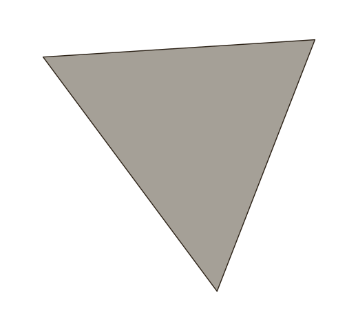
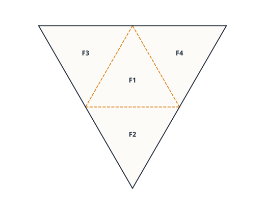

:layout: book
:title: Tetrahedron

===========
Tetrahedron
===========

*Euclid XIII.13 · Plato Timaeus (Fire) · Pacioli De Divina Proportione Cap. XXI · Tabulae I–VI*

.. epigraph::

   *To construct a regular tetrahedron inside a given sphere and to prove that the square on the diameter of the sphere is one and a half times the square on the side of the tetrahedron.*

   — :person:`Euclid of Alexandria`, *Elements* Book XIII, Proposition 13 (G-Index: ``G.592``)

.. list-table::
   :widths: 20 20 15 15 15 15
   :header-rows: 1

   * - Classical Name
     - Greek Orthography
     - Element (Plato)
     - Schläfli $\{p, q\}$
     - Euclid Proposition
     - Pacioli Chapter
   * - **Tetrahedron**
     - Τετράεδρον
     - **Fire** (*Ignis* / Πῦρ)
     - $\{3, 3\}$
     - Book XIII, Prop. 13 (``G.592``)
     - *De Divina Proportione*, Cap. XXI

The **Regular Tetrahedron** is the primary regular convex polyhedron in three-dimensional Euclidean space. In Plato's *Timaeus* (56b), the tetrahedron is assigned to the element **Fire**: having the fewest faces (4), the sharpest solid angles, and the greatest piercing power, it is the lightest, keenest, and most mobile of all elementary bodies.

Euclid constructs the regular tetrahedron in *Elements* XIII.13 by setting out a diameter of the given sphere, dividing it into three equal segments, and erecting an equilateral triangle on the plane perpendicular to the diameter at the two-thirds point.

In the GEOMETOR formulation, the tetrahedron is embedded directly into the integer lattice :math:`\mathbb{Z}^3` with zero floating-point approximations, as four alternating vertices of the canonical cube :math:`[-1, 1]^3`.

Interactive 3D Explorer
-----------------------

.. raw:: html

   

.. note::

   **Interactive Codex Controls**:
   
   - **Orbit & Inspect**: Click and drag to orbit in three dimensions. Scroll or pinch to zoom.
   - **Variant Toggle**: Switch seamlessly between Leonardo da Vinci's *Vacuum* (open-lattice wooden beams), *Solidum* (opaque planar facets), *Abscisum* (truncated tetrahedron), and *Elevatum* (triacontahedron stellations).
   - **Aperture Slider**: Scrub the wooden beam aperture parameter :math:`\mu \in [0.10, 0.45]` to inspect Leonardo's interior joinery.
   - **Structural Overlays**: Toggle the **Golden Ratio** structure and **Polar Dual** (self-dual inverted tetrahedron).
   - **Perspective Snap**: Reset camera to Leonardo da Vinci's canonical 1509 woodcut vantage point.

Exact Symbolic Coordinates & Metric Ledger
------------------------------------------

Canonical Lattice Coordinates
~~~~~~~~~~~~~~~~~~~~~~~~~~~~~

The regular tetrahedron is modeled over :math:`\mathbb{Z}` on four alternating vertices of the cube:

.. math::

   V_0 = (1, 1, 1), \quad V_1 = (1, -1, -1), \quad V_2 = (-1, 1, -1), \quad V_3 = (-1, -1, 1)

Face Cycles & Normal Orientations
~~~~~~~~~~~~~~~~~~~~~~~~~~~~~~~~~

The four equilateral triangular faces are oriented with outward-pointing counter-clockwise normal cycles:

.. math::

   F_0 = (0, 1, 2), \quad F_1 = (0, 3, 1), \quad F_2 = (0, 2, 3), \quad F_3 = (1, 3, 2)

Outward face normal vectors are computed via exact 3D cross products:

.. math::

   n_0 = (V_1 - V_0) \times (V_2 - V_0) = (0, -2, -2) \times (-2, 0, -2) = (4, 4, -4) \sim (1, 1, -1)

.. math::

   n_1 = (V_3 - V_0) \times (V_1 - V_0) = (-2, -2, 0) \times (0, -2, -2) = (4, -4, 4) \sim (1, -1, 1)

.. math::

   n_2 = (V_2 - V_0) \times (V_3 - V_0) = (-2, 0, -2) \times (-2, -2, 0) = (-4, 4, 4) \sim (-1, 1, 1)

.. math::

   n_3 = (V_3 - V_1) \times (V_2 - V_1) = (-2, 0, 2) \times (-2, 2, 0) = (-4, -4, -4) \sim (-1, -1, -1)

3D Rational Trigonometry Ledger
~~~~~~~~~~~~~~~~~~~~~~~~~~~~~~~

In Norman Wildberger's Rational Trigonometry, the metric properties of 3D polyhedra are formulated strictly via exact rational **quadrances** (squared lengths) and planar **spreads** (:math:`s = \sin^2\theta`):

.. list-table::
   :widths: 35 25 40
   :header-rows: 1

   * - Metric Invariant
     - Exact Value
     - Geometric Significance
   * - **Edge Quadrance** :math:`Q_E`
     - :math:`8`
     - Edge length :math:`s = 2\sqrt{2}`
   * - **Circumquadrance** :math:`Q_{\text{out}}`
     - :math:`3`
     - Circumradius :math:`R = \sqrt{3}`
   * - **Midquadrance** :math:`Q_{\text{mid}}`
     - :math:`1`
     - Midradius :math:`r_{\text{mid}} = 1` at edge midpoint :math:`(1, 0, 0)`
   * - **Inquadrance** :math:`Q_{\text{in}}`
     - :math:`1/3`
     - Inradius :math:`r = 1/\sqrt{3}` at face centroid :math:`(1/3, 1/3, -1/3)`
   * - **Sphere Quadrance Ratio** :math:`Q_{\text{in}} / Q_{\text{out}}`
     - :math:`1/9`
     - Concentric sphere volume ratio :math:`(1/9)^{3/2} = 1/27`
   * - **Mid-to-Circum Ratio** :math:`Q_{\text{mid}} / Q_{\text{out}}`
     - :math:`1/3`
     - Ratio of mid-sphere to circumsphere
   * - **Euclid XIII.13 Invariant** :math:`Q_D / Q_E`
     - :math:`3/2`
     - :math:`Q_{\text{diameter}} = 4 Q_{\text{out}} = 12 \implies 12 / 8 = 3/2`
   * - **Dihedral Spread** :math:`s`
     - :math:`8/9`
     - :math:`\cos\theta = 1/3 \implies s = 1 - (1/3)^2 = 8/9`
   * - **Polar Dual**
     - Self-dual
     - Dual is an inverted tetrahedron :math:`\{3, 3\}^* = \{3, 3\}`

Dihedral Spread Derivation
~~~~~~~~~~~~~~~~~~~~~~~~~~

The dihedral spread between two adjacent faces with normal vectors :math:`n_0 = (1, 1, -1)` and :math:`n_1 = (1, -1, 1)` is computed directly:

.. math::

   n_0 \cdot n_1 = 1(1) + 1(-1) + (-1)(1) = 1 - 1 - 1 = -1

.. math::

   Q(n_0) = 1^2 + 1^2 + (-1)^2 = 3, \quad Q(n_1) = 1^2 + (-1)^2 + 1^2 = 3

.. math::

   s(F_0, F_1) = 1 - \frac{(n_0 \cdot n_1)^2}{Q(n_0) Q(n_1)} = 1 - \frac{(-1)^2}{3 \times 3} = 1 - \frac{1}{9} = \frac{8}{9}

Topological Invariants
~~~~~~~~~~~~~~~~~~~~~~

.. list-table::
   :widths: 30 15 15 15 25
   :header-rows: 1

   * - Body Variant
     - Vertices :math:`V`
     - Edges :math:`E`
     - Faces :math:`F`
     - Euler Characteristic :math:`\chi` & Genus :math:`g`
   * - **Solidum** (Closed Polyhedron)
     - 4
     - 6
     - 4
     - :math:`\chi = V - E + F = 2`, :math:`g = 0` (Sphere)
   * - **Vacuum** (Open Wooden Frame)
     - 32
     - 60
     - 24
     - :math:`\chi = 4 - 2F = -4`, :math:`g = F - 1 = 3` (3-Hole Torus)

In Leonardo da Vinci's open-lattice *Vacuum*, each face aperture becomes a tunnel through the body. Topologically, a regular hollow frame with :math:`F` polygonal openings is an orientable closed surface of genus :math:`g = F - 1 = 3` and Euler characteristic :math:`\chi = 2 - 2g = 4 - 2F = -4`.

Golden Proportions (:math:`\phi`) in the Tetrahedron
----------------------------------------------------

George Odom's 1983 Golden Section Construction
~~~~~~~~~~~~~~~~~~~~~~~~~~~~~~~~~~~~~~~~~~~~~~

While the tetrahedron is traditionally considered an elemental figure devoid of the golden ratio, in 1983 the American artist and geometer **George Odom** made a stunning discovery: **the golden ratio is encoded directly on the face of the regular tetrahedron** when inscribed within its circumscribing circle.

   *George Odom's Golden Section (1983)*: Connecting the midpoints :math:`M_1, M_2` of two edges of an equilateral face and extending the segment to the circumscribing small circle produces the exact golden ratio :math:`\phi`.

Let :math:`\triangle ABC` be an equilateral face of the tetrahedron inscribed in its circumcircle :math:`\mathcal{C}` of radius :math:`r = 2`:

1. Let :math:`M_1` be the midpoint of edge :math:`AB`, and :math:`M_2` be the midpoint of edge :math:`AC`.
2. Draw the midsegment line :math:`M_1 M_2` and extend it to intersect the circle :math:`\mathcal{C}` at points :math:`G_1` and :math:`G_2` (with :math:`G_2` lying beyond :math:`M_2`).
3. **Theorem (George Odom, 1983)**: The point :math:`M_2` divides the segment :math:`M_1 G_2` in the **golden ratio**:

   .. math::

      \frac{|M_1 M_2|}{|M_2 G_2|} = \phi = \frac{1 + \sqrt{5}}{2}

In the language of 3D Rational Trigonometry and ``geometor.model``, the quadrance ratio satisfies:

.. math::

   \frac{Q(M_1, M_2)}{Q(M_2, G_2)} = \phi^2 = \phi + 1 = \frac{3 + \sqrt{5}}{2}

Furthermore, the ratio of the total segment :math:`M_1 G_2` to the midsegment :math:`M_1 M_2` is:

.. math::

   \frac{Q(M_1, G_2)}{Q(M_1, M_2)} = \phi^2 = \phi + 1

This elementary construction proves that even the simplest Platonic solid—the fire-pyramid of Plato—is intimately linked to the divine proportion :math:`\phi`.

Leonardo da Vinci's 1509 Woodcuts vs. Exact Mathematical SVGs
-------------------------------------------------------------

For Luca Pacioli's *De Divina Proportione* (Venice, 1509), **Leonardo da Vinci** designed sixty polyhedral drawings, cut onto pearwood blocks. Tabulae I and II depict the *Tetrahedron Planum Solidum* and *Tetrahedron Planum Vacuum*.

Comparative Visual Analysis
~~~~~~~~~~~~~~~~~~~~~~~~~~~

.. list-table::
   :widths: 50 50
   :header-rows: 1

   * - Leonardo da Vinci (1509 Woodcut)
     - GEOMETOR Exact Symbolic Reconstruction
   * - .. figure:: ../leonardo/plates/0187.g1.png
          :alt: Leonardo da Vinci — Tabula I: Tetrahedron Planum Solidum (1509)
          :width: 100%

          **Tabula I**: *Tetrahedron Planum Solidum* (Folio 0187)
     - .. figure:: ../_static/svg/platonic/tetrahedron_solidum.svg
          :alt: GEOMETOR Exact SVG — Tetrahedron Solidum
          :width: 100%

          **Exact Solidum**: Renaissance Chiaroscuro Perspective

.. list-table::
   :widths: 50 50
   :header-rows: 1

   * - Leonardo da Vinci (1509 Woodcut)
     - GEOMETOR Exact Symbolic Reconstruction
   * - .. figure:: ../leonardo/plates/0189.g1.png
          :alt: Leonardo da Vinci — Tabula II: Tetrahedron Planum Vacuum (1509)
          :width: 100%

          **Tabula II**: *Tetrahedron Planum Vacuum* (Folio 0189)
     - .. figure:: ../_static/svg/platonic/tetrahedron_vacuum.svg
          :alt: GEOMETOR Exact SVG — Tetrahedron Vacuum
          :width: 100%

          **Exact Vacuum**: Open Wooden Beam Lattice (:math:`\mu = 0.25`)

Renaissance Chiaroscuro & Perspective Artistry
~~~~~~~~~~~~~~~~~~~~~~~~~~~~~~~~~~~~~~~~~~~~~~

Leonardo's woodcuts demonstrate an unprecedented mastery of descriptive geometry:

1. **Upper-Left Illumination (*Luce Primaria*)**: In accordance with Leonardo's *Trattato della Pittura*, light descends from the upper left at an angle of :math:`45^\circ`, casting realistic shadow across the lower-right facets.
2. **Open-Lattice Joinery (*Il Corpo Vacuum*)**: Leonardo invented the *Vacuum* rendering to solve the problem of spatial opacity. By hollowing out the faces into solid wooden beams of width parameter :math:`\mu`, the interior edges, rear vertices, and spatial depth are revealed simultaneously.
3. **Mitered Triangular Vertices**: At each of the four vertices, three wooden beams meet at dihedral angles of :math:`\arccos(1/3) \approx 70.53^\circ`, joined with precision bevels.

2D Unfolded Net
---------------

The regular tetrahedron unfolds into the plane along three of its six edges without overlapping. The resulting net forms a larger equilateral triangle whose sides are twice the length of the tetrahedron's edges:

   *2D Dihedral-Hinge Unfolding*: Central triangular face surrounded by three outer faces hinged along internal seams (dashed lines) and cut boundaries (solid lines).

The net demonstrates that the total surface area of the regular tetrahedron is four times the area of a single equilateral face:

.. math::

   A_{\text{total}} = 4 \times \frac{\sqrt{3}}{4} s^2 = \sqrt{3} s^2 = 8\sqrt{3}
