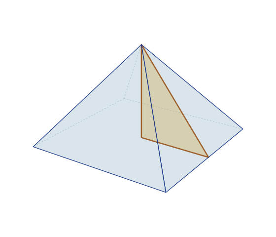
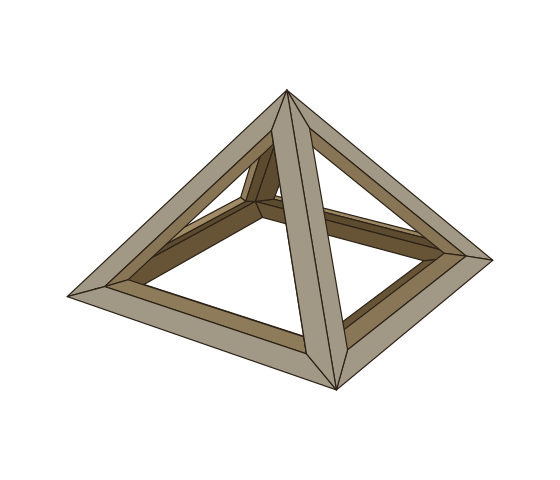

:navigation: header
:order: 4
:nav_title: Great Pyramid
:layout: book
:title: Kepler, Squaring the Circle & the Great Pyramid
:book_title: Kepler, Squaring the Circle & the Great Pyramid
:book_subtitle: The 1597 Kepler Right Triangle · Circle Quadrature · Old Kingdom 14:11 Seked & Polyhedral Duality

===============================================
Kepler, Squaring the Circle & the Great Pyramid
===============================================

*The 1597 Kepler Right Triangle · Circle Quadrature · Old Kingdom 14:11 Seked & Polyhedral Duality*

.. epigraph::

   *Geometria duo habet thesauros magnos: alterum est theorema Pythagorae, alterum sectio aequa ac media proportione. Primum auro comparare possumus, secundum gemmae pretiosae.*

   *Geometry has two great treasures: one is the Theorem of Pythagoras, the other the division of a line into extreme and mean ratio. The first we may compare to a measure of gold, the second we may name a precious jewel.*

   — **Johannes Kepler**, *Epistola ad Michaelem Mästlinum* (Prague, October 1597)

.. epigraph::

   *καὶ τῆς ποιήσεως τῆς πυραμίδος... ἑκάστης δὲ τῶν τεσσάρων πλευρῶν εἶναι τὸ ὕψος ὀκτὼ πλέθρα, ἐούσης τετραγώνου, καὶ τὸ εὖρος ἴσον.*

   *The pyramid was built such that the square on its vertical height equals the surface of each of its triangular faces, the base being square and four-sided.*

   — **Herodotus of Halicarnassus**, *Histories* II.124 (c. 440 BCE)

The Geometry of the Great Pyramid
---------------------------------

Across the history of architecture, mathematics, and cosmology, no monument has provoked deeper geometrical inquiry than the **Great Pyramid of Giza** (the Pyramid of Khufu, Fourth Dynasty, c. 2570 BCE).

In the **GEOMETOR** symbolic framework, the Great Pyramid is investigated not through speculative numerology, but through **exact algebraic geometry over certified field extensions**:

- The quadratic field :math:`\mathbb{Q}(\sqrt{5}) = \mathbb{Q}(\phi)` of the Divine Proportion :math:`\phi = \frac{1 + \sqrt{5}}{2}`;
- The quartic field :math:`\mathbb{Q}(\sqrt{\phi})` generated by Kepler's right triangle polynomial :math:`x^4 - x^2 - 1 = 0`;
- The rational field :math:`\mathbb{Q}` governing the Old Kingdom Egyptian *seked* ratio :math:`14 : 11` recorded in the Rhind Mathematical Papyrus;
- The transcendental perimeter quadrature relation :math:`h/a = 4/\pi`.

These four profiles converge upon nearly identical profiles within a fractional variance of less than one part in a thousand (:math:`< 0.1\%`), uniting the Pythagorean theorem, the golden ratio, circle quadrature, and polyhedral duality.

Interactive 3D Great Pyramid & Circle Quadrature Studio
-------------------------------------------------------

The interactive studio below mounts the exact symbolic engine of ``geometor.polyhedra``. Use the preset buttons and parameter sliders to inspect the four geometric profiles and toggle internal geometrical armatures in real time:

.. raw:: html

   

.. note::

   **Interactive Codex Controls**:

   - **Four Profile Presets**:
     - **Kepler φ** (:math:`h = \sqrt{\phi} \approx 1.2720`): Golden ratio apothem :math:`s = \phi` and Herodotus area equality :math:`A_{\text{face}} = h^2`.
     - **Seked 14:11** (:math:`h = 14/11 \approx 1.2727`): Khufu's historical Old Kingdom design (:math:`280 \times 220` Royal Cubits, Seked :math:`5\frac{1}{2}` palms).
     - **True π Quadrature** (:math:`h = 4/\pi \approx 1.2732`): Exact base perimeter circle quadrature (:math:`2\pi h = 8`).
     - **Half-Octahedron** (:math:`h = \sqrt{2} \approx 1.4142`): Equilateral triangular faces (:math:`s = \sqrt{3}`) from Platonic solid geometry.
   - **Continuous Height Slider**: Drag :math:`h \in [1.000, 1.600]` to observe dynamic deformation of dihedral angles and perimeter error.
   - **Kepler Meridian Triangle (1, √φ, φ)**: Toggles the luminous gold interior right triangle spanning the base center, baseline midpoint, and apex.
   - **Squaring the Circle (2πh = 8)**: Renders the horizontal base quadrature circle and vertical meridian quadrature circle (:math:`R = h`).
   - **Earth & Moon Cosmogram**: Mounts the inscribed Earth sphere (:math:`r_E = 1`) and tangent polar Moon sphere (:math:`r_M = h - 1 \approx 3/11`).
   - **Vacuum Frame**: Generates Leonardo da Vinci's hollow wooden timber frame (*Pyramis Quadrata Vacua*, genus :math:`g = 4`).
   - **Golden Bipyramid**: Reflects the pyramid downward across the square base :math:`z = 0` to produce the 8-faced golden octahedroid.
   - **Live Telemetry**: Real-time readout of face slope angle :math:`\alpha`, apothem :math:`s`, perimeter discrepancy, and face area vs. :math:`h^2`.

Master Comparison of the Four Square-Pyramid Models
---------------------------------------------------

To isolate structural invariants, all models are normalized to unit half-base :math:`a = 1` (base side :math:`2a = 2`, base perimeter :math:`P_{\text{base}} = 8`, base area :math:`A_{\text{base}} = 4`):

.. list-table::
   :header-rows: 1
   :widths: 18 16 14 14 13 13 12

   * - Model Profile
     - Vertical Height :math:`h`
     - Apothem :math:`s`
     - Lateral Edge :math:`e`
     - Slope Spread :math:`s_{\text{slope}}`
     - Slope Angle :math:`\alpha`
     - Dihedral Spread
   * - **Kepler Golden**
     - :math:`\sqrt{\phi} \approx 1.27202`
     - :math:`\phi \approx 1.61803`
     - :math:`\sqrt{\phi + 2} \approx 1.90211`
     - :math:`\phi^{-1} \approx 0.61803`
     - :math:`51^\circ 49' 38''`
     - :math:`3\phi - 4 \approx 0.85410`
   * - **Seked 14:11**
     - :math:`\frac{14}{11} \approx 1.27273`
     - :math:`\frac{\sqrt{317}}{11} \approx 1.61859`
     - :math:`\frac{\sqrt{438}}{11} \approx 1.90258`
     - :math:`\frac{196}{317} \approx 0.61830`
     - :math:`51^\circ 50' 34''`
     - :math:`\frac{85848}{100489} \approx 0.85430`
   * - **True π Quadrature**
     - :math:`\frac{4}{\pi} \approx 1.27324`
     - :math:`\sqrt{1 + \frac{16}{\pi^2}} \approx 1.61899`
     - :math:`\sqrt{2 + \frac{16}{\pi^2}} \approx 1.90293`
     - :math:`\frac{16}{\pi^2 + 16} \approx 0.61849`
     - :math:`51^\circ 51' 14''`
     - :math:`\frac{32(\pi^2 + 8)}{(\pi^2 + 16)^2} \approx 0.85445`
   * - **Half-Octahedron**
     - :math:`\sqrt{2} \approx 1.41421`
     - :math:`\sqrt{3} \approx 1.73205`
     - :math:`2.00000`
     - :math:`\frac{2}{3} \approx 0.66667`
     - :math:`54^\circ 44' 08''`
     - :math:`\frac{8}{9} \approx 0.88889`

.. list-table::
   :header-rows: 1
   :widths: 16 18 22 20 24

   * - Model Profile
     - Apex Circle :math:`2\pi h`
     - Perimeter Discrepancy :math:`2\pi h - 8`
     - Face Area :math:`A_{\text{face}}` vs. :math:`h^2`
     - Primary Invariant
   * - **Kepler Golden**
     - :math:`2\pi\sqrt{\phi} \approx 7.99235`
     - :math:`-0.00765` (:math:`-0.0957\%`)
     - :math:`\phi \equiv \phi` (Identical)
     - :math:`A_{\text{face}} = h^2 \iff 1 + \phi = \phi^2`
   * - **Seked 14:11**
     - :math:`\frac{28\pi}{11} \approx 7.99680`
     - :math:`-0.00320` (:math:`-0.0400\%` / :math:`0\%` at :math:`\pi = \frac{22}{7}`)
     - :math:`1.61859` vs. :math:`1.61983` (:math:`-0.08\%`)
     - :math:`2 \times \frac{22}{7} \times \frac{14}{11} = 8` (Exact rational)
   * - **True π Quadrature**
     - :math:`8.00000`
     - :math:`0.00000` (:math:`0.0000\%` Exact)
     - :math:`1.61899` vs. :math:`1.62114` (:math:`-0.13\%`)
     - :math:`2\pi h = P_{\text{base}} \iff h = \frac{4}{\pi}`
   * - **Half-Octahedron**
     - :math:`2\pi\sqrt{2} \approx 8.88577`
     - :math:`+0.88577` (:math:`+11.072\%`)
     - :math:`\sqrt{3} \approx 1.732` vs. :math:`2.000` (:math:`-13.4\%`)
     - Regular equilateral faces: :math:`\{3, 4\}` half

Perspective Projections: Elemental Solid & Leonardo Vacuum Frame
----------------------------------------------------------------

The 3D solid manifold of the Kepler Pyramid is rendered below in two Renaissance graphic traditions: the solid chiaroscuro projection highlighting the internal golden meridian right triangle, and Leonardo da Vinci's hollow timber frame (*pyramis vacua*):

   *The 3D Kepler Golden Pyramid with internal meridian right triangle :math:`(0, 0, -h/4) \to (1, 0, -h/4) \to (0, 0, 3h/4)` rendered in luminous gold.*

   *The Leonardo Vacuum Frame of the Kepler Pyramid (Pyramis Quadrata Vacua, genus :math:`g = 4`, aperture :math:`3/4`, shell thickness :math:`7/8`).*

Structure of the Great Pyramid Codex
------------------------------------

This monograph develops the geometry of the Great Pyramid across three rigorous thematic treatises:

1. **The Kepler Right Triangle & Golden Surface Harmony**:
   Euclidean compass-and-straightedge synthesis, Herodotus's area law, the golden progression of pyramid surface areas, and the circumradius bridge to the Platonic icosahedron.

2. **Squaring the Circle & the Earth–Moon Cosmogram**:
   Perimeter quadrature, the algebraic bridge between :math:`\pi` and :math:`\sqrt{\phi}`, Lindemann's transcendence theorem, and the astronomical Earth–Moon tangent cosmogram.

3. **Egyptian Seked Mensuration, 3D Spreads & Polyhedral Relatives**:
   The Old Kingdom Royal Cubit and Rhind Papyrus Seked :math:`14:11`, exact 3D Rational Trigonometry dihedral and apex spreads, the 2D star net, Leonardo's *pyramis vacua*, and the Golden Square Bipyramid.

.. toctree::
   :maxdepth: 2

   kepler_triangle
   squaring_the_circle
   seked_and_octahedron
