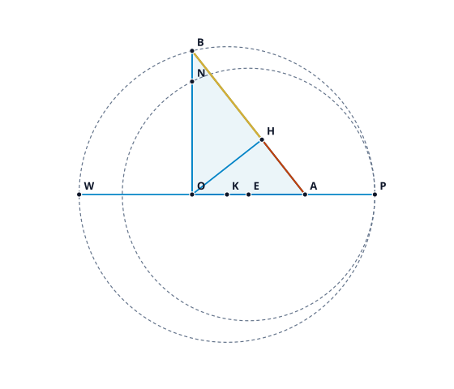

:layout: book
:type: treatise
:order: 1
:title: The 1597 Kepler Right Triangle & Golden Surface Harmony
:featured_image: _static/svg/pyramid/kepler_triangle_2d.svg
:featured_image_alt: The 1597 Kepler Right Triangle (1, √φ, φ)
:categories: great-pyramid
:tags: kepler-triangle, golden-ratio, great-pyramid, herodotus, quartic-field
:excerpt: Johannes Kepler's 1597 right triangle with sides in geometric progression (1, √φ, φ) synthesizing the Pythagorean theorem and the golden ratio, governing the surface geometry of the Great Pyramid.

=======================================================
The 1597 Kepler Right Triangle & Golden Surface Harmony
=======================================================

*Kepler's Two Treasures of Geometry · The Quartic Field · Herodotus's Area Law · The Icosahedral Bridge*

.. epigraph::

   *Si in triangulo rectangulo latera sint in continua proportione geometrica, quadratum basis aequale est rectangulo sub hypotenusa et differentia hypotenusae et basis.*

   *If in a right-angled triangle the sides are in continuous geometric progression, the square on the altitude equals the rectangle under the hypotenuse and the difference between the hypotenuse and the base.*

   — **Johannes Kepler**, *Epistola ad Michaelem Mästlinum* (October 1597)

.. enunciation::

   In October 1597, Johannes Kepler synthesized the Pythagorean Theorem (:math:`a^2 + b^2 = c^2`) and the Divine Proportion (:math:`1 + \phi = \phi^2`) into a singular right-angled triangle whose sides form a continuous geometric progression :math:`(1, \sqrt{\phi}, \phi)`. When this triangle serves as the meridian cross-section of a square pyramid, the square on the vertical height equals the area of each triangular face (:math:`A_{\text{face}} = h^2`), fulfilling Herodotus's ancient architectural enunciation over the quartic number field :math:`\mathbb{Q}(\sqrt{\phi})`.

Kepler's Two Treasures & the Quartic Field Extension
----------------------------------------------------

In October 1597, Johannes Kepler wrote to his former astronomy professor at Tübingen, Michael Mästlin, proposing a singular right-angled triangle that synthesized what he termed the *Two Great Treasures of Geometry*:

1. **The Theorem of Pythagoras** (Euclid *Elements* I.47): :math:`a^2 + b^2 = c^2`.
2. **The Golden Section** (Euclid *Elements* II.11, VI.30): division of a line in extreme and mean ratio, :math:`1 + \phi = \phi^2`.

Kepler posed the question: *Can a right-angled triangle have its three sides in a continuous geometric progression?*

Let the three sides of a right triangle be :math:`a`, :math:`ar`, and :math:`ar^2` where :math:`r > 0` is the common geometric ratio. By the Pythagorean theorem:

.. math::

   a^2 + (ar)^2 = (ar^2)^2 \iff a^2(1 + r^2) = a^2 r^4

Dividing by :math:`a^2 \neq 0`:

.. math::

   r^4 - r^2 - 1 = 0

Substituting :math:`u = r^2`:

.. math::

   u^2 - u - 1 = 0 \implies u = \frac{1 \pm \sqrt{5}}{2}

Since :math:`u = r^2 > 0`, we must choose the positive root, which is identically the golden ratio :math:`\phi`:

.. math::

   r^2 = \phi = \frac{1 + \sqrt{5}}{2} \implies r = \sqrt{\phi}

Normalizing the shortest side to :math:`a = 1`, the three sides of the **Kepler Right Triangle** are:

.. math::

   \text{Base: } 1, \qquad \text{Altitude: } \sqrt{\phi}, \qquad \text{Hypotenuse: } \phi

The Pythagorean relation is satisfied identically by virtue of the golden ratio's defining quadratic equation:

.. math::

   1^2 + (\sqrt{\phi})^2 = 1 + \phi = \phi^2

This triangle lives over the **quartic algebraic extension field**:

.. math::

   \mathbb{Q}(\sqrt{\phi}) = \mathbb{Q}(\sqrt{5}, \sqrt{\phi}) = \{ c_0 + c_1 \sqrt{\phi} + c_2 \phi + c_3 \phi^{3/2} \mid c_i \in \mathbb{Q} \}

The minimal polynomial of :math:`\sqrt{\phi}` over :math:`\mathbb{Q}` is:

.. math::

   P(x) = x^4 - x^2 - 1 = 0

Step-by-Step Compass and Straightedge Euclidean Construction
------------------------------------------------------------

The Kepler triangle is strictly constructible with classical Euclidean straightedge and compass. The exact symbolic implementation is certified in ``geometor.polyhedra.pyramid.build_kepler_triangle_model``:

   *Euclidean straightedge-and-compass construction of the Kepler Right Triangle: unit circle, golden swing circle :math:`c_{EN}` (Euclid II.11), Thales mean semicircle on :math:`WP` (Euclid VI.13), and altitude golden division on hypotenuse :math:`AB`.*

The formal construction steps proceed as follows:

1. **Unit Circle and Given Baseline**:
   Establish the origin :math:`O(0, 0)`, unit east point :math:`A(1, 0)`, west point :math:`W(-1, 0)`, and north point :math:`N(0, 1)`. Establish midpoint :math:`E(1/2, 0)`.

2. **Euclid II.11 Golden Swing**:
   Construct circle :math:`c(E, N)` centered at :math:`E` passing through :math:`N`. The quadrance from :math:`E` to :math:`N` is:

   .. math::

      Q(E, N) = \left(\frac{1}{2}\right)^2 + 1^2 = \frac{1}{4} + 1 = \frac{5}{4} \implies |EN| = \frac{\sqrt{5}}{2}

   Circle :math:`c(E, N)` intersects the positive horizontal axis at point :math:`P`:

   .. math::

      x_P = \frac{1}{2} + \frac{\sqrt{5}}{2} = \phi \implies P(\phi, 0)

3. **Baseline Segment :math:`WP` of Length :math:`\phi^2`**:
   The segment :math:`WP` spans from :math:`W(-1, 0)` to :math:`P(\phi, 0)`. Its total length is:

   .. math::

      |WP| = 1 + \phi = \phi^2

   The midpoint of :math:`WP` is :math:`K`:

   .. math::

      K\left(\frac{\phi - 1}{2}, 0\right) = K\left(\frac{1}{2\phi}, 0\right)

4. **Thales Mean Semicircle (Euclid VI.13)**:
   Construct circle :math:`c(K, P)` with diameter :math:`WP` and radius :math:`R = \frac{\phi^2}{2}`. By the classical intersecting chord theorem (Euclid VI.13), the perpendicular ordinate erected at :math:`O(0, 0)` satisfies:

   .. math::

      |OB|^2 = |WO| \cdot |OP| = 1 \cdot \phi = \phi \implies |OB| = \sqrt{\phi}

   Circle :math:`c(K, P)` intersects the positive vertical axis at vertex :math:`B(0, \sqrt{\phi})`.

5. **The Kepler Triangle :math:`\triangle OAB`**:
   Connecting :math:`O(0, 0)`, :math:`A(1, 0)`, and :math:`B(0, \sqrt{\phi})` forms the right triangle :math:`\triangle OAB` with:

   .. math::

      |OA| = 1, \qquad |OB| = \sqrt{\phi}, \qquad |AB| = \sqrt{1^2 + (\sqrt{\phi})^2} = \sqrt{1 + \phi} = \phi

Exact Altitude Division: Golden Major and Minor on the Hypotenuse
-----------------------------------------------------------------

Let :math:`H` be the foot of the perpendicular altitude dropped from the right angle vertex :math:`O(0, 0)` onto hypotenuse :math:`AB`.

In any right triangle with legs :math:`a`, :math:`b` and hypotenuse :math:`c`, the altitude length :math:`h_c` and segment projections :math:`p = |BH|` and :math:`q = |HA|` satisfy:

.. math::

   p = \frac{b^2}{c}, \qquad q = \frac{a^2}{c}, \qquad h_c = \frac{ab}{c}

For the Kepler triangle with :math:`a = |OA| = 1`, :math:`b = |OB| = \sqrt{\phi}`, and :math:`c = |AB| = \phi`:

.. math::

   |BH| = \frac{(\sqrt{\phi})^2}{\phi} = \frac{\phi}{\phi} = 1

.. math::

   |HA| = \frac{1^2}{\phi} = \frac{1}{\phi} = \phi - 1 = \phi^{-1}

.. math::

   |OH| = \frac{1 \cdot \sqrt{\phi}}{\phi} = \frac{1}{\sqrt{\phi}} = \sqrt{\phi^{-1}}

This reveals an astonishing theorem:

.. important::

   **The Kepler Altitude Golden Division Theorem**:

   The altitude foot :math:`H` divides the hypotenuse :math:`AB` of length :math:`\phi` in **extreme and mean ratio**:

   - The major segment is :math:`|BH| = 1` (identically equal to base :math:`OA`);
   - The minor segment is :math:`|HA| = \phi^{-1} = \phi - 1`;
   - The ratio of lengths is :math:`\frac{|BH|}{|HA|} = \frac{1}{\phi^{-1}} = \phi`;
   - The ratio of exact quadrances certified in ``geometor.polyhedra.pyramid`` is:

   .. math::

      \frac{Q(B, H)}{Q(H, A)} = \frac{1^2}{(\phi^{-1})^2} = \phi^2 = \phi + 1

The Herodotus–Taylor–Röber Face Area Law
----------------------------------------

In Book II, Chapter 124 of his *Histories*, Herodotus recorded the dimensions and construction rule of the Great Pyramid given to him by Egyptian priests at Memphis:

.. epigraph::

   *The pyramid was built so that the area of each lateral triangular face equals the square of the pyramid's vertical height.*

In 1859, British publisher and polymath John Taylor rediscovered this principle in *The Great Pyramid: Why Was It Built? & Who Built It?*, and in 1855, German architect Friedrich Röber independently demonstrated that this area equality forces the meridian cross-section to be identically the **Kepler Right Triangle**.

.. admonition:: Proof

   Consider a square pyramid with half-base :math:`a = 1`, base side :math:`2a = 2`, apex height :math:`h`, and face apothem :math:`s = \sqrt{a^2 + h^2} = \sqrt{1 + h^2}`.

   1. The area of one lateral triangular face is:

      .. math::

         A_{\text{face}} = \frac{1}{2} \times \text{base} \times \text{apothem} = \frac{1}{2}(2)(s) = s

   2. The square of the vertical height is:

      .. math::

         h^2

   3. Equating :math:`A_{\text{face}} = h^2`:

      .. math::

         s = h^2 \implies \sqrt{1 + h^2} = h^2

   4. Squaring both sides:

      .. math::

         1 + h^2 = h^4 \iff (h^2)^2 - (h^2) - 1 = 0

   5. Since :math:`h > 0`, :math:`h^2` must be the positive root of the golden quadratic:

      .. math::

         h^2 = \phi = \frac{1 + \sqrt{5}}{2} \implies h = \sqrt{\phi}

   6. The apothem is then:

      .. math::

         s = \sqrt{1 + h^2} = \sqrt{1 + \phi} = \sqrt{\phi^2} = \phi

   Thus, Herodotus's area condition is **necessary and sufficient** to determine the Kepler Golden Pyramid profile over :math:`\mathbb{Q}(\sqrt{\phi})`.

The Continuous Golden Surface Chain: 1 : φ : φ²
-----------------------------------------------

When the square base side is :math:`2` and apothem is :math:`\phi`, the surface areas of the Kepler Pyramid form a continuous geometric progression in :math:`\phi`:

1. **Base Area**:
   The square base has side :math:`2`:

   .. math::

      A_{\text{base}} = 2^2 = 4

2. **Total Lateral Area**:
   The pyramid has four triangular faces of area :math:`A_{\text{face}} = \phi`:

   .. math::

      A_{\text{lateral}} = 4 \times A_{\text{face}} = 4\phi

3. **Total Surface Area**:
   Summing the base and lateral faces:

   .. math::

      A_{\text{total}} = A_{\text{base}} + A_{\text{lateral}} = 4 + 4\phi = 4(1 + \phi) = 4\phi^2

Dividing throughout by :math:`4`:

.. math::

   A_{\text{base}} : A_{\text{lateral}} : A_{\text{total}} = 4 : 4\phi : 4\phi^2 = 1 : \phi : \phi^2

Furthermore, the additive law of the golden section:

.. math::

   1 + \phi = \phi^2 \iff A_{\text{base}} + A_{\text{lateral}} = A_{\text{total}}

This reveals that the Kepler Golden Pyramid is the unique square pyramid whose total surface area is divided between base and sides in the Divine Proportion.

The Icosahedron Circumradius Bridge over Q(φ)
---------------------------------------------

A profound and unexpected connection links the Kepler Golden Pyramid directly to the Platonic **Regular Icosahedron** :math:`\{3, 5\}`.

In Cartesian 3-space, place the Kepler Golden Pyramid with base corners at :math:`(\pm 1, \pm 1, 0)` and apex at :math:`(0, 0, \sqrt{\phi})`:

1. **Pyramid Lateral Corner Edge Quadrance**:
   The lateral edge vector :math:`\mathbf{e}` joins base corner :math:`(1, 1, 0)` to apex :math:`(0, 0, \sqrt{\phi})`:

   .. math::

      \mathbf{e} = (-1, -1, \sqrt{\phi})

   Its exact quadrance is:

   .. math::

      Q_{\text{edge}} = (-1)^2 + (-1)^2 + (\sqrt{\phi})^2 = 1 + 1 + \phi = \phi + 2

2. **Regular Icosahedron Circumradius Quadrance**:
   Recall the canonical twelve vertices of the regular icosahedron centered at :math:`(0, 0, 0)`:

   .. math::

      (0, \pm 1, \pm \phi), \quad (\pm \phi, 0, \pm 1), \quad (\pm 1, \pm \phi, 0)

   The circumquadrance of any vertex is:

   .. math::

      Q_{\text{out}} = 0^2 + (\pm 1)^2 + (\pm \phi)^2 = 1 + \phi^2 = 1 + (\phi + 1) = \phi + 2

.. note::

   **The Kepler–Icosahedron Identity**:

   .. math::

      Q_{\text{edge}}(\text{Kepler Pyramid}) = Q_{\text{out}}(\text{Regular Icosahedron}) \equiv \phi + 2

   The length of the corner edge of a Kepler Pyramid with unit half-base equals **identically** the circumradius of the canonical Platonic Icosahedron:

   .. math::

      e = \sqrt{\phi + 2} \approx 1.902113032590307

   This exact symbolic identity is certified in ``geometor.polyhedra.pyramid.verify_kepler_pyramid_identities()``.

Canonical Solid Codex
---------------------

For the complete interactive 3D model, exact symbolic coordinates over :math:`\mathbb{Q}(\sqrt{\phi})`, face normals, and dihedral angles, consult the canonical pyramid codex:

- :doc:`Kepler Golden Pyramid </solids/05-pyramids/kepler-pyramid/index>`
