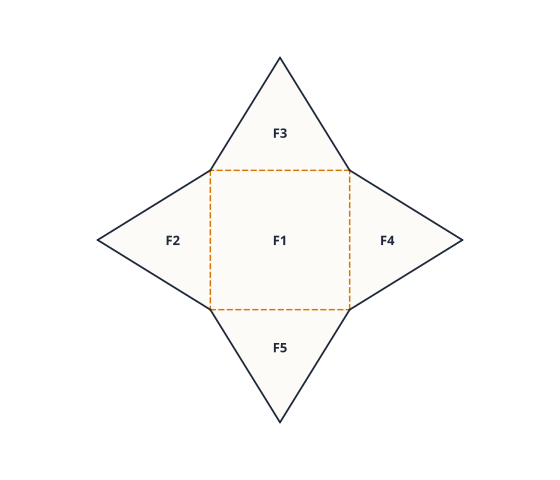
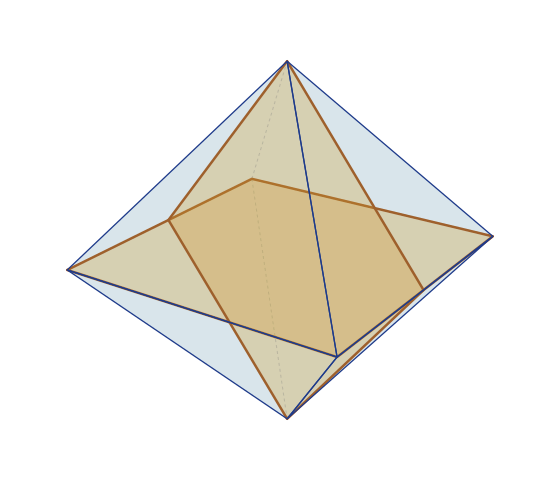

:layout: book
:title: Egyptian Seked Mensuration, 3D Spreads & Polyhedral Relatives

=============================================================
Egyptian Seked Mensuration, 3D Spreads & Polyhedral Relatives
=============================================================

*The Royal Cubit · Rhind Papyrus Seked 5½ · Rational Trigonometry · Leonardo's Vacua · Golden Bipyramid*

.. epigraph::

   *If a pyramid is 250 cubits high and the side of its base 360 cubits long, what is its seked? Take 1/2 of 360, it makes 180. Multiply 180 by 7, it makes 1260. Divide 1260 by 250, it makes 5 1/25 palms. This is its seked.*

   — **Ahmes the Scribe**, *Rhind Mathematical Papyrus* (c. 1550 BCE), Problem 56

The Old Kingdom Royal Cubit & Rhind Mathematical Papyrus
--------------------------------------------------------

Ancient Egyptian architectural mensuration was governed by the **Royal Cubit** (*meh niswt*), the standard metrological unit of Old Kingdom monumental construction:

.. math::

   1 \text{ Royal Cubit} = 7 \text{ palms} = 28 \text{ digits} \qquad (1 \text{ palm} = 4 \text{ digits})

The slope of an inclined masonry face was not measured by an angular degree (:math:`^\circ`), which was unknown to Egyptian geometry, but by the **seked** (*sqd*).

As formalized in Problems 56 to 60 of the **Rhind Mathematical Papyrus** (British Museum EA 10057/8), the seked expresses the horizontal setback (in palms and digits) per vertical rise of one Royal Cubit:

.. math::

   \text{seked} = 7 \times \cot\alpha = 7 \times \frac{\text{half-base}}{\text{height}}

For a pyramid with half-base :math:`a` and vertical height :math:`h`, the slope angle :math:`\alpha` satisfies:

.. math::

   \tan\alpha = \frac{h}{a}, \qquad \cot\alpha = \frac{a}{h} \implies \text{seked} = 7 \times \frac{a}{h} \text{ palms}

Flinders Petrie's 1883 Survey and the Historical Seked 5½
---------------------------------------------------------

In 1880–1882, Sir William Matthew Flinders Petrie conducted the first modern scientific triangulation survey of the Giza plateau, published in *The Pyramids and Temples of Gizeh* (1883).

Petrie established the baseline parameters of the Great Pyramid of Khufu:

- **Mean Base Side Length**: :math:`9068.8 \pm 0.5 \text{ inches}` (:math:`230.36 \text{ m}`);
- **Original Apex Height**: :math:`5776.0 \pm 7.0 \text{ inches}` (:math:`146.71 \text{ m}`);
- **Calculated Royal Cubit Length**: :math:`20.620 \pm 0.005 \text{ inches}` (:math:`52.375 \text{ cm}`).

Dividing the dimensions by the Royal Cubit length gives the intended integer blueprint of the Fourth Dynasty royal architect Hemiunu:

.. math::

   \text{Base Side: } 2a = 440 \text{ Royal Cubits} \implies a = 220 \text{ Royal Cubits}

.. math::

   \text{Apex Height: } h = 280 \text{ Royal Cubits}

The ratio of vertical height to half-base is:

.. math::

   \frac{h}{a} = \frac{280}{220} = \frac{14}{11} \approx 1.2727273

The resulting Egyptian seked is:

.. math::

   \text{seked} = 7 \times \frac{220}{280} = 7 \times \frac{11}{14} = \frac{77}{14} = \frac{11}{2} = 5\frac{1}{2} \text{ palms}

Expressed in digits (:math:`1 \text{ palm} = 4 \text{ digits}`):

.. math::

   \text{seked} = 5\frac{1}{2} \times 4 = 22 \text{ digits of horizontal setback per 28 digits (1 cubit) of vertical rise}

The casing stone slope angle measured by Petrie on surviving in-situ Tura limestone casing blocks was :math:`51^\circ 52' \pm 2'`. The exact seked :math:`14:11` angle is:

.. math::

   \alpha_{\text{seked}} = \arctan\left(\frac{14}{11}\right) \approx 51^\circ 50' 34'' \qquad (51.8428^\circ)

matching the archaeological casing stones to within less than two minutes of arc!

Exact 3D Rational Trigonometry of Square Pyramids
-------------------------------------------------

In **Rational Trigonometry** (Wildberger, *Divine Proportions*, 2005), transcendental trigonometric functions (:math:`\cos, \sin, \tan`) and angle measures are replaced by algebraic **quadrances** (squared distances) and **spreads** (squared sines of angles):

.. math::

   s(\theta) \equiv \sin^2\theta = \frac{Q_{\text{opposite}}}{Q_{\text{hypotenuse}}} \in [0, 1]

For a square pyramid with unit half-base :math:`a = 1` and vertical apex height :math:`h`, all 3D angular relationships evaluate to exact rational numbers over :math:`\mathbb{Q}` or closed-form expressions over :math:`\mathbb{Q}(\phi)`:

1. Face Slope Spread :math:`s_{\text{slope}}`
~~~~~~~~~~~~~~~~~~~~~~~~~~~~~~~~~~~~~~~~~~~~~

The meridian right triangle has base :math:`1`, height :math:`h`, and apothem hypotenuse :math:`s = \sqrt{1 + h^2}`:

.. math::

   s_{\text{slope}} = \sin^2\alpha = \frac{h^2}{1 + h^2}

- **Kepler Golden Pyramid** (:math:`h^2 = \phi`):

  .. math::

     s_{\text{slope}} = \frac{\phi}{1 + \phi} = \frac{\phi}{\phi^2} = \phi^{-1} = \phi - 1 \approx 0.6180339887

  *The slope spread equals identically the reciprocal of the golden ratio!*

- **Seked 14:11 Pyramid** (:math:`h = 14/11 \implies h^2 = 196/121`):

  .. math::

     s_{\text{slope}} = \frac{196/121}{1 + 196/121} = \frac{196}{121 + 196} = \frac{196}{317} \approx 0.61829653

- **Half-Octahedron** (:math:`h = \sqrt{2} \implies h^2 = 2`):

  .. math::

     s_{\text{slope}} = \frac{2}{1 + 2} = \frac{2}{3} \approx 0.66666667

2. Adjacent-Face Dihedral Spread :math:`s_{\text{adj}}`
~~~~~~~~~~~~~~~~~~~~~~~~~~~~~~~~~~~~~~~~~~~~~~~~~~~~~~~

Let :math:`\mathbf{n}_E = (h, 0, 1)` and :math:`\mathbf{n}_N = (0, h, 1)` be normal vectors to the East and North lateral faces. Their quadrances and dot product are:

.. math::

   Q(\mathbf{n}_E) = Q(\mathbf{n}_N) = h^2 + 1, \qquad \mathbf{n}_E \cdot \mathbf{n}_N = 1

The spread between the planes of adjacent faces is:

.. math::

   s_{\text{adj}} = 1 - \cos^2\delta = 1 - \frac{(\mathbf{n}_E \cdot \mathbf{n}_N)^2}{Q(\mathbf{n}_E) Q(\mathbf{n}_N)} = 1 - \frac{1}{(1 + h^2)^2} = \frac{h^4 + 2h^2}{(1 + h^2)^2}

- **Kepler Golden Pyramid** (:math:`h^2 = \phi \implies 1 + h^2 = \phi^2`, :math:`h^4 = \phi^2`):

  .. math::

     s_{\text{adj}} = \frac{\phi^2 + 2\phi}{\phi^4} = \frac{\phi + 2}{\phi^3} = \frac{\phi + 2}{2\phi + 1} = 3\phi - 4 \approx 0.854101966

  *An exact linear expression in :math:`\mathbb{Q}(\phi)`!*

- **Seked 14:11 Pyramid** (:math:`h^2 = 196/121`):

  .. math::

     1 + h^2 = \frac{317}{121} \implies s_{\text{adj}} = 1 - \frac{121^2}{317^2} = \frac{100489 - 14641}{100489} = \frac{85848}{100489} \approx 0.85430246

- **Half-Octahedron** (:math:`h^2 = 2`):

  .. math::

     1 + h^2 = 3 \implies s_{\text{adj}} = 1 - \frac{1}{9} = \frac{8}{9} \approx 0.88888889

3. Opposite-Apothem Apex Spread :math:`s_{\text{apex}}`
~~~~~~~~~~~~~~~~~~~~~~~~~~~~~~~~~~~~~~~~~~~~~~~~~~~~~~~

The meridian triangle across opposite faces has base :math:`2`, height :math:`h`, and apex angle :math:`2\beta` with :math:`\beta = 90^\circ - \alpha`:

.. math::

   \sin(2\beta) = 2 \sin\beta \cos\beta = 2 \left(\frac{1}{\sqrt{1 + h^2}}\right) \left(\frac{h}{\sqrt{1 + h^2}}\right) = \frac{2h}{1 + h^2}

.. math::

   s_{\text{apex}} = \sin^2(2\beta) = \frac{4h^2}{(1 + h^2)^2}

- **Kepler Golden Pyramid**:

  .. math::

     s_{\text{apex}} = \frac{4\phi}{\phi^4} = \frac{4}{\phi^3} = 4\phi^{-3} = 8\phi - 12 \approx 0.94427191

- **Seked 14:11 Pyramid**:

  .. math::

     s_{\text{apex}} = \frac{4 \times (196/121)}{(317/121)^2} = \frac{784 \times 121}{100489} = \frac{94864}{100489} \approx 0.94402372

- **Half-Octahedron**:

  .. math::

     s_{\text{apex}} = \frac{4 \times 2}{3^2} = \frac{8}{9} \approx 0.88888889

.. note::

   In the Half-Octahedron, the adjacent dihedral spread and the opposite apex spread are **identically equal**:

   .. math::

      s_{\text{adj}} = s_{\text{apex}} = \frac{8}{9}

The Unfolded 2D Star Net of the Golden Pyramid
----------------------------------------------

The papercraft net of the square pyramid consists of a central square base surrounded by four hinged isosceles triangular faces:

   *Unfolded 2D star net layout of the Kepler Golden Pyramid: central :math:`2 \times 2` square base (Face 1) unfolded along dashed interior hinge lines to four golden-apothem isosceles faces (:math:`s = \phi`, Faces 2–5).*

In the Kepler net:

- Base: :math:`2 \times 2` square (:math:`A_{\text{base}} = 4`).
- Four triangular petals: base :math:`2`, altitude :math:`s = \phi`, lateral edge :math:`e = \sqrt{\phi + 2}`.
- Face area of each petal: :math:`A = \frac{1}{2}(2)(\phi) = \phi`.
- Total unfolded net area: :math:`4 + 4\phi = 4\phi^2`.

Leonardo da Vinci's Pyramis Quadrata Vacua (Genus g = 4)
--------------------------------------------------------

In Luca Pacioli's *De Divina Proportione* (Venice, 1509), Leonardo da Vinci introduced the **vacuated polyhedral form** (*corpus vacuum*): replacing opaque facets with hollow, mitered timber beams to reveal the internal geometric structure of three-dimensional solids.

For a square pyramid with aperture ratio :math:`\mu = 3/4` and shell thickness :math:`\tau = 7/8`, the vacuation operator:

.. math::

   \text{vacuate}(\text{Solid3D}, \text{aperture}=3/4, \text{shell}=7/8)

hollows out the square base and four lateral triangular faces, converting the solid into a **3D orientable manifold with five portals**:

- 1 square portal in the base;
- 4 triangular portals in the lateral faces;
- The topological Euler characteristic is:

  .. math::

     \chi = V - E + F = 2 - 2g \implies g = 1 - \frac{\chi}{2}

  With :math:`\chi = -6`, the vacuated pyramid is a manifold of **genus :math:`g = 4`** (four through-holes linking the five portals).

The Golden Square Bipyramid vs. The Regular Octahedron
------------------------------------------------------

Reflecting the Kepler Golden Pyramid across its square base :math:`z = 0` produces the **Golden Square Bipyramid**:

   *The 3D Kepler Golden Square Bipyramid with equatorial square :math:`z = 0` and vertical meridian lozenge highlighted in luminous gold.*

The Golden Square Bipyramid has:

- **6 Vertices**: :math:`(\pm 1, \pm 1, 0)` on the equator, :math:`(0, 0, \sqrt{\phi})` at the North apex, and :math:`(0, 0, -\sqrt{\phi})` at the South apex;
- **12 Edges**: 4 equatorial edges of length :math:`2`, 8 polar edges of length :math:`\sqrt{\phi + 2}`;
- **8 Faces**: 8 congruent isosceles triangles of base :math:`2` and altitude :math:`\phi`;
- **Total Surface Area**: :math:`8\phi \approx 12.94427`.

Master Comparison: Bipyramid vs. Platonic Octahedron
~~~~~~~~~~~~~~~~~~~~~~~~~~~~~~~~~~~~~~~~~~~~~~~~~~~~

Both solids share the octahedroid combinatorial graph :math:`K_{2,2,2}` (6 vertices, 12 edges, 8 faces):

.. list-table::
   :header-rows: 1
   :widths: 25 35 40

   * - Geometric Parameter
     - Regular Octahedron :math:`\{3, 4\}`
     - Golden Square Bipyramid
   * - **Apex Height :math:`h`**
     - :math:`\sqrt{2} \approx 1.41421`
     - :math:`\sqrt{\phi} \approx 1.27202`
   * - **Face Geometry**
     - Equilateral triangles (:math:`2 \times 2 \times 2`)
     - Isosceles triangles (:math:`2 \times \sqrt{\phi+2} \times \sqrt{\phi+2}`)
   * - **Face Apothem :math:`s`**
     - :math:`\sqrt{3} \approx 1.73205`
     - :math:`\phi \approx 1.61803`
   * - **Face Area**
     - :math:`\sqrt{3} \approx 1.73205`
     - :math:`\phi \approx 1.61803`
   * - **Total Surface Area**
     - :math:`8\sqrt{3} \approx 13.85641`
     - :math:`8\phi \approx 12.94427`
   * - **Volume :math:`V`**
     - :math:`\frac{8\sqrt{2}}{3} \approx 3.77124`
     - :math:`\frac{8\sqrt{\phi}}{3} \approx 3.39205`
   * - **Symmetry Group**
     - Full Octahedral :math:`O_h` (order 48)
     - Square Tetragonal :math:`D_{4h}` (order 16)
   * - **Underlying Field**
     - :math:`\mathbb{Q}(\sqrt{2}, \sqrt{3})`
     - :math:`\mathbb{Q}(\sqrt{\phi})`

The Regular Octahedron represents maximal spherical symmetry with equilateral faces; the Golden Square Bipyramid represents the unique polyhedral embedding where every face apothem is the Divine Proportion :math:`\phi`, unifying Egyptian monumentality with Platonic solid geometry.
