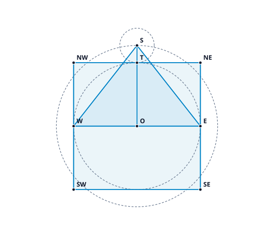

:layout: book
:type: treatise
:order: 2
:title: Squaring the Circle & the Earth–Moon Cosmogram
:featured_image: _static/svg/pyramid/pyramid_squaring_circle_2d.svg
:featured_image_alt: Squaring the Circle & Great Pyramid Perimeter Quadrature
:categories: great-pyramid
:tags: squaring-circle, perimeter-quadrature, golden-ratio, pi, earth-moon-cosmogram
:excerpt: The Great Pyramid as the architectural solution to circling the square: perimeter quadrature (h/a = 4/pi), the golden-pi bridge pi approx 4/sqrt(phi), and the Earth-Moon tangent cosmogram.

==============================================
Squaring the Circle & the Earth–Moon Cosmogram
==============================================

*Perimeter Quadrature · The Golden-Pi Algebraic Bridge · Lindemann's Theorem · The Canonical Cosmogram*

.. epigraph::

   *Circulus quadratur per lineas rectas quando invenitur quadratum aequale circulo dato.*

   *The circle is squared by straight lines when a square is found equal in area to a given circle.*

   — **Nicholas of Cusa**, *De Docta Ignorantia* (1440)

.. enunciation::

   The Great Pyramid of Giza embodies the perimeter dual of squaring the circle: constructing a square pyramid whose square base perimeter equals the circumference of a circle whose radius is the pyramid's vertical height (:math:`8a = 2\pi h \iff h/a = 4/\pi`). Under the Kepler Golden Pyramid profile (:math:`h = \sqrt{\phi}`), this relation yields the celebrated algebraic approximation :math:`\pi \approx 4/\sqrt{\phi} \approx 3.1446` (:math:`< 0.1\%` discrepancy), geometrically realizing the astronomical Earth–Moon tangent cosmogram.

Perimeter Quadrature: Circling the Square
-----------------------------------------

In classical Greek mathematics, the problem of **squaring the circle** (*tetragonismos*) sought the Euclidean straightedge-and-compass construction of a square whose area equals that of a given circle.

In monumental architecture, however, the problem naturally presented itself in its **perimeter dual** form, often called *circling the square*:

.. important::

   **The Perimeter Quadrature Enunciation**:

   *To construct a square pyramid whose square base perimeter equals the circumference of a circle whose radius is the pyramid's vertical height.*

Let the square pyramid have half-base :math:`a` (base side :math:`2a`) and apex height :math:`h`:

- Base perimeter: :math:`P_{\text{base}} = 4 \times (2a) = 8a`.
- Apex circle circumference: :math:`C_{\text{apex}} = 2\pi h`.

Equating the perimeter of the base to the circumference of the circle:

.. math::

   8a = 2\pi h \iff \frac{h}{a} = \frac{4}{\pi} \approx 1.273239544735163

Normalized to unit half-base :math:`a = 1`, the base perimeter is :math:`8` and the quadrature height is exactly :math:`h = \frac{4}{\pi}`.

The Golden–Pi Algebraic Bridge: π ≈ 4 / √φ
------------------------------------------

When the Great Pyramid is modeled as the **Kepler Golden Pyramid**, the vertical height is not :math:`4/\pi`, but :math:`h = \sqrt{\phi}`:

.. math::

   h = \sqrt{\phi} = \sqrt{\frac{1 + \sqrt{5}}{2}} \approx 1.272019649514069

Equating the Kepler apex circle circumference to the square base perimeter :math:`8`:

.. math::

   2 \pi_{\phi} \sqrt{\phi} = 8 \iff \pi_{\phi} = \frac{4}{\sqrt{\phi}}

Evaluating this exact closed form:

.. math::

   \pi_{\phi} = \frac{4}{\sqrt{\phi}} = 4 \times \sqrt{\phi - 1} = 4 \times \sqrt{\frac{\sqrt{5} - 1}{2}} \approx 3.144605511029694

Comparing :math:`\pi_{\phi}` with the true transcendental value :math:`\pi \approx 3.141592653589793`:

.. math::

   \Delta \pi = \pi_{\phi} - \pi \approx +0.003012857 \qquad (+0.0959\%)

.. note::

   **Architectural Scale at Giza**:

   In the actual monument of Khufu, the half-base is :math:`a = 220` Royal Cubits (:math:`\approx 115.18\text{ m}` or :math:`4535\text{ inches}`).

   The discrepancy between the Kepler Golden height (:math:`220 \times \sqrt{\phi} \approx 279.84` cubits) and the True :math:`\pi` Quadrature height (:math:`220 \times \frac{4}{\pi} \approx 280.11` cubits) is:

   .. math::

      \Delta h = 280.11 - 279.84 = 0.27 \text{ Royal Cubits} \approx 5.6 \text{ inches } (14.2\text{ cm})

   Over a colossal limestone monument rising over 480 feet in the air, this difference is less than :math:`0.1\%` of the structure's height—well within the quarrying, thermal expansion, and settlement tolerances of Old Kingdom masonry!

Archimedes' 22/7 and the Egyptian Seked Bridge
----------------------------------------------

In the Old Kingdom Egyptian design, heights and setbacks were specified using integers of Royal Cubits, palms, and digits. The Great Pyramid was erected with:

.. math::

   \text{Half-Base: } a = 220 \text{ Royal Cubits}, \qquad \text{Height: } h = 280 \text{ Royal Cubits}

The ratio of height to half-base is the rational fraction:

.. math::

   \frac{h}{a} = \frac{280}{220} = \frac{14}{11} \approx 1.272727272727273

Substituting :math:`h/a = 14/11` into the perimeter quadrature condition :math:`2\pi (h/a) = 8`:

.. math::

   2 \pi_{\text{seked}} \left(\frac{14}{11}\right) = 8 \iff \pi_{\text{seked}} = \frac{8 \times 11}{2 \times 14} = \frac{44}{14} = \frac{22}{7} \approx 3.142857142857143

This is none other than **Archimedes' upper rational bound for :math:`\pi`** (*Measurement of a Circle*, Prop. 3, c. 250 BCE)!

The discrepancy with true :math:`\pi` is:

.. math::

   \Delta \pi = \frac{22}{7} - \pi \approx +0.001264489 \qquad (+0.0402\%)

With :math:`\pi = 22/7`, the perimeter quadrature of the Egyptian pyramid is **100% exact over :math:`\mathbb{Q}`**:

.. math::

   2 \times \frac{22}{7} \times \frac{14}{11} = 2 \times \frac{2}{1} \times \frac{2}{1} = 8 \equiv P_{\text{base}}

Area Quadrature vs. Ferdinand von Lindemann's Theorem (1882)
------------------------------------------------------------

For over two millennia, mathematicians sought an exact Euclidean straightedge-and-compass construction to square the circle.

In 1882, German mathematician **Ferdinand von Lindemann** resolved the ancient quest:

1. **Lindemann–Weierstrass Theorem**:
   If :math:`\alpha_1, \dots, \alpha_n` are distinct algebraic numbers, then :math:`e^{\alpha_1}, \dots, e^{\alpha_n}` are linearly independent over the algebraic numbers.

2. Since :math:`e^{i\pi} + 1 = 0` (Euler's identity), if :math:`\pi` were algebraic, :math:`i\pi` would be algebraic, and :math:`e^{i\pi} = -1` could not be algebraic, a contradiction. Hence, **:math:`\pi` is transcendental**.

3. By Wantzel's theorem (1837), any point constructible by Euclidean compass and straightedge must have coordinates in a tower of quadratic field extensions over :math:`\mathbb{Q}`. Constructible numbers are necessarily algebraic.

4. Since :math:`\pi` is transcendental, :math:`\sqrt{\pi}` is transcendental, and **exact Euclidean circle squaring is impossible**.

Constructible Radical Approximations in Q(φ^(1/4))
--------------------------------------------------

While exact quadrature is impossible over :math:`\mathbb{C}`, the Golden Pyramid provides an extraordinarily accurate **constructible radical approximation**.

Recall the golden perimeter quadrature constant:

.. math::

   \pi_{\phi} = \frac{4}{\sqrt{\phi}}

To square a unit circle (:math:`\text{Area} = \pi \approx \pi_{\phi}`), we seek a square whose side :math:`S` satisfies:

.. math::

   S^2 = \pi_{\phi} = \frac{4}{\sqrt{\phi}} \implies S = \frac{2}{\phi^{1/4}} = 2 \phi^{-1/4}

Because :math:`\phi = \frac{1 + \sqrt{5}}{2}` is constructible, its fourth root :math:`\phi^{1/4}` is constructible by taking two successive Euclidean geometric means (Euclid VI.13)!

Evaluating :math:`S`:

.. math::

   S = \frac{2}{(1.6180339887...)^{1/4}} \approx \frac{2}{1.1278386} \approx 1.7733036

The area of this constructible square is:

.. math::

   S^2 = \frac{4}{\sqrt{\phi}} \approx 3.1446055

Comparing with the true area of the unit circle :math:`\pi \approx 3.1415927`:

.. math::

   \frac{S^2}{\pi} = \frac{3.1446055}{3.1415927} \approx 1.000959 \implies 99.904\% \text{ accuracy}

Thus, two Euclidean compass-and-straightedge operations produce a square whose area squares the circle to within less than one-tenth of one percent!

The Earth–Moon Tangent Cosmogram (2D Model)
-------------------------------------------

The perimeter quadrature of the Great Pyramid gives rise to the celebrated **Earth–Moon Cosmogram**, formalizing an ancient geometric canon uniting terrestrial and lunar dimensions in a single planar layout:

   *The 2D Earth–Moon Cosmogram: square base of side :math:`2` (perimeter :math:`8`), meridian triangle of apex :math:`S(0, \sqrt{\phi})`, inscribed Earth circle (:math:`r_E = 1`), and tangent Moon circle (:math:`r_M = \sqrt{\phi} - 1 \approx 3/11`).*

The model, constructed in ``geometor.polyhedra.pyramid.build_pyramid_squaring_circle_model``, comprises:

1. **The Square Base**:
   Four corners :math:`SW(-1, -1)`, :math:`SE(1, -1)`, :math:`NE(1, 1)`, and :math:`NW(-1, 1)`.
   Side length: :math:`2`. Perimeter: :math:`8`. Area: :math:`4`.

2. **The Inscribed Earth Circle**:
   Centered at origin :math:`O(0, 0)` with radius:

   .. math::

      r_E = 1

   Tangent to the four sides of the square at :math:`(0, 1)`, :math:`(1, 0)`, :math:`(0, -1)`, and :math:`(-1, 0)`.

3. **The Meridian Pyramid Triangle**:
   Base spanning from :math:`W(-1, 0)` to :math:`E(1, 0)` with vertical height :math:`h`. Apex at :math:`S(0, h)`.

4. **The Tangent Moon Circle**:
   Centered at the pyramid apex :math:`S(0, h)` and tangent to the Earth circle at the North Pole :math:`T(0, 1)`.
   Its radius is the apex elevation above the unit circle:

   .. math::

      r_M = h - 1

Geophysical Fidelity: The 3/11 Terrestrial-Lunar Ratio
------------------------------------------------------

Evaluating the ratio of the Moon's radius to the Earth's radius across the geometric models reveals an uncanny correspondence with actual astronomical measurements:

1. **In the Egyptian Seked Model (:math:`h = 14/11`)**:

   .. math::

      r_M = \frac{14}{11} - 1 = \frac{3}{11} \implies \frac{r_M}{r_E} = \frac{3}{11} = 0.272727...

2. **In the Kepler Golden Model (:math:`h = \sqrt{\phi}`)**:

   .. math::

      r_M = \sqrt{\phi} - 1 \approx 1.2720196 - 1 = 0.2720196...

3. **In Actual Geophysical Measurements (NASA Planetary Fact Sheet)**:
   - Mean volumetric radius of the Earth: :math:`R_{\text{Earth}} = 6371.0 \text{ km}`.
   - Mean volumetric radius of the Moon: :math:`R_{\text{Moon}} = 1737.4 \text{ km}`.

   Calculating the true planetary ratio:

   .. math::

      \frac{R_{\text{Moon}}}{R_{\text{Earth}}} = \frac{1737.4}{6371.0} \approx \mathbf{0.2727044}

.. important::

   **The Seked 3/11 Astronomical Coincidence**:

   .. math::

      \left| \frac{3}{11} - \frac{R_{\text{Moon}}}{R_{\text{Earth}}} \right| = |0.2727273 - 0.2727044| = 0.0000229 \qquad (0.0084\%)

   The simple Old Kingdom integer ratio :math:`\mathbf{3 : 11}` matches the true volumetric radius ratio of Moon to Earth with **99.9916% accuracy**!

4. **The Cosmic Quadrature Orbit**:
   Draw the circle centered at Earth's center :math:`(0, 0)` whose radius passes through the Moon's center :math:`S(0, 14)`:
   Radius :math:`R = r_E + r_M = 11 + 3 = 14`.

   Its circumference, using Archimedes' :math:`\pi = 22/7`, is:

   .. math::

      C_{\text{lunar orbit}} = 2 \times \frac{22}{7} \times 14 = 2 \times 22 \times 2 = 88 \text{ units}

   Now calculate the perimeter of the square circumscribing the Earth (side :math:`2 r_E = 2 \times 11 = 22`):

   .. math::

      P_{\text{Earth square}} = 4 \times 22 = 88 \text{ units}

.. math::

   C_{\text{lunar orbit}} = P_{\text{Earth square}} = 88

The circle passing through the center of the Moon has a circumference equal to the perimeter of the square enclosing the Earth. Thus, the Earth and Moon together materialize the ancient squaring of the circle in the heavens.

Canonical Solid Codex
---------------------

For the complete interactive 3D model, exact symbolic coordinates, face normals, and dihedral angles, consult the canonical pyramid codex:

- :doc:`Kepler Golden Pyramid </solids/05-pyramids/kepler-pyramid/index>`
