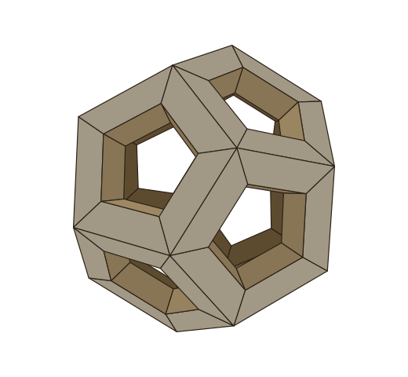
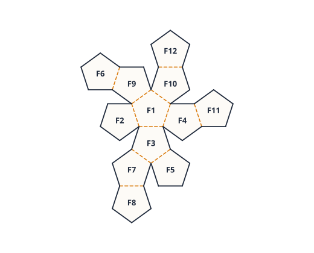

:layout: book
:type: solid
:order: 5
:canonical_id: P-01.05
:title: P-01.05 · Dodecahedron
:featured_image: solids/01-platonic/dodecahedron/dodecahedron.svg
:featured_image_alt: Dodecahedron
:categories: 01-platonic
:tags: platonic, regular, aether, dodecahedron, phi, pentagon, euclid, pacioli
:excerpt: The crowning masterpiece of classical stereometry, bounded by 12 regular pentagons with pure rational dihedral spread 4/5.

======================
P-01.05 · Dodecahedron
======================

*Dodecahedron · Field: :math:`\mathbb{Q}(\phi)` · Symmetry: :math:`I_h` (order 120) · Convex · Euclid Elements XIII.17*

.. epigraph::

   *To construct a regular dodecahedron inside a given sphere and to prove that the side of the dodecahedron is an irrational straight line called an apotome.*

   — **Euclid of Alexandria**, *Elements* Book XIII, Proposition 17 (G-Index: ``G.600``)

.. epigraph::

   *There being yet a fifth combination, God used it for the whole, embroidering constellations thereupon.*

   — **Plato**, *Timaeus* 55c

.. enunciation::

   The **Regular Dodecahedron** is the crowning masterpiece of classical stereometry and the principal subject of Luca Pacioli's *De Divina Proportione* (1509). Bounded by 12 regular pentagonal faces with 20 vertices and 30 edges (:math:`\{5, 3\}`), in Platonic and Pythagorean cosmology it represents the **Quintessence** (Aether / Cosmos), embodying celestial harmony and the divine proportion :math:`\phi`.

.. picture:: dodecahedron.svg
   :alt: Regular Dodecahedron

Interactive 3D Studio
---------------------

.. raw:: html

   

.. note::

   **Interactive Studio Controls**:

   - **Display Modes**: Switch between **Surfaces** (studio-lit polygonal facets), **Wireframe** (depth-cued structural edges), and **Frame** (mitered hollow beam manifold).
   - **Opacity & Aperture Sliders**: Adjust surface transparency from ``0%`` to ``100%`` in **Surfaces** and **Frame** modes, and tune the window **Aperture** in **Frame** mode.
   - **Vertices, Dual & Golden φ**: Toggle **Vertices** (default ON), **Dual** (the face-center dual whose vertices are the exact centers of the sides), and **Golden φ** (:math:`\phi : 1` golden sections and :math:`1 : \phi` golden rectangles).

Machine-Verified Symbolic Certificate
-------------------------------------

.. list-table::
   :widths: 35 30 35
   :header-rows: 1

   * - Mathematical Invariant
     - Exact Symbolic Value
     - Geometric Interpretation
   * - **Catalog Identifier**
     - ``P-01.05``
     - Family 01 (Platonic Solids), Solid 05
   * - **Algebraic Number Field**
     - :math:`\mathbb{Q}(\phi)`
     - Golden ratio field :math:`\phi = \frac{1+\sqrt{5}}{2}`
   * - **Topology**
     - :math:`(V=20, E=30, F=12)`
     - Euler characteristic :math:`\chi = 20 - 30 + 12 = 2`
   * - **Face Composition**
     - 12 regular pentagons
     - Schläfli symbol :math:`\{5, 3\}`
   * - **Exact Edge Quadrance** :math:`Q_E`
     - :math:`6 - 2\sqrt{5} = 4\phi^{-2}`
     - Edge length :math:`s = 2\phi^{-1} = \sqrt{5}-1` (apotome)
   * - **Exact Circumquadrance** :math:`Q_{\text{out}}`
     - :math:`3`
     - Circumradius :math:`R = \sqrt{3}` for all 20 vertices
   * - **Inquadrance** :math:`Q_{\text{in}}`
     - :math:`\frac{4\phi + 3}{5} = \frac{5 + 2\sqrt{5}}{5}`
     - Inradius at pentagon face centroid
   * - **Circum-to-Inratio** :math:`Q_{\text{in}} / Q_{\text{out}}`
     - :math:`\frac{4\phi + 3}{15} = \frac{5+2\sqrt{5}}{15}`
     - Identical to the Icosahedron ratio!
   * - **Primary Dihedral Spread** :math:`s`
     - :math:`4/5`
     - Pure rational dihedral spread: :math:`\cos\theta = -1/\sqrt{5} \implies s = 1 - 1/5 = 4/5`
   * - **Vacuum Manifold**
     - :math:`(V=160, E=360, F=180)`
     - Genus :math:`g = F - 1 = 11`, :math:`\chi = -20`
   * - **Polar Dual**
     - :doc:`Icosahedron </solids/01-platonic/icosahedron/index>`
     - Regular icosahedron connecting 12 face centroids
   * - **Symmetry Group**
     - :math:`I_h` (order 120)
     - Full icosahedral chiral and reflection group
   * - **Historical Canon**
     - Euclid XIII.17 (``G.600``)
     - Pacioli *De Divina Proportione* Cap. XXV; Tabulae XXVII–XXVIII

Exact Coordinate Representative Ledger & Algebraic Construction
---------------------------------------------------------------

Canonical Golden Coordinates
~~~~~~~~~~~~~~~~~~~~~~~~~~~~

In the GEOMETOR formulation, the 20 vertices of the regular dodecahedron are formed by uniting eight cube corners with twelve golden coordinate ridge points over :math:`\mathbb{Q}(\phi)` (where :math:`\phi^{-1} = \phi - 1`):

.. list-table::
   :widths: 15 45 40
   :header-rows: 1

   * - Vertex Index
     - Exact Symbolic Coordinates $(x, y, z)$
     - Geometric Role
   * - $V_0 .. V_3$
     - $(1, 1, 1), (1, 1, -1), (1, -1, 1), (1, -1, -1)$
     - Cube corners ($+x$ octants)
   * - $V_4 .. V_7$
     - $(-1, 1, 1), (-1, 1, -1), (-1, -1, 1), (-1, -1, -1)$
     - Cube corners ($-x$ octants)
   * - $V_8, V_9$
     - $(0, \phi^{-1}, \phi), (0, \phi^{-1}, -\phi)$
     - Golden ridge on $yz$-plane ($+y$)
   * - $V_{10}, V_{11}$
     - $(0, -\phi^{-1}, \phi), (0, -\phi^{-1}, -\phi)$
     - Golden ridge on $yz$-plane ($-y$)
   * - $V_{12}, V_{13}$
     - $(\phi^{-1}, \phi, 0), (\phi^{-1}, -\phi, 0)$
     - Golden ridge on $xy$-plane ($+x$)
   * - $V_{14}, V_{15}$
     - $(-\phi^{-1}, \phi, 0), (-\phi^{-1}, -\phi, 0)$
     - Golden ridge on $xy$-plane ($-x$)
   * - $V_{16}, V_{17}$
     - $(\phi, 0, \phi^{-1}), (\phi, 0, -\phi^{-1})$
     - Golden ridge on $zx$-plane ($+z$)
   * - $V_{18}, V_{19}$
     - $(-\phi, 0, \phi^{-1}), (-\phi, 0, -\phi^{-1})$
     - Golden ridge on $zx$-plane ($-z$)

Every vertex lies on the exact same circumscribing sphere:

.. math::

   Q_{\text{out}}(\text{Cube}) = 1^2 + 1^2 + 1^2 = 3

.. math::

   Q_{\text{out}}(\text{Golden}) = 0^2 + (\phi^{-1})^2 + \phi^2 = (2 - \phi) + (\phi + 1) = 3

Face Cycles & Normal Orientations
~~~~~~~~~~~~~~~~~~~~~~~~~~~~~~~~~

The twelve regular pentagonal faces are oriented with counter-clockwise outward normal cycles:

.. math::

   \begin{aligned}
   F_0 &= (0, 12, 14, 4, 8), & F_1 &= (0, 8, 10, 2, 16), & F_2 &= (0, 16, 17, 1, 12) \\
   F_3 &= (1, 9, 5, 14, 12), & F_4 &= (1, 17, 3, 11, 9), & F_5 &= (2, 10, 6, 15, 13) \\
   F_6 &= (2, 13, 3, 17, 16), & F_7 &= (3, 13, 15, 7, 11), & F_8 &= (4, 18, 6, 10, 8) \\
   F_9 &= (4, 14, 5, 19, 18), & F_{10} &= (5, 9, 11, 7, 19), & F_{11} &= (6, 18, 19, 7, 15)
   \end{aligned}

Dihedral Spread Derivation
~~~~~~~~~~~~~~~~~~~~~~~~~~

The cosine of the interior dihedral angle between adjacent regular pentagonal faces satisfies :math:`\cos\theta = -\frac{1}{\sqrt{5}}`.

Squaring this gives :math:`\cos^2\theta = \frac{1}{5}`. In Rational Trigonometry, the **dihedral spread** is:

.. math::

   s = 1 - \cos^2\theta = 1 - \frac{1}{5} = \frac{4}{5}

.. important::

   **Pure Rational Dihedral Spread**:
   The dihedral spread of the regular dodecahedron is the exact rational number **4/5**, despite requiring :math:`\sqrt{5}` and :math:`\phi` for its vertex positions and edge lengths.

Leonardo da Vinci's 1509 Woodcuts & Corpus Vacuum Reconstruction
----------------------------------------------------------------

In Luca Pacioli's *De Divina Proportione* (1509), Leonardo da Vinci celebrated the dodecahedron in Tabulae XXVII and XXVIII as *Dodecahedron Planum Solidum* and *Dodecahedron Planum Vacuum*.

   *Exact Symbolic Reconstruction*: Open wooden framework (:math:`\mu = 0.25`) of genus :math:`g = 11` and Euler characteristic :math:`\chi = -20`.

.. list-table::
   :widths: 50 50
   :header-rows: 1

   * - Leonardo da Vinci (1509 Woodcut)
     - Classical Designation & Codex Study
   * - .. figure:: /leonardo/plates/0243.g1.png
          :alt: Leonardo da Vinci Tabula XXVII Folio 0243 - Dodecahedron Planum Solidum
          :width: 100%

          **Tabula XXVII (Folio 0243)**: *Dodecahedron Planum Solidum*
     - Detailed codex analysis in :doc:`Tabulae XXVII–XXVIII: Dodecahedron </leonardo/tabula-27-28-dodecahedron>`.
       Solid dodecahedral body exhibiting chiaroscuro hatching.
   * - .. figure:: /leonardo/plates/0245.g1.png
          :alt: Leonardo da Vinci Tabula XXVIII Folio 0245 - Dodecahedron Planum Vacuum
          :width: 100%

          **Tabula XXVIII (Folio 0245)**: *Dodecahedron Planum Vacuum*
     - Detailed codex analysis in :doc:`Tabulae XXVII–XXVIII: Dodecahedron </leonardo/tabula-27-28-dodecahedron>`.
       Hollow pentagonal wooden beams showing internal mitered joints and opposite facets.

Unfolded 2D Papercraft Net
--------------------------

The regular dodecahedron unfolds into the Euclidean plane along 19 cut edges into two symmetrical rosettes of six pentagons:

   *2D Dihedral-Hinge Unfolding*: Twelve regular pentagons joined along 11 internal hinges (dashed lines) and 38 boundary cut edges (solid lines).

The total surface area is twelve times the area of a single regular pentagon:

.. math::

   A_{\text{total}} = 12 \times \frac{5}{4} s^2 \cot\left(\frac{\pi}{5}\right) = 3\sqrt{25 + 10\sqrt{5}} \, s^2
