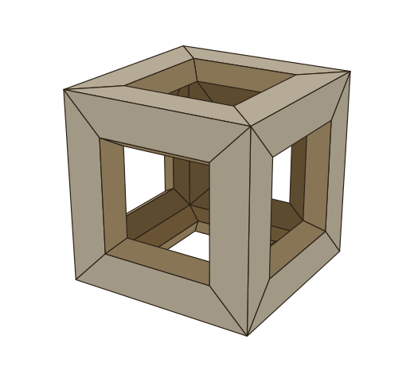
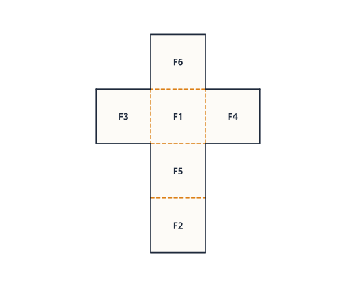

:layout: book
:type: solid
:order: 2
:canonical_id: P-01.02
:title: P-01.02 · Hexahedron (Cube)
:featured_image: solids/01-platonic/hexahedron/hexahedron.svg
:featured_image_alt: Hexahedron (Cube)
:categories: 01-platonic
:tags: platonic, regular, earth, cube, hexahedron, euclid, pacioli
:excerpt: The canonical orthogonal solid of Euclidean 3-space, bounded by 6 square faces with dihedral spread 1.

===========================
P-01.02 · Hexahedron (Cube)
===========================

*Exahedron · Field: :math:`\mathbb{Z}` · Symmetry: :math:`O_h` (order 48) · Convex · Euclid Elements XIII.15*

.. epigraph::

   *To construct a cube inside a given sphere and to prove that the square on the diameter of the sphere is three times the square on the side of the cube.*

   — **Euclid of Alexandria**, *Elements* Book XIII, Proposition 15 (G-Index: ``G.595``)

.. enunciation::

   The **Regular Hexahedron** (commonly called the **Cube**) is the canonical orthogonal solid of Euclidean three-space. Bounded by 6 congruent square faces with 8 vertices and 12 edges, each vertex is shared by 3 squares (:math:`\{4, 3\}`). In Plato's *Timaeus* (55d–56a), the cube is assigned to the element **Earth**: possessing square faces that sit firmly upon any plane, it is the most stable, immovable, and solid of the five Platonic bodies.

.. picture:: hexahedron.svg
   :alt: Regular Hexahedron (Cube)

Interactive 3D Solid & Vacuum Studio
------------------------------------

.. raw:: html

   

.. note::

   **Interactive Codex Controls**:
   
   - **Orbit & Inspect**: Click and drag to orbit in three dimensions. Scroll or pinch to zoom.
   - **Variant Toggle**: Switch between *Vacuum* (open wooden framework), *Solidum* (opaque square facets), and *Abscisum* (truncated cube / cuboctahedron).
   - **Aperture Slider**: Scrub the wooden beam aperture :math:`\mu \in [0.10, 0.45]` to inspect Leonardo's internal square joinery.
   - **Structural Overlays**: Toggle the **Golden Ratio** hipped roofs (Euclid XIII.17) and **Polar Dual** (regular octahedron connecting face centroids).
   - **Perspective Snap**: Snap directly to Leonardo da Vinci's canonical 1509 woodcut angle.

Machine-Verified Symbolic Certificate
-------------------------------------

.. list-table::
   :widths: 35 30 35
   :header-rows: 1

   * - Mathematical Invariant
     - Exact Symbolic Value
     - Geometric Interpretation
   * - **Catalog Identifier**
     - ``P-01.02``
     - Family 01 (Platonic Solids), Solid 02
   * - **Algebraic Number Field**
     - :math:`\mathbb{Z}`
     - Pure rational integer ring
   * - **Topology**
     - :math:`(V=8, E=12, F=6)`
     - Euler characteristic :math:`\chi = 8 - 12 + 6 = 2`
   * - **Face Composition**
     - 6 regular squares
     - Schläfli symbol :math:`\{4, 3\}`
   * - **Exact Edge Quadrance** :math:`Q_E`
     - :math:`4`
     - Edge length :math:`s = 2`
   * - **Exact Circumquadrance** :math:`Q_{\text{out}}`
     - :math:`3`
     - Circumradius :math:`R = \sqrt{3}` across diagonal
   * - **Inquadrance** :math:`Q_{\text{in}}`
     - :math:`1`
     - Inradius :math:`r = 1` at face center
   * - **Circum-to-Inratio** :math:`Q_{\text{in}} / Q_{\text{out}}`
     - :math:`1/3`
     - Sphere volume ratio :math:`(1/3)^{3/2} = 1/(3\sqrt{3})`
   * - **Primary Dihedral Spread** :math:`s`
     - :math:`1`
     - Absolute orthogonality: :math:`\theta = 90^\circ \implies s = \sin^2(90^\circ) = 1`
   * - **Vacuum Manifold**
     - :math:`(V=64, E=144, F=72)`
     - Genus :math:`g = F - 1 = 5`, :math:`\chi = -8`
   * - **Polar Dual**
     - :doc:`Octahedron </solids/01-platonic/octahedron/index>`
     - Regular octahedron connecting 6 face centroids
   * - **Symmetry Group**
     - :math:`O_h` (order 48)
     - Full octahedral chiral and reflection group
   * - **Historical Canon**
     - Euclid XIII.15 (``G.595``)
     - Pacioli *De Divina Proportione* Cap. XXII; Tabulae VII–VIII

Exact Coordinate Representative Ledger & Algebraic Construction
---------------------------------------------------------------

Canonical Lattice Coordinates
~~~~~~~~~~~~~~~~~~~~~~~~~~~~~

The regular cube is modeled on the eight canonical corners of the symmetric unit cube in :math:`\mathbb{Z}^3`:

.. list-table::
   :widths: 20 40 40
   :header-rows: 1

   * - Vertex Index
     - Exact Symbolic Coordinates $(x, y, z)$
     - Circumquadrance $Q_{\text{out}}$
   * - $V_0$
     - $(1, 1, 1)$
     - $1^2 + 1^2 + 1^2 = 3$
   * - $V_1$
     - $(1, 1, -1)$
     - $1^2 + 1^2 + (-1)^2 = 3$
   * - $V_2$
     - $(1, -1, 1)$
     - $1^2 + (-1)^2 + 1^2 = 3$
   * - $V_3$
     - $(1, -1, -1)$
     - $1^2 + (-1)^2 + (-1)^2 = 3$
   * - $V_4$
     - $(-1, 1, 1)$
     - $(-1)^2 + 1^2 + 1^2 = 3$
   * - $V_5$
     - $(-1, 1, -1)$
     - $(-1)^2 + 1^2 + (-1)^2 = 3$
   * - $V_6$
     - $(-1, -1, 1)$
     - $(-1)^2 + (-1)^2 + 1^2 = 3$
   * - $V_7$
     - $(-1, -1, -1)$
     - $(-1)^2 + (-1)^2 + (-1)^2 = 3$

Face Cycles & Normal Orientations
~~~~~~~~~~~~~~~~~~~~~~~~~~~~~~~~~

The six square faces are oriented with outward-pointing counter-clockwise normal cycles:

.. math::

   \begin{aligned}
   F_0 &= (0, 2, 3, 1) \quad (+x \text{ face}, \; n_0 = (1, 0, 0)) \\
   F_1 &= (4, 5, 7, 6) \quad (-x \text{ face}, \; n_1 = (-1, 0, 0)) \\
   F_2 &= (0, 1, 5, 4) \quad (+y \text{ face}, \; n_2 = (0, 1, 0)) \\
   F_3 &= (2, 6, 7, 3) \quad (-y \text{ face}, \; n_3 = (0, -1, 0)) \\
   F_4 &= (0, 4, 6, 2) \quad (+z \text{ face}, \; n_4 = (0, 0, 1)) \\
   F_5 &= (1, 3, 7, 5) \quad (-z \text{ face}, \; n_5 = (0, 0, -1))
   \end{aligned}

Dihedral Spread Derivation
~~~~~~~~~~~~~~~~~~~~~~~~~~

Adjacent faces meet at right angles along coordinate planes. Taking normal vectors :math:`n_0 = (1, 0, 0)` and :math:`n_2 = (0, 1, 0)`:

.. math::

   n_0 \cdot n_2 = 1(0) + 0(1) + 0(0) = 0

.. math::

   Q(n_0) = 1^2 = 1, \quad Q(n_2) = 1^2 = 1

.. math::

   s(F_0, F_2) = 1 - \frac{(n_0 \cdot n_2)^2}{Q(n_0) Q(n_2)} = 1 - \frac{0^2}{1 \times 1} = 1

The dihedral spread of the cube is identically **1**, reflecting the absolute orthogonality of Cartesian 3-space.

Leonardo da Vinci's 1509 Woodcuts & Corpus Vacuum Reconstruction
----------------------------------------------------------------

In Luca Pacioli's *De Divina Proportione* (1509), Leonardo da Vinci depicted the cube in Tabulae VII and VIII as *Exahedron Planum Solidum* and *Exahedron Planum Vacuum*.

   *Exact Symbolic Reconstruction*: Open wooden framework (:math:`\mu = 0.25`) of genus :math:`g = 5` and Euler characteristic :math:`\chi = -8`.

.. list-table::
   :widths: 50 50
   :header-rows: 1

   * - Leonardo da Vinci (1509 Woodcut)
     - Classical Designation & Codex Study
   * - .. figure:: /leonardo/plates/0199.g1.png
          :alt: Leonardo da Vinci Tabula VII Folio 0199 - Exahedron Planum Solidum
          :width: 100%

          **Tabula VII (Folio 0199)**: *Exahedron Planum Solidum*
     - Detailed codex analysis in :doc:`Tabulae VII–VIII: Hexahedron </leonardo/tabula-07-08-hexahedron>`.
       Solid cubic body demonstrating Renaissance illumination from the upper-left.
   * - .. figure:: /leonardo/plates/0201.g1.png
          :alt: Leonardo da Vinci Tabula VIII Folio 0201 - Exahedron Planum Vacuum
          :width: 100%

          **Tabula VIII (Folio 0201)**: *Exahedron Planum Vacuum*
     - Detailed codex analysis in :doc:`Tabulae VII–VIII: Hexahedron </leonardo/tabula-07-08-hexahedron>`.
       Hollow mitered wooden frame revealing internal opposite facets and spatial depth.

Unfolded 2D Papercraft Net
--------------------------

The regular hexahedron unfolds into the Euclidean plane along 7 cut edges into the classic Latin cross configuration:

   *2D Dihedral-Hinge Unfolding*: Six squares joined along five internal hinges (dashed lines) and fourteen boundary cut edges (solid lines).

The total surface area is six times the area of a single square facet:

.. math::

   A_{\text{total}} = 6 \times s^2 = 6 \times 4 = 24
