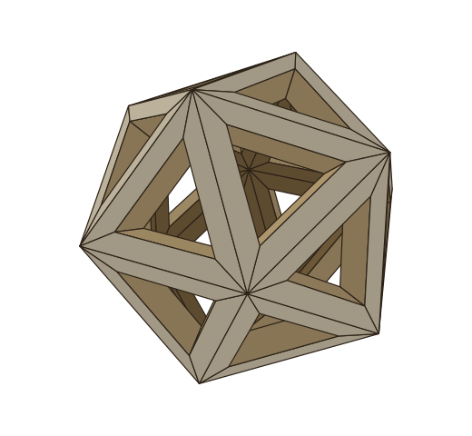
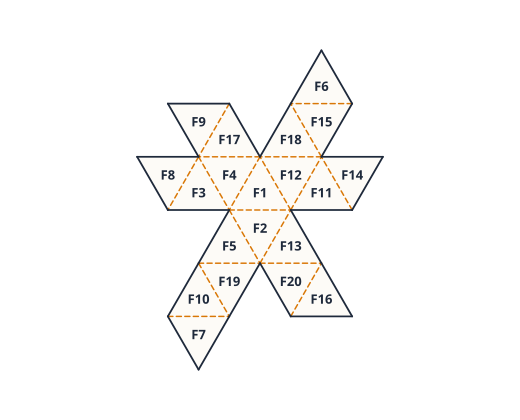

:layout: book
:type: solid
:order: 4
:canonical_id: P-01.04
:title: P-01.04 · Icosahedron
:featured_image: solids/01-platonic/icosahedron/icosahedron.svg
:featured_image_alt: Icosahedron
:categories: 01-platonic
:tags: platonic, regular, water, icosahedron, phi, golden-rectangles, euclid, pacioli
:excerpt: The canonical 20-face golden ratio deltahedron, modeled over Q(phi) via three orthogonal golden rectangles with pure rational dihedral spread 4/9.

=====================
P-01.04 · Icosahedron
=====================

*Icosahedron · Field: :math:`\mathbb{Q}(\phi)` · Symmetry: :math:`I_h` (order 120) · Convex · Euclid Elements XIII.16*

.. epigraph::

   *To construct a regular icosahedron inside a given sphere and to prove that the side of the icosahedron is an irrational straight line called minor.*

   — **Euclid of Alexandria**, *Elements* Book XIII, Proposition 16 (G-Index: ``G.597``)

.. enunciation::

   The **Regular Icosahedron** is the highest-order deltahedral Platonic solid, possessing 20 congruent equilateral triangular faces, 12 vertices, and 30 edges (:math:`\{3, 5\}`). In Plato's *Timaeus* (56a–56b), the icosahedron is assigned to the element **Water**: with the greatest number of faces, the most obtuse dihedral angles, and the closest approximation to a rolling sphere, it is the most mobile, fluid, and least sharp of all triangular polyhedra.

.. picture:: icosahedron.svg
   :alt: Regular Icosahedron

Interactive 3D Studio
---------------------

.. raw:: html

   

.. note::

   **Interactive Studio Controls**:

   - **Display Modes**: Switch between **Surfaces** (studio-lit polygonal facets), **Wireframe** (depth-cued structural edges), and **Frame** (mitered hollow beam manifold).
   - **Opacity & Aperture Sliders**: Adjust surface transparency from ``0%`` to ``100%`` in **Surfaces** and **Frame** modes, and tune the window **Aperture** in **Frame** mode.
   - **Vertices, Dual & Golden φ**: Toggle **Vertices** (default ON), **Dual** (the face-center dual whose vertices are the exact centers of the sides), and **Golden φ** (:math:`\phi : 1` golden sections and :math:`1 : \phi` golden rectangles).

Machine-Verified Symbolic Certificate
-------------------------------------

.. list-table::
   :widths: 35 30 35
   :header-rows: 1

   * - Mathematical Invariant
     - Exact Symbolic Value
     - Geometric Interpretation
   * - **Catalog Identifier**
     - ``P-01.04``
     - Family 01 (Platonic Solids), Solid 04
   * - **Algebraic Number Field**
     - :math:`\mathbb{Q}(\phi)`
     - Golden ratio field :math:`\phi = \frac{1+\sqrt{5}}{2}`
   * - **Topology**
     - :math:`(V=12, E=30, F=20)`
     - Euler characteristic :math:`\chi = 12 - 30 + 20 = 2`
   * - **Face Composition**
     - 20 equilateral triangles
     - Schläfli symbol :math:`\{3, 5\}`
   * - **Exact Edge Quadrance** :math:`Q_E`
     - :math:`4`
     - Edge length :math:`s = 2`
   * - **Exact Circumquadrance** :math:`Q_{\text{out}}`
     - :math:`\phi + 2 = \frac{5+\sqrt{5}}{2}`
     - :math:`0^2 + 1^2 + \phi^2 = 1 + (\phi+1) = \phi + 2`
   * - **Inquadrance** :math:`Q_{\text{in}}`
     - :math:`\frac{2\phi + 2}{3} = \frac{3+\sqrt{5}}{3}`
     - Inradius at face centroid
   * - **Circum-to-Inratio** :math:`Q_{\text{in}} / Q_{\text{out}}`
     - :math:`\frac{4\phi + 3}{15} = \frac{5+2\sqrt{5}}{15}`
     - Identical to the Dodecahedron ratio!
   * - **Primary Dihedral Spread** :math:`s`
     - :math:`4/9`
     - Pure rational dihedral spread: :math:`\cos\theta = -\sqrt{5}/3 \implies s = 1 - 5/9 = 4/9`
   * - **Vacuum Manifold**
     - :math:`(V=144, E=360, F=180)`
     - Genus :math:`g = F - 1 = 19`, :math:`\chi = -36`
   * - **Polar Dual**
     - :doc:`Dodecahedron </solids/01-platonic/dodecahedron/index>`
     - Regular dodecahedron connecting 20 face centroids
   * - **Symmetry Group**
     - :math:`I_h` (order 120)
     - Full icosahedral chiral and reflection group
   * - **Historical Canon**
     - Euclid XIII.16 (``G.597``)
     - Pacioli *De Divina Proportione* Cap. XXIIII; Tabulae XXI–XXII

Exact Coordinate Representative Ledger & Algebraic Construction
---------------------------------------------------------------

Canonical Golden Coordinates
~~~~~~~~~~~~~~~~~~~~~~~~~~~~

In the GEOMETOR formulation, the 12 vertices of the regular icosahedron are generated by cyclic permutations of coordinates over :math:`\mathbb{Q}(\phi)` forming three mutually orthogonal Golden Rectangles:

.. list-table::
   :widths: 15 45 40
   :header-rows: 1

   * - Vertex Index
     - Exact Symbolic Coordinates $(x, y, z)$
     - Circumquadrance $Q_{\text{out}}$
   * - $V_0$
     - $(0, 1, \phi)$
     - $0 + 1 + \phi^2 = \phi + 2$
   * - $V_1$
     - $(0, 1, -\phi)$
     - $0 + 1 + \phi^2 = \phi + 2$
   * - $V_2$
     - $(0, -1, \phi)$
     - $0 + 1 + \phi^2 = \phi + 2$
   * - $V_3$
     - $(0, -1, -\phi)$
     - $0 + 1 + \phi^2 = \phi + 2$
   * - $V_4$
     - $(1, \phi, 0)$
     - $1 + \phi^2 + 0 = \phi + 2$
   * - $V_5$
     - $(1, -\phi, 0)$
     - $1 + \phi^2 + 0 = \phi + 2$
   * - $V_6$
     - $(-1, \phi, 0)$
     - $1 + \phi^2 + 0 = \phi + 2$
   * - $V_7$
     - $(-1, -\phi, 0)$
     - $1 + \phi^2 + 0 = \phi + 2$
   * - $V_8$
     - $(\phi, 0, 1)$
     - $\phi^2 + 0 + 1 = \phi + 2$
   * - $V_9$
     - $(\phi, 0, -1)$
     - $\phi^2 + 0 + 1 = \phi + 2$
   * - $V_{10}$
     - $(-\phi, 0, 1)$
     - $\phi^2 + 0 + 1 = \phi + 2$
   * - $V_{11}$
     - $(-\phi, 0, -1)$
     - $\phi^2 + 0 + 1 = \phi + 2$

Face Cycles & Normal Orientations
~~~~~~~~~~~~~~~~~~~~~~~~~~~~~~~~~

The twenty equilateral triangular faces are oriented with counter-clockwise outward normal cycles:

.. math::

   \begin{aligned}
   F_0 &= (0, 2, 8), & F_1 &= (0, 10, 2), & F_2 &= (0, 4, 6), & F_3 &= (0, 8, 4), & F_4 &= (0, 6, 10) \\
   F_5 &= (1, 9, 3), & F_6 &= (1, 3, 11), & F_7 &= (1, 6, 4), & F_8 &= (1, 4, 9), & F_9 &= (1, 11, 6) \\
   F_{10} &= (2, 7, 5), & F_{11} &= (2, 5, 8), & F_{12} &= (2, 10, 7), & F_{13} &= (3, 5, 7), & F_{14} &= (3, 9, 5) \\
   F_{15} &= (3, 7, 11), & F_{16} &= (4, 8, 9), & F_{17} &= (5, 9, 8), & F_{18} &= (6, 11, 10), & F_{19} &= (7, 10, 11)
   \end{aligned}

Dihedral Spread Derivation
~~~~~~~~~~~~~~~~~~~~~~~~~~

The cosine of the interior dihedral angle between two adjacent faces is:

.. math::

   \cos\theta = -\frac{\sqrt{5}}{3}

Squaring this value produces :math:`\cos^2\theta = \frac{5}{9}`. In Rational Trigonometry, the **dihedral spread** is:

.. math::

   s = 1 - \cos^2\theta = 1 - \frac{5}{9} = \frac{4}{9}

.. important::

   **Pure Rational Dihedral Spread**:
   Although expressing individual vertex coordinates and dihedral angles requires the quadratic golden field :math:`\mathbb{Q}(\phi)`, the planar dihedral spread between adjacent faces is the exact rational fraction **4/9**!

Leonardo da Vinci's 1509 Woodcuts & Corpus Vacuum Reconstruction
----------------------------------------------------------------

In Luca Pacioli's *De Divina Proportione* (1509), Leonardo da Vinci rendered the icosahedron in Tabulae XXI and XXII as *Icosahedron Planum Solidum* and *Icosahedron Planum Vacuum*.

   *Exact Symbolic Reconstruction*: Hollow wooden frame (:math:`\mu = 0.25`) of genus :math:`g = 19` and Euler characteristic :math:`\chi = -36`.

.. list-table::
   :widths: 50 50
   :header-rows: 1

   * - Leonardo da Vinci (1509 Woodcut)
     - Classical Designation & Codex Study
   * - .. figure:: /leonardo/plates/0231.g1.png
          :alt: Leonardo da Vinci Tabula XXI Folio 0231 - Icosahedron Planum Solidum
          :width: 100%

          **Tabula XXI (Folio 0231)**: *Icosahedron Planum Solidum*
     - Detailed codex analysis in :doc:`Tabulae XXI–XXII: Icosahedron </leonardo/tabula-21-22-icosahedron>`.
       Solid icosahedral body with directional chiaroscuro shading.
   * - .. figure:: /leonardo/plates/0233.g1.png
          :alt: Leonardo da Vinci Tabula XXII Folio 0233 - Icosahedron Planum Vacuum
          :width: 100%

          **Tabula XXII (Folio 0233)**: *Icosahedron Planum Vacuum*
     - Detailed codex analysis in :doc:`Tabulae XXI–XXII: Icosahedron </leonardo/tabula-21-22-icosahedron>`.
       Open wooden lattice revealing internal golden rectangles and opposite vertices.

Unfolded 2D Papercraft Net
--------------------------

The regular icosahedron unfolds into the Euclidean plane along 11 cut edges into a strip of twenty equilateral triangles:

   *2D Dihedral-Hinge Unfolding*: Twenty equilateral triangles joined along 19 internal hinges (dashed lines) and 22 boundary cut edges (solid lines).

The total surface area is twenty times the area of an equilateral triangle:

.. math::

   A_{\text{total}} = 20 \times \frac{\sqrt{3}}{4} s^2 = 5\sqrt{3} s^2 = 5\sqrt{3} \times 4 = 20\sqrt{3}
