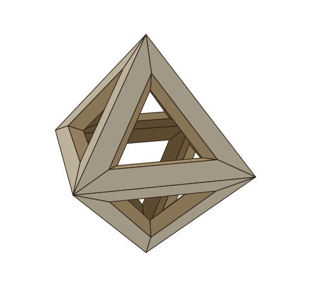
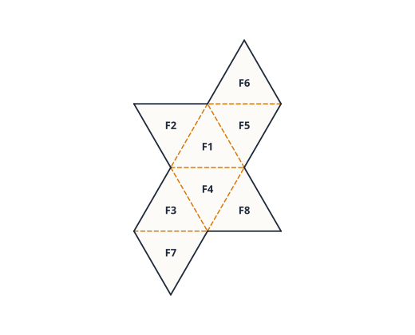

:layout: book
:type: solid
:order: 3
:canonical_id: P-01.03
:title: P-01.03 · Octahedron
:featured_image: solids/01-platonic/octahedron/octahedron.svg
:featured_image_alt: Octahedron
:categories: 01-platonic
:tags: platonic, regular, air, octahedron, deltahedron, euclid, pacioli
:excerpt: The central dual bridge of the Platonic canon, bounded by 8 equilateral triangles with pure rational dihedral spread 8/9.

====================
P-01.03 · Octahedron
====================

*Octahedron · Field: :math:`\mathbb{Z}` · Symmetry: :math:`O_h` (order 48) · Convex · Euclid Elements XIII.14*

.. epigraph::

   *To construct a regular octahedron inside a given sphere and to prove that the square on the diameter of the sphere is double the square on the side of the octahedron.*

   — **Euclid of Alexandria**, *Elements* Book XIII, Proposition 14 (G-Index: ``G.594``)

.. enunciation::

   The **Regular Octahedron** is the central dual bridge between the fire-tetrahedron and the water-icosahedron. Bounded by 8 congruent equilateral triangular faces with 6 vertices and 12 edges, each vertex is shared by 4 triangles (:math:`\{3, 4\}`). In Plato's *Timaeus* (56a–56b), the octahedron is assigned to the element **Air**: with intermediate mobility, intermediate sharpness of dihedral angles, and intermediate fineness of parts between the keen tetrahedron (fire) and the multi-faceted icosahedron (water).

.. picture:: octahedron.svg
   :alt: Regular Octahedron

Interactive 3D Studio
---------------------

.. raw:: html

   

.. note::

   **Interactive Studio Controls**:

   - **Display Modes**: Switch between **Surfaces** (studio-lit polygonal facets), **Wireframe** (depth-cued structural edges), and **Frame** (mitered hollow beam manifold).
   - **Opacity & Aperture Sliders**: Adjust surface transparency from ``0%`` to ``100%`` in **Surfaces** and **Frame** modes, and tune the window **Aperture** in **Frame** mode.
   - **Vertices, Dual & Golden φ**: Toggle **Vertices** (default ON), **Dual** (the face-center dual whose vertices are the exact centers of the sides), and **Golden φ** (:math:`\phi : 1` golden sections and :math:`1 : \phi` golden rectangles).

Machine-Verified Symbolic Certificate
-------------------------------------

.. list-table::
   :widths: 35 30 35
   :header-rows: 1

   * - Mathematical Invariant
     - Exact Symbolic Value
     - Geometric Interpretation
   * - **Catalog Identifier**
     - ``P-01.03``
     - Family 01 (Platonic Solids), Solid 03
   * - **Algebraic Number Field**
     - :math:`\mathbb{Z}`
     - Pure rational integer ring
   * - **Topology**
     - :math:`(V=6, E=12, F=8)`
     - Euler characteristic :math:`\chi = 6 - 12 + 8 = 2`
   * - **Face Composition**
     - 8 equilateral triangles
     - Schläfli symbol :math:`\{3, 4\}`
   * - **Exact Edge Quadrance** :math:`Q_E`
     - :math:`2`
     - Edge length :math:`s = \sqrt{2}` across axes
   * - **Exact Circumquadrance** :math:`Q_{\text{out}}`
     - :math:`1`
     - Circumradius :math:`R = 1` along coordinate axes
   * - **Inquadrance** :math:`Q_{\text{in}}`
     - :math:`1/3`
     - Inradius :math:`r = 1/\sqrt{3}` at face centroid :math:`(1/3, 1/3, 1/3)`
   * - **Circum-to-Inratio** :math:`Q_{\text{in}} / Q_{\text{out}}`
     - :math:`1/3`
     - Sphere volume ratio :math:`(1/3)^{3/2} = 1/(3\sqrt{3})`
   * - **Primary Dihedral Spread** :math:`s`
     - :math:`8/9`
     - :math:`\cos\theta = -1/3 \implies s = 1 - (-1/3)^2 = 8/9`
   * - **Vacuum Manifold**
     - :math:`(V=60, E=144, F=72)`
     - Genus :math:`g = F - 1 = 7`, :math:`\chi = -12`
   * - **Polar Dual**
     - :doc:`Hexahedron (Cube) </solids/01-platonic/hexahedron/index>`
     - Regular cube connecting 8 face centroids
   * - **Symmetry Group**
     - :math:`O_h` (order 48)
     - Full octahedral chiral and reflection group
   * - **Historical Canon**
     - Euclid XIII.14 (``G.594``)
     - Pacioli *De Divina Proportione* Cap. XXIII; Tabulae XV–XVI

Exact Coordinate Representative Ledger & Algebraic Construction
---------------------------------------------------------------

Canonical Lattice Coordinates
~~~~~~~~~~~~~~~~~~~~~~~~~~~~~

In the GEOMETOR formulation, the octahedron resides directly on the six Cartesian axial unit vertices:

.. list-table::
   :widths: 20 40 40
   :header-rows: 1

   * - Vertex Index
     - Exact Symbolic Coordinates $(x, y, z)$
     - Circumquadrance $Q_{\text{out}}$
   * - $V_0$
     - $(1, 0, 0)$
     - $1^2 + 0^2 + 0^2 = 1$
   * - $V_1$
     - $(-1, 0, 0)$
     - $(-1)^2 + 0^2 + 0^2 = 1$
   * - $V_2$
     - $(0, 1, 0)$
     - $0^2 + 1^2 + 0^2 = 1$
   * - $V_3$
     - $(0, -1, 0)$
     - $0^2 + (-1)^2 + 0^2 = 1$
   * - $V_4$
     - $(0, 0, 1)$
     - $0^2 + 0^2 + 1^2 = 1$
   * - $V_5$
     - $(0, 0, -1)$
     - $0^2 + 0^2 + (-1)^2 = 1$

Face Cycles & Normal Orientations
~~~~~~~~~~~~~~~~~~~~~~~~~~~~~~~~~

The eight equilateral triangular faces are oriented with outward-pointing counter-clockwise normal cycles:

.. math::

   \begin{aligned}
   F_0 &= (0, 2, 4) \quad (+++ \text{ octant}, \; n_0 = (1, 1, 1)) \\
   F_1 &= (0, 4, 3) \quad (+-+ \text{ octant}, \; n_1 = (1, -1, 1)) \\
   F_2 &= (0, 3, 5) \quad (+-- \text{ octant}, \; n_2 = (1, -1, -1)) \\
   F_3 &= (0, 5, 2) \quad (++- \text{ octant}, \; n_3 = (1, 1, -1)) \\
   F_4 &= (1, 4, 2) \quad (-++ \text{ octant}, \; n_4 = (-1, 1, 1)) \\
   F_5 &= (1, 3, 4) \quad (--+ \text{ octant}, \; n_5 = (-1, -1, 1)) \\
   F_6 &= (1, 5, 3) \quad (--- \text{ octant}, \; n_6 = (-1, -1, -1)) \\
   F_7 &= (1, 2, 5) \quad (-+- \text{ octant}, \; n_7 = (-1, 1, -1))
   \end{aligned}

Dihedral Spread Derivation
~~~~~~~~~~~~~~~~~~~~~~~~~~

Adjacent faces meet across coordinate edges. Taking unnormalized outward normals :math:`n_0 = (1, 1, 1)` and :math:`n_1 = (1, -1, 1)`:

.. math::

   n_0 \cdot n_1 = 1(1) + 1(-1) + 1(1) = 1

.. math::

   Q(n_0) = 1^2 + 1^2 + 1^2 = 3, \quad Q(n_1) = 1^2 + (-1)^2 + 1^2 = 3

The dihedral spread is:

.. math::

   s(F_0, F_1) = 1 - \frac{(n_0 \cdot n_1)^2}{Q(n_0) Q(n_1)} = 1 - \frac{1^2}{3 \times 3} = 1 - \frac{1}{9} = \frac{8}{9}

.. important::

   **Identical Dihedral Spread with Tetrahedron**:
   The Octahedron :math:`\{3, 4\}` and the Tetrahedron :math:`\{3, 3\}` share the exact same dihedral spread :math:`s = 8/9`, reflecting their mutual participation in the face-centered cubic lattice.

Leonardo da Vinci's 1509 Woodcuts & Corpus Vacuum Reconstruction
----------------------------------------------------------------

In Luca Pacioli's *De Divina Proportione* (1509), Leonardo da Vinci rendered the octahedron in Tabulae XV and XVI as *Octahedron Planum Solidum* and *Octahedron Planum Vacuum*.

   *Exact Symbolic Reconstruction*: Hollow wooden frame (:math:`\mu = 0.25`) of genus :math:`g = 7` and Euler characteristic :math:`\chi = -12`.

.. list-table::
   :widths: 50 50
   :header-rows: 1

   * - Leonardo da Vinci (1509 Woodcut)
     - Classical Designation & Codex Study
   * - .. figure:: /leonardo/plates/0219.g1.png
          :alt: Leonardo da Vinci Tabula XV Folio 0219 - Octahedron Planum Solidum
          :width: 100%

          **Tabula XV (Folio 0219)**: *Octahedron Planum Solidum*
     - Detailed codex analysis in :doc:`Tabulae XV–XVI: Octahedron </leonardo/tabula-15-16-octahedron>`.
       Opaque octahedron exhibiting pyramidal face shading.
   * - .. figure:: /leonardo/plates/0221.g1.png
          :alt: Leonardo da Vinci Tabula XVI Folio 0221 - Octahedron Planum Vacuum
          :width: 100%

          **Tabula XVI (Folio 0221)**: *Octahedron Planum Vacuum*
     - Detailed codex analysis in :doc:`Tabulae XV–XVI: Octahedron </leonardo/tabula-15-16-octahedron>`.
       Open-lattice wooden structure framing internal voids.

Unfolded 2D Papercraft Net
--------------------------

The regular octahedron unfolds into the Euclidean plane along 5 cut edges into a staggered double-row parallelogram of eight equilateral triangles:

   *2D Dihedral-Hinge Unfolding*: Eight equilateral triangles joined along seven internal hinges (dashed lines) and twelve boundary cut edges (solid lines).

The total surface area is eight times the area of an equilateral triangle:

.. math::

   A_{\text{total}} = 8 \times \frac{\sqrt{3}}{4} s^2 = 2\sqrt{3} s^2 = 2\sqrt{3} \times 2 = 4\sqrt{3}
