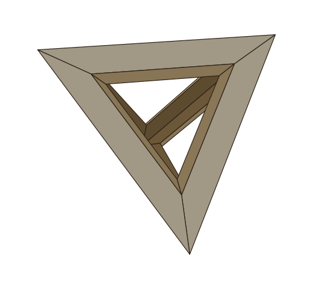
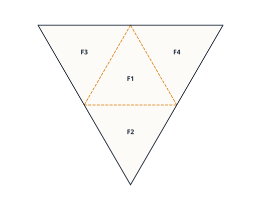

:layout: book
:type: solid
:order: 1
:canonical_id: P-01.01
:title: P-01.01 · Tetrahedron
:featured_image: solids/01-platonic/tetrahedron/tetrahedron.svg
:featured_image_alt: Tetrahedron
:categories: 01-platonic
:tags: platonic, regular, fire, tetrahedron, simplex, euclid, pacioli
:excerpt: The primary regular convex polyhedron, bounded by 4 equilateral triangles with pure rational dihedral spread 8/9.

=====================
P-01.01 · Tetrahedron
=====================

*Tetrahedron · Field: :math:`\mathbb{Z}` · Symmetry: :math:`T_d` (order 24) · Convex · Euclid Elements XIII.13*

.. epigraph::

   *To construct a regular tetrahedron inside a given sphere and to prove that the square on the diameter of the sphere is one and a half times the square on the side of the tetrahedron.*

   — **Euclid of Alexandria**, *Elements* Book XIII, Proposition 13 (G-Index: ``G.592``)

.. enunciation::

   The **Regular Tetrahedron** is the primary regular convex polyhedron in three-dimensional Euclidean space. Bounded by 4 equilateral triangular faces with 4 vertices and 6 edges, each vertex is shared by 3 triangles (:math:`\{3, 3\}`). In Plato's *Timaeus* (56b), the tetrahedron is assigned to the element **Fire**: having the fewest faces, the sharpest solid angles, and the greatest piercing power, it is the lightest, keenest, and most mobile of all elementary bodies.

.. picture:: tetrahedron.svg
   :alt: Regular Tetrahedron

Interactive 3D Studio
---------------------

.. raw:: html

   

.. note::

   **Interactive Studio Controls**:

   - **Display Modes**: Switch between **Surfaces** (studio-lit polygonal facets), **Wireframe** (depth-cued structural edges), and **Frame** (mitered hollow beam manifold).
   - **Opacity & Aperture Sliders**: Adjust surface transparency from ``0%`` to ``100%`` in **Surfaces** and **Frame** modes, and tune the window **Aperture** in **Frame** mode.
   - **Vertices & Overlays**: Toggle **Vertices** to display 3D points at all polyhedral corners, along with structural overlays and camera presets (**Perspective**, **Isometric**, **Front**, **Top**).

Machine-Verified Symbolic Certificate
-------------------------------------

.. list-table::
   :widths: 35 30 35
   :header-rows: 1

   * - Mathematical Invariant
     - Exact Symbolic Value
     - Geometric Interpretation
   * - **Catalog Identifier**
     - ``P-01.01``
     - Family 01 (Platonic Solids), Solid 01
   * - **Algebraic Number Field**
     - :math:`\mathbb{Z}`
     - Pure rational integer ring
   * - **Topology**
     - :math:`(V=4, E=6, F=4)`
     - Euler characteristic :math:`\chi = 4 - 6 + 4 = 2`
   * - **Face Composition**
     - 4 equilateral triangles
     - Schläfli symbol :math:`\{3, 3\}`
   * - **Exact Edge Quadrance** :math:`Q_E`
     - :math:`8`
     - Edge length :math:`s = 2\sqrt{2}`
   * - **Exact Circumquadrance** :math:`Q_{\text{out}}`
     - :math:`3`
     - Circumradius :math:`R = \sqrt{3}` across diagonal
   * - **Inquadrance** :math:`Q_{\text{in}}`
     - :math:`1/3`
     - Inradius :math:`r = 1/\sqrt{3}` at face centroid
   * - **Circum-to-Inratio** :math:`Q_{\text{in}} / Q_{\text{out}}`
     - :math:`1/9`
     - Sphere volume ratio :math:`(1/9)^{3/2} = 1/27`
   * - **Primary Dihedral Spread** :math:`s`
     - :math:`8/9`
     - :math:`\cos\theta = 1/3 \implies s = 1 - (1/3)^2 = 8/9`
   * - **Vacuum Manifold**
     - :math:`(V=32, E=72, F=36)`
     - Genus :math:`g = F - 1 = 3`, :math:`\chi = -4`
   * - **Polar Dual**
     - :doc:`Tetrahedron </solids/01-platonic/tetrahedron/index>`
     - Self-dual inverted tetrahedron :math:`\{3, 3\}`
   * - **Symmetry Group**
     - :math:`T_d` (order 24)
     - Full tetrahedral chiral and reflection group
   * - **Historical Canon**
     - Euclid XIII.13 (``G.592``)
     - Pacioli *De Divina Proportione* Cap. XXI; Tabulae I–II

Exact Coordinate Representative Ledger & Algebraic Construction
---------------------------------------------------------------

Canonical Lattice Coordinates
~~~~~~~~~~~~~~~~~~~~~~~~~~~~~

In the GEOMETOR formulation, the regular tetrahedron is embedded directly into the integer lattice :math:`\mathbb{Z}^3` as four alternating vertices of the canonical cube :math:`[-1, 1]^3`:

.. list-table::
   :widths: 20 40 40
   :header-rows: 1

   * - Vertex Index
     - Exact Symbolic Coordinates $(x, y, z)$
     - Circumquadrance $Q_{\text{out}}$
   * - $V_0$
     - $(1, 1, 1)$
     - $1^2 + 1^2 + 1^2 = 3$
   * - $V_1$
     - $(1, -1, -1)$
     - $1^2 + (-1)^2 + (-1)^2 = 3$
   * - $V_2$
     - $(-1, 1, -1)$
     - $(-1)^2 + 1^2 + (-1)^2 = 3$
   * - $V_3$
     - $(-1, -1, 1)$
     - $(-1)^2 + (-1)^2 + 1^2 = 3$

Face Cycles & Normal Orientations
~~~~~~~~~~~~~~~~~~~~~~~~~~~~~~~~~

The four equilateral triangular faces are oriented with outward-pointing counter-clockwise normal cycles:

.. math::

   F_0 = (0, 1, 2), \quad F_1 = (0, 3, 1), \quad F_2 = (0, 2, 3), \quad F_3 = (1, 3, 2)

Outward face normal vectors are computed via exact 3D cross products:

.. math::

   n_0 = (V_1 - V_0) \times (V_2 - V_0) = (0, -2, -2) \times (-2, 0, -2) = (4, 4, -4) \sim (1, 1, -1)

.. math::

   n_1 = (V_3 - V_0) \times (V_1 - V_0) = (-2, -2, 0) \times (0, -2, -2) = (4, -4, 4) \sim (1, -1, 1)

.. math::

   n_2 = (V_2 - V_0) \times (V_3 - V_0) = (-2, 0, -2) \times (-2, -2, 0) = (-4, 4, 4) \sim (-1, 1, 1)

.. math::

   n_3 = (V_3 - V_1) \times (V_2 - V_1) = (-2, 0, 2) \times (-2, 2, 0) = (-4, -4, -4) \sim (-1, -1, -1)

Dihedral Spread Derivation
~~~~~~~~~~~~~~~~~~~~~~~~~~

The dihedral spread between two adjacent faces with normal vectors :math:`n_0 = (1, 1, -1)` and :math:`n_1 = (1, -1, 1)` is computed directly without trigonometry:

.. math::

   n_0 \cdot n_1 = 1(1) + 1(-1) + (-1)(1) = 1 - 1 - 1 = -1

.. math::

   Q(n_0) = 1^2 + 1^2 + (-1)^2 = 3, \quad Q(n_1) = 1^2 + (-1)^2 + 1^2 = 3

.. math::

   s(F_0, F_1) = 1 - \frac{(n_0 \cdot n_1)^2}{Q(n_0) Q(n_1)} = 1 - \frac{(-1)^2}{3 \times 3} = 1 - \frac{1}{9} = \frac{8}{9}

George Odom's 1983 Golden Section Construction
~~~~~~~~~~~~~~~~~~~~~~~~~~~~~~~~~~~~~~~~~~~~~~

While the tetrahedron is traditionally considered an elemental figure devoid of the golden ratio, in 1983 the American artist and geometer **George Odom** proved that **the golden ratio is encoded directly on the face of the regular tetrahedron** when inscribed within its circumscribing circle.

Let :math:`\triangle ABC` be an equilateral face of the tetrahedron inscribed in its circumcircle :math:`\mathcal{C}` of radius :math:`r = 2`:

1. Let :math:`M_1` be the midpoint of edge :math:`AB`, and :math:`M_2` be the midpoint of edge :math:`AC`.
2. Draw the midsegment line :math:`M_1 M_2` and extend it to intersect the circle :math:`\mathcal{C}` at points :math:`G_1` and :math:`G_2` (with :math:`G_2` lying beyond :math:`M_2`).
3. **Theorem (George Odom, 1983)**: The point :math:`M_2` divides the segment :math:`M_1 G_2` in the **golden ratio**:

   .. math::

      \frac{|M_1 M_2|}{|M_2 G_2|} = \phi = \frac{1 + \sqrt{5}}{2}

In the language of 3D Rational Trigonometry and ``geometor.model``, the quadrance ratio satisfies:

.. math::

   \frac{Q(M_1, M_2)}{Q(M_2, G_2)} = \phi^2 = \phi + 1 = \frac{3 + \sqrt{5}}{2}

Leonardo da Vinci's 1509 Woodcuts & Corpus Vacuum Reconstruction
----------------------------------------------------------------

For Luca Pacioli's *De Divina Proportione* (Venice, 1509), **Leonardo da Vinci** designed sixty polyhedral drawings, cut onto pearwood blocks. Tabulae I and II depict the *Tetrahedron Planum Solidum* and *Tetrahedron Planum Vacuum*.

   *Exact Symbolic Reconstruction*: Hollow wooden armillary framework (:math:`\mu = 0.25`) of genus :math:`g = 3` and Euler characteristic :math:`\chi = -4`.

.. list-table::
   :widths: 50 50
   :header-rows: 1

   * - Leonardo da Vinci (1509 Woodcut)
     - Classical Designation & Codex Study
   * - .. figure:: /leonardo/plates/0187.g1.png
          :alt: Leonardo da Vinci Tabula I Folio 0187 - Tetrahedron Planum Solidum
          :width: 100%

          **Tabula I (Folio 0187)**: *Tetrahedron Planum Solidum*
     - Detailed codex analysis in :doc:`Tabulae I–II: Tetrahedron </leonardo/tabula-01-02-tetrahedron>`.
       Opaque body with directional shading (*luce primaria*) descending from upper-left at :math:`45^\circ`.
   * - .. figure:: /leonardo/plates/0189.g1.png
          :alt: Leonardo da Vinci Tabula II Folio 0189 - Tetrahedron Planum Vacuum
          :width: 100%

          **Tabula II (Folio 0189)**: *Tetrahedron Planum Vacuum*
     - Detailed codex analysis in :doc:`Tabulae I–II: Tetrahedron </leonardo/tabula-01-02-tetrahedron>`.
       Open wooden beam lattice revealing opposite vertices and interior mitered joinery.

Unfolded 2D Papercraft Net
--------------------------

The regular tetrahedron unfolds into the plane along three of its six edges without overlapping. The resulting net forms a larger equilateral triangle whose sides are twice the length of the tetrahedron's edges:

   *2D Dihedral-Hinge Unfolding*: Central triangular face surrounded by three outer faces hinged along internal seams (dashed lines) and cut boundaries (solid lines).

The net demonstrates that the total surface area of the regular tetrahedron is four times the area of a single equilateral face:

.. math::

   A_{\text{total}} = 4 \times \frac{\sqrt{3}}{4} s^2 = \sqrt{3} s^2 = 8\sqrt{3}
