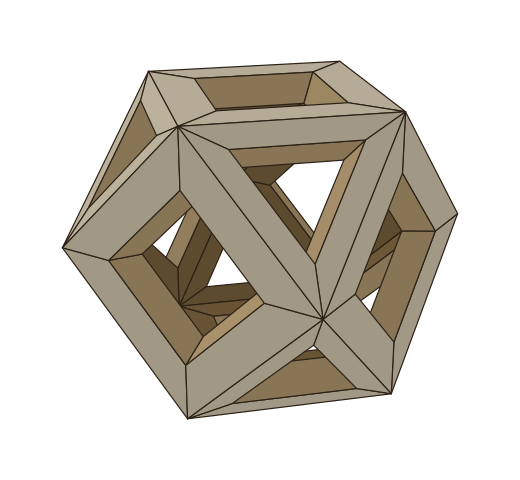
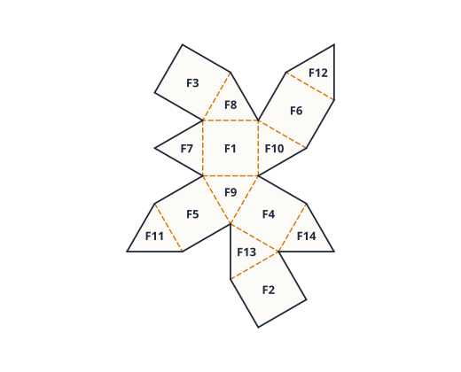

:layout: book
:type: solid
:order: 2
:canonical_id: P-02.02
:title: P-02.02 · Cuboctahedron
:featured_image: solids/02-archimedean/cuboctahedron/cuboctahedron.svg
:featured_image_alt: Cuboctahedron
:categories: 02-archimedean
:tags: archimedean, rectification, cube, octahedron, pacioli, quasi-regular
:excerpt: A quasi-regular Archimedean solid formed by rectifying a regular hexahedron or octahedron at edge midpoints.

===========================
P-02.02 · Cuboctahedron
===========================

*Exahedron Abscisum · Field: :math:`\mathbb{Q}` · Symmetry: :math:`O_h` (order 48) · Convex · Archimedes of Syracuse*

.. epigraph::

   *Exahedron abscisum fit per abscisionem octo angulorum solidorum cubi usque ad medietates costarum... unde oriuntur sex bases quadratae et octo triangulares.*

   *The truncated hexahedron is made by cutting away the eight solid angles of the cube as far as the midpoints of the edges... whence arise six square bases and eight triangular bases.*

   — **Luca Pacioli**, *De Divina Proportione*, Cap. XXII (Venice, 1509)

.. enunciation::

   The **Cuboctahedron** (*Exahedron Abscisum*) is the canonical quasi-regular Archimedean solid formed by edge-midpoint rectification (``rectify``) of either the cube or the regular octahedron. Bounded by 8 equilateral triangles and 6 squares with 12 vertices and 24 edges, every vertex is surrounded by alternating triangles and squares (:math:`(3 \cdot 4)^2`).

.. picture:: cuboctahedron.svg
   :alt: Cuboctahedron

Interactive 3D Solid & Vacuum Studio
------------------------------------

.. raw:: html

   

.. note::

   **Interactive Codex Controls**:
   
   - **Orbit & Inspect**: Click and drag to orbit in three dimensions. Scroll or pinch to zoom.
   - **Variant Toggle**: Switch between Leonardo da Vinci's *Vacuum* (wooden beams), *Solidum* (opaque facets), and *Dual* (the Rhombic Dodecahedron).
   - **Aperture Slider**: Scrub the wooden beam aperture parameter :math:`\mu \in [0.10, 0.45]` to inspect the fourteen internal window tunnels.
   - **Perspective Snap**: Reset camera to Leonardo da Vinci's canonical 1509 woodcut vantage point.

Machine-Verified Symbolic Certificate
-------------------------------------

.. list-table::
   :widths: 35 30 35
   :header-rows: 1

   * - Mathematical Invariant
     - Exact Symbolic Value
     - Geometric Interpretation
   * - **Catalog Identifier**
     - ``P-02.02``
     - Family 02 (Archimedean Solids), Solid 02
   * - **Algebraic Number Field**
     - :math:`\mathbb{Q}`
     - Pure rational field
   * - **Topology**
     - :math:`(V=12, E=24, F=14)`
     - Euler characteristic :math:`\chi = 12 - 24 + 14 = 2`
   * - **Face Composition**
     - 8 equilateral triangles + 6 squares
     - Quasi-regular vertex figure :math:`(3 \cdot 4)^2`
   * - **Exact Edge Quadrance** :math:`Q_E`
     - :math:`2`
     - Edge length :math:`s = \sqrt{2}`
   * - **Exact Circumquadrance** :math:`Q_{\text{out}}`
     - :math:`2`
     - Circumradius :math:`R = \sqrt{2}` (edge length equals circumradius!)
   * - **Primary Dihedral Spread** :math:`s`
     - :math:`2/3`
     - Triangle-to-square spread: :math:`\cos\theta = -1/\sqrt{3} \implies s = 1 - 1/3 = 2/3`
   * - **Vacuum Manifold**
     - :math:`(V=120, E=288, F=144)`
     - Genus :math:`g = F - 1 = 13`, :math:`\chi = -24`
   * - **Polar Dual**
     - :doc:`Rhombic Dodecahedron </solids/03-catalan/rhombic-dodecahedron/index>`
     - Catalan solid with 12 congruent golden/rhombic faces
   * - **Symmetry Group**
     - :math:`O_h` (order 48)
     - Full octahedral chiral and reflection group
   * - **Historical Canon**
     - Archimedes of Syracuse; Ptolemy
     - Pacioli *De Divina Proportione* Cap. XXII; Tabulae VIIII–X

Exact Coordinate Representative Ledger & Algebraic Construction
---------------------------------------------------------------

Canonical Rational Coordinates
~~~~~~~~~~~~~~~~~~~~~~~~~~~~~~

The twelve vertices of the cuboctahedron reside at the midpoints of the twelve edges of the canonical cube :math:`[-1, 1]^3`, generated by all twelve permutations of :math:`(\pm 1, \pm 1, 0)`:

.. list-table::
   :widths: 20 40 40
   :header-rows: 1

   * - Vertex Group
     - Exact Symbolic Coordinates $(x, y, z)$
     - Circumquadrance $Q_{\text{out}}$
   * - $xy$-plane (4 vertices)
     - $(1, 1, 0), \; (1, -1, 0), \; (-1, 1, 0), \; (-1, -1, 0)$
     - $1^2 + 1^2 + 0^2 = 2$
   * - $yz$-plane (4 vertices)
     - $(0, 1, 1), \; (0, 1, -1), \; (0, -1, 1), \; (0, -1, -1)$
     - $0^2 + 1^2 + 1^2 = 2$
   * - $zx$-plane (4 vertices)
     - $(1, 0, 1), \; (1, 0, -1), \; (-1, 0, 1), \; (-1, 0, -1)$
     - $1^2 + 0^2 + 1^2 = 2$

Remarkably, the edge length equals the distance from the center to each vertex: :math:`Q_E = Q_{\text{out}} = 2`, making the cuboctahedron the unique central vector equilibrium (Buckminster Fuller's *Jitterbug* core).

Leonardo da Vinci's 1509 Woodcuts & Corpus Vacuum Reconstruction
----------------------------------------------------------------

In Luca Pacioli's *De Divina Proportione* (1509), Leonardo da Vinci rendered the cuboctahedron in Tabulae VIIII and X under the designation *Exahedron Abscisum Solidum* and *Exahedron Abscisum Vacuum*.

   *Exact Symbolic Reconstruction*: Open wooden framework (:math:`\mu = 0.25`) of genus :math:`g = 13` and Euler characteristic :math:`\chi = -24`.

.. list-table::
   :widths: 50 50
   :header-rows: 1

   * - Leonardo da Vinci (1509 Woodcut)
     - Classical Designation & Codex Study
   * - .. figure:: /leonardo/plates/0203.g1.png
          :alt: Leonardo da Vinci Tabula VIIII Folio 0203 - Exahedron Abscisum Solidum
          :width: 100%

          **Tabula VIIII (Folio 0203)**: *Exahedron Abscisum Solidum*
     - Detailed codex analysis in :doc:`Tabulae VIIII–X: Exahedron Abscisum </leonardo/tabula-09-10-hexahedron-abscisum>`.
       Solid body displaying alternating triangular and square facets.
   * - .. figure:: /leonardo/plates/0205.g1.png
          :alt: Leonardo da Vinci Tabula X Folio 0205 - Exahedron Abscisum Vacuum
          :width: 100%

          **Tabula X (Folio 0205)**: *Exahedron Abscisum Vacuum*
     - Detailed codex analysis in :doc:`Tabulae VIIII–X: Exahedron Abscisum </leonardo/tabula-09-10-hexahedron-abscisum>`.
       Open wooden framework revealing internal octahedral cross-bracing.

Unfolded 2D Papercraft Net
--------------------------

The cuboctahedron unfolds into the Euclidean plane along 11 cut edges into a symmetrical net of eight triangles and six squares:

   *2D Dihedral-Hinge Unfolding*: Fourteen polygons joined along 13 internal hinges (dashed lines) and 35 boundary cut edges (solid lines).
