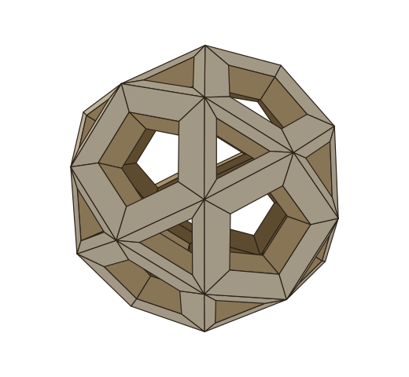
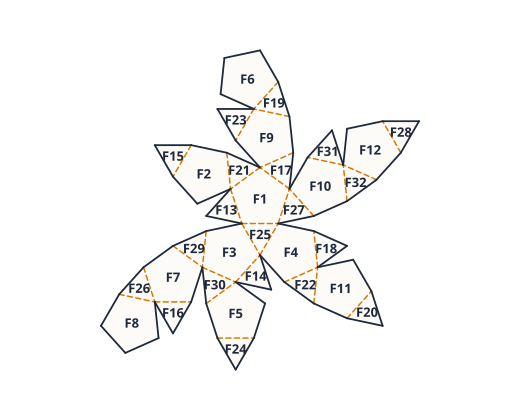

:layout: book
:type: solid
:order: 6
:canonical_id: P-02.06
:title: P-02.06 · Icosidodecahedron
:featured_image: solids/02-archimedean/icosidodecahedron/icosidodecahedron.svg
:featured_image_alt: Icosidodecahedron
:categories: 02-archimedean
:tags: archimedean, rectification, dodecahedron, icosahedron, phi, golden-ratio, pacioli
:excerpt: A quasi-regular Archimedean solid formed by edge rectification of a regular dodecahedron or icosahedron.

==============================
P-02.06 · Icosidodecahedron
==============================

*Dodecahedron Abscisum · Field: :math:`\mathbb{Q}(\phi)` · Symmetry: :math:`I_h` (order 120) · Convex · Archimedes of Syracuse*

.. epigraph::

   *Dodecahedron abscisum fit per abscisionem viginti angulorum solidorum dodecaedri usque ad medietates costarum... unde oriuntur duodecim bases pentagonae et viginti triangulares.*

   *The truncated dodecahedron is made by cutting away the twenty solid angles of the dodecahedron as far as the midpoints of the edges... whence arise twelve pentagonal bases and twenty triangular bases.*

   — **Luca Pacioli**, *De Divina Proportione*, Cap. XXVI (Venice, 1509)

.. enunciation::

   The **Icosidodecahedron** (*Dodecahedron Abscisum*) is the canonical quasi-regular golden ratio solid formed by edge-midpoint rectification (``rectify``) of either the regular dodecahedron or regular icosahedron. Bounded by 20 equilateral triangles and 12 regular pentagons with 30 vertices and 60 edges, every vertex is surrounded by alternating triangles and pentagons (:math:`(3 \cdot 5)^2`).

.. picture:: icosidodecahedron.svg
   :alt: Icosidodecahedron

Interactive 3D Solid & Vacuum Studio
------------------------------------

.. raw:: html

   

.. note::

   **Interactive Codex Controls**:
   
   - **Orbit & Inspect**: Click and drag to orbit in three dimensions. Scroll or pinch to zoom.
   - **Variant Toggle**: Switch between Leonardo da Vinci's *Vacuum* (wooden beams), *Solidum* (opaque facets), and *Dual* (the Rhombic Triacontahedron).
   - **Aperture Slider**: Scrub the wooden beam aperture parameter :math:`\mu \in [0.10, 0.45]` to inspect the thirty-two internal light conduits.
   - **Perspective Snap**: Reset camera to Leonardo da Vinci's canonical 1509 woodcut vantage point.

Machine-Verified Symbolic Certificate
-------------------------------------

.. list-table::
   :widths: 35 30 35
   :header-rows: 1

   * - Mathematical Invariant
     - Exact Symbolic Value
     - Geometric Interpretation
   * - **Catalog Identifier**
     - ``P-02.06``
     - Family 02 (Archimedean Solids), Solid 06
   * - **Algebraic Number Field**
     - :math:`\mathbb{Q}(\phi)`
     - Golden ratio field :math:`\phi = \frac{1+\sqrt{5}}{2}`
   * - **Topology**
     - :math:`(V=30, E=60, F=32)`
     - Euler characteristic :math:`\chi = 30 - 60 + 32 = 2`
   * - **Face Composition**
     - 20 equilateral triangles + 12 regular pentagons
     - Quasi-regular vertex figure :math:`(3 \cdot 5)^2`
   * - **Exact Edge Quadrance** :math:`Q_E`
     - :math:`1`
     - Unit edge length :math:`s = 1`
   * - **Exact Circumquadrance** :math:`Q_{\text{out}}`
     - :math:`\phi + 1 = \phi^2 = \frac{3+\sqrt{5}}{2}`
     - Circumradius :math:`R = \phi`
   * - **Primary Dihedral Spread** :math:`s`
     - :math:`\frac{2}{3} - \frac{2\sqrt{5}}{15}`
     - Triangle-to-pentagon dihedral spread
   * - **Vacuum Manifold**
     - :math:`(V=300, E=720, F=360)`
     - Genus :math:`g = F - 1 = 31`, :math:`\chi = -60`
   * - **Polar Dual**
     - :doc:`Rhombic Triacontahedron </solids/03-catalan/rhombic-triacontahedron/index>`
     - Catalan solid with 30 congruent golden rhombi
   * - **Symmetry Group**
     - :math:`I_h` (order 120)
     - Full icosahedral chiral and reflection group
   * - **Historical Canon**
     - Archimedes of Syracuse; Heron *Definitiones*
     - Pacioli *De Divina Proportione* Cap. XXVI; Tabulae XXIX–XXX

Exact Coordinate Representative Ledger & Algebraic Construction
---------------------------------------------------------------

Canonical Golden Coordinates
~~~~~~~~~~~~~~~~~~~~~~~~~~~~

In the GEOMETOR formulation, the 30 vertices of the icosidodecahedron are the midpoints of the 30 edges of the regular icosahedron over :math:`\mathbb{Q}(\phi)`. They partition into two golden symmetry orbits:

.. list-table::
   :widths: 25 35 40
   :header-rows: 1

   * - Symmetry Orbit
     - Exact Coordinate Generator
     - Orbit Multiplicity
   * - Axial Golden Orbit
     - $(0, 0, \pm \phi), \; (0, \pm \phi, 0), \; (\pm \phi, 0, 0)$
     - 6 vertices
   * - Permuted Golden Orbit
     - Even cyclic permutations of $(\pm 1/2, \pm \phi/2, \pm (\phi+1)/2)$
     - 24 vertices

Every vertex has exact circumquadrance:

.. math::

   Q_{\text{out}} = 0^2 + 0^2 + \phi^2 = \phi + 1 = \frac{3+\sqrt{5}}{2}

All 60 edges have uniform unit quadrance :math:`Q_E = 1`, making the icosidodecahedron a central equilibrium figure of icosahedral geometry.

Leonardo da Vinci's 1509 Woodcuts & Corpus Vacuum Reconstruction
----------------------------------------------------------------

In Luca Pacioli's *De Divina Proportione* (1509), Leonardo da Vinci rendered the icosidodecahedron in Tabulae XXIX and XXX under the designation *Dodecahedron Abscisum Solidum* and *Dodecahedron Abscisum Vacuum*.

   *Exact Symbolic Reconstruction*: Open wooden framework (:math:`\mu = 0.25`) of genus :math:`g = 31` and Euler characteristic :math:`\chi = -60`.

.. list-table::
   :widths: 50 50
   :header-rows: 1

   * - Leonardo da Vinci (1509 Woodcut)
     - Classical Designation & Codex Study
   * - .. figure:: /leonardo/plates/0247.g1.png
          :alt: Leonardo da Vinci Tabula XXIX Folio 0247 - Dodecahedron Abscisum Solidum
          :width: 100%

          **Tabula XXIX (Folio 0247)**: *Dodecahedron Abscisum Solidum*
     - Detailed codex analysis in :doc:`Tabulae XXIX–XXX: Dodecahedron Abscisum </leonardo/tabula-29-30-dodecahedron-abscisum>`.
       Solid 32-base body with triangular and pentagonal facets.
   * - .. figure:: /leonardo/plates/0249.g1.png
          :alt: Leonardo da Vinci Tabula XXX Folio 0249 - Dodecahedron Abscisum Vacuum
          :width: 100%

          **Tabula XXX (Folio 0249)**: *Dodecahedron Abscisum Vacuum*
     - Detailed codex analysis in :doc:`Tabulae XXIX–XXX: Dodecahedron Abscisum </leonardo/tabula-29-30-dodecahedron-abscisum>`.
       Open wooden framework showing internal triangular and pentagonal light tunnels.

Unfolded 2D Papercraft Net
--------------------------

The icosidodecahedron unfolds into the Euclidean plane along 29 cut edges into a symmetrical net of twenty triangles and twelve pentagons:

   *2D Dihedral-Hinge Unfolding*: Thirty-two regular polygons joined along 31 internal hinges (dashed lines) and 58 boundary cut edges (solid lines).
