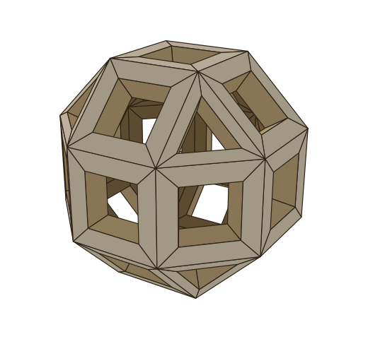
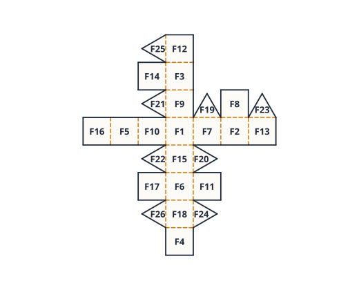

:layout: book
:type: solid
:order: 5
:canonical_id: P-02.05
:title: P-02.05 · Rhombicuboctahedron
:featured_image: solids/02-archimedean/rhombicuboctahedron/rhombicuboctahedron.svg
:featured_image_alt: Rhombicuboctahedron (Vigintisex Basium)
:categories: 02-archimedean
:tags: archimedean, rhombicuboctahedron, pacioli, leonardo, sqrt2, vigintisex-basium
:excerpt: Leonardo's 26-base body (Vigintisex Basium), bounded by 18 squares and 8 equilateral triangles.

===================================
P-02.05 · Rhombicuboctahedron
===================================

*Vigintisex Basium · Field: :math:`\mathbb{Q}(\sqrt{2})` · Symmetry: :math:`O_h` (order 48) · Convex · Pacioli & Leonardo da Vinci*

.. epigraph::

   *Inter omnia abscisa corpora eminet vigintisex basium planum solidum et vacuum... habens octodecim bases quadrilateras et octo triangulares.*

   *Among all truncated bodies the twenty-six base body, solid and hollow, stands supreme... having eighteen quadrilateral bases and eight triangular bases.*

   — **Luca Pacioli**, *De Divina Proportione*, Cap. LXI (Venice, 1509)

.. enunciation::

   The **Rhombicuboctahedron** (*Vigintisex Basium*, the 26-Base Body) is the celebrated centerpiece of Renaissance stereometry depicted by Leonardo da Vinci. Bounded by 18 squares (6 axial and 12 chamfer facets) and 8 equilateral octant triangles with 24 vertices and 48 edges, every vertex is surrounded by three squares and one triangle (:math:`3 \cdot 4^3`).

.. picture:: rhombicuboctahedron.svg
   :alt: Rhombicuboctahedron (Vigintisex Basium)

Interactive 3D Studio
---------------------

.. raw:: html

   

.. note::

   **Interactive Studio Controls**:

   - **Display Modes**: Switch between **Surfaces** (studio-lit polygonal facets), **Wireframe** (depth-cued structural edges), and **Frame** (mitered hollow beam manifold).
   - **Opacity & Aperture Sliders**: Adjust surface transparency from ``0%`` to ``100%`` in **Surfaces** and **Frame** modes, and tune the window **Aperture** in **Frame** mode.
   - **Vertices & Overlays**: Toggle **Vertices** to display 3D points at all polyhedral corners, along with structural overlays and camera presets (**Perspective**, **Isometric**, **Front**, **Top**).

Machine-Verified Symbolic Certificate
-------------------------------------

.. list-table::
   :widths: 35 30 35
   :header-rows: 1

   * - Mathematical Invariant
     - Exact Symbolic Value
     - Geometric Interpretation
   * - **Catalog Identifier**
     - ``P-02.05``
     - Family 02 (Archimedean Solids), Solid 05
   * - **Algebraic Number Field**
     - :math:`\mathbb{Q}(\sqrt{2})`
     - Quadratic algebraic extension
   * - **Topology**
     - :math:`(V=24, E=48, F=26)`
     - Euler characteristic :math:`\chi = 24 - 48 + 26 = 2`
   * - **Face Composition**
     - 8 equilateral triangles + 18 squares
     - Vertex figure :math:`3 \cdot 4^3`
   * - **Exact Edge Quadrance** :math:`Q_E`
     - :math:`4`
     - Edge length :math:`s = 2`
   * - **Exact Circumquadrance** :math:`Q_{\text{out}}`
     - :math:`5 + 2\sqrt{2}`
     - Circumradius :math:`R = \sqrt{5+2\sqrt{2}} \approx 2.7979`
   * - **Primary Dihedral Spread** :math:`s`
     - :math:`1/2`
     - Square-to-square chamfer spread: :math:`\theta = 135^\circ \implies s = \sin^2(135^\circ) = 1/2`
   * - **Vacuum Manifold**
     - :math:`(V=240, E=576, F=288)`
     - Genus :math:`g = F - 1 = 25`, :math:`\chi = -48`
   * - **Polar Dual**
     - Deltoidal Icositetrahedron
     - Catalan solid with 24 kite-shaped faces
   * - **Symmetry Group**
     - :math:`O_h` (order 48)
     - Full octahedral chiral and reflection group
   * - **Historical Canon**
     - Archimedes of Syracuse; Ptolemy
     - Pacioli *De Divina Proportione* Cap. LXI; Tabulae XXXV–XXXVI

Exact Coordinate Representative Ledger & Algebraic Construction
---------------------------------------------------------------

Canonical Quadratic Coordinates
~~~~~~~~~~~~~~~~~~~~~~~~~~~~~~~

In the GEOMETOR formulation, the 24 vertices of the rhombicuboctahedron are generated by all signed coordinate permutations of :math:`(\pm (1+\sqrt{2}), \pm 1, \pm 1)` over :math:`\mathbb{Q}(\sqrt{2})`:

.. list-table::
   :widths: 25 35 40
   :header-rows: 1

   * - Coordinate Family
     - Exact Symbolic Generator
     - Number of Vertices
   * - Major $x$-axis
     - $(\pm (1+\sqrt{2}), \pm 1, \pm 1)$
     - 8 vertices
   * - Major $y$-axis
     - $(\pm 1, \pm (1+\sqrt{2}), \pm 1)$
     - 8 vertices
   * - Major $z$-axis
     - $(\pm 1, \pm 1, \pm (1+\sqrt{2}))$
     - 8 vertices

Every vertex has exact circumquadrance:

.. math::

   Q_{\text{out}} = (1+\sqrt{2})^2 + 1^2 + 1^2 = (3 + 2\sqrt{2}) + 2 = 5 + 2\sqrt{2}

All 48 edges have uniform integer quadrance :math:`Q_E = 4` (:math:`s = 2`), proving exact uniformity of all 18 square and 8 triangular facets.

Leonardo da Vinci's 1509 Woodcuts & Corpus Vacuum Reconstruction
----------------------------------------------------------------

In Luca Pacioli's *De Divina Proportione* (1509), Leonardo da Vinci celebrated the rhombicuboctahedron in Tabulae XXXV and XXXVI as *Vigintisex Basium Planum Solidum* and *Vigintisex Basium Planum Vacuum*.

   *Exact Symbolic Reconstruction*: Open wooden framework (:math:`\mu = 0.25`) of genus :math:`g = 25` and Euler characteristic :math:`\chi = -48`.

.. list-table::
   :widths: 50 50
   :header-rows: 1

   * - Leonardo da Vinci (1509 Woodcut)
     - Classical Designation & Codex Study
   * - .. figure:: /leonardo/plates/0259.g1.png
          :alt: Leonardo da Vinci Tabula XXXV Folio 0259 - Vigintisex Basium Planum Solidum
          :width: 100%

          **Tabula XXXV (Folio 0259)**: *Vigintisex Basium Planum Solidum*
     - Detailed codex analysis in :doc:`Tabulae XXXV–XXXVI: Vigintisex Basium </leonardo/tabula-35-36-vigintisex-basium>`.
       Opaque 26-base body with axial and chamfer facets.
   * - .. figure:: /leonardo/plates/0261.g1.png
          :alt: Leonardo da Vinci Tabula XXXVI Folio 0261 - Vigintisex Basium Planum Vacuum
          :width: 100%

          **Tabula XXXVI (Folio 0261)**: *Vigintisex Basium Planum Vacuum*
     - Detailed codex analysis in :doc:`Tabulae XXXV–XXXVI: Vigintisex Basium </leonardo/tabula-35-36-vigintisex-basium>`.
       Hollow wooden armillary construction of 26 windows.

Unfolded 2D Papercraft Net
--------------------------

The rhombicuboctahedron unfolds into the Euclidean plane along 25 cut edges into an interconnected band of 18 squares and 8 triangles:

   *2D Dihedral-Hinge Unfolding*: Twenty-six polygons joined along 25 internal hinges (dashed lines) and 46 boundary cut edges (solid lines).
