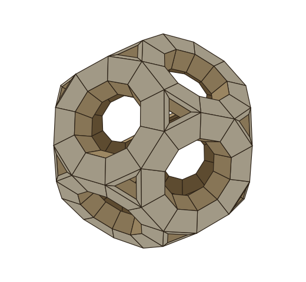
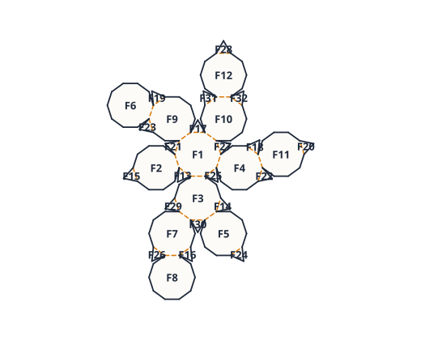

:layout: book
:type: solid
:order: 8
:canonical_id: P-02.08
:title: P-02.08 · Truncated Dodecahedron
:featured_image: solids/02-archimedean/truncated-dodecahedron/truncated-dodecahedron.svg
:featured_image_alt: Truncated Dodecahedron
:categories: 02-archimedean
:tags: archimedean, truncation, dodecahedron, decagon, phi, golden-ratio
:excerpt: An Archimedean solid formed by truncating a dodecahedron at edge depth (3 - phi)/5 to yield regular decagons.

===================================
P-02.08 · Truncated Dodecahedron
===================================

*Dodecahedron Abscisum Decagonale · Field: :math:`\mathbb{Q}(\phi)` · Symmetry: :math:`I_h` (order 120) · Convex · Archimedes / Piero*

.. epigraph::

   *Ex dodecaedro si anguli viginti ita resecentur ut relinquatur decagonum regulare, prodibit corpus Archimedeum triginta duarum basium.*

   *If from the dodecahedron the twenty corners are so cut that a regular decagon remains, there will result an Archimedean body of thirty-two bases.*

   — **Johannes Kepler**, *Harmonices Mundi*, Lib. II (Linz, 1619)

.. enunciation::

   The **Truncated Dodecahedron** (*Dodecahedron Abscisum Decagonale*) is an Archimedean semi-regular solid formed by truncating the twenty vertices of a regular dodecahedron at the exact golden edge depth :math:`t = \frac{3 - \phi}{5} = \frac{5 - \sqrt{5}}{10} \in \mathbb{Q}(\phi)`. Bounded by 20 equilateral triangles and 12 regular decagons with 60 vertices and 90 edges, every vertex is surrounded identically by one triangle and two decagons (:math:`3 \cdot 10^2`).

.. picture:: truncated-dodecahedron.svg
   :alt: Truncated Dodecahedron

Interactive 3D Solid & Vacuum Studio
------------------------------------

.. raw:: html

   

.. note::

   **Interactive Codex Controls**:
   
   - **Orbit & Inspect**: Click and drag to orbit in three dimensions. Scroll or pinch to zoom.
   - **Variant Toggle**: Switch between *Vacuum* (open wooden beam lattice), *Solidum* (opaque planar facets), and *Dual* (the Triakis Icosahedron).
   - **Aperture Slider**: Scrub the wooden beam aperture parameter :math:`\mu \in [0.10, 0.45]` to inspect the thirty-two internal light conduits.
   - **Perspective Snap**: Align camera to canonical isometric orientation.

Machine-Verified Symbolic Certificate
-------------------------------------

.. list-table::
   :widths: 35 30 35
   :header-rows: 1

   * - Mathematical Invariant
     - Exact Symbolic Value
     - Geometric Interpretation
   * - **Catalog Identifier**
     - ``P-02.08``
     - Family 02 (Archimedean Solids), Solid 08
   * - **Algebraic Number Field**
     - :math:`\mathbb{Q}(\phi)`
     - Golden ratio field :math:`\phi = \frac{1+\sqrt{5}}{2}`
   * - **Topology**
     - :math:`(V=60, E=90, F=32)`
     - Euler characteristic :math:`\chi = 60 - 90 + 32 = 2`
   * - **Face Composition**
     - 20 equilateral triangles + 12 regular decagons
     - Vertex figure :math:`3 \cdot 10^2`
   * - **Exact Edge Quadrance** :math:`Q_E`
     - :math:`\frac{6 - 2\sqrt{5}}{5} = \frac{4\phi^{-2}}{5}`
     - Edge length :math:`s = \frac{\sqrt{5}-1}{\sqrt{5}} = 1 - \frac{\sqrt{5}}{5}`
   * - **Exact Circumquadrance** :math:`Q_{\text{out}}`
     - :math:`\frac{9 + 2\sqrt{5}}{5}`
     - Circumradius :math:`R = \sqrt{\frac{9+2\sqrt{5}}{5}} \approx 1.6415`
   * - **Primary Dihedral Spread** :math:`s`
     - :math:`4/5`
     - Decagon-to-decagon dihedral spread: identical to regular dodecahedron
   * - **Vacuum Manifold**
     - :math:`(V=480, E=1080, F=540)`
     - Genus :math:`g = F - 1 = 31`, :math:`\chi = -60`
   * - **Polar Dual**
     - Triakis Icosahedron
     - Catalan solid with 60 isosceles triangular faces
   * - **Symmetry Group**
     - :math:`I_h` (order 120)
     - Full icosahedral chiral and reflection group
   * - **Historical Canon**
     - Archimedes of Syracuse; Piero della Francesca (1482)
     - Johannes Kepler, *Harmonices Mundi* (1619), Lib. II

Exact Coordinate Representative Ledger & Algebraic Construction
---------------------------------------------------------------

Canonical Golden Coordinates
~~~~~~~~~~~~~~~~~~~~~~~~~~~~

In the GEOMETOR formulation, the 60 vertices of the truncated dodecahedron are generated by applying the golden truncation depth :math:`t = \frac{3 - \phi}{5}` to the twenty vertices of the regular dodecahedron:

.. list-table::
   :widths: 25 35 40
   :header-rows: 1

   * - Symmetry Orbit
     - Exact Coordinate Generator
     - Number of Vertices
   * - Orbit A (ridge)
     - $(0, \pm \phi^{-1}/5, \pm (5\phi-1)/5)$ and cyclic permutations
     - 12 vertices
   * - Orbit B (cube corner cut)
     - $(\pm 1, \pm (\phi+2)/5, \pm (3\phi-1)/5)$ and cyclic permutations
     - 24 vertices
   * - Orbit C (face boundary)
     - $(\pm \phi, \pm 2\phi^{-1}/5, \pm (2\phi+1)/5)$ and cyclic permutations
     - 24 vertices

Every vertex has exact circumquadrance:

.. math::

   Q_{\text{out}} = \frac{9 + 2\sqrt{5}}{5}

All 90 edges have uniform exact quadrance :math:`Q_E = \frac{6 - 2\sqrt{5}}{5}`, ensuring that each of the twelve 10-sided faces is a regular Euclidean decagon.

Corpus Vacuum Reconstruction
----------------------------

The hollow armillary representation displays the intricate geometry of twelve large decagonal portals interconnected by twenty small triangular corner frames:

   *Exact Symbolic Reconstruction*: Open wooden beam lattice (:math:`\mu = 0.25`) of genus :math:`g = 31` and Euler characteristic :math:`\chi = -60`.

First reconstructed in the Renaissance by **Piero della Francesca** in his treatise *De Quinque Corporibus Regularibus* (c. 1482), this body was later rediscovered and systematized by Johannes Kepler in 1619.

Unfolded 2D Papercraft Net
--------------------------

The truncated dodecahedron unfolds into the Euclidean plane along 59 cut edges into a rosette of twelve regular decagons and twenty equilateral triangles:

   *2D Dihedral-Hinge Unfolding*: Thirty-two regular polygons joined along 31 internal hinges (dashed lines) and 88 boundary cut edges (solid lines).
