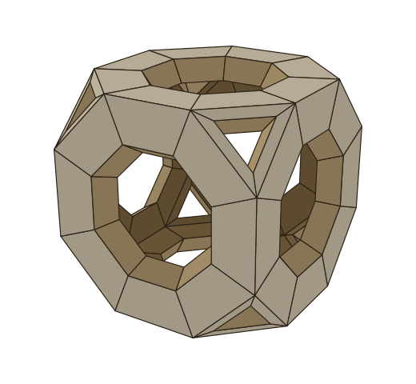
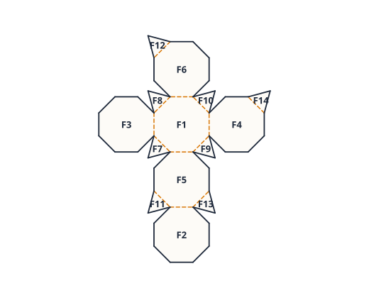

:layout: book
:type: solid
:order: 3
:canonical_id: P-02.03
:title: P-02.03 · Truncated Hexahedron
:featured_image: solids/02-archimedean/truncated-hexahedron/truncated-hexahedron.svg
:featured_image_alt: Truncated Hexahedron
:categories: 02-archimedean
:tags: archimedean, truncation, cube, octagon, sqrt2
:excerpt: An Archimedean solid formed by cutting corners of a cube at edge depth 1 - sqrt(2)/2 to yield regular octagons.

=================================
P-02.03 · Truncated Hexahedron
=================================

*Exahedron Abscisum Octogonale · Field: :math:`\mathbb{Q}(\sqrt{2})` · Symmetry: :math:`O_h` (order 48) · Convex · Archimedes / Kepler*

.. epigraph::

   *Ex cubo si anguli octo ita abscindantur ut relinquatur octogonum aequilaterum, orietur corpus Archimedeum quatuordecim basium.*

   *If from the cube the eight corners are so cut away that an equilateral octagon remains, there arises an Archimedean body of fourteen bases.*

   — **Johannes Kepler**, *Harmonices Mundi*, Lib. II (Linz, 1619)

.. enunciation::

   The **Truncated Hexahedron** (*Truncated Cube*) is an Archimedean semi-regular solid formed by truncating the eight corners of a cube at edge depth :math:`t = 1 - \frac{\sqrt{2}}{2} \in \mathbb{Q}(\sqrt{2})`. Bounded by 8 equilateral triangles and 6 regular octagons with 24 vertices and 36 edges, every vertex is surrounded identically by one triangle and two octagons (:math:`3 \cdot 8^2`).

.. picture:: truncated-hexahedron.svg
   :alt: Truncated Hexahedron

Interactive 3D Solid & Vacuum Studio
------------------------------------

.. raw:: html

   

.. note::

   **Interactive Codex Controls**:
   
   - **Orbit & Inspect**: Click and drag to orbit in three dimensions. Scroll or pinch to zoom.
   - **Variant Toggle**: Switch between *Vacuum* (open wooden beam lattice), *Solidum* (opaque planar facets), and *Dual* (the Triakis Octahedron).
   - **Aperture Slider**: Scrub the wooden beam aperture parameter :math:`\mu \in [0.10, 0.45]` to inspect the interior octagonal corridors.
   - **Perspective Snap**: Align camera to canonical isometric orientation.

Machine-Verified Symbolic Certificate
-------------------------------------

.. list-table::
   :widths: 35 30 35
   :header-rows: 1

   * - Mathematical Invariant
     - Exact Symbolic Value
     - Geometric Interpretation
   * - **Catalog Identifier**
     - ``P-02.03``
     - Family 02 (Archimedean Solids), Solid 03
   * - **Algebraic Number Field**
     - :math:`\mathbb{Q}(\sqrt{2})`
     - Quadratic algebraic extension
   * - **Topology**
     - :math:`(V=24, E=36, F=14)`
     - Euler characteristic :math:`\chi = 24 - 36 + 14 = 2`
   * - **Face Composition**
     - 8 equilateral triangles + 6 regular octagons
     - Vertex figure :math:`3 \cdot 8^2`
   * - **Exact Edge Quadrance** :math:`Q_E`
     - :math:`12 - 8\sqrt{2}`
     - Edge length :math:`s = 2(\sqrt{2}-1) \approx 0.8284`
   * - **Exact Circumquadrance** :math:`Q_{\text{out}}`
     - :math:`5 - 2\sqrt{2}`
     - Circumradius :math:`R = \sqrt{5-2\sqrt{2}} \approx 1.4736`
   * - **Primary Dihedral Spread** :math:`s`
     - :math:`1`
     - Octagon-to-octagon dihedral spread: orthogonal Cartesian faces (:math:`90^\circ`)
   * - **Vacuum Manifold**
     - :math:`(V=192, E=432, F=216)`
     - Genus :math:`g = F - 1 = 13`, :math:`\chi = -24`
   * - **Polar Dual**
     - Triakis Octahedron
     - Catalan solid with 24 isosceles triangular faces
   * - **Symmetry Group**
     - :math:`O_h` (order 48)
     - Full octahedral chiral and reflection group
   * - **Historical Canon**
     - Archimedes of Syracuse; Heron *Definitiones*
     - Johannes Kepler, *Harmonices Mundi* (1619), Lib. II

Exact Coordinate Representative Ledger & Algebraic Construction
---------------------------------------------------------------

Canonical Quadratic Coordinates
~~~~~~~~~~~~~~~~~~~~~~~~~~~~~~~

The 24 vertices of the truncated hexahedron are generated by all coordinate permutations of :math:`(\pm 1, \pm 1, \pm (\sqrt{2}-1))` over :math:`\mathbb{Q}(\sqrt{2})`:

.. list-table::
   :widths: 25 35 40
   :header-rows: 1

   * - Coordinate Family
     - Exact Symbolic Generator
     - Number of Vertices
   * - $z$-truncated ($xy$-plane faces)
     - $(\pm 1, \pm 1, \pm (\sqrt{2}-1))$
     - 8 vertices
   * - $y$-truncated ($zx$-plane faces)
     - $(\pm 1, \pm (\sqrt{2}-1), \pm 1)$
     - 8 vertices
   * - $x$-truncated ($yz$-plane faces)
     - $(\pm (\sqrt{2}-1), \pm 1, \pm 1)$
     - 8 vertices

Every vertex has exact circumquadrance:

.. math::

   Q_{\text{out}} = 1^2 + 1^2 + (\sqrt{2}-1)^2 = 2 + (3 - 2\sqrt{2}) = 5 - 2\sqrt{2}

The 36 edges have uniform quadrance :math:`Q_E = 12 - 8\sqrt{2}`, confirming that the 6 octagons are regular Euclidean 8-gons.

Corpus Vacuum Reconstruction
----------------------------

The hollow armillary representation reveals the deep internal symmetry between the orthogonal octagonal windows and triangular corner bevels:

   *Exact Symbolic Reconstruction*: Open wooden beam lattice (:math:`\mu = 0.25`) of genus :math:`g = 13` and Euler characteristic :math:`\chi = -24`.

While omitted from Luca Pacioli's 1509 woodcuts, Johannes Kepler formally established the complete constructive theory of this semi-regular solid in his *Harmonices Mundi* (Linz, 1619).

Unfolded 2D Papercraft Net
--------------------------

The truncated hexahedron unfolds into the Euclidean plane along 23 cut edges into a central cross of six octagons with corner triangles:

   *2D Dihedral-Hinge Unfolding*: Six regular octagons and eight equilateral triangles joined along 13 internal hinges (dashed lines) and 50 boundary cut edges (solid lines).
