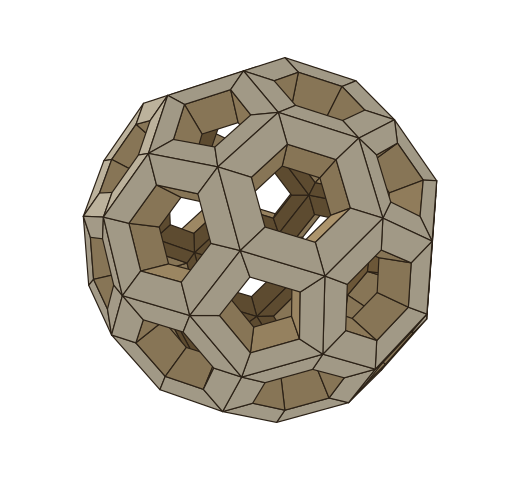
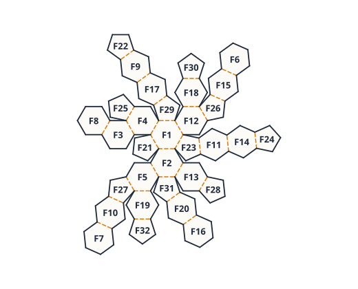

:layout: book
:type: solid
:order: 7
:canonical_id: P-02.07
:title: P-02.07 · Truncated Icosahedron
:featured_image: solids/02-archimedean/truncated-icosahedron/truncated-icosahedron.svg
:featured_image_alt: Truncated Icosahedron
:categories: 02-archimedean
:tags: archimedean, truncation, icosahedron, fullerene, buckyball, phi, pacioli
:excerpt: The canonical truncated icosahedron (fullerene Buckyball), bounded by 12 pentagons and 20 hexagons.

==================================
P-02.07 · Truncated Icosahedron
==================================

*Icosahedron Abscisum · Field: :math:`\mathbb{Q}(\phi)` · Symmetry: :math:`I_h` (order 120) · Convex · Archimedes / Pacioli*

.. epigraph::

   *Icosahedron abscisum fit per abscisionem duodecim angulorum solidorum icosaedri ad tertiam partem uniuscuiusque costae... unde oriuntur duodecim bases pentagonae et viginti hexagonae.*

   *The truncated icosahedron is made by cutting away the twelve solid angles of the icosahedron at the third part of each edge... whence arise twelve pentagonal bases and twenty hexagonal bases.*

   — **Luca Pacioli**, *De Divina Proportione*, Cap. XXIIII (Venice, 1509)

.. enunciation::

   The **Truncated Icosahedron** (*Icosahedron Abscisum*, the canonical Archimedean fullerene / Buckminsterfullerene :math:`C_{60}`) is formed by truncating the twelve vertices of a regular icosahedron at one-third edge depth (:math:`t = 1/3`). Bounded by 12 regular pentagons and 20 regular hexagons with 60 vertices and 90 edges, every vertex is surrounded identically by one pentagon and two hexagons (:math:`5 \cdot 6^2`).

.. picture:: truncated-icosahedron.svg
   :alt: Truncated Icosahedron

Interactive 3D Studio
---------------------

.. raw:: html

   

.. note::

   **Interactive Studio Controls**:

   - **Display Modes**: Switch between **Surfaces** (studio-lit polygonal facets), **Wireframe** (depth-cued structural edges), and **Frame** (mitered hollow beam manifold).
   - **Opacity & Aperture Sliders**: Adjust surface transparency from ``0%`` to ``100%`` in **Surfaces** and **Frame** modes, and tune the window **Aperture** in **Frame** mode.
   - **Vertices & Overlays**: Toggle **Vertices** to display 3D points at all polyhedral corners, along with structural overlays and camera presets (**Perspective**, **Isometric**, **Front**, **Top**).

Machine-Verified Symbolic Certificate
-------------------------------------

.. list-table::
   :widths: 35 30 35
   :header-rows: 1

   * - Mathematical Invariant
     - Exact Symbolic Value
     - Geometric Interpretation
   * - **Catalog Identifier**
     - ``P-02.07``
     - Family 02 (Archimedean Solids), Solid 07
   * - **Algebraic Number Field**
     - :math:`\mathbb{Q}(\phi)`
     - Golden ratio field :math:`\phi = \frac{1+\sqrt{5}}{2}`
   * - **Topology**
     - :math:`(V=60, E=90, F=32)`
     - Euler characteristic :math:`\chi = 60 - 90 + 32 = 2`
   * - **Face Composition**
     - 12 regular pentagons + 20 regular hexagons
     - Vertex figure :math:`5 \cdot 6^2`
   * - **Exact Edge Quadrance** :math:`Q_E`
     - :math:`4/9`
     - Edge length :math:`s = 2/3` (:math:`1/3` of regular icosahedron edge)
   * - **Exact Circumquadrance** :math:`Q_{\text{out}}`
     - :math:`\frac{9\phi + 20}{18} = \frac{29 + 9\sqrt{5}}{18}`
     - Circumradius :math:`R = \sqrt{\frac{29+9\sqrt{5}}{18}} \approx 1.6529`
   * - **Primary Dihedral Spread** :math:`s`
     - :math:`4/9`
     - Hexagon-to-hexagon dihedral spread: pure rational fraction
   * - **Vacuum Manifold**
     - :math:`(V=480, E=1080, F=540)`
     - Genus :math:`g = F - 1 = 31`, :math:`\chi = -60`
   * - **Polar Dual**
     - Pentakis Dodecahedron
     - Catalan solid with 60 isosceles triangular faces
   * - **Symmetry Group**
     - :math:`I_h` (order 120)
     - Full icosahedral chiral and reflection group
   * - **Historical Canon**
     - Archimedes of Syracuse; Piero della Francesca
     - Pacioli *De Divina Proportione* Cap. XXIIII; Tabulae XXIII–XXIIII

Exact Coordinate Representative Ledger & Algebraic Construction
---------------------------------------------------------------

Canonical Fullerene Coordinates
~~~~~~~~~~~~~~~~~~~~~~~~~~~~~~~

In the GEOMETOR formulation, the 60 vertices of the truncated icosahedron are generated by cyclic permutations of three golden coordinates over :math:`\mathbb{Q}(\phi)`:

.. list-table::
   :widths: 25 35 40
   :header-rows: 1

   * - Symmetry Orbit
     - Exact Coordinate Generator
     - Number of Vertices
   * - Orbit A (axial)
     - $(0, \pm 1/3, \pm (3\phi+1)/3)$ and cyclic permutations
     - 12 vertices
   * - Orbit B (planar)
     - $(\pm 1/3, \pm (2\phi-1)/3, \pm 2\phi/3)$ and cyclic permutations
     - 24 vertices
   * - Orbit C (spatial)
     - $(\pm 2/3, \pm \phi/3, \pm (2\phi+1)/3)$ and cyclic permutations
     - 24 vertices

Every vertex has exact circumquadrance:

.. math::

   Q_{\text{out}} = \frac{9\phi + 20}{18} = \frac{29 + 9\sqrt{5}}{18}

All 90 edges have uniform rational quadrance :math:`Q_E = 4/9`. In 1985, Harold Kroto, Robert Curl, and Richard Smalley discovered that carbon atoms naturally condense into this exact geometry, forming the allotrope Buckminsterfullerene :math:`C_{60}`.

Leonardo da Vinci's 1509 Woodcuts & Corpus Vacuum Reconstruction
----------------------------------------------------------------

In Luca Pacioli's *De Divina Proportione* (1509), Leonardo da Vinci rendered the truncated icosahedron in Tabulae XXIII and XXIIII under the designation *Icosahedron Abscisum Solidum* and *Icosahedron Abscisum Vacuum*.

   *Exact Symbolic Reconstruction*: Open wooden framework (:math:`\mu = 0.25`) of genus :math:`g = 31` and Euler characteristic :math:`\chi = -60`.

.. list-table::
   :widths: 50 50
   :header-rows: 1

   * - Leonardo da Vinci (1509 Woodcut)
     - Classical Designation & Codex Study
   * - .. figure:: /leonardo/plates/0235.g1.png
          :alt: Leonardo da Vinci Tabula XXIII Folio 0235 - Icosahedron Abscisum Solidum
          :width: 100%

          **Tabula XXIII (Folio 0235)**: *Icosahedron Abscisum Solidum*
     - Detailed codex analysis in :doc:`Tabulae XXIII–XXIIII: Icosahedron Abscisum </leonardo/tabula-23-24-icosahedron-abscisum>`.
       Solid fullerene body illustrating directional chiaroscuro.
   * - .. figure:: /leonardo/plates/0237.g1.png
          :alt: Leonardo da Vinci Tabula XXIIII Folio 0237 - Icosahedron Abscisum Vacuum
          :width: 100%

          **Tabula XXIIII (Folio 0237)**: *Icosahedron Abscisum Vacuum*
     - Detailed codex analysis in :doc:`Tabulae XXIII–XXIIII: Icosahedron Abscisum </leonardo/tabula-23-24-icosahedron-abscisum>`.
       Open wooden lattice revealing internal pentagonal and hexagonal tunnels.

Unfolded 2D Papercraft Net
--------------------------

The truncated icosahedron unfolds into the Euclidean plane along 59 cut edges into a symmetrical net of twelve pentagons and twenty hexagons:

   *2D Dihedral-Hinge Unfolding*: Thirty-two regular polygons joined along 31 internal hinges (dashed lines) and 88 boundary cut edges (solid lines).
