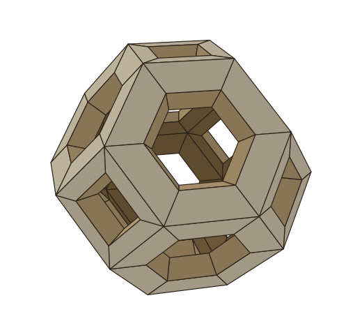
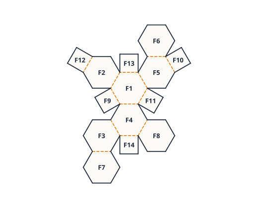

:layout: book
:type: solid
:order: 4
:canonical_id: P-02.04
:title: P-02.04 · Truncated Octahedron
:featured_image: solids/02-archimedean/truncated-octahedron/truncated-octahedron.svg
:featured_image_alt: Truncated Octahedron
:categories: 02-archimedean
:tags: archimedean, truncation, octahedron, space-filling, permutohedron, pacioli
:excerpt: A space-filling Archimedean solid formed by truncating the vertices of a regular octahedron at one-third edge length.

=================================
P-02.04 · Truncated Octahedron
=================================

*Octahedron Abscisum · Field: :math:`\mathbb{Q}` · Symmetry: :math:`O_h` (order 48) · Convex · Archimedes of Syracuse*

.. epigraph::

   *Octahedron abscisum fit per abscisionem sex angulorum solidorum regularis octaedri... unde fiunt sex bases quadratae et octo hexagonae.*

   *The truncated octahedron is made by cutting away the six solid angles of the regular octahedron... whence arise six square bases and eight hexagonal bases.*

   — **Luca Pacioli**, *De Divina Proportione*, Cap. XXIII (Venice, 1509)

.. enunciation::

   The **Truncated Octahedron** (*Octahedron Abscisum*, Lord Kelvin's ideal foam cell, and the order-4 permutohedron) is the unique space-filling Archimedean solid formed by truncating the six corners of a regular octahedron at one-third edge depth (:math:`t = 1/3`). Bounded by 6 squares and 8 regular hexagons with 24 vertices and 36 edges, every vertex is surrounded by one square and two hexagons (:math:`4 \cdot 6^2`).

.. picture:: truncated-octahedron.svg
   :alt: Truncated Octahedron

Interactive 3D Studio
---------------------

.. raw:: html

   

.. note::

   **Interactive Studio Controls**:

   - **Display Modes**: Switch between **Surfaces** (studio-lit polygonal facets), **Wireframe** (depth-cued structural edges), and **Frame** (mitered hollow beam manifold).
   - **Opacity & Aperture Sliders**: Adjust surface transparency from ``0%`` to ``100%`` in **Surfaces** and **Frame** modes, and tune the window **Aperture** in **Frame** mode.
   - **Vertices, Dual & Golden φ**: Toggle **Vertices** (default ON), **Dual** (the face-center dual whose vertices are the exact centers of the sides), and **Golden φ** (:math:`\phi : 1` golden sections and :math:`1 : \phi` golden rectangles).

Machine-Verified Symbolic Certificate
-------------------------------------

.. list-table::
   :widths: 35 30 35
   :header-rows: 1

   * - Mathematical Invariant
     - Exact Symbolic Value
     - Geometric Interpretation
   * - **Catalog Identifier**
     - ``P-02.04``
     - Family 02 (Archimedean Solids), Solid 04
   * - **Algebraic Number Field**
     - :math:`\mathbb{Q}`
     - Pure rational field
   * - **Topology**
     - :math:`(V=24, E=36, F=14)`
     - Euler characteristic :math:`\chi = 24 - 36 + 14 = 2`
   * - **Face Composition**
     - 6 squares + 8 regular hexagons
     - Vertex figure :math:`4 \cdot 6^2`
   * - **Exact Edge Quadrance** :math:`Q_E`
     - :math:`2/9`
     - Edge length :math:`s = \frac{\sqrt{2}}{3}`
   * - **Exact Circumquadrance** :math:`Q_{\text{out}}`
     - :math:`5/9`
     - Circumradius :math:`R = \frac{\sqrt{5}}{3}`
   * - **Primary Dihedral Spread** :math:`s`
     - :math:`8/9`
     - Hexagon-to-square spread: :math:`s = 8/9`, identical to regular octahedron
   * - **Vacuum Manifold**
     - :math:`(V=192, E=432, F=216)`
     - Genus :math:`g = F - 1 = 13`, :math:`\chi = -24`
   * - **Polar Dual**
     - Tetrakis Hexahedron
     - Catalan solid with 24 isosceles triangular faces
   * - **Symmetry Group**
     - :math:`O_h` (order 48)
     - Full octahedral chiral and reflection group
   * - **Historical Canon**
     - Archimedes of Syracuse; Heron *Definitiones*
     - Pacioli *De Divina Proportione* Cap. XXIII; Tabulae XVII–XVIII

Exact Coordinate Representative Ledger & Algebraic Construction
---------------------------------------------------------------

Canonical Permutohedron Coordinates
~~~~~~~~~~~~~~~~~~~~~~~~~~~~~~~~~~~

In the GEOMETOR formulation, the 24 vertices of the truncated octahedron are generated by all coordinate permutations of :math:`(0, \pm 1/3, \pm 2/3)`:

.. list-table::
   :widths: 25 35 40
   :header-rows: 1

   * - Coordinate Family
     - Exact Symbolic Generator
     - Number of Vertices
   * - $x = 0$ plane
     - $(0, \pm 1/3, \pm 2/3), \; (0, \pm 2/3, \pm 1/3)$
     - 8 vertices
   * - $y = 0$ plane
     - $(\pm 1/3, 0, \pm 2/3), \; (\pm 2/3, 0, \pm 1/3)$
     - 8 vertices
   * - $z = 0$ plane
     - $(\pm 1/3, \pm 2/3, 0), \; (\pm 2/3, \pm 1/3, 0)$
     - 8 vertices

Every vertex has exact rational circumquadrance:

.. math::

   Q_{\text{out}} = 0^2 + (1/3)^2 + (2/3)^2 = \frac{1}{9} + \frac{4}{9} = \frac{5}{9}

All 36 edges have uniform quadrance :math:`Q_E = 2/9`. Because the truncated octahedron tiles 3-space without voids (the bitruncated cubic honeycomb), in 1887 Lord Kelvin proposed this solid as the optimal geometry for partition of space into equal-volume cells of minimum surface area.

Leonardo da Vinci's 1509 Woodcuts & Corpus Vacuum Reconstruction
----------------------------------------------------------------

In Luca Pacioli's *De Divina Proportione* (1509), Leonardo da Vinci rendered the truncated octahedron in Tabulae XVII and XVIII as *Octahedron Abscisum Solidum* and *Octahedron Abscisum Vacuum*.

   *Exact Symbolic Reconstruction*: Open wooden framework (:math:`\mu = 0.25`) of genus :math:`g = 13` and Euler characteristic :math:`\chi = -24`.

.. list-table::
   :widths: 50 50
   :header-rows: 1

   * - Leonardo da Vinci (1509 Woodcut)
     - Classical Designation & Codex Study
   * - .. figure:: /leonardo/plates/0223.g1.png
          :alt: Leonardo da Vinci Tabula XVII Folio 0223 - Octahedron Abscisum Solidum
          :width: 100%

          **Tabula XVII (Folio 0223)**: *Octahedron Abscisum Solidum*
     - Detailed codex analysis in :doc:`Tabulae XVII–XVIII: Octahedron Abscisum </leonardo/tabula-17-18-octahedron-abscisum>`.
       Solid space-filling cell with hexagonal and square facets.
   * - .. figure:: /leonardo/plates/0225.g1.png
          :alt: Leonardo da Vinci Tabula XVIII Folio 0225 - Octahedron Abscisum Vacuum
          :width: 100%

          **Tabula XVIII (Folio 0225)**: *Octahedron Abscisum Vacuum*
     - Detailed codex analysis in :doc:`Tabulae XVII–XVIII: Octahedron Abscisum </leonardo/tabula-17-18-octahedron-abscisum>`.
       Hollow wooden frame showing interior hexagonal conduits and diagonal joinery.

Unfolded 2D Papercraft Net
--------------------------

The truncated octahedron unfolds into the Euclidean plane along 23 cut edges into a symmetrical net of eight hexagons and six squares:

   *2D Dihedral-Hinge Unfolding*: Fourteen polygons joined along 13 internal hinges (dashed lines) and 46 boundary cut edges (solid lines).
