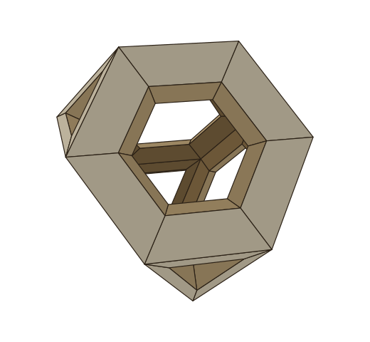
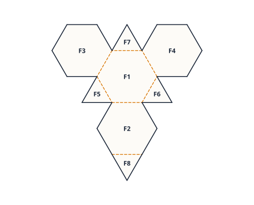

:layout: book
:type: solid
:order: 1
:canonical_id: P-02.01
:title: P-02.01 · Truncated Tetrahedron
:featured_image: solids/02-archimedean/truncated-tetrahedron/truncated-tetrahedron.svg
:featured_image_alt: Truncated Tetrahedron
:categories: 02-archimedean
:tags: archimedean, truncation, tetrahedron, pacioli, semi-regular
:excerpt: An Archimedean solid formed by truncating the vertices of a regular tetrahedron at one-third edge length.

==================================
P-02.01 · Truncated Tetrahedron
==================================

*Tetrahedron Abscisum · Field: :math:`\mathbb{Q}` · Symmetry: :math:`T_d` (order 24) · Convex · Archimedes of Syracuse*

.. epigraph::

   *Tetrahedron abscisum fit per abscisionem quatuor angulorum solidorum regularis tetraedri ad tertiam partem uniuscuiusque costae.*

   *The truncated tetrahedron is made by cutting away the four solid angles of the regular tetrahedron at the third part of each edge.*

   — **Luca Pacioli**, *De Divina Proportione*, Cap. XXVII (Venice, 1509)

.. enunciation::

   The **Truncated Tetrahedron** (*Tetrahedron Abscisum*) is the simplest Archimedean semi-regular polyhedron, formed by cutting off the four corners of a regular tetrahedron at one-third of its edge length (:math:`t = 1/3`). Bounded by 4 equilateral triangles and 4 regular hexagons with 12 vertices and 18 edges, every vertex is surrounded identically by one triangle and two hexagons (:math:`3 \cdot 6^2`).

.. picture:: truncated-tetrahedron.svg
   :alt: Truncated Tetrahedron

Interactive 3D Solid & Vacuum Studio
------------------------------------

.. raw:: html

   

.. note::

   **Interactive Codex Controls**:
   
   - **Orbit & Inspect**: Click and drag to orbit in three dimensions. Scroll or pinch to zoom.
   - **Variant Toggle**: Switch between Leonardo da Vinci's *Vacuum* (open wooden beam lattice), *Solidum* (opaque planar facets), and *Platonic Origin* (regular tetrahedron).
   - **Aperture Slider**: Scrub the wooden beam aperture parameter :math:`\mu \in [0.10, 0.45]` to inspect Leonardo's interior hexagonal joinery.
   - **Perspective Snap**: Reset camera to Leonardo da Vinci's canonical 1509 woodcut vantage point.

Machine-Verified Symbolic Certificate
-------------------------------------

.. list-table::
   :widths: 35 30 35
   :header-rows: 1

   * - Mathematical Invariant
     - Exact Symbolic Value
     - Geometric Interpretation
   * - **Catalog Identifier**
     - ``P-02.01``
     - Family 02 (Archimedean Solids), Solid 01
   * - **Algebraic Number Field**
     - :math:`\mathbb{Q}`
     - Pure rational field
   * - **Topology**
     - :math:`(V=12, E=18, F=8)`
     - Euler characteristic :math:`\chi = 12 - 18 + 8 = 2`
   * - **Face Composition**
     - 4 equilateral triangles + 4 regular hexagons
     - Vertex figure :math:`3 \cdot 6^2`
   * - **Exact Edge Quadrance** :math:`Q_E`
     - :math:`8/9`
     - Edge length :math:`s = \frac{2\sqrt{2}}{3}` (:math:`1/3` of tetrahedron edge)
   * - **Exact Circumquadrance** :math:`Q_{\text{out}}`
     - :math:`11/9`
     - Circumradius :math:`R = \frac{\sqrt{11}}{3}`
   * - **Primary Dihedral Spread** :math:`s`
     - :math:`8/9`
     - Hexagon-to-triangle dihedral spread: identical to regular tetrahedron
   * - **Vacuum Manifold**
     - :math:`(V=96, E=216, F=108)`
     - Genus :math:`g = F - 1 = 7`, :math:`\chi = -12`
   * - **Polar Dual**
     - Triakis Tetrahedron
     - Catalan solid with 12 isosceles triangular faces
   * - **Symmetry Group**
     - :math:`T_d` (order 24)
     - Full tetrahedral chiral and reflection group
   * - **Historical Canon**
     - Archimedes of Syracuse; Heron *Definitiones*
     - Pacioli *De Divina Proportione* Cap. XXVII; Tabulae III–IIII

Exact Coordinate Representative Ledger & Algebraic Construction
---------------------------------------------------------------

Canonical Rational Coordinates
~~~~~~~~~~~~~~~~~~~~~~~~~~~~~~

Generated by applying the exact corner truncation operator ``truncate(solid, t=1/3)`` to the canonical regular tetrahedron over :math:`\mathbb{Z}^3`:

.. list-table::
   :widths: 20 40 40
   :header-rows: 1

   * - Vertex Index
     - Exact Symbolic Coordinates $(x, y, z)$
     - Circumquadrance $Q_{\text{out}}$
   * - $V_0, V_1$
     - $(1, 1/3, 1/3), \; (1, -1/3, -1/3)$
     - $1 + 1/9 + 1/9 = 11/9$
   * - $V_2, V_3$
     - $(1/3, 1, 1/3), \; (-1/3, 1, -1/3)$
     - $1/9 + 1 + 1/9 = 11/9$
   * - $V_4, V_5$
     - $(1/3, 1/3, 1), \; (-1/3, -1/3, 1)$
     - $1/9 + 1/9 + 1 = 11/9$
   * - $V_6, V_7$
     - $(1/3, -1/3, -1), \; (-1/3, 1/3, -1)$
     - $1/9 + 1/9 + 1 = 11/9$
   * - $V_8, V_9$
     - $(1/3, -1, -1/3), \; (-1/3, -1, 1/3)$
     - $1/9 + 1 + 1/9 = 11/9$
   * - $V_{10}, V_{11}$
     - $(-1, 1/3, -1/3), \; (-1, -1/3, 1/3)$
     - $1 + 1/9 + 1/9 = 11/9$

The 18 edges have uniform rational quadrance :math:`Q_E = 8/9`, proving that all faces are regular equilateral triangles and regular hexagons.

Leonardo da Vinci's 1509 Woodcuts & Corpus Vacuum Reconstruction
----------------------------------------------------------------

In Luca Pacioli's *De Divina Proportione* (1509), Leonardo da Vinci rendered the truncated tetrahedron in Tabulae III and IIII as *Tetrahedron Abscisum Solidum* and *Tetrahedron Abscisum Vacuum*.

   *Exact Symbolic Reconstruction*: Open wooden framework (:math:`\mu = 0.25`) of genus :math:`g = 7` and Euler characteristic :math:`\chi = -12`.

.. list-table::
   :widths: 50 50
   :header-rows: 1

   * - Leonardo da Vinci (1509 Woodcut)
     - Classical Designation & Codex Study
   * - .. figure:: /leonardo/plates/0191.g1.png
          :alt: Leonardo da Vinci Tabula III Folio 0191 - Tetrahedron Abscisum Solidum
          :width: 100%

          **Tabula III (Folio 0191)**: *Tetrahedron Abscisum Solidum*
     - Detailed codex analysis in :doc:`Tabulae III–IIII: Tetrahedron Abscisum </leonardo/tabula-03-04-tetrahedron-abscisum>`.
       Opaque semi-regular body with hexagonal and triangular facets.
   * - .. figure:: /leonardo/plates/0193.g1.png
          :alt: Leonardo da Vinci Tabula IIII Folio 0193 - Tetrahedron Abscisum Vacuum
          :width: 100%

          **Tabula IIII (Folio 0193)**: *Tetrahedron Abscisum Vacuum*
     - Detailed codex analysis in :doc:`Tabulae III–IIII: Tetrahedron Abscisum </leonardo/tabula-03-04-tetrahedron-abscisum>`.
       Open wooden framework displaying internal hexagonal corridors and triangular windows.

Unfolded 2D Papercraft Net
--------------------------

The truncated tetrahedron unfolds into the Euclidean plane along 11 cut edges into a symmetrical planar net of four hexagons and four triangles:

   *2D Dihedral-Hinge Unfolding*: Four regular hexagons and four equilateral triangles joined along seven internal hinges (dashed lines) and twenty-two boundary cut edges (solid lines).
