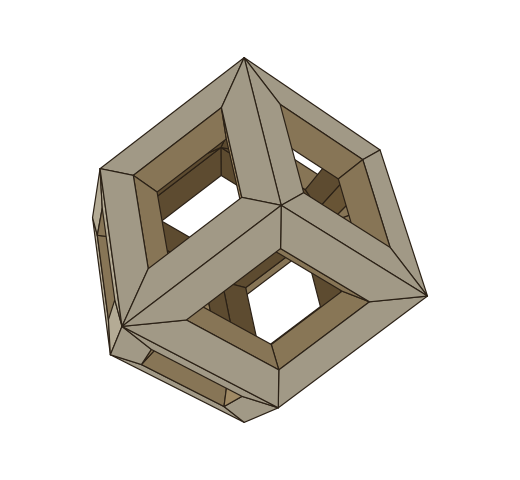
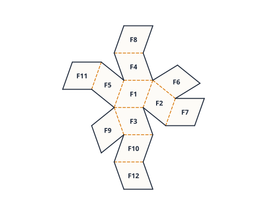

:layout: book
:type: solid
:order: 1
:canonical_id: P-03.01
:title: P-03.01 · Rhombic Dodecahedron
:featured_image: solids/03-catalan/rhombic-dodecahedron/rhombic-dodecahedron.svg
:featured_image_alt: Rhombic Dodecahedron
:categories: 03-catalan
:tags: catalan, polar-dual, space-filling, rhombus, kepler
:excerpt: A Catalan solid and space-filling polyhedron bounded by 12 congruent rhombi, polar dual to the cuboctahedron.

==============================
P-03.01 · Rhombic Dodecahedron
==============================

*Dodecahedron Rhombicum · Field: :math:`\mathbb{Q}` · Symmetry: O_h (order 48) · Convex*

.. enunciation::

   A Catalan solid and space-filling polyhedron bounded by 12 congruent rhombi, polar dual to the cuboctahedron.

.. picture:: rhombic-dodecahedron.svg
   :alt: Rhombic Dodecahedron

Interactive 3D Solid & Vacuum Studio
------------------------------------

.. raw:: html

   

Machine-Verified Symbolic Certificate
-------------------------------------

.. list-table::
   :widths: 30 70
   :header-rows: 0

   * - **Canonical Identifier**
     - ``P-03.01``
   * - **Classical Latin Name**
     - *Dodecahedron Rhombicum*
   * - **Polyhedral Family**
     - 03-catalan
   * - **Number Field**
     - :math:`\mathbb{Q}`
   * - **Topology Invariants**
     - :math:`V = 14,\; E = 24,\; F = 12,\; \chi = 2`
   * - **Face Composition**
     - 12 rhombi
   * - **Exact Edge Quadrance(s)**
     - :math:`Q_e = \frac{27}{16}`
   * - **Exact Vertex Quadrance(s)**
     - :math:`Q_v = \frac{27}{16}, Q_v = \frac{9}{4}`
   * - **Primary Dihedral Spread**
     - :math:`S = \frac{3}{4}`
   * - **Vacuum Manifold Invariants**
     - :math:`V_{\text{vac}} = 124,\; E_{\text{vac}} = 288,\; F_{\text{vac}} = 144,\; g = 11`
   * - **Polar Dual / Parent Solid**
     - :doc:`Cuboctahedron </solids/02-archimedean/cuboctahedron/index>`
   * - **Symmetry Group**
     - O_h (order 48)
   * - **Historical Literature**
     - **Johannes Kepler**, Strena seu de Nive Sexangula (1611); **Eugène Catalan** (1865)

Exact Algebraic Coordinates & Geometric Proof
---------------------------------------------
The **Rhombic Dodecahedron** is the polar dual of the semi-regular Archimedean cuboctahedron.
Its 14 vertices partition into two distinct orbits under octahedral symmetry :math:`O_h`:

- **6 Degree-4 Vertices** (axial): placed at :math:`(\pm 3/2, 0, 0)`, :math:`(0, \pm 3/2, 0)`, :math:`(0, 0, \pm 3/2)` with vertex quadrance :math:`Q_v = 9/4`.
- **8 Degree-3 Vertices** (cubic corners): placed at :math:`(\pm 3/4, \pm 3/4, \pm 3/4)` with vertex quadrance :math:`Q_v = 27/16`.

Each of the 12 faces is a congruent rhombus whose diagonal lengths satisfy:

- **Long Diagonal** :math:`d_1`: connects opposite degree-4 vertices with length :math:`d_1 = \sqrt{(3/2)^2 + (3/2)^2} = \frac{3\sqrt{2}}{2}`.
- **Short Diagonal** :math:`d_2`: connects opposite degree-3 vertices with length :math:`d_2 = \sqrt{2 \times (3/2)^2} = \frac{3}{2}`.
- **Diagonal Ratio**: :math:`\frac{d_1}{d_2} = \sqrt{2} : 1` (quadrance ratio :math:`2 : 1`).

Because :math:`\sqrt{2}` is the ratio of face diagonals, the rhombic dodecahedron packs three-dimensional Euclidean space :math:`\mathbb{R}^3` without voids as the Voronoi cell of the face-centered cubic lattice. All vertex coordinates and edge quadrances lie strictly in the rational field :math:`\mathbb{Q}`.

Leonardo da Vinci's Woodcuts & Corpus Vacuum Reconstruction
-----------------------------------------------------------

   **Hollow Framework**: *Dodecahedron Rhombicum Vacuum* (topological genus :math:`g = 11`).

Unfolded 2D Papercraft Net
--------------------------

   **Unfolded Net**: Planar polygon unfolding layout with perimeter cut lines and interior hinge folds.
