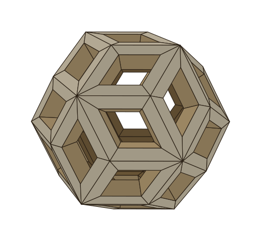
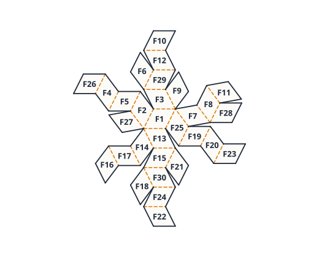

:layout: book
:type: solid
:order: 2
:canonical_id: P-03.02
:title: P-03.02 · Rhombic Triacontahedron
:featured_image: solids/03-catalan/rhombic-triacontahedron/rhombic-triacontahedron.svg
:featured_image_alt: Rhombic Triacontahedron
:categories: 03-catalan
:tags: catalan, polar-dual, golden-ratio, zonohedron, kepler, phi
:excerpt: A Catalan zonohedron bounded by 30 congruent golden rhombi, polar dual to the icosidodecahedron.

=================================
P-03.02 · Rhombic Triacontahedron
=================================

*Triacontahedron Rhombicum · Field: :math:`\mathbb{Q}(\phi)` · Symmetry: I_h (order 120) · Convex*

.. enunciation::

   A Catalan zonohedron bounded by 30 congruent golden rhombi, polar dual to the icosidodecahedron.

.. picture:: rhombic-triacontahedron.svg
   :alt: Rhombic Triacontahedron

Interactive 3D Solid & Vacuum Studio
------------------------------------

.. raw:: html

   

Machine-Verified Symbolic Certificate
-------------------------------------

.. list-table::
   :widths: 30 70
   :header-rows: 0

   * - **Canonical Identifier**
     - ``P-03.02``
   * - **Classical Latin Name**
     - *Triacontahedron Rhombicum*
   * - **Polyhedral Family**
     - 03-catalan
   * - **Number Field**
     - :math:`\mathbb{Q}(\phi)`
   * - **Topology Invariants**
     - :math:`V = 32,\; E = 60,\; F = 30,\; \chi = 2`
   * - **Face Composition**
     - 30 golden rhombi
   * - **Exact Edge Quadrance(s)**
     - :math:`Q_e = \frac{5 \sqrt{5}}{32} + \frac{25}{32}`
   * - **Exact Vertex Quadrance(s)**
     - :math:`Q_v = \frac{15 \sqrt{5}}{32} + \frac{45}{32}, Q_v = \frac{5 \sqrt{5}}{8} + \frac{25}{16}`
   * - **Primary Dihedral Spread**
     - :math:`S = \frac{5}{8} - \frac{\sqrt{5}}{8}`
   * - **Vacuum Manifold Invariants**
     - :math:`V_{\text{vac}} = 304,\; E_{\text{vac}} = 720,\; F_{\text{vac}} = 360,\; g = 29`
   * - **Polar Dual / Parent Solid**
     - :doc:`Icosidodecahedron </solids/02-archimedean/icosidodecahedron/index>`
   * - **Symmetry Group**
     - I_h (order 120)
   * - **Historical Literature**
     - **Johannes Kepler**, Harmonices Mundi (1619), Lib. II; **Eugène Catalan** (1865)

Exact Algebraic Coordinates & Geometric Proof
---------------------------------------------
The **Rhombic Triacontahedron** is the polar dual of the quasi-regular Archimedean icosidodecahedron.
Its 32 vertices partition into two concentric golden orbits under icosahedral symmetry :math:`I_h`:

- **12 Degree-5 Vertices**: corresponding to the vertices of an inscribed regular icosahedron.
- **20 Degree-3 Vertices**: corresponding to the vertices of an inscribed regular dodecahedron.

Each of the 30 faces is a congruent **golden rhombus** whose diagonal ratio is the Divine Proportion :math:`\phi`:

.. math::

   \frac{d_{\text{long}}}{d_{\text{short}}} = \phi = \frac{1 + \sqrt{5}}{2} \implies \frac{Q_{\text{long}}}{Q_{\text{short}}} = \phi^2 = \phi + 1

The solid is a zonohedron formed by the orthogonal projection of a 6-dimensional hypercube into :math:`\mathbb{R}^3`. Every edge has uniform quadrance :math:`Q_e = \frac{25 + 5\sqrt{5}}{32}`, and the primary dihedral spread is :math:`S = \frac{5 - \sqrt{5}}{8}` (dihedral angle :math:`144^\circ`).

For deep harmonic proofs and George Odom sections, consult:

- :doc:`Rhombic Triacontahedron in the Golden Canon </golden/rhombic_triacontahedron>`

Leonardo da Vinci's Woodcuts & Corpus Vacuum Reconstruction
-----------------------------------------------------------

   **Hollow Framework**: *Triacontahedron Rhombicum Vacuum* (topological genus :math:`g = 29`).

Unfolded 2D Papercraft Net
--------------------------

   **Unfolded Net**: Planar polygon unfolding layout with perimeter cut lines and interior hinge folds.
