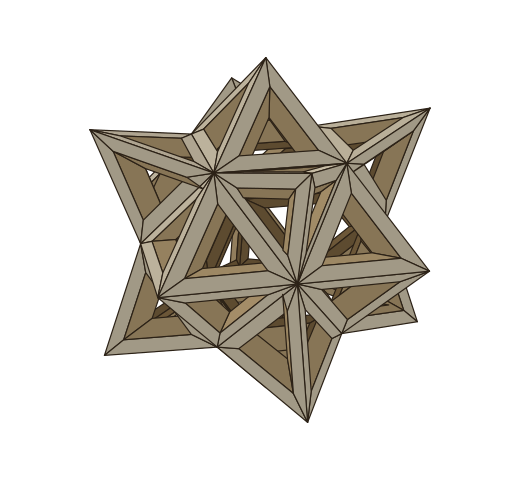

:layout: book
:type: solid
:order: 6
:canonical_id: P-04.06
:title: P-04.06 · Cuboctahedron Elevatum
:featured_image: solids/04-elevated/cuboctahedron-elevatum/cuboctahedron-elevatum.svg
:featured_image_alt: Cuboctahedron Elevatum
:categories: 04-elevated
:tags: elevated, stellation, cuboctahedron, pacioli
:excerpt: Pacioli's Exahedron Abscisum Elevatum, formed by erecting equilateral pyramids on the 14 faces of a cuboctahedron.

================================
P-04.06 · Cuboctahedron Elevatum
================================

*Exahedron Abscisum Elevatum · Field: :math:`\mathbb{Q}` · Symmetry: O_h (order 48) · Non-Convex*

.. enunciation::

   Pacioli's Exahedron Abscisum Elevatum, formed by erecting equilateral pyramids on the 14 faces of a cuboctahedron.

.. picture:: cuboctahedron-elevatum.svg
   :alt: Cuboctahedron Elevatum

Interactive 3D Solid & Vacuum Studio
------------------------------------

.. raw:: html

   

Machine-Verified Symbolic Certificate
-------------------------------------

.. list-table::
   :widths: 30 70
   :header-rows: 0

   * - **Canonical Identifier**
     - ``P-04.06``
   * - **Classical Latin Name**
     - *Exahedron Abscisum Elevatum*
   * - **Polyhedral Family**
     - 04-elevated
   * - **Number Field**
     - :math:`\mathbb{Q}`
   * - **Topology Invariants**
     - :math:`V = 26,\; E = 72,\; F = 48,\; \chi = 2`
   * - **Face Composition**
     - 48 equilateral triangles
   * - **Exact Edge Quadrance(s)**
     - :math:`Q_e = 2`
   * - **Exact Vertex Quadrance(s)**
     - :math:`Q_v = 2, Q_v = 4, Q_v = \frac{16}{3}`
   * - **Primary Dihedral Spread**
     - :math:`S = \frac{8}{9}`
   * - **Vacuum Manifold Invariants**
     - :math:`V_{\text{vac}} = 340,\; E_{\text{vac}} = 864,\; F_{\text{vac}} = 432,\; g = 47`
   * - **Polar Dual / Parent Solid**
     - Base: :doc:`Cuboctahedron </solids/02-archimedean/cuboctahedron/index>`
   * - **Symmetry Group**
     - O_h (order 48)
   * - **Historical Literature**
     - **Luca Pacioli** & **Leonardo da Vinci**, De Divina Proportione (1509), Tabulae XIII–XIIII

Exact Algebraic Coordinates & Geometric Proof
---------------------------------------------
The **Cuboctahedron Elevatum** (Exahedron Abscisum Elevatum) is Pacioli's 14-base stellation formed by elevating the 8 triangular and 6 square faces of the Archimedean cuboctahedron.
Starting from the cuboctahedron with 12 vertices at permutations of :math:`(\pm 1, \pm 1, 0)` (edge length :math:`s = \sqrt{2}`):

- **Triangular Apices (8)**: :math:`h_3 = \sqrt{2 - \frac{2}{3}} = \frac{2}{\sqrt{3}}`. Normal :math:`(1, 1, 1)` yields apex :math:`(2/3, 2/3, 2/3) + 2/3(1, 1, 1) = (4/3, 4/3, 4/3)`.
- **Square Apices (6)**: :math:`h_4 = \sqrt{2 - 1} = 1`. Normal :math:`(1, 0, 0)` yields apex :math:`(1, 0, 0) + 1 \cdot (1, 0, 0) = (2, 0, 0)`.

Both sets of apices have strictly rational coordinates! Thus all 26 vertices lie entirely in :math:`\mathbb{Q}`. The manifold contains 48 equilateral triangular faces with genus :math:`g = 47`.

Leonardo da Vinci's Woodcuts & Corpus Vacuum Reconstruction
-----------------------------------------------------------

   **Hollow Framework**: *Exahedron Abscisum Elevatum Vacuum* (topological genus :math:`g = 47`).

.. list-table::
   :widths: 50 50

   * - .. figure:: /leonardo/plates/0211.g1.png
          :align: center
          :alt: Tabula XIII (Folio 0211) - Exahedron Abscisum Elevatum Solidum

          **Tabula XIII (Folio 0211)**: *Exahedron Abscisum Elevatum Solidum*.
     - .. figure:: /leonardo/plates/0217.g1.png
          :align: center
          :alt: Tabula XIIII (0217) - Exahedron Abscisum Elevatum Vacuum

          **Tabula XIIII (Folio 0217)**: *Exahedron Abscisum Elevatum Vacuum*.

For detailed commentary and high-resolution plate studies, consult the manuscript folio codex:

- :doc:`Tabulae XIII–XIIII: Hexahedron Abscisum Elevatum (1509) </leonardo/tabula-13-14-hexahedron-abscisum-elevatum>`
