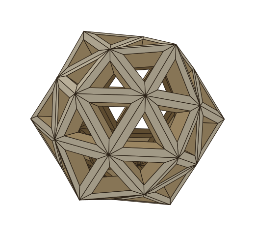

:layout: book
:type: solid
:order: 5
:canonical_id: P-04.05
:title: P-04.05 · Dodecahedron Elevatum
:featured_image: solids/04-elevated/dodecahedron-elevatum/dodecahedron-elevatum.svg
:featured_image_alt: Dodecahedron Elevatum
:categories: 04-elevated
:tags: elevated, stellation, dodecahedron, phi, pacioli, pentakis
:excerpt: A stellated polyhedron formed by erecting equilateral pentagonal pyramids on the twelve faces of a dodecahedron.

===============================
P-04.05 · Dodecahedron Elevatum
===============================

*Dodecahedron Elevatum · Field: :math:`\mathbb{Q}(\sqrt{5 - \sqrt{5}})` · Symmetry: I_h (order 120) · Non-Convex*

.. enunciation::

   A stellated polyhedron formed by erecting equilateral pentagonal pyramids on the twelve faces of a dodecahedron.

.. picture:: dodecahedron-elevatum.svg
   :alt: Dodecahedron Elevatum

Interactive 3D Solid & Vacuum Studio
------------------------------------

.. raw:: html

   

Machine-Verified Symbolic Certificate
-------------------------------------

.. list-table::
   :widths: 30 70
   :header-rows: 0

   * - **Canonical Identifier**
     - ``P-04.05``
   * - **Classical Latin Name**
     - *Dodecahedron Elevatum*
   * - **Polyhedral Family**
     - 04-elevated
   * - **Number Field**
     - :math:`\mathbb{Q}(\sqrt{5 - \sqrt{5}})`
   * - **Topology Invariants**
     - :math:`V = 32,\; E = 90,\; F = 60,\; \chi = 2`
   * - **Face Composition**
     - 60 equilateral triangles
   * - **Exact Edge Quadrance(s)**
     - :math:`Q_e = 6 - 2 \sqrt{5}`
   * - **Exact Vertex Quadrance(s)**
     - :math:`Q_v = 3, Q_v = - \sqrt{5} + \sqrt{50 - 20 \sqrt{5}} + 5`
   * - **Primary Dihedral Spread**
     - :math:`S = \frac{4}{9}`
   * - **Vacuum Manifold Invariants**
     - :math:`V_{\text{vac}} = 424,\; E_{\text{vac}} = 1080,\; F_{\text{vac}} = 540,\; g = 59`
   * - **Polar Dual / Parent Solid**
     - Base: :doc:`Dodecahedron </solids/01-platonic/dodecahedron/index>` · Dual: :doc:`Truncated Icosahedron </solids/02-archimedean/truncated-icosahedron/index>`
   * - **Symmetry Group**
     - I_h (order 120)
   * - **Historical Literature**
     - **Luca Pacioli** & **Leonardo da Vinci**, De Divina Proportione (1509), Tabulae XXXI–XXXII

Exact Algebraic Coordinates & Geometric Proof
---------------------------------------------
The **Dodecahedron Elevatum** (Pentakis Dodecahedron) is formed by erecting equilateral pentagonal pyramids on the 12 pentagonal faces of the regular dodecahedron.
For a regular pentagonal face of side :math:`s = \sqrt{6 - 2\sqrt{5}}`:

- **Pentagon Circumradius Squared**: :math:`r_5^2 = \frac{s^2}{5 - \sqrt{5}}`.
- **Pyramid Altitude**: :math:`h_5 = s \sqrt{\frac{5 - \sqrt{5}}{10}}`.

Erecting 12 pentagonal pyramids produces 12 apices, yielding :math:`V = 20 + 12 = 32` vertices, :math:`E = 90` edges, and :math:`F = 60` equilateral triangular faces. The algebraic number field is the nested radical field :math:`\mathbb{Q}(\sqrt{5 - \sqrt{5}})`. Its topological genus is :math:`g = 60 - 1 = 59`.

Leonardo da Vinci's Woodcuts & Corpus Vacuum Reconstruction
-----------------------------------------------------------

   **Hollow Framework**: *Dodecahedron Elevatum Vacuum* (topological genus :math:`g = 59`).

.. list-table::
   :widths: 50 50

   * - .. figure:: /leonardo/plates/0251.g1.png
          :align: center
          :alt: Tabula XXXI (Folio 0251) - Dodecahedron Elevatum Solidum

          **Tabula XXXI (Folio 0251)**: *Dodecahedron Elevatum Solidum*.
     - .. figure:: /leonardo/plates/0253.g1.png
          :align: center
          :alt: Tabula XXXII (0253) - Dodecahedron Elevatum Vacuum

          **Tabula XXXII (Folio 0253)**: *Dodecahedron Elevatum Vacuum*.

For detailed commentary and high-resolution plate studies, consult the manuscript folio codex:

- :doc:`Tabulae XXXI–XXXII: Dodecahedron Elevatum Solidum et Vacuum (1509) </leonardo/tabula-31-32-dodecahedron-elevatum>`
