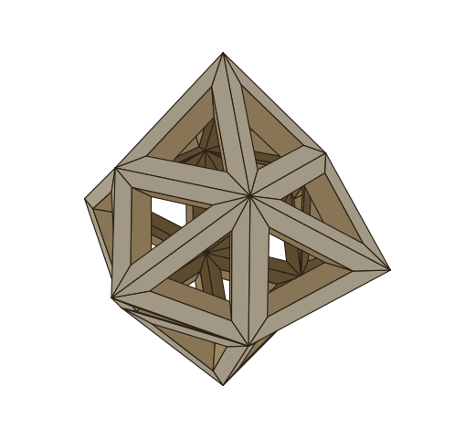

:layout: book
:type: solid
:order: 2
:canonical_id: P-04.02
:title: P-04.02 · Hexahedron Elevatum
:featured_image: solids/04-elevated/hexahedron-elevatum/hexahedron-elevatum.svg
:featured_image_alt: Hexahedron Elevatum
:categories: 04-elevated
:tags: elevated, stellation, cube, pacioli, tetrakis
:excerpt: A stellated polyhedron formed by erecting equilateral pyramids on the six faces of a cube.

=============================
P-04.02 · Hexahedron Elevatum
=============================

*Exahedron Elevatum · Field: :math:`\mathbb{Q}(\sqrt{2})` · Symmetry: O_h (order 48) · Non-Convex*

.. enunciation::

   A stellated polyhedron formed by erecting equilateral pyramids on the six faces of a cube.

.. picture:: hexahedron-elevatum.svg
   :alt: Hexahedron Elevatum

Interactive 3D Studio
---------------------

.. raw:: html

   

Machine-Verified Symbolic Certificate
-------------------------------------

.. list-table::
   :widths: 30 70
   :header-rows: 0

   * - **Canonical Identifier**
     - ``P-04.02``
   * - **Classical Latin Name**
     - *Exahedron Elevatum*
   * - **Polyhedral Family**
     - 04-elevated
   * - **Number Field**
     - :math:`\mathbb{Q}(\sqrt{2})`
   * - **Topology Invariants**
     - :math:`V = 14,\; E = 36,\; F = 24,\; \chi = 2`
   * - **Face Composition**
     - 24 equilateral triangles
   * - **Exact Edge Quadrance(s)**
     - :math:`Q_e = 4`
   * - **Exact Vertex Quadrance(s)**
     - :math:`Q_v = 3, Q_v = 2 \sqrt{2} + 3`
   * - **Primary Dihedral Spread**
     - :math:`S = \frac{8}{9}`
   * - **Vacuum Manifold Invariants**
     - :math:`V_{\text{vac}} = 172,\; E_{\text{vac}} = 432,\; F_{\text{vac}} = 216,\; g = 23`
   * - **Polar Dual / Parent Solid**
     - Base: :doc:`Hexahedron (Cube) </solids/01-platonic/hexahedron/index>` · Dual: :doc:`Truncated Octahedron </solids/02-archimedean/truncated-octahedron/index>`
   * - **Symmetry Group**
     - O_h (order 48)
   * - **Historical Literature**
     - **Luca Pacioli** & **Leonardo da Vinci**, De Divina Proportione (1509), Tabulae XI–XII

Exact Algebraic Coordinates & Geometric Proof
---------------------------------------------
The **Hexahedron Elevatum** (Tetrakis Hexahedron) is constructed by erecting equilateral square pyramids on the 6 faces of a cube.
Starting from the canonical cube with 8 vertices :math:`(\pm 1, \pm 1, \pm 1)` (edge length :math:`s = 2`, quadrance :math:`s^2 = 4`):

- **Square Face Circumradius Squared**: :math:`r_4^2 = \frac{s^2}{2} = 2`.
- **Pyramid Altitude**: :math:`h_4 = \sqrt{s^2 - r_4^2} = \sqrt{4 - 2} = \sqrt{2}`.
- **6 Apices**: Displaced by :math:`h_4 = \sqrt{2}` along the 6 coordinate axes:

.. math::

   (\pm(1 + \sqrt{2}), 0, 0), \quad (0, \pm(1 + \sqrt{2}), 0), \quad (0, 0, \pm(1 + \sqrt{2}))

The 14 vertices lie in the quadratic extension field :math:`\mathbb{Q}(\sqrt{2})` and span 24 congruent equilateral triangular faces.

Leonardo da Vinci's Woodcuts & Corpus Vacuum Reconstruction
-----------------------------------------------------------

   **Hollow Framework**: *Exahedron Elevatum Vacuum* (topological genus :math:`g = 23`).

.. list-table::
   :widths: 50 50

   * - .. figure:: /leonardo/plates/0207.g1.png
          :align: center
          :alt: Tabula XI (Folio 0207) - Exahedron Elevatum Solidum

          **Tabula XI (Folio 0207)**: *Exahedron Elevatum Solidum*.
     - .. figure:: /leonardo/plates/0209.g1.png
          :align: center
          :alt: Tabula XII (0209) - Exahedron Elevatum Vacuum

          **Tabula XII (Folio 0209)**: *Exahedron Elevatum Vacuum*.

For detailed commentary and high-resolution plate studies, consult the manuscript folio codex:

- :doc:`Tabulae XI–XII: Hexahedron Elevatum Solidum et Vacuum (1509) </leonardo/tabula-11-12-hexahedron-elevatum>`
