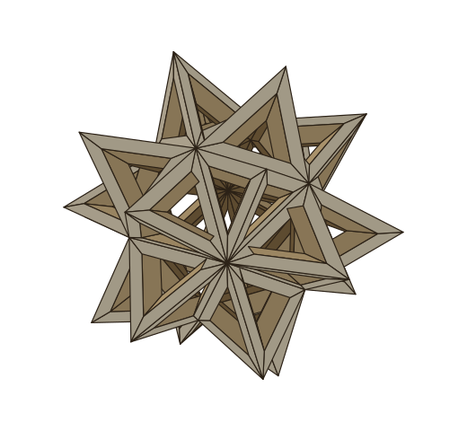

:layout: book
:type: solid
:order: 4
:canonical_id: P-04.04
:title: P-04.04 · Icosahedron Elevatum
:featured_image: solids/04-elevated/icosahedron-elevatum/icosahedron-elevatum.svg
:featured_image_alt: Icosahedron Elevatum
:categories: 04-elevated
:tags: elevated, stellation, icosahedron, phi, pacioli, triakis
:excerpt: A stellated polyhedron formed by erecting equilateral triangular pyramids on the twenty faces of an icosahedron.

==============================
P-04.04 · Icosahedron Elevatum
==============================

*Icosahedron Elevatum · Field: :math:`\mathbb{Q}(\phi, \sqrt{2})` · Symmetry: I_h (order 120) · Non-Convex*

.. enunciation::

   A stellated polyhedron formed by erecting equilateral triangular pyramids on the twenty faces of an icosahedron.

.. picture:: icosahedron-elevatum.svg
   :alt: Icosahedron Elevatum

Interactive 3D Studio
---------------------

.. raw:: html

   

Machine-Verified Symbolic Certificate
-------------------------------------

.. list-table::
   :widths: 30 70
   :header-rows: 0

   * - **Canonical Identifier**
     - ``P-04.04``
   * - **Classical Latin Name**
     - *Icosahedron Elevatum*
   * - **Polyhedral Family**
     - 04-elevated
   * - **Number Field**
     - :math:`\mathbb{Q}(\phi, \sqrt{2})`
   * - **Topology Invariants**
     - :math:`V = 32,\; E = 90,\; F = 60,\; \chi = 2`
   * - **Face Composition**
     - 60 equilateral triangles
   * - **Exact Edge Quadrance(s)**
     - :math:`Q_e = 4`
   * - **Exact Vertex Quadrance(s)**
     - :math:`Q_v = \frac{\sqrt{5}}{2} + \frac{5}{2}, Q_v = \frac{\sqrt{5}}{2} + \frac{2 \sqrt{10}}{3} + 2 \sqrt{2} + \frac{23}{6}`
   * - **Primary Dihedral Spread**
     - :math:`S = \frac{8}{9}`
   * - **Vacuum Manifold Invariants**
     - :math:`V_{\text{vac}} = 424,\; E_{\text{vac}} = 1080,\; F_{\text{vac}} = 540,\; g = 59`
   * - **Polar Dual / Parent Solid**
     - Base: :doc:`Icosahedron </solids/01-platonic/icosahedron/index>` · Dual: :doc:`Truncated Dodecahedron </solids/02-archimedean/truncated-dodecahedron/index>`
   * - **Symmetry Group**
     - I_h (order 120)
   * - **Historical Literature**
     - **Luca Pacioli** & **Leonardo da Vinci**, De Divina Proportione (1509), Tabulae XXV–XXVI

Exact Algebraic Coordinates & Geometric Proof
---------------------------------------------
The **Icosahedron Elevatum** (Triakis Icosahedron) is formed by erecting equilateral triangular pyramids on all 20 faces of the regular icosahedron.
Starting from the 12 golden ratio vertices of the icosahedron over :math:`\mathbb{Q}(\phi)` with edge length :math:`s = 2`:

- **Face Circumradius Squared**: :math:`r_3^2 = \frac{s^2}{3} = \frac{4}{3}`.
- **Pyramid Altitude**: :math:`h_3 = \sqrt{s^2 - r_3^2} = \sqrt{4 - \frac{4}{3}} = \frac{2\sqrt{6}}{3}`.

The 20 erected apices bring the total vertex count to :math:`V = 12 + 20 = 32`, with :math:`E = 90` edges and :math:`F = 60` equilateral triangular faces. The coordinates belong to the biquadratic number field :math:`\mathbb{Q}(\phi, \sqrt{2})`.

Leonardo da Vinci's Woodcuts & Corpus Vacuum Reconstruction
-----------------------------------------------------------

   **Hollow Framework**: *Icosahedron Elevatum Vacuum* (topological genus :math:`g = 59`).

.. list-table::
   :widths: 50 50

   * - .. figure:: /leonardo/plates/0239.g1.png
          :align: center
          :alt: Tabula XXV (Folio 0239) - Icosahedron Elevatum Solidum

          **Tabula XXV (Folio 0239)**: *Icosahedron Elevatum Solidum*.
     - .. figure:: /leonardo/plates/0241.g1.png
          :align: center
          :alt: Tabula XXVI (0241) - Icosahedron Elevatum Vacuum

          **Tabula XXVI (Folio 0241)**: *Icosahedron Elevatum Vacuum*.

For detailed commentary and high-resolution plate studies, consult the manuscript folio codex:

- :doc:`Tabulae XXV–XXVI: Icosahedron Elevatum Solidum et Vacuum (1509) </leonardo/tabula-25-26-icosahedron-elevatum>`
