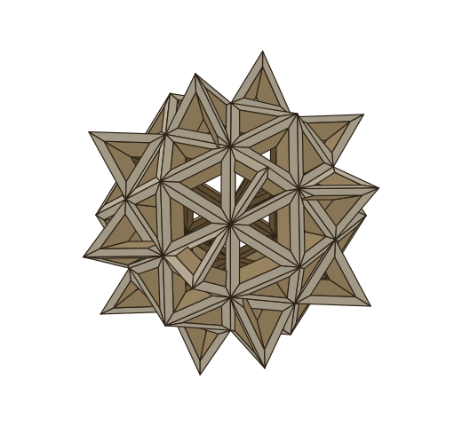

:layout: book
:type: solid
:order: 7
:canonical_id: P-04.07
:title: P-04.07 · Icosidodecahedron Elevatum
:featured_image: solids/04-elevated/icosidodecahedron-elevatum/icosidodecahedron-elevatum.svg
:featured_image_alt: Icosidodecahedron Elevatum
:categories: 04-elevated
:tags: elevated, stellation, icosidodecahedron, pacioli, phi
:excerpt: Pacioli's Dodecahedron Abscisum Elevatum, formed by erecting equilateral pyramids on the 32 faces of an icosidodecahedron.

====================================
P-04.07 · Icosidodecahedron Elevatum
====================================

*Dodecahedron Abscisum Elevatum · Field: :math:`\mathbb{Q}(\sqrt{5 - \sqrt{5}}, \sqrt{2})` · Symmetry: I_h (order 120) · Non-Convex*

.. enunciation::

   Pacioli's Dodecahedron Abscisum Elevatum, formed by erecting equilateral pyramids on the 32 faces of an icosidodecahedron.

.. picture:: icosidodecahedron-elevatum.svg
   :alt: Icosidodecahedron Elevatum

Interactive 3D Solid & Vacuum Studio
------------------------------------

.. raw:: html

   

Machine-Verified Symbolic Certificate
-------------------------------------

.. list-table::
   :widths: 30 70
   :header-rows: 0

   * - **Canonical Identifier**
     - ``P-04.07``
   * - **Classical Latin Name**
     - *Dodecahedron Abscisum Elevatum*
   * - **Polyhedral Family**
     - 04-elevated
   * - **Number Field**
     - :math:`\mathbb{Q}(\sqrt{5 - \sqrt{5}}, \sqrt{2})`
   * - **Topology Invariants**
     - :math:`V = 62,\; E = 180,\; F = 120,\; \chi = 2`
   * - **Face Composition**
     - 120 equilateral triangles
   * - **Exact Edge Quadrance(s)**
     - :math:`Q_e = 1`
   * - **Exact Vertex Quadrance(s)**
     - :math:`Q_v = \frac{\sqrt{5}}{2} + \frac{3}{2}, Q_v = \frac{\sqrt{10}}{3} + \frac{\sqrt{5}}{2} + \sqrt{2} + \frac{11}{6}, Q_v = - \frac{2 \sqrt{5} \sqrt{10 \sqrt{5} + 30}}{5} - \frac{4 \sqrt{5} \sqrt{2 \sqrt{5} + 6}}{5} + \frac{3 \sqrt{5}}{10} + \frac{3}{2} + 2 \sqrt{2 \sqrt{5} + 6} + \sqrt{10 \sqrt{5} + 30}`
   * - **Primary Dihedral Spread**
     - :math:`S = \frac{8}{9}`
   * - **Vacuum Manifold Invariants**
     - :math:`V_{\text{vac}} = 844,\; E_{\text{vac}} = 2160,\; F_{\text{vac}} = 1080,\; g = 119`
   * - **Polar Dual / Parent Solid**
     - Base: :doc:`Icosidodecahedron </solids/02-archimedean/icosidodecahedron/index>`
   * - **Symmetry Group**
     - I_h (order 120)
   * - **Historical Literature**
     - **Luca Pacioli** & **Leonardo da Vinci**, De Divina Proportione (1509), Tabulae XXXIII–XXXIIII

Exact Algebraic Coordinates & Geometric Proof
---------------------------------------------
The **Icosidodecahedron Elevatum** (Dodecahedron Abscisum Elevatum) is Pacioli's massive 32-base stellation formed by elevating the 20 triangular and 12 pentagonal faces of the Archimedean icosidodecahedron.

- **Triangular Faces**: 20 equilateral pyramids erected on triangular facets.
- **Pentagonal Faces**: 12 equilateral pyramids erected on regular pentagonal facets.

The resulting stellated manifold has :math:`V = 30 + 32 = 62` vertices, :math:`E = 180` edges, and :math:`F = 120` equilateral triangular faces. Its number field is :math:`\mathbb{Q}(\sqrt{5 - \sqrt{5}}, \sqrt{2})`, and its hollow framework attains a topological genus of :math:`g = 120 - 1 = 119`.

Leonardo da Vinci's Woodcuts & Corpus Vacuum Reconstruction
-----------------------------------------------------------

   **Hollow Framework**: *Dodecahedron Abscisum Elevatum Vacuum* (topological genus :math:`g = 119`).

.. list-table::
   :widths: 50 50

   * - .. figure:: /leonardo/plates/0255.g1.png
          :align: center
          :alt: Tabula XXXIII (Folio 0255) - Dodecahedron Abscisum Elevatum Solidum

          **Tabula XXXIII (Folio 0255)**: *Dodecahedron Abscisum Elevatum Solidum*.
     - .. figure:: /leonardo/plates/0257.g1.png
          :align: center
          :alt: Tabula XXXIIII (0257) - Dodecahedron Abscisum Elevatum Vacuum

          **Tabula XXXIIII (Folio 0257)**: *Dodecahedron Abscisum Elevatum Vacuum*.

For detailed commentary and high-resolution plate studies, consult the manuscript folio codex:

- :doc:`Tabulae XXXIII–XXXIIII: Dodecahedron Abscisum Elevatum (1509) </leonardo/tabula-33-34-dodecahedron-abscisum-elevatum>`
