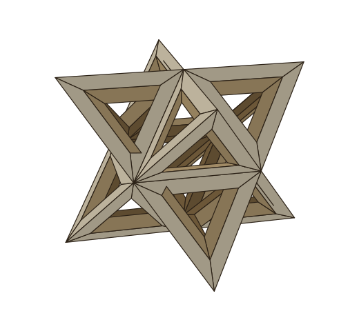

:layout: book
:type: solid
:order: 3
:canonical_id: P-04.03
:title: P-04.03 · Stella Octangula (Octahedron Elevatum)
:featured_image: solids/04-elevated/stella-octangula/stella-octangula.svg
:featured_image_alt: Stella Octangula (Octahedron Elevatum)
:categories: 04-elevated
:tags: elevated, stellation, octahedron, stella-octangula, kepler, compound, pacioli
:excerpt: The Stella Octangula compound of two dual tetrahedra, formed by elevating the eight faces of an octahedron.

================================================
P-04.03 · Stella Octangula (Octahedron Elevatum)
================================================

*Octahedron Elevatum · Field: :math:`\mathbb{Z}` · Symmetry: O_h (order 48) · Non-Convex*

.. enunciation::

   The Stella Octangula compound of two dual tetrahedra, formed by elevating the eight faces of an octahedron.

.. picture:: stella-octangula.svg
   :alt: Stella Octangula (Octahedron Elevatum)

Interactive 3D Solid & Vacuum Studio
------------------------------------

.. raw:: html

   

Machine-Verified Symbolic Certificate
-------------------------------------

.. list-table::
   :widths: 30 70
   :header-rows: 0

   * - **Canonical Identifier**
     - ``P-04.03``
   * - **Classical Latin Name**
     - *Octahedron Elevatum*
   * - **Polyhedral Family**
     - 04-elevated
   * - **Number Field**
     - :math:`\mathbb{Z}`
   * - **Topology Invariants**
     - :math:`V = 14,\; E = 36,\; F = 24,\; \chi = 2`
   * - **Face Composition**
     - 24 equilateral triangles
   * - **Exact Edge Quadrance(s)**
     - :math:`Q_e = 2`
   * - **Exact Vertex Quadrance(s)**
     - :math:`Q_v = 1, Q_v = 3`
   * - **Primary Dihedral Spread**
     - :math:`S = \frac{8}{9}`
   * - **Vacuum Manifold Invariants**
     - :math:`V_{\text{vac}} = 172,\; E_{\text{vac}} = 432,\; F_{\text{vac}} = 216,\; g = 23`
   * - **Polar Dual / Parent Solid**
     - Base: :doc:`Octahedron </solids/01-platonic/octahedron/index>` · Self-dual compound
   * - **Symmetry Group**
     - O_h (order 48)
   * - **Historical Literature**
     - **Luca Pacioli** & **Leonardo da Vinci** (1509), Tabulae XIX–XX; Kepler, Harmonices Mundi (1619)

Exact Algebraic Coordinates & Geometric Proof
---------------------------------------------
The **Stella Octangula** (Octahedron Elevatum) is the regular compound of two dual tetrahedra.
Starting from the regular octahedron with 6 vertices :math:`(\pm 1, 0, 0)`, :math:`(0, \pm 1, 0)`, :math:`(0, 0, \pm 1)` (edge length :math:`s = \sqrt{2}`, quadrance :math:`s^2 = 2`):

- **Face Centroid**: :math:`\mathbf{c}_f = (1/3, 1/3, 1/3)` on face :math:`x + y + z = 1`.
- **Face Circumradius Squared**: :math:`r_3^2 = \frac{s^2}{3} = \frac{2}{3}`.
- **Pyramid Altitude Squared**: :math:`h_3^2 = s^2 - r_3^2 = 2 - \frac{2}{3} = \frac{4}{3}`.
- **Apex Coordinate**: Normal vector :math:`\mathbf{n} = (1, 1, 1)` has quadrance :math:`\|\mathbf{n}\|^2 = 3`:

.. math::

   \mathbf{apex} = \mathbf{c}_f + \sqrt{\frac{h_3^2}{\|\mathbf{n}\|^2}} \mathbf{n} = \left(\frac{1}{3}, \frac{1}{3}, \frac{1}{3}\right) + \frac{2}{3}(1, 1, 1) = (1, 1, 1) \in \mathbb{Z}^3

The 8 erected apices are exactly the 8 integer vertices of a cube :math:`(\pm 1, \pm 1, \pm 1)`! Combined with the 6 octahedron vertices, they form two interleaved dual regular tetrahedra:

- :math:`T_1 = \{(1, 1, 1), (1, -1, -1), (-1, 1, -1), (-1, -1, 1)\}`
- :math:`T_2 = \{(-1, -1, -1), (-1, 1, 1), (1, -1, 1), (1, 1, -1)\}`

Every single coordinate of this 14-vertex star manifold collapses into the pure integer ring :math:`\mathbb{Z}`!

Leonardo da Vinci's Woodcuts & Corpus Vacuum Reconstruction
-----------------------------------------------------------

   **Hollow Framework**: *Octahedron Elevatum Vacuum* (topological genus :math:`g = 23`).

.. list-table::
   :widths: 50 50

   * - .. figure:: /leonardo/plates/0227.g1.png
          :align: center
          :alt: Tabula XIX (Folio 0227) - Octahedron Elevatum Solidum

          **Tabula XIX (Folio 0227)**: *Octahedron Elevatum Solidum*.
     - .. figure:: /leonardo/plates/0229.g1.png
          :align: center
          :alt: Tabula XX (0229) - Octahedron Elevatum Vacuum

          **Tabula XX (Folio 0229)**: *Octahedron Elevatum Vacuum*.

For detailed commentary and high-resolution plate studies, consult the manuscript folio codex:

- :doc:`Tabulae XIX–XX: Octahedron Elevatum Solidum et Vacuum (1509) </leonardo/tabula-19-20-octahedron-elevatum>`
