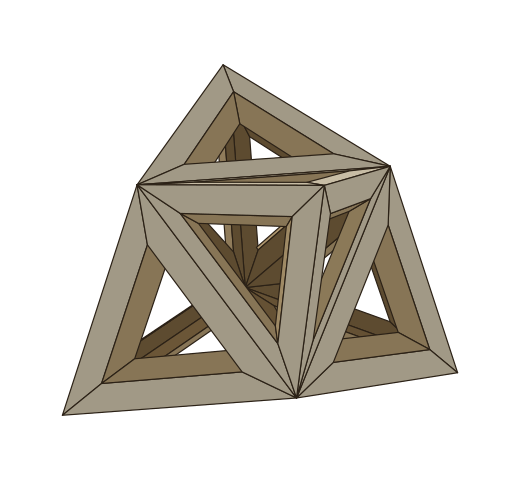

:layout: book
:type: solid
:order: 1
:canonical_id: P-04.01
:title: P-04.01 · Tetrahedron Elevatum
:featured_image: solids/04-elevated/tetrahedron-elevatum/tetrahedron-elevatum.svg
:featured_image_alt: Tetrahedron Elevatum
:categories: 04-elevated
:tags: elevated, stellation, tetrahedron, pacioli, triakis
:excerpt: A stellated polyhedron formed by erecting equilateral triangular pyramids on the four faces of a tetrahedron.

==============================
P-04.01 · Tetrahedron Elevatum
==============================

*Tetrahedron Elevatum · Field: :math:`\mathbb{Q}` · Symmetry: T_d (order 24) · Non-Convex*

.. enunciation::

   A stellated polyhedron formed by erecting equilateral triangular pyramids on the four faces of a tetrahedron.

.. picture:: tetrahedron-elevatum.svg
   :alt: Tetrahedron Elevatum

Interactive 3D Solid & Vacuum Studio
------------------------------------

.. raw:: html

   

Machine-Verified Symbolic Certificate
-------------------------------------

.. list-table::
   :widths: 30 70
   :header-rows: 0

   * - **Canonical Identifier**
     - ``P-04.01``
   * - **Classical Latin Name**
     - *Tetrahedron Elevatum*
   * - **Polyhedral Family**
     - 04-elevated
   * - **Number Field**
     - :math:`\mathbb{Q}`
   * - **Topology Invariants**
     - :math:`V = 8,\; E = 18,\; F = 12,\; \chi = 2`
   * - **Face Composition**
     - 12 equilateral triangles
   * - **Exact Edge Quadrance(s)**
     - :math:`Q_e = 8`
   * - **Exact Vertex Quadrance(s)**
     - :math:`Q_v = 3, Q_v = \frac{25}{3}`
   * - **Primary Dihedral Spread**
     - :math:`S = \frac{8}{9}`
   * - **Vacuum Manifold Invariants**
     - :math:`V_{\text{vac}} = 88,\; E_{\text{vac}} = 216,\; F_{\text{vac}} = 108,\; g = 11`
   * - **Polar Dual / Parent Solid**
     - Base: :doc:`Tetrahedron </solids/01-platonic/tetrahedron/index>` · Dual: :doc:`Truncated Tetrahedron </solids/02-archimedean/truncated-tetrahedron/index>`
   * - **Symmetry Group**
     - T_d (order 24)
   * - **Historical Literature**
     - **Luca Pacioli** & **Leonardo da Vinci**, De Divina Proportione (1509), Tabulae V–VI

Exact Algebraic Coordinates & Geometric Proof
---------------------------------------------
The **Tetrahedron Elevatum** (Triakis Tetrahedron) is constructed by erecting equilateral triangular pyramids on the 4 faces of a regular tetrahedron.
Starting from the regular tetrahedron with vertices :math:`(1, 1, 1)`, :math:`(1, -1, -1)`, :math:`(-1, 1, -1)`, :math:`(-1, -1, 1)` (edge length :math:`s = \sqrt{8}`, quadrance :math:`s^2 = 8`):

- **Face Centroid**: :math:`\mathbf{c}_f = (1/3, 1/3, 1/3)` with normal vector :math:`\mathbf{n} = (1, 1, 1)`.
- **Face Circumradius Squared**: :math:`r_3^2 = \frac{s^2}{3} = \frac{8}{3}`.
- **Pyramid Altitude Squared**: :math:`h_3^2 = s^2 - r_3^2 = 8 - \frac{8}{3} = \frac{16}{3}`.
- **Apex Coordinate**: The altitude displacement along unit normal :math:`\mathbf{n}/\sqrt{3}` is:

.. math::

   \mathbf{apex} = \mathbf{c}_f + \sqrt{\frac{h_3^2}{\|\mathbf{n}\|^2}} \mathbf{n} = \left(\frac{1}{3}, \frac{1}{3}, \frac{1}{3}\right) + \frac{4}{3}(1, 1, 1) = \left(\frac{5}{3}, \frac{5}{3}, \frac{5}{3}\right) \in \mathbb{Q}^3

Remarkably, all square roots completely cancel, placing all 8 vertices strictly within the rational field :math:`\mathbb{Q}`!

Leonardo da Vinci's Woodcuts & Corpus Vacuum Reconstruction
-----------------------------------------------------------

   **Hollow Framework**: *Tetrahedron Elevatum Vacuum* (topological genus :math:`g = 11`).

.. list-table::
   :widths: 50 50

   * - .. figure:: /leonardo/plates/0195.g1.png
          :align: center
          :alt: Tabula V (Folio 0195) - Tetrahedron Elevatum Solidum

          **Tabula V (Folio 0195)**: *Tetrahedron Elevatum Solidum*.
     - .. figure:: /leonardo/plates/0197.g1.png
          :align: center
          :alt: Tabula VI (0197) - Tetrahedron Elevatum Vacuum

          **Tabula VI (Folio 0197)**: *Tetrahedron Elevatum Vacuum*.

For detailed commentary and high-resolution plate studies, consult the manuscript folio codex:

- :doc:`Tabulae V–VI: Tetrahedron Elevatum Solidum et Vacuum (1509) </leonardo/tabula-05-06-tetrahedron-elevatum>`
