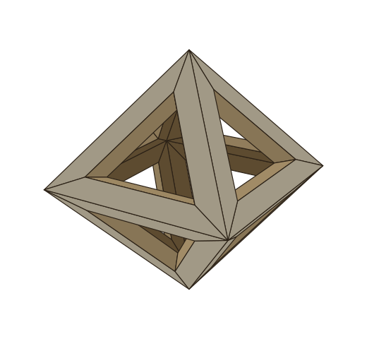
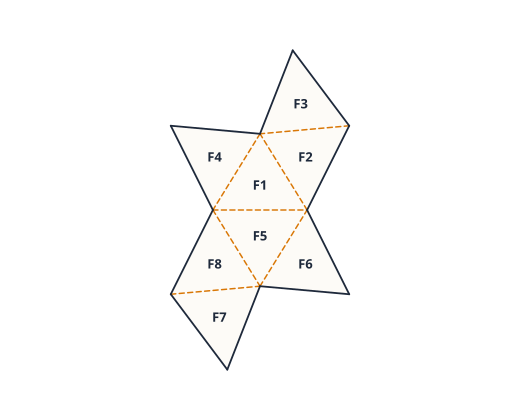

:layout: book
:type: solid
:order: 3
:canonical_id: P-05.03
:title: P-05.03 · Golden Square Bipyramid
:featured_image: solids/05-pyramids/golden-bipyramid/golden-bipyramid.svg
:featured_image_alt: Golden Square Bipyramid
:categories: 05-pyramids
:tags: bipyramid, kepler, phi, golden-ratio, octahedral
:excerpt: An octahedral bipyramid formed by reflecting the Kepler Golden Pyramid across its square base.

=================================
P-05.03 · Golden Square Bipyramid
=================================

*Bipyramis Aurea · Field: :math:`\mathbb{Q}(\sqrt{\phi})` · Symmetry: D_{4h} (order 16) · Convex*

.. enunciation::

   An octahedral bipyramid formed by reflecting the Kepler Golden Pyramid across its square base.

.. picture:: golden-bipyramid.svg
   :alt: Golden Square Bipyramid

Interactive 3D Studio
---------------------

.. raw:: html

   

Machine-Verified Symbolic Certificate
-------------------------------------

.. list-table::
   :widths: 30 70
   :header-rows: 0

   * - **Canonical Identifier**
     - ``P-05.03``
   * - **Classical Latin Name**
     - *Bipyramis Aurea*
   * - **Polyhedral Family**
     - 05-pyramids
   * - **Number Field**
     - :math:`\mathbb{Q}(\sqrt{\phi})`
   * - **Topology Invariants**
     - :math:`V = 6,\; E = 12,\; F = 8,\; \chi = 2`
   * - **Face Composition**
     - 8 Kepler golden triangles
   * - **Exact Edge Quadrance(s)**
     - :math:`Q_e = \frac{\sqrt{5}}{2} + \frac{5}{2}, Q_e = 4`
   * - **Exact Vertex Quadrance(s)**
     - :math:`Q_v = \frac{1}{2} + \frac{\sqrt{5}}{2}, Q_v = 2`
   * - **Primary Dihedral Spread**
     - :math:`S = - \frac{5}{2} + \frac{3 \sqrt{5}}{2}`
   * - **Vacuum Manifold Invariants**
     - :math:`V_{\text{vac}} = 60,\; E_{\text{vac}} = 144,\; F_{\text{vac}} = 72,\; g = 7`
   * - **Polar Dual / Parent Solid**
     - Half-Pyramid: :doc:`Kepler Golden Pyramid </solids/05-pyramids/kepler-pyramid/index>`
   * - **Symmetry Group**
     - D_{4h} (order 16)
   * - **Historical Literature**
     - **Johannes Kepler** (1597); GEOMETOR Golden Pyramid Canon

Exact Algebraic Coordinates & Geometric Proof
---------------------------------------------
The **Golden Square Bipyramid** is formed by reflecting the Kepler Golden Pyramid across its square base.
It consists of 6 vertices and 8 congruent Kepler golden triangles with full octahedral dihedral symmetry :math:`D_{4h}`:

- **Equatorial Base Vertices (4)**: :math:`(\pm 1, \pm 1, 0)` with vertex quadrance :math:`Q_v = 2`.
- **North Apex**: :math:`(0, 0, \sqrt{\phi})` with vertex quadrance :math:`Q_v = \phi`.
- **South Apex**: :math:`(0, 0, -\sqrt{\phi})` with vertex quadrance :math:`Q_v = \phi`.

The 12 edges have uniform slant quadrance :math:`Q_e = 2 + \phi = \frac{5 + \sqrt{5}}{2}`, and every edge shares the exact dihedral spread :math:`S = 3\phi - 4`. Its hollow vacuate framework has topological genus :math:`g = 8 - 1 = 7`.

Hollow Frame Manifold
---------------------

   **Hollow Framework**: *Bipyramis Aurea Vacuum* (topological genus :math:`g = 7`).

Unfolded 2D Papercraft Net
--------------------------

   **Unfolded Net**: Planar polygon unfolding layout with perimeter cut lines and interior hinge folds.
