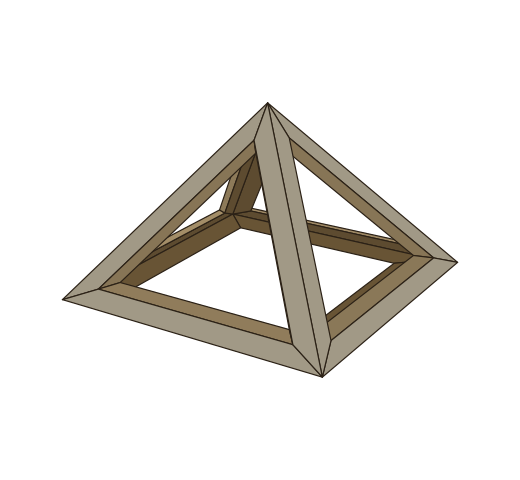
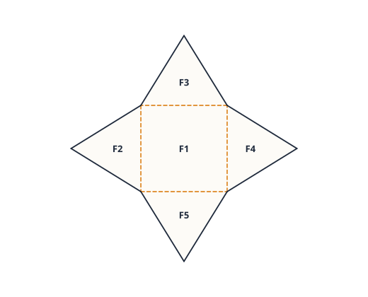

:layout: book
:type: solid
:order: 1
:canonical_id: P-05.01
:title: P-05.01 · Kepler Golden Pyramid
:featured_image: solids/05-pyramids/kepler-pyramid/kepler-pyramid.svg
:featured_image_alt: Kepler Golden Pyramid
:categories: 05-pyramids
:tags: pyramid, kepler, phi, golden-ratio, herodotus, giza
:excerpt: The Great Pyramid profile based on the Kepler right triangle 1 : sqrt(phi) : phi satisfying Herodotus's area law.

===============================
P-05.01 · Kepler Golden Pyramid
===============================

*Pyramis Aurea Kepleriana · Field: :math:`\mathbb{Q}(\sqrt{\phi})` · Symmetry: C_{4v} (order 8) · Convex*

.. enunciation::

   The Great Pyramid profile based on the Kepler right triangle 1 : sqrt(phi) : phi satisfying Herodotus's area law.

.. picture:: kepler-pyramid.svg
   :alt: Kepler Golden Pyramid

Interactive 3D Solid & Vacuum Studio
------------------------------------

.. raw:: html

   

Machine-Verified Symbolic Certificate
-------------------------------------

.. list-table::
   :widths: 30 70
   :header-rows: 0

   * - **Canonical Identifier**
     - ``P-05.01``
   * - **Classical Latin Name**
     - *Pyramis Aurea Kepleriana*
   * - **Polyhedral Family**
     - 05-pyramids
   * - **Number Field**
     - :math:`\mathbb{Q}(\sqrt{\phi})`
   * - **Topology Invariants**
     - :math:`V = 5,\; E = 8,\; F = 5,\; \chi = 2`
   * - **Face Composition**
     - 1 square + 4 Kepler golden triangles
   * - **Exact Edge Quadrance(s)**
     - :math:`Q_e = \frac{\sqrt{5}}{2} + \frac{5}{2}, Q_e = 4`
   * - **Exact Vertex Quadrance(s)**
     - :math:`Q_v = \frac{9}{32} + \frac{9 \sqrt{5}}{32}, Q_v = \frac{\sqrt{5}}{32} + \frac{65}{32}`
   * - **Primary Dihedral Spread**
     - :math:`S = - \frac{5}{2} + \frac{3 \sqrt{5}}{2}`
   * - **Vacuum Manifold Invariants**
     - :math:`V_{\text{vac}} = 42,\; E_{\text{vac}} = 96,\; F_{\text{vac}} = 48,\; g = 4`
   * - **Polar Dual / Parent Solid**
     - Double Pyramid: :doc:`Golden Square Bipyramid </solids/05-pyramids/golden-bipyramid/index>`
   * - **Symmetry Group**
     - C_{4v} (order 8)
   * - **Historical Literature**
     - **Johannes Kepler**, Epistola ad Mästlinum (1597); **Herodotus**, Histories II.124

Exact Algebraic Coordinates & Geometric Proof
---------------------------------------------
The **Kepler Golden Pyramid** is the exact geometric model of the Great Pyramid profile satisfying Herodotus's area law.
Its cross-section along the meridian is the **Kepler right triangle** with side lengths :math:`1 : \sqrt{\phi} : \phi`.

Coordinates in origin-centered space with base side 2:

- **Base Vertices (4)**: :math:`(\pm 1, \pm 1, -\frac{\sqrt{\phi}}{4})`
- **Apex (1)**: :math:`(0, 0, \frac{3\sqrt{\phi}}{4})`

**Herodotus's Area Theorem**:

.. math::

   h^2 = (\sqrt{\phi})^2 = \phi, \quad \text{Area}(\triangle) = \frac{1}{2} \times \text{base} \times \text{slant} = \frac{1}{2}(2)(\phi) = \phi

The square of the height equals the area of each triangular face! The face slope spread is :math:`S_{\text{slope}} = \frac{\phi}{\phi + 1} = \phi^{-1} = \phi - 1`, and the primary dihedral spread is :math:`S = 3\phi - 4`.

Cross-references:

- :doc:`The Kepler Right Triangle </pyramid/kepler_triangle>`
- :doc:`Squaring the Circle with the Golden Pyramid </pyramid/squaring_the_circle>`

Leonardo da Vinci's Woodcuts & Corpus Vacuum Reconstruction
-----------------------------------------------------------

   **Hollow Framework**: *Pyramis Aurea Kepleriana Vacuum* (topological genus :math:`g = 4`).

.. list-table::
   :widths: 50 50

   * - .. figure:: /leonardo/plates/0283.g1.png
          :align: center
          :alt: Tabula XLVII (Folio 0283) - Pyramis Laterata Quadrangula Solida

          **Tabula XLVII (Folio 0283)**: *Pyramis Laterata Quadrangula Solida*.
     - .. figure:: /leonardo/plates/0287.g1.png
          :align: center
          :alt: Tabula XLVIII (0287) - Pyramis Laterata Quadrangula Vacua

          **Tabula XLVIII (Folio 0287)**: *Pyramis Laterata Quadrangula Vacua*.

For detailed commentary and high-resolution plate studies, consult the manuscript folio codex:

- :doc:`Tabulae XLVII–XLVIII: Pyramis Laterata Quadrangula (1509) </leonardo/tabula-47-48-pyramis-quadrangula>`

Unfolded 2D Papercraft Net
--------------------------

   **Unfolded Net**: Planar polygon unfolding layout with perimeter cut lines and interior hinge folds.
