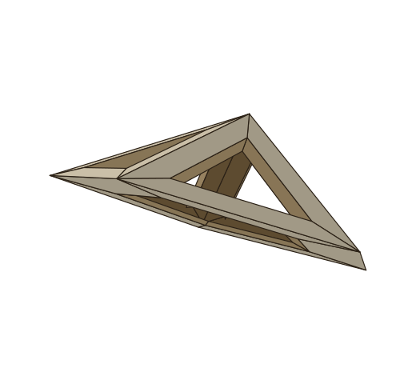
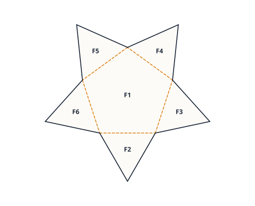

:layout: book
:type: solid
:order: 4
:canonical_id: P-05.04
:title: P-05.04 · Regular Pentagonal Pyramid (Johnson J2)
:featured_image: solids/05-pyramids/pentagonal-pyramid/pentagonal-pyramid.svg
:featured_image_alt: Regular Pentagonal Pyramid (Johnson J2)
:categories: 05-pyramids
:tags: pyramid, johnson, j2, icosahedron-cap, phi, golden-ratio, euclid, pacioli
:excerpt: The regular equilateral pentagonal pyramid (Johnson Solid J2), forming the 6-vertex cap of the regular icosahedron.

=================================================
P-05.04 · Regular Pentagonal Pyramid (Johnson J2)
=================================================

*Pyramis Laterata Penthagona (Johnson J2) · Field: :math:`\mathbb{Q}(\phi)` · Symmetry: C_{5v} (order 10) · Convex*

.. enunciation::

   The regular equilateral pentagonal pyramid (Johnson Solid J2), forming the 6-vertex cap of the regular icosahedron.

.. picture:: pentagonal-pyramid.svg
   :alt: Regular Pentagonal Pyramid (Johnson J2)

Interactive 3D Studio
---------------------

.. raw:: html

   

Machine-Verified Symbolic Certificate
-------------------------------------

.. list-table::
   :widths: 30 70
   :header-rows: 0

   * - **Canonical Identifier**
     - ``P-05.04``
   * - **Classical Latin Name**
     - *Pyramis Laterata Penthagona (Johnson J2)*
   * - **Polyhedral Family**
     - 05-pyramids
   * - **Number Field**
     - :math:`\mathbb{Q}(\phi)`
   * - **Topology Invariants**
     - :math:`V = 6,\; E = 10,\; F = 6,\; \chi = 2`
   * - **Face Composition**
     - 1 regular pentagon + 5 equilateral triangles
   * - **Exact Edge Quadrance(s)**
     - :math:`Q_e = 4`
   * - **Exact Vertex Quadrance(s)**
     - :math:`Q_v = \frac{25}{18} - \frac{5 \sqrt{5}}{18}, Q_v = \frac{7 \sqrt{5}}{18} + \frac{37}{18}`
   * - **Primary Dihedral Spread**
     - :math:`S = \frac{2}{3} - \frac{2 \sqrt{5}}{15}`
   * - **Vacuum Manifold Invariants**
     - :math:`V_{\text{vac}} = 52,\; E_{\text{vac}} = 120,\; F_{\text{vac}} = 60,\; g = 5`
   * - **Polar Dual / Parent Solid**
     - Parent: :doc:`Regular Icosahedron </solids/01-platonic/icosahedron/index>` (severed cap)
   * - **Symmetry Group**
     - C_{5v} (order 10)
   * - **Historical Literature**
     - **Euclid**, Elements XIII.16; **Luca Pacioli** & **Leonardo da Vinci** (1509), Tabulae LI–LII; **Norman Johnson** (1966, J2)

Exact Algebraic Coordinates & Geometric Proof
---------------------------------------------
The **Regular Pentagonal Pyramid** is Norman Johnson's solid :math:`J_2`, forming the 6-vertex cap severed from the regular icosahedron in Euclid *Elements* XIII.16.
Its 6 vertices embed directly in :math:`\mathbb{Z}[\phi]` on the regular icosahedron:

- **Apex**: :math:`(0, 1, \phi)`
- **Base Vertex 1**: :math:`(0, -1, \phi)`
- **Base Vertex 2**: :math:`(\phi, 0, 1)`
- **Base Vertex 3**: :math:`(-\phi, 0, 1)`
- **Base Vertex 4**: :math:`(1, \phi, 0)`
- **Base Vertex 5**: :math:`(-1, \phi, 0)`

All five base vertices lie strictly on the cutting plane :math:`y + \phi z = \phi`. All 10 edges have uniform quadrance :math:`Q_e = 4` (edge length 2). The primary dihedral spread is :math:`S = \frac{2}{3} - \frac{2\sqrt{5}}{15}`, and the hollow framework attains genus :math:`g = 6 - 1 = 5`.

Leonardo da Vinci's Woodcuts & Corpus Vacuum Reconstruction
-----------------------------------------------------------

   **Hollow Framework**: *Pyramis Laterata Penthagona (Johnson J2) Vacuum* (topological genus :math:`g = 5`).

.. list-table::
   :widths: 50 50

   * - .. figure:: /leonardo/plates/0293.g1.png
          :align: center
          :alt: Tabula LI (Folio 0293) - Pyramis Laterata Penthagona Solida

          **Tabula LI (Folio 0293)**: *Pyramis Laterata Penthagona Solida*.
     - .. figure:: /leonardo/plates/0295.g1.png
          :align: center
          :alt: Tabula LII (0295) - Pyramis Laterata Penthagona Vacua

          **Tabula LII (Folio 0295)**: *Pyramis Laterata Penthagona Vacua*.

For detailed commentary and high-resolution plate studies, consult the manuscript folio codex:

- :doc:`Tabulae LI–LII: Pyramis Laterata Penthagona (1509) </leonardo/tabula-51-52-pyramis-penthagona>`

Unfolded 2D Papercraft Net
--------------------------

   **Unfolded Net**: Planar polygon unfolding layout with perimeter cut lines and interior hinge folds.
