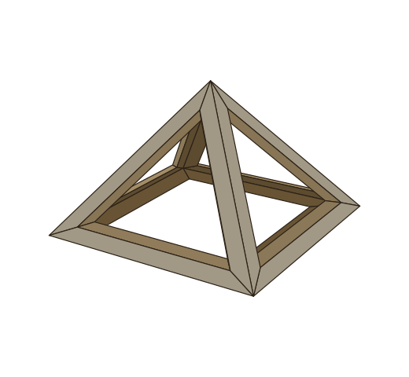
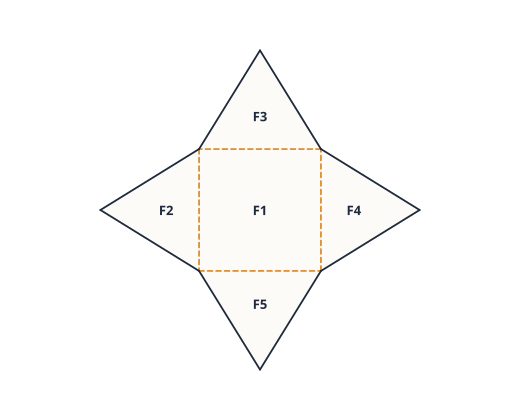

:layout: book
:type: solid
:order: 2
:canonical_id: P-05.02
:title: P-05.02 · Seked 14:11 Pyramid
:featured_image: solids/05-pyramids/seked-pyramid/seked-pyramid.svg
:featured_image_alt: Seked 14:11 Pyramid
:categories: 05-pyramids
:tags: pyramid, seked, egyptian, khufu, giza, rational
:excerpt: The canonical Egyptian architectural pyramid with Seked slope 14:11 (rise 14 to run 11 palms).

=============================
P-05.02 · Seked 14:11 Pyramid
=============================

*Pyramis Aegyptia Seked · Field: :math:`\mathbb{Q}` · Symmetry: C_{4v} (order 8) · Convex*

.. enunciation::

   The canonical Egyptian architectural pyramid with Seked slope 14:11 (rise 14 to run 11 palms).

.. picture:: seked-pyramid.svg
   :alt: Seked 14:11 Pyramid

Interactive 3D Studio
---------------------

.. raw:: html

   

Machine-Verified Symbolic Certificate
-------------------------------------

.. list-table::
   :widths: 30 70
   :header-rows: 0

   * - **Canonical Identifier**
     - ``P-05.02``
   * - **Classical Latin Name**
     - *Pyramis Aegyptia Seked*
   * - **Polyhedral Family**
     - 05-pyramids
   * - **Number Field**
     - :math:`\mathbb{Q}`
   * - **Topology Invariants**
     - :math:`V = 5,\; E = 8,\; F = 5,\; \chi = 2`
   * - **Face Composition**
     - 1 square + 4 Seked 14:11 triangles
   * - **Exact Edge Quadrance(s)**
     - :math:`Q_e = \frac{438}{121}, Q_e = 4`
   * - **Exact Vertex Quadrance(s)**
     - :math:`Q_v = \frac{441}{484}, Q_v = \frac{1017}{484}`
   * - **Primary Dihedral Spread**
     - :math:`S = \frac{85848}{100489}`
   * - **Vacuum Manifold Invariants**
     - :math:`V_{\text{vac}} = 42,\; E_{\text{vac}} = 96,\; F_{\text{vac}} = 48,\; g = 4`
   * - **Polar Dual / Parent Solid**
     - Architectural Profile of Khufu Great Pyramid
   * - **Symmetry Group**
     - C_{4v} (order 8)
   * - **Historical Literature**
     - Rhind Mathematical Papyrus (c. 1550 BCE), Problem 56; Khufu Pyramid survey

Exact Algebraic Coordinates & Geometric Proof
---------------------------------------------
The **Seked 14:11 Pyramid** embodies the historical architectural profile of the Great Pyramid of Giza (Khufu), recorded in the Rhind Mathematical Papyrus (Problem 56).
A seked of :math:`5 \frac{1}{2}` palms gives a rise-to-run ratio of :math:`14 : 11` (semi-base :math:`b = 1`, height :math:`h = 14/11`).

Coordinates in origin-centered space with base side 2:

- **Base Vertices (4)**: :math:`(\pm 1, \pm 1, -\frac{7}{22})` with quadrance :math:`Q_v = \frac{1017}{484}`.
- **Apex (1)**: :math:`(0, 0, \frac{21}{22})` with quadrance :math:`Q_v = \frac{441}{484}`.

**Circle Quadrature Harmony**:
The perimeter of the square base is :math:`4 \times 2 = 8`. Under the canonical Egyptian approximation :math:`\pi \approx \frac{22}{7}`:

.. math::

   2 \pi h = 2 \times \frac{22}{7} \times \frac{14}{11} = 8 = \text{Perimeter}_{\text{base}}

The base edge quadrance is :math:`Q_b = 4`, the hip edge quadrance is :math:`Q_e = \frac{438}{121}`, and the dihedral spread is the strictly rational fraction :math:`S = \frac{85848}{100489}`.

Cross-references:

- :doc:`The Seked Ratio and Octahedron Geometry </pyramid/seked_and_octahedron>`
- :doc:`Squaring the Circle with the Golden Pyramid </pyramid/squaring_the_circle>`

Leonardo da Vinci's Woodcuts & Corpus Vacuum Reconstruction
-----------------------------------------------------------

   **Hollow Framework**: *Pyramis Aegyptia Seked Vacuum* (topological genus :math:`g = 4`).

.. list-table::
   :widths: 50 50

   * - .. figure:: /leonardo/plates/0283.g1.png
          :align: center
          :alt: Tabula XLVII (Folio 0283) - Pyramis Laterata Quadrangula Solida

          **Tabula XLVII (Folio 0283)**: *Pyramis Laterata Quadrangula Solida*.
     - .. figure:: /leonardo/plates/0287.g1.png
          :align: center
          :alt: Tabula XLVIII (0287) - Pyramis Laterata Quadrangula Vacua

          **Tabula XLVIII (Folio 0287)**: *Pyramis Laterata Quadrangula Vacua*.

For detailed commentary and high-resolution plate studies, consult the manuscript folio codex:

- :doc:`Tabulae XLVII–XLVIII: Pyramis Laterata Quadrangula (1509) </leonardo/tabula-47-48-pyramis-quadrangula>`

Unfolded 2D Papercraft Net
--------------------------

   **Unfolded Net**: Planar polygon unfolding layout with perimeter cut lines and interior hinge folds.
